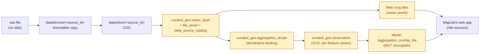
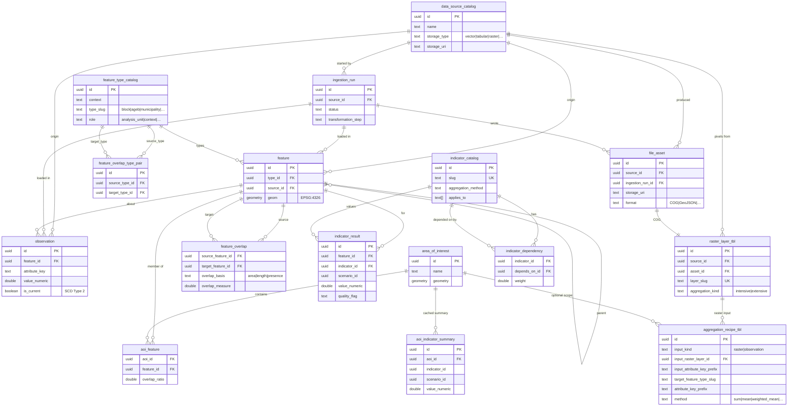
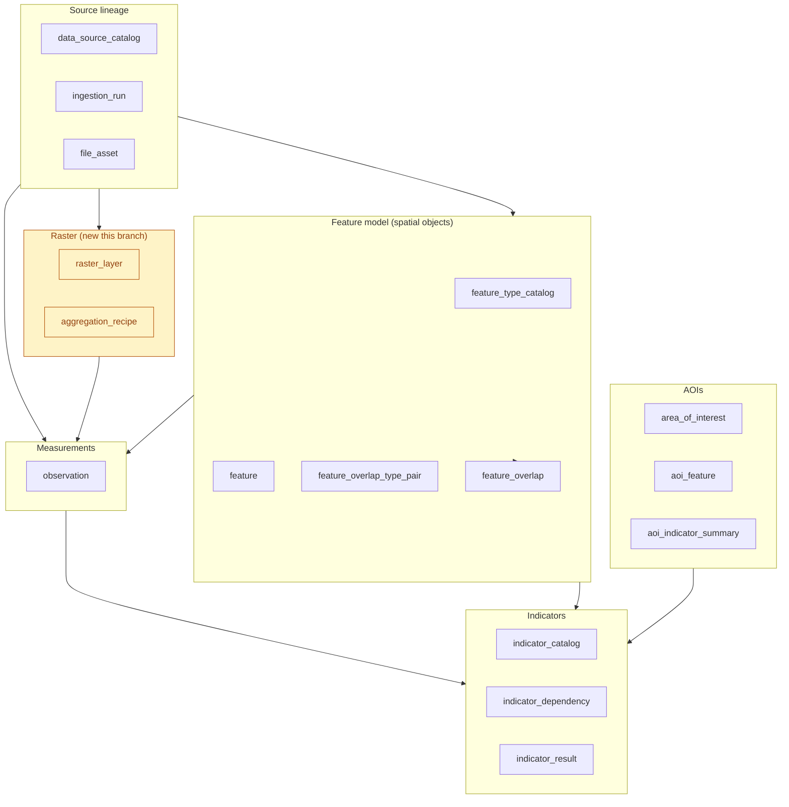

# reimagina — what we built, and where it lives

A presentation-oriented narrative of the current system state, every
claim linked to the exact file + line where the behaviour lives and
the exact migration + DB object that records it. Written as a
reference to speak from, not a textbook.

The pre-existing scaffolding (baseline features, indicator catalog,
`feature_overlap`) is explained only insofar as it enabled what this
branch added on top of it. For the canonical architecture, see
[`architecture/`](architecture/).

Source paths are relative to the repo root. Line numbers are accurate
at commit `d5bd093` (tip of `feature/raster-integration`).

---

## Dataflow at a glance

How a raw raster becomes a map tile — the path this branch made
possible:



The highlighted nodes are what this branch added. `obs` also feeds
observation→observation rollups (same recipe table, different
`input_kind`) that land at AGEB or municipality grain.

---

## 1. Starting point

Before this work, the system already had:

| Capability                                         | Where it lives                                                                                                                                                                                                                            |
| -------------------------------------------------- | ----------------------------------------------------------------------------------------------------------------------------------------------------------------------------------------------------------------------------------------- |
| Canonical feature + observation + indicator tables | [`curated_geo.feature`](../infra/db/migrations/versions/r003_feature_schema.py), [`.observation`](../infra/db/migrations/versions/r003_feature_schema.py), [`.indicator_result`](../infra/db/migrations/versions/r016_indicator_layer.py) |
| One formula dispatcher for rollups                 | [`packages/py/reimagina/jobs/aggregation.py::aggregate`](../packages/py/reimagina/jobs/aggregation.py#L25) — supports `mean` / `weighted_mean` / `sum` / `min` / `max`                                                                    |
| Cross-grain bridge                                 | [`curated_geo.feature_overlap`](../infra/db/migrations/versions/r009_feature_overlap.py) + [`PostgresOverlapRepository.compute_feature_overlaps`](../packages/py/reimagina/storage/postgres/repositories.py#L1069)                        |
| Indicator rollup worker                            | [`packages/py/reimagina/jobs/rollup.py::run_rollup`](../packages/py/reimagina/jobs/rollup.py#L41)                                                                                                                                         |
| Live vector tiles                                  | Martin auto-publishes every `serving_geo.*(z,x,y,query_params json) RETURNS bytea` function — [`infra/docker/martin.yaml`](../infra/docker/martin.yaml)                                                                                   |
| Existing MVT choropleth for indicators             | [`serving_geo.indicator_overlay_tile`](../infra/db/migrations/versions/r017_indicator_overlay_tile.py)                                                                                                                                    |

What was **missing** was everything raster-shaped: no ingest path, no
COG tile server, no declarative way to say "produce population per
block from this raster", no observation→observation rollup worker, and
no hover affordances on any of the new surfaces. That gap is the
scope of this branch.

---

## 2. Raster integration in four phases

The work landed as four incremental phases. Each one left the system
in a usable state before the next began.

### R1 — Registry (migration `r019`)

[`infra/db/migrations/versions/r019_raster_support.py`](../infra/db/migrations/versions/r019_raster_support.py)
introduces `curated_geo.raster_layer` with FK references to
`data_source_catalog` + `file_asset`, a `CHECK aggregation_kind IN
('intensive','extensive')`, and paired read surfaces
`serving_geo.raster_layer_v` + `explore.raster_layer_v`.

The repository Protocol that every worker reads through:
[`RasterLayerRepository`](../packages/py/reimagina/storage/interfaces/raster.py) —
impls at
[`PostgresRasterLayerRepository`](../packages/py/reimagina/storage/postgres/repositories.py#L643).

### R2 — Ingest pipeline

Single entry point:
[`reimagina.pipeline.raster.ingest_raster_source`](../packages/py/reimagina/pipeline/raster.py#L61).
The ordering matters — each step leaves a recoverable state on
failure:

1. Validate the raw file (single-band only in v1) and capture CRS +
   resolution metadata **before** any DB work.
2. Register source, start `ingestion_run`, and **commit immediately**
   so a later SQL failure can't roll back the very row meant to
   record the failure.
3. Land the file in `data/bronze/<source_id>/` (immutable copy) via
   [`pipeline.bronze.land_file`](../packages/py/reimagina/pipeline/bronze.py).
4. Convert to a Cloud-Optimised GeoTIFF in
   `data/silver/<source_id>/` using `rasterio.shutil.copy(...,
   driver="COG")` — internal overviews come for free.
5. Write `file_asset` + `raster_layer` rows, then mark the
   ingestion_run succeeded. On failure, rollback the aborted
   transaction first, then write a `failed` row on a clean
   connection.

CLI wrapper:
[`apps/cli/raster.py::ingest_raster`](../apps/cli/raster.py#L47)
invoked as `reimagina raster ingest --raw-path … --layer-slug …
--aggregation-kind …`.

**CDMX today:** ingested WorldPop 2020 Mexico (894 MB, 100 m) via
[`scripts/clip_worldpop_to_cdmx.py`](../scripts/clip_worldpop_to_cdmx.py),
clipped to the CDMX municipality union (CVEGEO prefix `09%`),
yielding a 648 KB CDMX-scoped COG registered as `layer_slug =
worldpop_cdmx_2020_100m`.

### R3 — Zonal-stats worker

[`reimagina.jobs.raster_zonal_stats.run_raster_zonal_stats`](../packages/py/reimagina/jobs/raster_zonal_stats.py#L165)
turns a registered raster into observations at a chosen grain. The
correctness-critical pieces:

- **Advisory-lock critical section** — the retire + bulk_upsert pair
  must be atomic under a named lock. On Postgres we hash the prefix
  with blake2b into a signed int64 in
  [`_prefix_lock_key`](../packages/py/reimagina/jobs/raster_zonal_stats.py#L122),
  then take `pg_try_advisory_xact_lock` on a dedicated connection
  (so the transaction-scoped lock survives pooled callers).
- **Success finalisation routed through the safe path** —
  [`_finalise_run_safely`](../packages/py/reimagina/jobs/raster_zonal_stats.py#L53)
  wraps both failure and success status writes. A flaky MV refresh
  after the observations are durable can log a warning without
  crashing the caller.
- **Prefix-collision guard** — CLI refuses to run a recipe whose
  prefix is already owned by a different source. The SCD invariant
  is per-`attribute_key`, not per-source, so co-ownership would
  silently retire each other's rows.

SCD retire + bulk insert:
[`PostgresObservationRepository.bulk_upsert_current`](../packages/py/reimagina/storage/postgres/repositories.py#L485)
+ [`retire_current_by_prefix`](../packages/py/reimagina/storage/postgres/repositories.py#L542).

Test coverage:
[`tests/integration/test_raster_zonal_stats.py`](../tests/integration/test_raster_zonal_stats.py)
(happy path, narrow-stats rerun retires dropped stats, coverage
threshold, advisory-lock contention, post-commit finalise failure).

### R4 — Tile serving + web UI

`titiler.core` mounted **in-process** at `/cog` on the FastAPI app
([`apps/api/app.py`](../apps/api/app.py#L22)) with a
`path_dependency` that gates the `url=` query parameter:
[`apps/api/cog_security.py::validated_cog_path`](../apps/api/cog_security.py#L26).
All four rejection paths are tested in
[`tests/integration/test_tile_sources_rasters.py`](../tests/integration/test_tile_sources_rasters.py)
(non-`file://` → 400, netloc set → 400, outside data root → 403,
missing file → 404, non-regular file → 403).

`/tile-sources` emits each published raster as a `raster_cog` entry
with a percent-encoded tile-URL template:
[`reimagina.tiles.sources._resolve_raster_layers`](../packages/py/reimagina/tiles/sources.py).
The web-side install:
[`installRasterLayers`](../apps/web/src/layers.ts#L257).

---

## 3. The aggregation layer — recipes, not imperatives

The raster worker alone was imperative. Real use needs the same
raster to produce observations at multiple grains, uniformly across
every raster we'll ever ingest. The key insight was that the
codebase already had exactly one aggregation vocabulary — we needed
a **declarative binding** on top, not a new formula registry.

### `curated_geo.aggregation_recipe` (migration `r020`)

[`infra/db/migrations/versions/r020_aggregation_recipe.py`](../infra/db/migrations/versions/r020_aggregation_recipe.py).
One row per "source → observations at target grain" mapping:

- `input_kind` is `'raster'` or `'observation'`; a DB-level XOR CHECK
  (`aggregation_recipe_input_shape`) enforces that exactly one input
  shape is populated.
- `method` reuses the `aggregation_method` enum from
  `indicator_catalog` — no new vocabulary.
- `weight_basis` reuses `feature_overlap.overlap_basis`.
- UNIQUE `(target_feature_type_slug, attribute_key_prefix)` protects
  the retire-by-prefix contract.

Repo Protocol + impls:
[`AggregationRecipeRepository`](../packages/py/reimagina/storage/interfaces/raster.py),
[`PostgresAggregationRecipeRepository`](../packages/py/reimagina/storage/postgres/repositories.py#L742).

### Dispatcher + two worker arms

[`reimagina.jobs.derivations.run_recipe`](../packages/py/reimagina/jobs/derivations.py#L63)
reads a recipe and routes on `input_kind`:

- **Raster arm** → wraps
  [`run_raster_zonal_stats`](../packages/py/reimagina/jobs/raster_zonal_stats.py#L165);
  `method='sum'` maps to `stats=('sum',)`; `params.stats` overrides.
- **Observation arm** — new —
  [`run_observation_rollup`](../packages/py/reimagina/jobs/observation_rollup.py#L80).
  Reads current observations at the finer grain via
  [`PostgresOverlapRepository.rollup_observation_child_rows`](../packages/py/reimagina/storage/postgres/repositories.py#L1243),
  aggregates through the existing `aggregate()` function, writes
  output observations under the same SCD + advisory-lock contract.

`run_all_for_raster`
([derivations.py#L85](../packages/py/reimagina/jobs/derivations.py#L85))
iterates every enabled recipe bound to one raster.

CLI subcommands: `reimagina raster derivation add/list/enable/remove/run` —
wired in
[`apps/cli/app.py#L519`](../apps/cli/app.py#L519), delegating to
[`add_derivation`](../apps/cli/raster.py#L312) /
[`run_derivation`](../apps/cli/raster.py#L409).

Test coverage:
[`tests/integration/test_aggregation_recipes.py`](../tests/integration/test_aggregation_recipes.py)
(raster arm dispatches correctly, obs arm rolls up with suffix
pass-through + lineage_ref, XOR CHECK rejects malformed recipes,
disabled recipes refuse to run).

### What's live today

Three recipes bound to the WorldPop raster:

| Input | Target grain | Method | Rows |
|---|---|---|---|
| Raster (100 m pixels) | block | sum | 31,454 |
| Block observations | AGEB | sum | 2,417 |
| Block observations | municipality | sum | 16 |

Populated after running `overlap compute-all` unrestricted
([`apps/cli/overlap.py`](../apps/cli/overlap.py)) so `feature_overlap`
held 66,381 block→AGEB rows and 66,824 block→municipality rows.
Query any of them directly:

```sql
SELECT count(*), min(value_numeric), max(value_numeric)
FROM curated_geo.observation
WHERE is_current
  AND attribute_key = 'pop_worldpop_2020_ageb_sum';
```

---

## 4. Tile function for aggregation overlays (migration `r021`)

[`infra/db/migrations/versions/r021_aggregation_overlay_tile.py`](../infra/db/migrations/versions/r021_aggregation_overlay_tile.py)
adds `serving_geo.aggregation_overlay_tile(z,x,y,query_params)` —
same signature Martin auto-publishes, same z≥10 guard and
simplification ladder as the older
`serving_geo.indicator_overlay_tile`. Query params:
`attribute_key` + `feature_type_slug`.

Frontend-side source + tile URL assembly (with a `v=<epoch>`
cache-buster sourced from `max(observation.updated_at)` so a
rollup re-run invalidates MapLibre's in-memory tile cache):
[`_resolve_aggregation_overlays`](../packages/py/reimagina/tiles/sources.py).
Transitive raster parent resolution — so observation-input recipes
nest under the right raster in the UI:
[`_resolve_transitive_raster_parent`](../packages/py/reimagina/tiles/sources.py)
(same file).

Test:
[`test_tile_sources_emits_aggregation_overlay_nested_under_parent_raster`](../tests/integration/test_tile_sources_rasters.py).

---

## 5. Web interactions — modular, not per-layer

Three new vector layer types (raster pixels, aggregation choropleths,
indicator choropleths) plus hover tooltip and feature highlight on
every one. Instead of hand-wiring each layer, we built two small
modules every install site plugs into.

### `TooltipController` and providers

[`apps/web/src/tooltip.ts`](../apps/web/src/tooltip.ts) — the
[`TooltipController` class](../apps/web/src/tooltip.ts#L45) owns the
tooltip DOM, listens to `mousemove` once on the map, and dispatches
through a registry of providers. Adding hover content for a new layer
is one factory call:

- [`mvtProvider`](../apps/web/src/tooltip.ts#L138) —
  `queryRenderedFeatures` on any MVT layer; caller supplies a format
  callback.
- [`cogPointProvider`](../apps/web/src/tooltip.ts#L167) — debounced
  + cache-coalesced caller of titiler's `/cog/point/{lng,lat}`. Snaps
  to a ~1 m grid so a stationary cursor stays fast. Request-id
  guard drops stale async results.

### `enableHoverHighlight`

[`apps/web/src/hover-highlight.ts::enableHoverHighlight`](../apps/web/src/hover-highlight.ts#L74).
MapLibre feature-state idiom encapsulated:

1. Source is created with `promoteId: 'feature_id'` so
   `setFeatureState` can target the right feature.
2. On mousemove/mouseleave the `hover` state flips; cursor is set on
   the **canvas container** (not the canvas — that gets overridden
   by MapLibre's `grab` cursor) so the pointing-finger stays stable
   while the map is idle over a feature.
3. Paint expressions are rewritten at install time to read
   `['feature-state', 'hover']` — MapLibre's renderer handles
   transitions, no per-mousemove JS work.
4. Aggregation + indicator overlays get a dedicated line layer at
   default `line-width: 0` — `fill-outline-color` is hardwired to
   1 px in MapLibre, so a line layer is the only way to get a thick
   hover border.

Standard hover stroke:
[`HOVER_OUTLINE_COLOR`](../apps/web/src/hover-highlight.ts#L34)
(`#ffffff`, 3.5 px).

### Four call sites share one pattern

Every vector surface on the map uses the same two helpers:

| Layer type | Install function | File |
|---|---|---|
| Baseline vectors (building, block, AGEB, municipality) | [`installInputLayers`](../apps/web/src/layers.ts#L117) | `apps/web/src/layers.ts` |
| Aggregation choropleths | [`installAggregationOverlays`](../apps/web/src/layers.ts#L321) | `apps/web/src/layers.ts` |
| Raster pixel tiles | [`installRasterLayers`](../apps/web/src/layers.ts#L257) | `apps/web/src/layers.ts` |
| Indicator choropleth | [`activateIndicator`](../apps/web/src/choropleth.ts#L135) | `apps/web/src/choropleth.ts` |

Sidebar ordering: finest grain first
([`INPUT_LAYERS`](../apps/web/src/layers.ts#L38): building → block →
AGEB → municipality). Aggregation children within each raster group
sort by the same grain order.

---

## 6. The DB objects this branch added, at a glance

Read off `explore.layer_catalog_v`, all registered with their
intended use:

| Schema | Object | Kind | Added in |
|---|---|---|---|
| `curated_geo` | `raster_layer` | canonical | r019 |
| `curated_geo` | `aggregation_recipe` | canonical | r020 |
| `serving_geo` | `raster_layer_v` | serving | r019 |
| `serving_geo` | `aggregation_recipe_v` | serving | r020 |
| `serving_geo` | `aggregation_overlay_tile` | serving (Martin function) | r021 |
| `explore` | `raster_layer_v` | explore | r019 |
| `explore` | `aggregation_recipe_v` | explore | r020 |

Query yourself:

```sql
SELECT schema_name, object_name, layer_kind
FROM explore.layer_catalog_v
WHERE object_name LIKE '%raster%'
   OR object_name LIKE '%aggregation%'
ORDER BY layer_kind, object_name;
```

### Schema diagram

The `curated_geo` tables and their foreign-key relationships as they
stand at the tip of this branch. Tables introduced by this branch are
suffixed with `(new)`; everything else pre-existed and this work only
added references to it.



> The two new entities are suffixed `_tbl` in the diagram only to
> avoid mermaid's reserved-word parse of bare `raster_layer`. In the
> database they are just `curated_geo.raster_layer` and
> `curated_geo.aggregation_recipe` — every table shown lives under
> the `curated_geo` schema.

### Conceptual layers

The same tables grouped by concern — useful for explaining which
subsystem a change affects:



---

## 7. Provenance, testing, safety

- **Migration-driven state** — every DB change lands as an Alembic
  revision under
  [`infra/db/migrations/versions/`](../infra/db/migrations/versions/).
- **Two review passes** (one Claude, one Codex) landed the
  hardening commits: run-row isolation on ingest, advisory-lock
  guard tightening, URL encoding, TOCTOU on `validated_cog_path`.
  See commits `6692e21` and `d3cf4f5`.
- **254 tests green.** Raster + recipe tests in
  [`tests/integration/test_raster_ingest.py`](../tests/integration/test_raster_ingest.py),
  [`test_raster_zonal_stats.py`](../tests/integration/test_raster_zonal_stats.py),
  [`test_aggregation_recipes.py`](../tests/integration/test_aggregation_recipes.py),
  [`test_tile_sources_rasters.py`](../tests/integration/test_tile_sources_rasters.py).
- **Provenance on every row** — observations carry `source_id` +
  `ingestion_run_id` + a `lineage_ref` JSONB (for rollups, the
  source `attribute_key` + method; for raster zonals, the
  `asset_id` + stat_name). `data_source_catalog.storage_uri` is
  overwritten from the `<pending>` placeholder once the silver path
  is known
  ([`pipeline/raster.py#L175`](../packages/py/reimagina/pipeline/raster.py#L175)).

---

## 8. End-to-end walkthrough an operator would follow

```bash
# 1. Stage + publish a raster (runs through the whole pipeline).
reimagina raster ingest \
  --raw-path data/local/worldpop_cdmx.tif \
  --layer-slug worldpop_cdmx_2020_100m \
  --aggregation-kind extensive

# 2. Declare recipes for the grains you want observations at.
reimagina raster derivation add \
  --input-kind raster \
  --raster-layer-slug worldpop_cdmx_2020_100m \
  --target-feature-type block \
  --attribute-key-prefix pop_worldpop_2020_block \
  --method sum

# 3. Materialise the observations.
reimagina raster derivation run \
  --raster-layer-slug worldpop_cdmx_2020_100m

# 4. Reload the web app. Sidebar shows a nested "Raster overlays"
#    group for the raster + a toggle per recipe; hover reveals the
#    value under the cursor.
```

For the CDMX rollups to cover the whole city rather than one
alcaldía, run `reimagina overlap compute-all` once without
`--aoi-id` so `feature_overlap` holds block→AGEB and
block→municipality rows for every block.

---

## Further reading

- [`architecture/DATA_LAYER.md`](architecture/DATA_LAYER.md) —
  bronze/silver/curated split, observation SCD, raster path.
- [`architecture/INDICATORS_LAYER.md`](architecture/INDICATORS_LAYER.md) —
  the indicator catalog this work plugs into.
- [`architecture/TILE_SERVING.md`](architecture/TILE_SERVING.md) —
  Martin + PMTiles baseline.
- [`architecture/JOB_LAYER.md`](architecture/JOB_LAYER.md) — the
  `Orchestrator` port, run state, and the rollup contract.
- Git log on `feature/raster-integration` — eleven feature commits,
  two hardening commits, the UX polish commits — the authoritative
  history of what was delivered.
