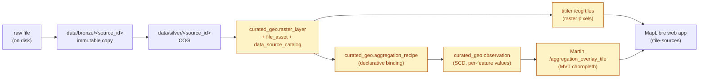
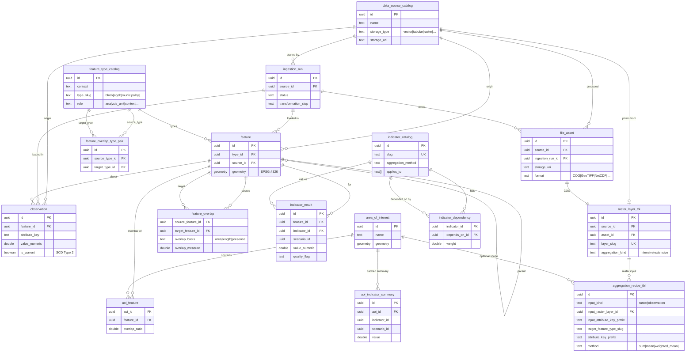
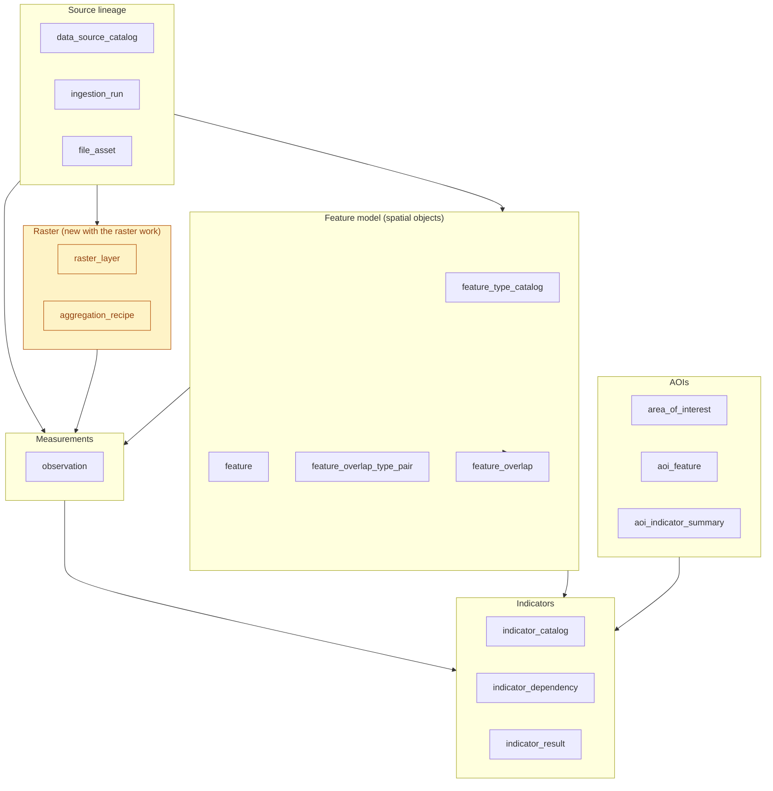

# reimagina — what we built, and where it lives

A presentation-oriented narrative of the raster integration and the
aggregation layer — merged to `main` as the squash commit `2fc850e`
("raster integration + aggregation layer + modular map interactions") —
and of how runs are scheduled today (§9). Every claim is linked to the
file and symbol where the behaviour lives and the migration + DB object that
records it. Written as a reference to speak from, not a textbook.

The pre-existing scaffolding (baseline features, indicator catalog,
`feature_overlap`) is explained only insofar as it enabled what the
raster work added on top of it. For the canonical architecture, see
[`architecture/`](architecture/).

Source paths are relative to the repo root. CLI commands are run as
`uv run python -m apps.cli.app <group> <command>`; there is no installed
`reimagina` executable.

---

## Dataflow at a glance

How a raw raster becomes a map tile — the path the raster work made
possible:



The highlighted nodes are what the raster work added. `obs` also feeds
observation→observation rollups (same recipe table, different
`input_kind`) that land at a coarser grain (AGEB or municipality).
Martin is the default tile server; the API serves the same function at
`/tiles/aggregation_overlay_tile/{z}/{x}/{y}`
([`apps/api/routers/mvt.py`](../apps/api/routers/mvt.py), allowlist in
[`reimagina/tiles/functions.py`](../packages/py/reimagina/tiles/functions.py)).

---

## 1. Starting point

Before this work, the system already had:

| Capability                                         | Where it lives                                                                                                                                                                                                                            |
| -------------------------------------------------- | ----------------------------------------------------------------------------------------------------------------------------------------------------------------------------------------------------------------------------------------- |
| Canonical feature + observation + indicator tables | [`curated_geo.feature`](../infra/db/migrations/versions/r003_feature_tables.py), [`.observation`](../infra/db/migrations/versions/r003_feature_tables.py), [`.indicator_result`](../infra/db/migrations/versions/r016_indicator_layer.py) |
| One formula dispatcher for rollups                 | [`packages/py/reimagina/jobs/aggregation.py::aggregate`](../packages/py/reimagina/jobs/aggregation.py) — supports `mean` / `weighted_mean` / `sum` / `min` / `max`                                                                    |
| Cross-grain bridge                                 | [`curated_geo.feature_overlap`](../infra/db/migrations/versions/r009_feature_overlap.py) + [`PostgresOverlapRepository.compute_feature_overlaps`](../packages/py/reimagina/storage/postgres/repositories.py)                        |
| Observation rollup worker                          | [`packages/py/reimagina/jobs/observation_rollup.py::run_observation_rollup`](../packages/py/reimagina/jobs/observation_rollup.py) — the *indicator* rollup worker this row used to name was deleted in `e48ad4e` (#63); every indicator is block-grain now |
| Live vector tiles                                  | Martin auto-publishes every `serving_geo.*(z,x,y,query_params json) RETURNS bytea` function — [`infra/docker/martin.yaml`](../infra/docker/martin.yaml)                                                                                   |
| Existing MVT choropleth for indicators             | [`serving_geo.indicator_overlay_tile`](../infra/db/migrations/versions/r017_indicator_overlay_tile.py)                                                                                                                                    |

What was **missing** was everything raster-shaped: no ingest path, no
COG tile server, no declarative way to say "produce population per
block from this raster", no observation→observation rollup worker, and
no hover affordances on any of the new surfaces. That gap is the
scope of the raster work.

---

## 2. Raster integration in four phases

The work landed as four incremental phases. Each one left the system
in a usable state before the next began.

### R1 — Registry (migration `r019`)

[`infra/db/migrations/versions/r019_raster_support.py`](../infra/db/migrations/versions/r019_raster_support.py)
introduces `curated_geo.raster_layer` with FK references to
`data_source_catalog` + `file_asset`, a `CHECK aggregation_kind IN
('intensive','extensive')`, and paired read surfaces
`serving_geo.raster_layer_v` + `explore.raster_layer_v`.

The repository Protocol that every worker reads through:
[`RasterLayerRepository`](../packages/py/reimagina/storage/interfaces/raster.py) —
implemented by
[`PostgresRasterLayerRepository`](../packages/py/reimagina/storage/postgres/repositories.py).

### R2 — Ingest pipeline

Single entry point:
[`reimagina.pipeline.raster.ingest_raster_source`](../packages/py/reimagina/pipeline/raster.py).
The ordering matters — each step leaves a recoverable state on
failure:

1. Validate the raw file (single-band only in v1) and capture CRS +
   resolution metadata **before** any DB work.
2. Register source (`storage_type='raster'`,
   `integration_role='enrichment'`; `storage_uri` records where the
   data came from — `--origin-uri`, else the raw file's own URI), start
   `ingestion_run`, and **commit immediately** so a later SQL failure
   can't roll back the very row meant to record the failure.
3. Land the file in `data/bronze/<source_id>/` (immutable copy) via
   [`pipeline.bronze.land_file`](../packages/py/reimagina/pipeline/bronze.py).
4. Convert to a Cloud-Optimised GeoTIFF in
   `data/silver/<source_id>/`, in the input's native CRS, using
   `rasterio.shutil.copy(..., driver="COG")` — internal overviews come
   for free.
5. Write `file_asset` (whose `storage_uri` is the silver COG,
   `file://data/silver/…`) + `raster_layer` rows, then mark the
   ingestion_run succeeded. On failure, rollback the aborted
   transaction first, then write a `failed` row on a clean
   connection.

CLI wrapper:
[`apps/cli/raster.py::ingest_raster`](../apps/cli/raster.py)
invoked as `python -m apps.cli.app raster ingest --raw-path … --source-name …
--provider … --version … --layer-slug … [--aggregation-kind extensive]`
(`--aggregation-kind` defaults to `intensive`).

**CDMX:** WorldPop 2020 Mexico (100 m) was clipped to the CDMX
municipality union (`source_record_ref LIKE '09%'`) by a one-off script
and registered as `layer_slug = worldpop_cdmx_2020_100m`. The CLI now
does the same fetch and clip itself: `raster fetch-worldpop --country MEX
--year 2020 --aoi-id <AOI>` writes a local GeoTIFF ready for `raster
ingest` (see [`BOOTSTRAP.md`](BOOTSTRAP.md)).

### R3 — Zonal-stats worker

[`reimagina.jobs.raster_zonal_stats.run_raster_zonal_stats`](../packages/py/reimagina/jobs/raster_zonal_stats.py)
turns a registered raster into observations at a chosen grain. The
correctness-critical pieces:

- **Advisory-lock critical section** — the retire + bulk_upsert pair
  must be atomic under a named lock. On Postgres we hash the prefix
  with blake2b into a signed int64 in
  [`_prefix_lock_key`](../packages/py/reimagina/jobs/raster_zonal_stats.py),
  then take `pg_try_advisory_xact_lock` on a dedicated connection
  (so the transaction-scoped lock survives pooled callers).
- **Success finalisation routed through the safe path** —
  [`_finalise_run_safely`](../packages/py/reimagina/jobs/raster_zonal_stats.py)
  wraps both failure and success status writes. A flaky MV refresh
  after the observations are durable can log a warning without
  crashing the caller.
- **Prefix-collision guard** — the `raster zonal-stats` CLI
  ([`apps/cli/raster.py::run_zonal_stats`](../apps/cli/raster.py))
  refuses to run when the prefix is already owned by a different
  source's current observations *at the same grain*, unless `--force`.
  The SCD invariant is per-`attribute_key`, not per-source, so
  co-ownership at one grain would silently retire each other's rows.
  Across grains it is safe and permitted: `aggregation_recipe`'s
  uniqueness key is `(target_feature_type_slug, attribute_key_prefix)`.
  The guard lives in that CLI wrapper only; the worker and the recipe
  path (`raster derivation run`) do not apply it.
- **Retirement is scoped to what the run recomputed** — one grain,
  optionally one AOI. `bulk_upsert_current` already retires per
  `(feature_id, attribute_key)`, so the prefix-wide retire exists only
  to catch rows the new run no longer writes; its scope has to be the
  run's scope. Unscoped, an AOI-limited run retired the prefix for
  every feature of the grain and re-inserted only the in-AOI ones.

SCD retire + bulk insert:
[`PostgresObservationRepository.bulk_upsert_current`](../packages/py/reimagina/storage/postgres/repositories.py)
+ [`retire_current_by_prefix`](../packages/py/reimagina/storage/postgres/repositories.py).

Test coverage:
[`tests/integration/test_raster_zonal_stats.py`](../tests/integration/test_raster_zonal_stats.py)
(happy path, narrow-stats rerun retires dropped stats, coverage
threshold, CLI prefix collision, advisory-lock contention, post-commit
finalise failure, sub-pixel polygons under exactextract).

### R4 — Tile serving + web UI

`titiler.core` mounted **in-process** at `/cog` on the FastAPI app
([`apps/api/app.py::create_app`](../apps/api/app.py)) with a
`path_dependency` that gates the `url=` query parameter:
[`apps/api/cog_security.py::validated_cog_path`](../apps/api/cog_security.py).
It has seven rejection paths: non-`file://` → 400, netloc set → 400,
empty path → 400, NUL byte in the path → 400, outside data root → 403
(decided before existence, so a path outside answers alike whether or not
it exists), missing file → 404, non-regular file → 403.
[`tests/integration/test_tile_sources_rasters.py`](../tests/integration/test_tile_sources_rasters.py)
tests the non-`file://`, outside-data-root, path-traversal and
missing-file cases, and
[`tests/unit/test_cog_path_validator.py`](../tests/unit/test_cog_path_validator.py)
the NUL byte, the outside-path answer and the missing file; the netloc,
empty-path and non-regular-file paths have no test.

`/tile-sources` emits each published raster as a `raster_cog` entry
with a percent-encoded tile-URL template:
[`reimagina.tiles.sources._resolve_raster_layers`](../packages/py/reimagina/tiles/sources.py).
The web-side install:
[`installRasterLayers`](../apps/web/src/layers.ts).

---

## 3. The aggregation layer — recipes, not imperatives

The raster worker alone was imperative. Real use needs the same
raster to produce observations at multiple grains, uniformly across
every raster we'll ever ingest. The key insight was that the
codebase already had exactly one aggregation vocabulary — we needed
a **declarative binding** on top, not a new formula registry.

### `curated_geo.aggregation_recipe` (migration `r020`)

[`infra/db/migrations/versions/r020_aggregation_recipe.py`](../infra/db/migrations/versions/r020_aggregation_recipe.py).
One row per "source → observations at target grain" mapping:

- `input_kind` is `'raster'` or `'observation'`; a DB-level XOR CHECK
  (`aggregation_recipe_input_shape`) enforces that exactly one input
  shape is populated.
- `method` reuses the `indicator_catalog.aggregation_method`
  vocabulary — a text CHECK on `mean` / `weighted_mean` / `sum` /
  `min` / `max` (the catalog's `none` excluded); no new vocabulary.
- `weight_basis` reuses `feature_overlap.overlap_basis`.
- UNIQUE `(target_feature_type_slug, attribute_key_prefix)` protects
  the retire-by-prefix contract.

Repo Protocol + implementation:
[`AggregationRecipeRepository`](../packages/py/reimagina/storage/interfaces/raster.py),
[`PostgresAggregationRecipeRepository`](../packages/py/reimagina/storage/postgres/repositories.py).

### Dispatcher + two worker arms

[`reimagina.jobs.derivations.run_recipe`](../packages/py/reimagina/jobs/derivations.py)
reads a recipe and routes on `input_kind`:

- **Raster arm** → wraps
  [`run_raster_zonal_stats`](../packages/py/reimagina/jobs/raster_zonal_stats.py);
  `method='sum'` maps to `stats=('sum',)`; `params.stats` overrides.
- **Observation arm** — new —
  [`run_observation_rollup`](../packages/py/reimagina/jobs/observation_rollup.py).
  Reads current observations at the finer grain via
  [`PostgresOverlapRepository.rollup_observation_child_rows`](../packages/py/reimagina/storage/postgres/repositories.py),
  aggregates through the existing `aggregate()` function, writes
  output observations under the same SCD + advisory-lock contract.

`run_all_for_raster`
([`derivations.py`](../packages/py/reimagina/jobs/derivations.py))
iterates every enabled recipe bound to one raster.

CLI subcommands: `python -m apps.cli.app raster derivation add/list/enable/remove/run`
(`enable --disable` turns a recipe off) — wired in
`derivation_app` in [`apps/cli/app.py`](../apps/cli/app.py), delegating to
[`add_derivation`](../apps/cli/raster.py) /
[`run_derivation`](../apps/cli/raster.py).

Test coverage:
[`tests/integration/test_aggregation_recipes.py`](../tests/integration/test_aggregation_recipes.py)
(raster arm dispatches correctly, obs arm rolls up with suffix
pass-through + lineage_ref, XOR CHECK rejects malformed recipes,
unknown recipe ids and disabled recipes refuse to run,
`run_all_for_raster` runs every enabled recipe).

### What was live when this landed

Three recipes bound to the WorldPop raster (row counts as measured at
the time; this is database state, not code):

| Input | Target grain | Method | Rows |
|---|---|---|---|
| Raster (100 m pixels) | block | sum | 31,454 |
| Block observations | AGEB | sum | 2,417 |
| Block observations | municipality | sum | 16 |

Populated after running `overlap compute-all` unrestricted
([`apps/cli/overlap.py`](../apps/cli/overlap.py)) so `feature_overlap`
held 66,381 block→AGEB rows and 66,824 block→municipality rows.
Query any of them directly:

```sql
SELECT count(*), min(value_numeric), max(value_numeric)
FROM curated_geo.observation
WHERE is_current
  AND attribute_key = 'pop_worldpop_2020_ageb_sum';
```

⚠ The AGEB grain has since been withdrawn. The comment that replaced its
entry in [`INPUT_LAYERS`](../apps/web/src/layers.ts) records that it
carried no observations, indicator results or aggregation recipes by then
and that its rows were removed from the dataset, so the AGEB row above
describes the database as it was, not as it is.

---

## 4. Tile function for aggregation overlays (migration `r021`)

[`infra/db/migrations/versions/r021_aggregation_overlay_tile.py`](../infra/db/migrations/versions/r021_aggregation_overlay_tile.py)
adds `serving_geo.aggregation_overlay_tile(z,x,y,query_params)` —
same signature Martin auto-publishes, and at the time the same z≥10
guard and simplification ladder as the older
`serving_geo.indicator_overlay_tile`. Query params:
`attribute_key` + `feature_type_slug`. Three later migrations changed
it: [`r023`](../infra/db/migrations/versions/r023_aggregation_overlay_tile_aoi.py)
added an optional `aoi_id` filter,
[`r024`](../infra/db/migrations/versions/r024_tile_aoi_uuid_validation.py)
validates that id as a UUID, and
[`r025`](../infra/db/migrations/versions/r025_overlay_tile_zoom_floor.py)
lowered the floor of both overlay functions to z≥8.

Frontend-side source + tile URL assembly (with a `v=<epoch>`
cache-buster sourced from `max(observation.updated_at)` so a
rollup re-run invalidates MapLibre's in-memory tile cache):
[`_resolve_aggregation_overlays`](../packages/py/reimagina/tiles/sources.py).
Transitive raster parent resolution — so observation-input recipes
nest under the right raster in the UI:
[`_resolve_transitive_raster_parent`](../packages/py/reimagina/tiles/sources.py)
(same file).

Test:
[`test_tile_sources_emits_aggregation_overlay_nested_under_parent_raster`](../tests/integration/test_tile_sources_rasters.py).

---

## 5. Web interactions — modular, not per-layer

Three new layer types (raster pixels, aggregation choropleths,
indicator choropleths) plus a hover tooltip on every one and a
feature highlight on every vector one. Instead of hand-wiring each
layer, we built two small modules every install site plugs into.

### `TooltipController` and providers

[`apps/web/src/tooltip.ts`](../apps/web/src/tooltip.ts) — the
[`TooltipController` class](../apps/web/src/tooltip.ts) owns the
tooltip DOM, listens to `mousemove` once on the map, and dispatches
through a registry of providers (later registrations are asked first;
a provider whose layers are hidden is skipped). A request-id guard in
the controller drops stale async results. Adding hover content for a
new layer is one factory call:

- [`mvtProvider`](../apps/web/src/tooltip.ts) —
  `queryRenderedFeatures` on any MVT layer; caller supplies a format
  callback.
- [`cogPointProvider`](../apps/web/src/tooltip.ts) — debounced
  (150 ms) + cached caller of titiler's `/cog/point/{lng},{lat}`.
  Snaps to a 5-decimal (~1 m) grid so a stationary cursor stays fast.

### `enableHoverHighlight`

[`apps/web/src/hover-highlight.ts::enableHoverHighlight`](../apps/web/src/hover-highlight.ts).
MapLibre feature-state idiom encapsulated:

1. The source is created with a `promoteId` so `setFeatureState` can
   target the right feature: `feature_id` for the aggregation and
   indicator overlays, `id` for the baseline layers, because
   `serving_geo.get_tile` emits the feature uuid under that name.
2. On mousemove/mouseleave the `hover` state flips; cursor is set on
   the **canvas container** (not the canvas — that gets overridden
   by MapLibre's `grab` cursor) so the pointing-finger stays stable
   while the map is idle over a feature.
3. Paint expressions are rewritten at install time to read
   `['feature-state', 'hover']` (or `'pinned'`, which the map page's
   inspector sets so a pinned block keeps its outline) — MapLibre's
   renderer handles transitions, no per-mousemove JS work.
4. Aggregation + indicator overlays get a dedicated line layer at
   default `line-width: 0` — `fill-outline-color` is hardwired to
   1 px in MapLibre, so a line layer is the only way to get a thick
   hover border.

Standard hover stroke:
[`HOVER_OUTLINE_COLOR`](../apps/web/src/hover-highlight.ts)
(`#22d3ee`, cyan) at `HOVER_LINE_WIDTH` 3.5 px. While a selection
shape is being drawn, `setHoverGloballySuspended` and
`setTooltipGloballySuspended` turn both helpers off.

### Four call sites share one pattern

Every vector surface on the map page (`index.html`, `src/main.ts`) uses
the same two helpers:

| Layer type | Install function | File |
|---|---|---|
| Baseline vectors (streets, buildings, blocks, municipalities) | [`installInputLayers`](../apps/web/src/layers.ts) | `apps/web/src/layers.ts` |
| Aggregation choropleths | [`installAggregationOverlays`](../apps/web/src/layers.ts) | `apps/web/src/layers.ts` |
| Raster pixel tiles | [`installRasterLayers`](../apps/web/src/layers.ts) | `apps/web/src/layers.ts` |
| Indicator choropleth | [`activateIndicator`](../apps/web/src/choropleth.ts) | `apps/web/src/choropleth.ts` |

Streets are a line layer and take neither the tooltip nor the highlight.
The scenario workspace (`scenarios.html`, `ScenarioMap.svelte`) reuses
two of these: `installInputLayers` with only the street layer visible, and
`activateIndicator`.

Layer order: [`INPUT_LAYERS`](../apps/web/src/layers.ts) lists
streets first (bottom of the map), then finest grain first: building →
block → municipality. AGEB is withdrawn from the list. Aggregation
children within each raster group sort by the same grain order. Every
layer toggle starts off; they sit in the collapsed "Layers" group of the
side panel, with the raster groups under a "Raster overlays" heading
([`wireRasterToggles`](../apps/web/src/layers.ts)).

---

## 6. The DB objects the raster work added, at a glance

Read off `explore.layer_catalog_v`, all registered with their
intended use:

| Schema | Object | Kind | Added in |
|---|---|---|---|
| `curated_geo` | `raster_layer` | canonical | r019 |
| `curated_geo` | `aggregation_recipe` | canonical | r020 |
| `serving_geo` | `raster_layer_v` | serving | r019 |
| `serving_geo` | `aggregation_recipe_v` | serving | r020 |
| `serving_geo` | `aggregation_overlay_tile` | serving (Martin function) | r021 |
| `explore` | `raster_layer_v` | explore | r019 |
| `explore` | `aggregation_recipe_v` | explore | r020 |

Query yourself:

```sql
SELECT schema_name, object_name, layer_kind
FROM explore.layer_catalog_v
WHERE object_name LIKE '%raster%'
   OR object_name LIKE '%aggregation%'
ORDER BY layer_kind, object_name;
```

### Schema diagram

The `curated_geo` tables this work touched and their foreign-key
relationships, as they stood when it merged. The two tables it
introduced are drawn as `raster_layer_tbl` and `aggregation_recipe_tbl`
(see the note under the diagram); everything else pre-existed and this
work only added references to it. Tables added to `curated_geo` since —
`scenario_override` (r030), `road_node` / `road_edge` (r037), the asset
graph (r041), `scenario_rule` (r055) — are not shown.



> The two new entities are suffixed `_tbl` in the diagram only to
> avoid mermaid's reserved-word parse of bare `raster_layer`. In the
> database they are just `curated_geo.raster_layer` and
> `curated_geo.aggregation_recipe` — every table shown lives under
> the `curated_geo` schema.

### Conceptual layers

The same tables grouped by concern — useful for explaining which
subsystem a change affects:



---

## 7. Provenance, testing, safety

- **Migration-driven state** — every DB change lands as an Alembic
  revision under
  [`infra/db/migrations/versions/`](../infra/db/migrations/versions/).
- **Hardening** landed in two review passes: run-row isolation on
  ingest, advisory-lock guard tightening, URL encoding, TOCTOU on
  `validated_cog_path`. They were separate commits on the feature
  branch and are part of the squash `2fc850e` on `main`.
- **Tests.** Raster + recipe tests in
  [`tests/integration/test_raster_ingest.py`](../tests/integration/test_raster_ingest.py),
  [`test_raster_zonal_stats.py`](../tests/integration/test_raster_zonal_stats.py),
  [`test_aggregation_recipes.py`](../tests/integration/test_aggregation_recipes.py),
  [`test_tile_sources_rasters.py`](../tests/integration/test_tile_sources_rasters.py).
- **Provenance on every row** — observations carry `source_id` +
  `ingestion_run_id` + a `lineage_ref` JSONB (for rollups, the
  source `attribute_key`, input and target feature types, method and
  child count; for raster zonals, the `asset_id`, `stat_name` and
  fractional pixel count). `data_source_catalog.storage_uri` records
  where the raster came from — `--origin-uri`, else the raw file's URI
  ([`pipeline/raster.py::ingest_raster_source`](../packages/py/reimagina/pipeline/raster.py));
  the silver COG's path is on `file_asset.storage_uri`.

---

## 8. End-to-end walkthrough an operator would follow

```bash
CLI="uv run python -m apps.cli.app"

# 1. Stage + publish a raster (runs through the whole pipeline).
#    --source-name, --provider and --version are required.
$CLI raster ingest \
  --raw-path data/local/worldpop_cdmx_2020_100m.tif \
  --source-name "WorldPop · MEX · 2020 (100m, CDMX clip)" \
  --provider WorldPop --version 2020-100m \
  --layer-slug worldpop_cdmx_2020_100m \
  --aggregation-kind extensive

# 2. Declare recipes for the grains you want observations at.
$CLI raster derivation add \
  --input-kind raster \
  --raster-layer-slug worldpop_cdmx_2020_100m \
  --target-feature-type block \
  --attribute-key-prefix pop_worldpop_2020_block \
  --method sum

# 3. Materialise the observations.
$CLI raster derivation run \
  --raster-layer-slug worldpop_cdmx_2020_100m

# 4. Reload the map page. The collapsed "Layers" group of the side
#    panel lists the raster under "Raster overlays" with a toggle per
#    recipe (all off); hover reveals the value under the cursor.
```

`derivation run --raster-layer-slug` resolves only *published* layers.
For the CDMX rollups to cover the whole city rather than one
alcaldía, run `python -m apps.cli.app overlap compute-all` once without
`--aoi-id` so `feature_overlap` holds rows for every block of each
declared pair (block→AGEB in [`BOOTSTRAP.md`](BOOTSTRAP.md) step 9;
declare block→municipality the same way for municipal rollups).

---

## 9. Scheduling — what runs, in what order

Not part of the raster work: this is the layer that executes indicator
runs (the raster and recipe workers above run from the CLI, outside
it). Detail lives in
[`architecture/JOB_LAYER.md`](architecture/JOB_LAYER.md) and
[`architecture/OPS_PLANE_RUNBOOK.md`](architecture/OPS_PLANE_RUNBOOK.md);
this is the shape of it.

**Who executes.** The API submits runs as a DBOS *client*
(`REIMAGINA_DBOS_EXECUTION_MODE` defaults to `client`) and executes
nothing; a separate worker process, `python -m apps.worker` (mode
`executor`), drains the queues. `make dev` starts it beside the API and
the web server; without it every submitted run stays `queued`. Two DBOS
queues, each with a per-worker concurrency: `runs` (one `run_workflow`
per run, `REIMAGINA_RUN_CONCURRENCY`, default 2) and `units` (one
`unit_workflow` per indicator, `REIMAGINA_UNIT_CONCURRENCY`, default 8) —
[`orchestration/dbos_app.py`](../packages/py/reimagina/orchestration/dbos_app.py).

**Four decisions, and only three of them exist.**

| decision | who makes it |
|---|---|
| what runs at all | `orchestration/plan.py::plan_run` — an explicit indicator list as given; else `orchestration/impact.py`, where an attribute change-set seeds every indicator whose `reads` matches, then propagates along `depends_on`; with nothing named, asset freshness (`assets/freshness.py`) — every indicator whose materialized version differs from the one its inputs imply |
| what order is *legal* | the indicator DAG itself — a constraint, not a choice |
| what is eligible *now* | `orchestration/wave.py::plan_wave` — a pure function: which queued units have all dependencies succeeded |
| which eligible unit goes *first* | the DBOS `units` queue — FIFO by arrival. **Nothing orders by cost or critical path.** |

**Dispatch is as-completed, not level-synchronous.** A unit starts the
moment its last dependency clears, rather than waiting for the slowest
member of its level. `plan_wave` is re-evaluated after every single
completion, and `DBOS.wait_first` makes that replayable by recording the
winning completion as durable history.

That matters because the alternative is silently wrong rather than
loudly wrong: DBOS resolves a replayed child by position, and raises only
on a function-*name* mismatch — but every child is `unit_workflow`, so a
reordered replay hands back the wrong child's result instead of failing.

**The ceiling is the graph, not the engine.** A DAG's average parallelism
is `work / span`; on the catalog it was measured against (13 indicators,
1,500 blocks — the comment above the `units` queue in `dbos_app.py`) that
is 4.03, and 16 worker slots measure exactly 4.03. The shipped default of
8 reaches 3.92.

⚠ **The catalog exercises more of this than it used to, and still not
much.** 10 of today's 12 indicators are roots; the two composites are
`urban_form_block_composite` and `livability_block_score`. Adding
`livability_block_score` took the number of attribute edits that produce
two waves from one to seven — `geometry`, `poi_version`,
`network_version`, `num_levels`, `unit_size`, `people_per_household` and
`lot_coverage` now each seed a family whose results a composite consumes,
where before only `geometry` did. `floors` remains single-wave.

Two levels is still shallow, so the ordering machinery is real but
lightly loaded. What deepens it is not more indicators of the shapes
already here — another POI category is another root — but the shapes that
are missing: a **population-normalised** indicator (a percentile makes
every value depend on every other, so the dirty set stops being a subset
of features), a **spatial-lag** one (a value depends on its neighbours',
so a unit cannot be partitioned by feature id), and **rollup as a DAG
edge** rather than the CLI-only step it is today.

---

## Further reading

- [`architecture/DATA_LAYER.md`](architecture/DATA_LAYER.md) —
  bronze/silver/curated split, observation SCD, raster path.
- [`architecture/INDICATORS_LAYER.md`](architecture/INDICATORS_LAYER.md) —
  the indicator catalog this work plugs into.
- [`architecture/TILE_SERVING.md`](architecture/TILE_SERVING.md) —
  live MVT (Martin, or the API's own `/tiles` route) and PMTiles
  snapshots.
- [`architecture/JOB_LAYER.md`](architecture/JOB_LAYER.md) — the
  `Orchestrator` port, run state, the DBOS engine, and what replaced the
  indicator rollup.
- Commit `2fc850e` on `main` — the squash of the 25 commits of
  `feature/raster-integration`, and its message the list of what was
  delivered; `git log` on `main` for everything since.
