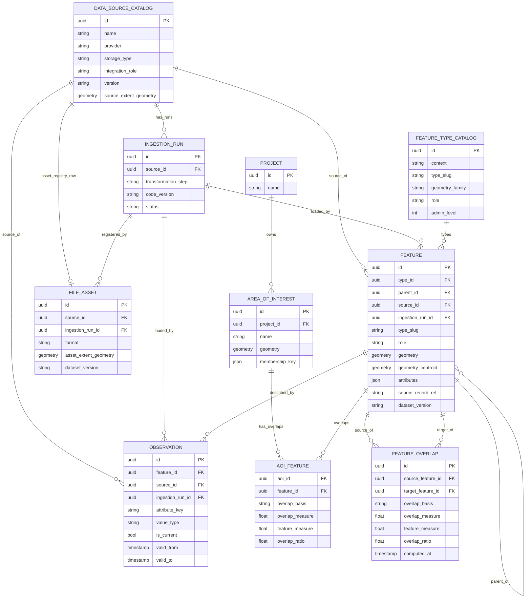
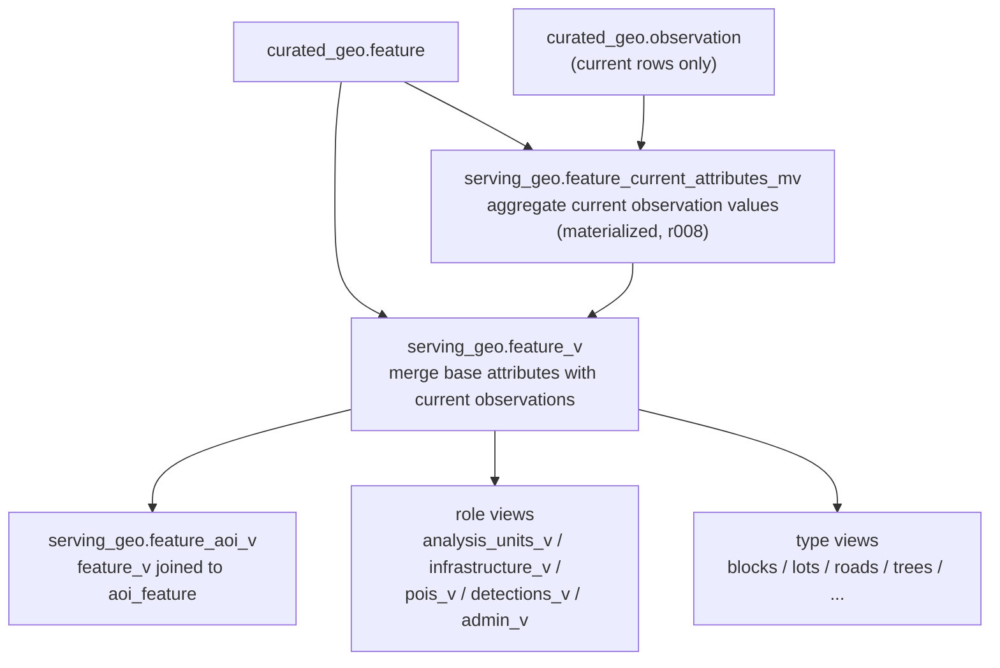

# Data Layer

How the platform ingests, stores, and serves all city data — regardless of origin, format, or size.

**Related documents:** `INDICATORS_LAYER.md` — what gets computed from this data. `SCENARIOS_LAYER.md` — how scenarios read and overlay this data.

---

## What this layer does

It maintains a clean, traceable, canonical representation of the city as it exists today. Everything else — indicators, scenarios — reads from here. Nothing in this layer is ever overwritten by a scenario.

This layer answers five recurring questions:

1. How do we classify a new dataset before loading it?
2. Which table should receive it?
3. How do we keep provenance across very different data types?
4. Which parts of baseline data can scenarios override, and which stay read-only?
5. How do we expose a stable read contract without duplicating the whole database?

---

## Pipeline

Datasets follow a three-zone path before the application can read them.

```
Bronze (files)  →  Silver (files)  →  curated_geo (PostgreSQL)
```

Bronze and Silver are directories under the data directory (`<repo>/data`, overridable with `REIMAGINA_DATA_DIR`; `reimagina/paths.py`): `data/bronze/<source_id>/` and `data/silver/<source_id>/`, keyed by the `data_source_catalog` row's id.

| Zone | Rule | Purpose |
|---|---|---|
| **Bronze** | Immutable after landing. Never modified, never deleted (`pipeline/bronze.py` `land_file` copies the raw file unchanged). | Exact copy of the source. Enables full re-processing without re-fetching. |
| **Silver** | Vector: reprojected to EPSG:4326, invalid geometries repaired with `make_valid`, null and empty geometries dropped (`pipeline/silver.py` `clean_vector`), written as GeoParquet. Raster: re-encoded as a COG in its **native** CRS (`pipeline/raster.py`). | Source-agnostic clean data ready to load. |
| **curated_geo** | Canonical tables with provenance on every row. | What the rest of the platform reads. |

Not every loader uses both file zones. `cdmx`, `overture` (buildings and places) and `raster` land a Bronze copy and write Silver; `inegi-marco` and `points` read a local copy named with `--source-root` (the Mexicali source bundle) and write Silver only; `inegi-censo` reads its parquet copy and writes observations directly; `network bootstrap` loads OSM data straight into `road_node`/`road_edge` with no file zone and no `ingestion_run`.

The API never touches Bronze or Silver. Its feature and tile reads go through `serving_geo`, a thin view-and-function layer over `curated_geo`; other endpoints (AOI listing, the indicator catalog, scenario authoring) read and write `curated_geo` tables through the storage repositories (`storage/postgres/repositories.py`).

---

## Two destinations, one question

Every dataset that enters this platform produces one of two kinds of canonical records:

- **`feature`** — a spatial object that exists in the city: a block, a parcel, a road segment, a detected tree. Has its own geometry, a stable identity, and is reused across indicators and scenarios.
- **`observation`** — a measured or derived value *about* an existing feature: the population count of a block, the NDVI mean of a lot, the width of a sidewalk. Comes from a separate dataset, arrives at a different time, and must retain its own provenance.

**The single question that routes every dataset:**

> Does this dataset define spatial objects, or does it describe them?
> - Defines new spatial objects with geometry → **`feature`**
> - Describes or measures existing objects → **`observation`**

This is the OGC Observations & Measurements (ISO 19156) pattern. An observation is always *about* a feature — it cannot exist without one.

### Where each storage type lands

Every dataset has a `storage_type`, and it names the loading path below. Each loader sets it when it registers its source; nothing dispatches on it at runtime, and the only place the database acts on it is the `file_asset` trigger.

| `storage_type` | Examples | Canonical destination |
|---|---|---|
| `vector` | INEGI blocks, lots, roads, bus stops | `curated_geo.feature` — new spatial objects with geometry |
| `tabular` | Census population, employment counts, school capacity | `curated_geo.observation` — measured values about existing features |
| `raster` | WorldPop population, Sentinel-2 NDVI, elevation | COG file (registered in `file_asset` + `raster_layer`) + zonal stats → `curated_geo.observation` |
| `imagery` | Google Street View, aerial photos | File + ML detections → `curated_geo.feature` |
| `point_cloud` | LiDAR | File + derived metrics → `curated_geo.observation` |

Loaders exist for `vector`, `tabular` and `raster`. No imagery or point-cloud loader exists yet; those two rows describe the intended path.

### Why does raster land in `observation`, not `feature`?

A raster is a continuous surface — every pixel is a value, not an object. There is no meaningful "raster row" to persist in a city model. The standard practice is **zonal statistics**: for each existing feature (block, lot, grid cell), summarize the pixels that fall inside it — mean NDVI, median elevation, canopy fraction. Each summary value is an observation *about* that feature from that raster dataset.

The raster file itself stays on file storage permanently (the Bronze copy and the Silver COG). Only the per-feature summary values enter PostgreSQL as `observation` rows, with full lineage back to the source file and the ingestion run.

Tool: [`exactextract`](https://github.com/isciences/exactextract) — computes exact partial-pixel overlap rather than approximating from centroid or bounding box (`jobs/raster_zonal_stats.py`).

### Why does imagery land in `feature`, not `observation`?

An ML model run over imagery identifies discrete spatial objects — individual trees, barriers, building fronts — each with a point or polygon geometry. These are candidates for stable city objects. If the detection confidence is high enough to persist, each detection becomes a `feature` row (with `confidence` and `model_version` set). Measurements about a detected object (height estimate, canopy area) go to `observation`.

---

## Repeatable onboarding playbook

Every new dataset follows the same decision path. The goal is that onboarding a new source is mostly classification and mapping work, not schema redesign.

### Step 1. Register the source

Create one `data_source_catalog` row before loading anything. At registration time, answer four questions:

| Question | Why it matters | Typical answers |
|---|---|---|
| What raw asset arrived? | Sets `storage_type` | `vector`, `tabular`, `raster`, `imagery`, `point_cloud` |
| What role does it play in the city model? | Sets `integration_role` | `canonical_entity`, `enrichment`, `model_output` |
| Does it define baseline reality, enrich it, seed scenario-editable context, or become scenario output? | Guides worker usage and examples | baseline-defining, baseline evidence, scenario-editable, output-only |
| What feature grain does it attach to? | Determines joins and keys | block, lot, road, sidewalk, tree, grid cell |

### Step 2. Decide the landing table

- If the dataset defines persistent spatial objects, load `feature`.
- If it measures or derives values about existing objects, load `observation`.
- If it is a large file asset, register metadata in `file_asset` and write derived values to `observation`.
- If it is a user-facing computed result imported from outside the normal worker pipeline, treat it as `indicator_result`.

### Step 3. Start lineage

Create an `ingestion_run` for each curated load step. Every canonical row must point back to the run that produced it.

### Step 4. Expose only what readers need

The API's feature reads and the tile functions go through `serving_geo` (`feature_v`, `feature_aoi_v`, `get_tile`), not the canonical tables directly. Start with plain views. Only materialize proven hot paths.

### Step 5. Decide scenario participation

- Baseline-defining data lives only in the data layer.
- Baseline evidence stays read-only but can influence scenario recomputation.
- Scenario rules are drawn into `curated_geo.scenario_rule` (r055) and materialized into per-feature `curated_geo.scenario_override` rows (r030), never back into `feature` or `observation`.
- A scenario can only author the attributes the shipped indicators read, minus geometry and the two dirty markers (`assets.registry.authorable_attributes()`): today `floors`, `lot_coverage`, `num_levels`, `people_per_household`, `unit_size`. Everything else in the data layer is read-only to scenarios.

This means a source can be essential to scenario evaluation without ever becoming scenario-owned data.

---

## Schema setup

```sql
-- r001
CREATE EXTENSION IF NOT EXISTS postgis;
CREATE SCHEMA IF NOT EXISTS app_core;
CREATE SCHEMA IF NOT EXISTS jobs_runtime;
CREATE SCHEMA IF NOT EXISTS curated_geo;
CREATE SCHEMA IF NOT EXISTS serving_geo;

-- r006: engineer-facing inspection views (explore.layer_catalog_v, source_runs_v, ...)
CREATE SCHEMA IF NOT EXISTS explore;

-- r037: routing for the network accessibility indicators
CREATE EXTENSION IF NOT EXISTS pgrouting;
```

r029 creates a `procrastinate` schema only if that library is importable (it is not a dependency), and r032 drops it; it does not exist at head.

---

## Visual schema

This section uses two diagrams on purpose, because one diagram is not enough to explain the data layer clearly without mixing storage concerns and read-model concerns.

**Diagram 1** answers: *what tables exist and how are they related?*  
**Diagram 2** answers: *how is the API/model read contract derived from those tables?*

### 1. Stored entities and lineage

This is the persisted schema view. It shows the main stored tables, the key foreign-key-style links, and the ownership/lineage structure. It intentionally focuses on persisted entities only.



Read Diagram 1 as:

- `data_source_catalog` and `ingestion_run` provide provenance.
- `feature` is the canonical city-object table.
- `observation` stores later measurements about `feature`.
- `file_asset` stores batch/manifest-level asset metadata, not per-feature values.
- `area_of_interest` and `aoi_feature` are project-scoped support tables for AOI filtering and overlap-based prorating.
- `feature_overlap` stores pre-computed spatial intersections between arbitrary feature type pairs (e.g. blocks vs. AGEBs, lots vs. road segments), generalising `aoi_feature` to feature-to-feature; `UNIQUE (source_feature_id, target_feature_id)`. Populated by `reimagina.jobs.overlap` (CLI: `overlap declare-pair` + `overlap compute-all --aoi-id …`; `overlap list-pairs` lists the declarations) for declared type-pair combinations (`feature_overlap_type_pair`, `UNIQUE (source_type_id, target_type_id)`). Its one reader is the observation rollup (`reimagina.jobs.observation_rollup`), which aggregates current observations from a finer grain to a coarser one, driven by `aggregation_recipe` (r020); it works for hierarchical and non-hierarchical relationships alike because it never reads `feature.parent_id`. Indicators are block-grain only and do not read it.
- `aoi_indicator_summary` caches a single aggregated value per `(aoi_id, scenario_id, indicator_id)`. The schema and read contract (`serving_geo.aoi_summary_v`) landed in Layer 1 (r015) so API code could target them; the worker that populates rows from `indicator_result` shipped with Layer 2 as `reimagina.jobs.aoi_summary.summarise_aoi`, weighting by `aoi_feature`. Uniqueness is two partial unique indexes, `aoi_indicator_summary_base_uk (aoi_id, indicator_id) WHERE scenario_id IS NULL` and `aoi_indicator_summary_scenario_uk (aoi_id, scenario_id, indicator_id) WHERE scenario_id IS NOT NULL`; `status` is `current` | `stale` | `missing`, and `aoi_summary_v` shows `current` rows only. `indicator_id` has no FK to `indicator_catalog`: r015 deferred it and no later revision added it.
- In the actual schema, `aoi_feature` uses the pair `(aoi_id, feature_id)` as its composite primary key.

Other `curated_geo` tables the data layer owns but the diagram leaves out:

- `raster_layer` (r019) — one row per registered raster (`source_id` and `asset_id` both `UNIQUE`, FKs to `data_source_catalog` and `file_asset`, `ON DELETE CASCADE`), carrying `layer_slug`, tile styling (`colormap_name`, `rescale`, `minzoom` default 5, `maxzoom` default 14), `published` (default true) and `aggregation_kind` (`intensive` | `extensive`, default `intensive`). Read through `serving_geo.raster_layer_v` (joined with `file_asset`) and `explore.raster_layer_v`. Written by `raster ingest` (`pipeline/raster.py`).
- `road_node` / `road_edge` (r037) — the pgRouting walking graph. Node ids are OSM node ids; `road_edge` carries `osm_id`, `source`/`target` (FKs to `road_node`, `ON DELETE CASCADE`), `cost` and `reverse_cost` (both edge length in metres) and a `LineString` geometry. Loaded by `network bootstrap` (`pipeline/osm_network.py`), which replaces the whole graph and opens no `ingestion_run`; by default the same command publishes the edges as `global:road` features (`data/roads.py`, `transformation_step = 'publish_road_features'`).
- `tile_snapshot_registry` (r013) — PMTiles snapshot registry; see `TILE_SERVING.md`.
- `asset`, `asset_version`, `asset_dependency`, `asset_materialization` (r041) — the asset graph; see `ASSET_LAYER.md`.
- `aggregation_recipe` (r020) — the declarative raster→observation and observation→observation bindings; see `docs/SYSTEM_OVERVIEW.md`. The indicator tables (`indicator_catalog`, `indicator_dependency`, `indicator_result`) are in `INDICATORS_LAYER.md`; `scenario_override` and `scenario_rule` are in `SCENARIOS_LAYER.md`.

### Shipped loaders and the CDMX bootstrap

The loaders are CLI families of `uv run python -m apps.cli.app` (`apps/cli/app.py`); `docs/BOOTSTRAP.md` is the full runbook.

- **Overture** — `overture` family. Buildings (`extract`, `load`; `pipeline/overture.py`) as `global:building`; parks, recreation and cultural places (`places`; `pipeline/overture_places.py`) as `global:establishment`; `divisions` lists Overture administrative divisions and `aoi-from-division` creates an AOI from one (`pipeline/overture_divisions.py`); and `block-storeys`, which writes each block's footprint-weighted mean storeys (Overture `num_floors` where tagged, 1 where not; only on blocks with at least one tagged building) as a `floors` observation (`pipeline/block_storeys.py`).
- **CDMX canonical geometry (INEGI + datos.cdmx.gob.mx)** — `cdmx` CLI family
  (`pipeline/cdmx.py`); fetches the Marco Geoestadístico 2020 per-state archive
  (state 09 = CDMX) and the CDMX colonias layer, lands them through
  Bronze/Silver, and loads them into `curated_geo.feature` as
  `MEX:municipality`, `MEX:ageb`, `MEX:block`, and `MEX:neighborhood`.
  Colonias download may need manual fallback when the CDMX portal is
  rate-limited (`--from-path LAYER=PATH` accepts a local archive).
- **INEGI Marco Geoestadístico 2024** — `inegi-marco bootstrap` (`pipeline/inegi_marco.py`); states, municipalities, urban AGEBs and urban blocks for the entidades given with `--cve-ent`, read from a local parquet copy of the INEGI product (`--source-root`; the Mexicali source bundle holds Baja California).
- **INEGI census 2020** — `inegi-censo bootstrap` (`pipeline/inegi_censo.py`); block-level values as `censo_2020_<column>` observations, joined to blocks by CVEGEO, read from a local parquet copy (`--source-root`; the source bundle's `inegi/censo_2020/manzanas_2020.parquet/`).
- **Amenity points** — `points bootstrap` (`pipeline/points.py`); per-pilot-city GeoParquet layers as `global:establishment`, at fixed paths under `--source-root` (Mexicali: the source bundle's INEGI DENUE selection, `inegi/denue/equipamientos_mexicali.parquet`).
- **Rasters** — `raster ingest`, `raster fetch-worldpop`, `raster zonal-stats` (`pipeline/raster.py`, `jobs/raster_zonal_stats.py`), plus `raster derivation` for aggregation recipes.
- **Routing network** — `network bootstrap` (`pipeline/osm_network.py`); see `road_node` / `road_edge` above.

```bash
uv run python -m apps.cli.app feat seed-types
uv run python -m apps.cli.app cdmx bootstrap --layers municipalities,agebs,blocks
uv run python -m apps.cli.app cdmx aoi-from-alcaldia --cve-mun 015 --name "Cuauhtémoc"
uv run python -m apps.cli.app aoi compute-features
uv run python -m apps.cli.app cdmx status
```

Baseline load counts for INEGI 2020 CDMX: 16 municipalities, 2 431 AGEBs,
66 789 manzanas. See `PERFORMANCE.md` for timing + overlap baseline numbers.

The diagram does **not** try to encode every workflow rule. For example, raster assets produce `observation` rows through zonal statistics, and imagery may later produce detected `feature` rows, but that is a pipeline behavior, not a direct foreign-key relationship.

### 2. Derived serving views

This is the read-model view. It shows how `serving_geo` is built from the canonical tables. These are derived views, not additional source-of-truth tables.



Read Diagram 2 as:

- `feature_current_attributes_mv` aggregates the current `observation` rows per feature. It is the materialized copy of the live view `feature_current_attributes_v` (r005, still present), refreshed when an ingestion run succeeds.
- `feature_v` combines `feature.attributes` with those aggregated current values.
- `feature_aoi_v`, role-based and type-based views are thin projections over `feature_v`.
- `serving_geo` is not a second storage layer: it is the read contract derived from canonical tables. The only object in it that stores rows is the materialized view.

---

## Tables

### data_source_catalog

Every dataset must be registered here before any data is loaded. This is the registry that makes every canonical row traceable to its origin.

**Purpose:** one row per external dataset or feed, before any curated load occurs.  
**Use this when:** onboarding any new source, even if the canonical load has not been written yet.  
**Do not use this for:** per-run lineage, per-feature values, or model execution metadata.  
**Relationships:** parent of `ingestion_run`; referenced by `feature`, `observation`, `file_asset`, and `raster_layer`.  
**Examples:** INEGI blocks, INEGI census 2020, Overture buildings, WorldPop population, Sentinel-2 NDVI, GSV detection batches, cellphone footfall by block.

Each row should represent one loadable dataset version or asset collection in v1, not an entire provider universe. For example, `Sentinel-2 NDVI 2024-Q1` is one source row; `GSV tree detections batch 2024-03` is another.

```sql
CREATE TABLE curated_geo.data_source_catalog (
  id                uuid        PRIMARY KEY DEFAULT gen_random_uuid(),
  name              text        NOT NULL,
  provider          text        NOT NULL,
  -- Free text. Values the loaders write include 'INEGI', 'Overture Maps Foundation',
  -- 'Gobierno de la Ciudad de México', 'SIG-CDMX', 'openstreetmap',
  -- 'reimagina-rollup'; `raster ingest` takes it from --provider.

  storage_type      text        NOT NULL
                                CHECK (storage_type IN ('vector','tabular','raster','imagery','point_cloud')),
  -- Raw-format class. Answers "what kind of asset arrived?"

  integration_role  text        NOT NULL
                                CHECK (integration_role IN
                                  ('canonical_entity','enrichment','model_output')),
  -- Semantic routing class. Answers "how does this dataset participate in the city model?"

  storage_uri       text        NOT NULL,
  -- Lineage: where the data came from — the upstream it was fetched or cut from
  -- (a publisher's download or product page, an Overture release), or the file
  -- an operator handed in when nothing upstream is known. NOT the local copy:
  -- the Bronze copy is addressed by this row's id at data/bronze/<source_id>/,
  -- and a processed raster's location is file_asset.storage_uri, which is what
  -- tiles and zonal stats read. Nothing opens a file through this column.
  --
  -- This line used to read "Bronze file location", while other notes said the
  -- same column keeps the upstream URL for lineage. The pipelines split along
  -- that contradiction — three wrote an origin, three overwrote it with a local
  -- path — until it was settled here.

  schema_definition jsonb,
  -- Intended as the JSON Schema of expected source fields, to validate Silver
  -- before loading. No loader writes or reads it today, so no structural
  -- validation is applied at ingest.

  version           text        NOT NULL,
  license           text,
  credit            text,
  -- r054. The exact map credit the licence prescribes, where it prescribes one
  -- per product: the INEGI loaders write "Fuente: INEGI, <producto>, <fecha>".
  -- NULL = the map shows "provider (license)". Read by data/attribution.py.
  update_frequency  text
                                CHECK (update_frequency IS NULL OR update_frequency IN
                                  ('daily','weekly','monthly','quarterly','annual','on_demand')),
  -- No loader sets it today.
  source_extent_geometry geometry(Polygon, 4326),
  -- Optional footprint of the registered source dataset or asset collection.
  -- No loader sets it today.
  ingested_at       timestamptz,
  -- Set by reimagina.data.catalog.complete_ingestion_run when a succeeded run
  -- that names a registered asset wrote rows (the same condition that publishes
  -- an asset version). NULL = no such load yet.
  notes             text,
  created_at        timestamptz NOT NULL DEFAULT now(),
  UNIQUE (provider, name, version)
);
```

`register_source` upserts on `(provider, name, version)`: a re-registration updates `storage_type`, `integration_role` and `storage_uri`, and `license` / `notes` when given (`PostgresSourceCatalogRepository.register_or_get_source`).

---

### ingestion_run

One row per curated-load execution. Every canonical row points back here, giving full lineage: which script, which version, which run produced this data.

**Purpose:** the lineage anchor for one curated load step.  
**Use this when:** writing any new batch of canonical rows into `feature`, `observation`, or `file_asset`.  
**Do not use this for:** queue execution or model results; that belongs to `job_run`.  
**Relationships:** child of `data_source_catalog`; referenced by `feature`, `observation`, `file_asset`, and `asset_version` (r041, `ON DELETE SET NULL`).  
**Examples:** `silver_to_curated` for vector and census loads, `raster_landing` for a raster ingest, `raster_zonal_stats` for per-feature raster summaries, `observation_rollup`, `derive_block_storeys`, `publish_road_features`.

```sql
CREATE TABLE curated_geo.ingestion_run (
  id                  uuid        PRIMARY KEY DEFAULT gen_random_uuid(),
  source_id           uuid        NOT NULL REFERENCES curated_geo.data_source_catalog(id),
  orchestrator        text        NOT NULL,          -- 'manual' (CLI loaders), 'worker' (zonal stats, observation rollup)
  orchestrator_run_id text        NOT NULL,          -- caller-chosen; most loaders default to a fresh uuid
  transformation_step text        NOT NULL,          -- see Examples above
  code_version        text        NOT NULL,          -- git SHA or package version ('dev' by default)
  status              text        NOT NULL
                                  CHECK (status IN ('running','succeeded','failed','cancelled')),
  started_at          timestamptz NOT NULL DEFAULT now(),
  completed_at        timestamptz,
  details             jsonb       NOT NULL DEFAULT '{}',
  -- counts or error metadata: {"records_written": 14200}, or on failure
  -- {"error_type": "...", "error_message": "..."}
  CHECK (completed_at IS NULL OR completed_at >= started_at),
  UNIQUE (source_id, orchestrator, orchestrator_run_id, transformation_step)
);

CREATE INDEX ingestion_run_source_idx ON curated_geo.ingestion_run (source_id);
CREATE INDEX ingestion_run_status_idx ON curated_geo.ingestion_run (status);
CREATE INDEX ingestion_run_source_started_idx
  ON curated_geo.ingestion_run (source_id, started_at DESC);   -- r007
```

Loaders insert the run as `running` and commit it before writing data, so a failed load can still mark it `failed` (`pipeline/loader.py`). This table stores only the lineage reference and a small `details` summary, not verbose runtime output; there is no separate ETL log store.

---

### feature_type_catalog

Defines what spatial types exist. New types are rows here — no table or schema migration needed.

**Purpose:** registry of valid feature kinds, their geometry family, and their semantic role.  
**Use this when:** introducing a canonical object type the catalog does not have yet, such as `grid_cell`.  
**Do not use this for:** source-specific datasets or ad hoc attributes.  
**Relationships:** referenced by `feature.type_id`, `feature_overlap_type_pair` (both sides), `scenario_rule.type_id` (r055) and `asset.feature_type_id` (r041); drives `role`-based serving views.  
**Examples:** `block`, `lot`, `tree`, `road`, `bus_stop`, `building`.

```sql
CREATE TABLE curated_geo.feature_type_catalog (
  id              uuid      PRIMARY KEY DEFAULT gen_random_uuid(),
  context         text      NOT NULL,
  -- 'global'  → applies everywhere (tree, road, bus_stop)
  -- 'MEX'     → Mexico-specific administrative types
  -- A project UUID can also be used for project-specific types.

  type_slug       text      NOT NULL,
  -- Stable code-level identifier: 'block', 'municipality', 'tree', 'grid_cell'

  label           text      NOT NULL,
  -- Human-readable display name: 'Manzana', 'Municipio', 'Árbol'

  geometry_family text      NOT NULL
                            CHECK (geometry_family IN ('point','line','polygon','geometry')),
  -- 'geometry' allows any type (mixed datasets)

  role            text      NOT NULL
                            CHECK (role IN ('analysis_unit','context','infrastructure','poi','detection')),
  -- analysis_unit  → spatial units that receive indicator values (block, lot, ageb, grid_cell)
  -- context        → administrative framing, not directly analysed (municipality, state)
  -- infrastructure → physical urban fabric (road, sidewalk, bike lane)
  -- poi            → point of interest, establishment, amenity
  -- detection      → ML-derived object with a confidence score

  admin_level     smallint  CHECK (admin_level IS NULL OR admin_level > 0),
  -- Hierarchy depth: 1 = coarsest, N = finest. NULL for non-hierarchical types.

  description     text,
  UNIQUE (context, type_slug)
);
```

**Seed data — Mexico + global** (r003, and again idempotently by `feat seed-types` from `reimagina.data.feature.FEATURE_TYPE_ROWS`; both use `ON CONFLICT (context, type_slug) DO NOTHING`):
```sql
INSERT INTO curated_geo.feature_type_catalog
  (context, type_slug, label, geometry_family, role, admin_level)
VALUES
  ('MEX', 'state',         'Estado',        'polygon', 'context',        1),
  ('MEX', 'municipality',  'Municipio',     'polygon', 'context',        2),
  ('MEX', 'neighborhood',  'Colonia',       'polygon', 'context',        3),
  ('MEX', 'ageb',          'AGEB',          'polygon', 'analysis_unit',  4),
  ('MEX', 'block',         'Manzana',       'polygon', 'analysis_unit',  5),
  ('MEX', 'lot',           'Predio',        'polygon', 'analysis_unit',  6),
  ('global', 'building',      'Building',      'polygon', 'context',        NULL),
  ('global', 'tree',          'Tree',          'point',   'detection',      NULL),
  ('global', 'bus_stop',      'Bus Stop',      'point',   'poi',            NULL),
  ('global', 'station',       'Station',       'point',   'poi',            NULL),
  ('global', 'establishment', 'Establishment', 'point',   'poi',            NULL),
  ('global', 'road',          'Road',          'line',    'infrastructure', NULL),
  ('global', 'sidewalk',      'Sidewalk',      'line',    'infrastructure', NULL),
  ('global', 'bike_lane',     'Bike Lane',     'line',    'infrastructure', NULL),
  ('global', 'crossing',      'Crossing',      'point',   'infrastructure', NULL)
ON CONFLICT (context, type_slug) DO NOTHING;
```

**Use case with no administrative hierarchy (flat grid):**
```sql
INSERT INTO curated_geo.feature_type_catalog
  (context, type_slug, label, geometry_family, role, admin_level)
VALUES
  ('custom', 'grid_cell', 'Analysis Cell', 'polygon', 'analysis_unit', 1);
-- All grid cells will have parent_id = NULL.
```

---

### feature

One row = one canonical spatial object. All types live in one table. The type is a column, not a table name.

**Purpose:** store stable spatial objects that should exist in the city model with identity, geometry, and provenance.  
**Use this when:** a dataset defines reusable entities such as blocks, roads, lots, bus stops, or validated detections.  
**Do not use this for:** mutable enrichments like population, NDVI, footfall, or sidewalk measurements from a later dataset.  
**Relationships:** child of `feature_type_catalog`, `data_source_catalog`, and `ingestion_run`; parent of `observation`, `aoi_feature`, `feature_overlap`, `scenario_override`, and `indicator_result` (all `ON DELETE CASCADE`).  
**Examples:** municipality polygons, block polygons, Overture building footprints, road centerlines, detected trees.

```sql
CREATE TABLE curated_geo.feature (
  id                uuid             PRIMARY KEY DEFAULT gen_random_uuid(),

  -- Type
  type_id           uuid             NOT NULL REFERENCES curated_geo.feature_type_catalog(id),
  type_slug         text             NOT NULL,
  -- Set from feature_type_catalog by the trigger on every insert and update;
  -- a supplied value is overwritten.
  role              text             NOT NULL,
  -- Set from feature_type_catalog by the trigger on every insert and update.

  -- Hierarchy (self-referencing, any depth)
  parent_id         uuid             REFERENCES curated_geo.feature(id),
  -- NULL at the top of the hierarchy, or for non-hierarchical types.
  -- None of the shipped loaders sets it (only scripts/synthetic_territory.py does).

  name              text,

  geometry          geometry(Geometry, 4326) NOT NULL,

  attributes        jsonb            NOT NULL DEFAULT '{}',
  -- Base properties that belong to the object itself, copied from source columns.
  -- block:    {"CVE_ENT": "09", "CVE_MUN": "015", "CVE_LOC": "0001",
  --            "CVE_AGEB": "…", "CVE_MZA": "…", "AMBITO": "…", "TIPOMZA": "…"}
  -- building: {"subtype": …, "class": …, "height": …, "num_floors": 3, …}
  -- Mutable or derived values (census, raster summaries, footfall) go to observation.
  -- Exception: scripts/seed_demo_attributes.py merges fixture scenario inputs
  -- into block attributes, bypassing observation provenance.

  -- Provenance
  source_id         uuid             NOT NULL REFERENCES curated_geo.data_source_catalog(id),
  source_record_ref text             NOT NULL,
  -- Original ID in the source dataset. Used for upserts and deduplication.
  ingestion_run_id  uuid             NOT NULL REFERENCES curated_geo.ingestion_run(id),
  dataset_version   text             NOT NULL,

  -- ML detection metadata (NULL for authoritative sources)
  confidence        double precision CHECK (confidence IS NULL OR confidence BETWEEN 0 AND 1),
  model_version     text,

  created_at        timestamptz      NOT NULL DEFAULT now(),
  updated_at        timestamptz      NOT NULL DEFAULT now(),

  UNIQUE (source_id, dataset_version, source_record_ref),

  -- r027. A point guaranteed inside the geometry, maintained by Postgres.
  -- Backs point-in-polygon selection (ST_Contains / ST_Covers on the centroid).
  geometry_centroid geometry(Point, 4326)
                    GENERATED ALWAYS AS (ST_PointOnSurface(geometry)) STORED
);

CREATE INDEX feature_geometry_gist  ON curated_geo.feature USING GIST (geometry);
CREATE INDEX feature_type_slug_idx  ON curated_geo.feature (type_slug);
CREATE INDEX feature_role_idx       ON curated_geo.feature (role);
CREATE INDEX feature_parent_idx     ON curated_geo.feature (parent_id);
CREATE INDEX feature_source_idx     ON curated_geo.feature (source_id);
CREATE INDEX feature_type_id_idx       ON curated_geo.feature (type_id);           -- r007
CREATE INDEX feature_ingestion_run_idx ON curated_geo.feature (ingestion_run_id);  -- r007
CREATE INDEX feature_centroid_gist     ON curated_geo.feature USING GIST (geometry_centroid);  -- r027

-- Partial spatial indexes for the highest-frequency types
CREATE INDEX feature_block_geom_idx ON curated_geo.feature USING GIST (geometry) WHERE type_slug = 'block';
CREATE INDEX feature_lot_geom_idx   ON curated_geo.feature USING GIST (geometry) WHERE type_slug = 'lot';
-- r010: the only rows get_tile fetches below z8
CREATE INDEX feature_context_geom_idx ON curated_geo.feature USING GIST (geometry) WHERE role = 'context';
```

Loaders insert with `ON CONFLICT (source_id, dataset_version, source_record_ref) DO NOTHING` (`PostgresFeatureRepository.bulk_insert_features` and `bulk_insert_features_from_parquet`): re-running a load at the same `dataset_version` writes nothing, and a new `dataset_version` adds new rows beside the old ones.

**Trigger — `curated_geo.feature_before_write`** (r003, `BEFORE INSERT OR UPDATE`):
Sets `type_slug` and `role` from `type_id` (unknown `type_id` raises). Validates the geometry type against the catalog's `geometry_family` (`geometry` accepts any). Rejects a `source_id` that differs from `ingestion_run.source_id`. Enforces hierarchy rules: no self-parenting, no parent for a type whose `admin_level` is NULL, a parent's `admin_level` strictly lower than the child's, no cycles. Sets `updated_at = now()`.

---

### observation

One row = one measured or derived value about an existing feature, from a specific dataset, at a specific time. Implements the OGC Observations & Measurements (ISO 19156) pattern.

This is separate from `feature.attributes` because observations come from different datasets at different times and must remain traceable independently. `feature.attributes` is what the object *is*; `observation` is what we have *learned about it* from external data.

**Purpose:** store external measurements and derived values about canonical features, with independent provenance and history.  
**Use this when:** a dataset enriches existing objects instead of defining new ones.  
**Do not use this for:** the immutable identity of a feature, scenario overrides, or pairwise flow matrices that are not naturally "about one feature".  
**Relationships:** child of `feature`, `data_source_catalog`, and `ingestion_run`; merged into `serving_geo.feature_v` through `feature_current_attributes_mv`.  
**Examples:** census population for a block, WorldPop population summed per block, a block's footprint-weighted mean storeys from Overture, NDVI mean for a lot, sidewalk width from GSV, cellphone footfall by AGEB and hour.

```sql
CREATE TABLE curated_geo.observation (
  id               uuid             PRIMARY KEY DEFAULT gen_random_uuid(),
  feature_id       uuid             NOT NULL REFERENCES curated_geo.feature(id) ON DELETE CASCADE,

  attribute_key    text             NOT NULL CHECK (attribute_key <> ''),
  -- e.g. 'censo_2020_pobtot' (census),
  -- '<prefix>_mean' / '<prefix>_sum' (raster zonal stats), 'floors' (block-storeys)

  value_type       text             NOT NULL
                                    CHECK (value_type IN ('numeric','text','json')),
  value_numeric    double precision,
  value_text       text,
  value_json       jsonb,
  -- Exactly one of these must be populated. Enforced by the trigger below.

  -- Provenance
  source_id        uuid             NOT NULL REFERENCES curated_geo.data_source_catalog(id),
  ingestion_run_id uuid             NOT NULL REFERENCES curated_geo.ingestion_run(id),
  lineage_ref      jsonb,
  -- Optional extra context, e.g. zonal stats write
  -- {"kind": "raster_zonal_stats", "asset_id": …, "stat_name": …, "fractional_pixel_count": …}

  -- Currency tracking
  is_current       boolean          NOT NULL DEFAULT true,
  valid_from       timestamptz      NOT NULL DEFAULT now(),
  valid_to         timestamptz,

  created_at       timestamptz      NOT NULL DEFAULT now(),
  updated_at       timestamptz      NOT NULL DEFAULT now(),

  CHECK ((is_current AND valid_to IS NULL) OR (NOT is_current AND valid_to IS NOT NULL)),
  CHECK (valid_to IS NULL OR valid_to >= valid_from)
);

-- Only one current value per (feature, attribute)
CREATE UNIQUE INDEX obs_one_current
  ON curated_geo.observation (feature_id, attribute_key)
  WHERE is_current;

CREATE INDEX obs_feature_key_idx ON curated_geo.observation (feature_id, attribute_key);
CREATE INDEX obs_source_run_idx  ON curated_geo.observation (source_id, ingestion_run_id);
CREATE INDEX observation_ingestion_run_idx ON curated_geo.observation (ingestion_run_id);  -- r007
-- r026: attribute-first, for listing every current row of a key
CREATE INDEX obs_attr_feat_current
  ON curated_geo.observation (attribute_key, feature_id)
  WHERE is_current;
```

**Trigger — `curated_geo.observation_before_write`** (r003, `BEFORE INSERT OR UPDATE`):
Enforces exactly one populated value column and requires it to match `value_type`. Rejects a `source_id` that differs from `ingestion_run.source_id`. Sets `updated_at = now()`. The trigger does not close prior rows: refresh semantics are applied by the write path (below), and the partial unique index `obs_one_current` is the final safety net.

**Refresh rule:** before inserting a new current value for `(feature_id, attribute_key)`, mark the previous current row `is_current = false, valid_to = now(), updated_at = now()`. `PostgresObservationRepository.upsert_current` and `bulk_upsert_current` (reached through `reimagina.data.observation`) do exactly this in one transaction. The unique partial index enforces one current value at a time.

---

### file_asset

Asset registry for files that permanently reside on file storage: rasters, imagery batches, and point-cloud collections. Derived values extracted from these files land in `observation` or `feature`.

**Purpose:** register external assets that remain on file storage while their derived values feed the relational model.  
**Use this when:** the source is a raster, imagery collection, or point-cloud asset too large or too scene-based to become canonical rows directly.  
**Do not use this for:** per-feature summaries or detections themselves. Those go to `observation` or `feature`.  
**Relationships:** child of `data_source_catalog` and `ingestion_run`; parent of `raster_layer` (r019, one layer per asset); paired with downstream `observation` rows or `feature` detections.  
**Examples:** a WorldPop population COG, Sentinel-2 NDVI GeoTIFF, a GSV image batch manifest, a LAZ tile collection. Only rasters have a loader (`raster ingest`); it writes `storage_uri = 'file://data/silver/<source_id>/<stem>.cog.tif'`, `format = 'COG'`, the native CRS, and `band_description = {"1": <band name>}`.

In v1, this table stores one row per registered source batch, version, or manifest. It does not attempt per-scene or per-tile lineage. If finer-grained lineage becomes necessary later, add a child `asset_item` table rather than overloading the current v1 contract.

```sql
CREATE TABLE curated_geo.file_asset (
  id               uuid             PRIMARY KEY DEFAULT gen_random_uuid(),
  source_id        uuid             NOT NULL REFERENCES curated_geo.data_source_catalog(id) UNIQUE,
  -- UNIQUE: one metadata record per registered source batch/version/manifest
  ingestion_run_id uuid             NOT NULL REFERENCES curated_geo.ingestion_run(id),
  storage_uri      text             NOT NULL,
  format           text             CHECK (format IN ('COG','GeoTIFF','NetCDF','LAZ','JPEG','PNG')),
  crs              text,
  resolution_m     double precision,
  band_description jsonb            NOT NULL DEFAULT '{}',
  -- {"B4": "red", "B8": "NIR", "NDVI": "derived"}
  -- {"returns": "lidar_returns", "height": "normalized_height"}
  asset_extent_geometry geometry(Polygon, 4326),
  -- Not populated by the raster loader in v1.
  captured_at      timestamptz,
  dataset_version  text             NOT NULL,
  created_at       timestamptz      NOT NULL DEFAULT now()
);

CREATE INDEX file_asset_ingestion_run_idx ON curated_geo.file_asset (ingestion_run_id);  -- r007
```

**Trigger — `curated_geo.file_asset_before_write`** (r003, `BEFORE INSERT OR UPDATE`): rejects rows whose `source_id` does not have `storage_type IN ('raster','imagery','point_cloud')`, and rejects a `source_id` that differs from `ingestion_run.source_id`.

---

### area_of_interest

User-defined study scope for a project. Not a city feature — it is project-scoped. It defines where analysis runs, not what exists in the city. AOIs are created through `reimagina.data.aoi.create_aoi`, which the CLI calls with an administrative boundary (`cdmx aoi-from-alcaldia`, `cdmx aoi-from-state`, `overture aoi-from-division`); the API has no AOI-creation endpoint.

**Purpose:** store project-scoped analysis boundaries.  
**Use this when:** a project needs a study boundary or user-selected subarea.  
**Do not use this for:** baseline city objects or administrative hierarchy.  
**Relationships:** child of `app_core.project`; parent of `aoi_feature` and `aoi_indicator_summary` (both `ON DELETE CASCADE`); referenced by `app_core.scenario.aoi_id` and `aggregation_recipe.aoi_id` (both `ON DELETE SET NULL`); used by jobs and result queries.  
**Examples:** an alcaldía, a whole state, downtown study boundary, regeneration district, corridor project polygon.

```sql
CREATE TABLE curated_geo.area_of_interest (
  id          uuid             PRIMARY KEY DEFAULT gen_random_uuid(),
  project_id  uuid             NOT NULL REFERENCES app_core.project(id) ON DELETE CASCADE,
  name        text             NOT NULL,
  description text,
  geometry    geometry(Geometry, 4326) NOT NULL
              CHECK (ST_GeometryType(geometry) IN ('ST_Polygon', 'ST_MultiPolygon')),
  created_at  timestamptz      NOT NULL DEFAULT now(),
  updated_at  timestamptz      NOT NULL DEFAULT now(),
  -- r040 (added with ALTER TABLE, so it is the last column).
  -- Identifier-based membership, e.g. {"CVE_ENT":"09","CVE_MUN":"012"}.
  -- NULL means geometry decides for everything, which is the pre-r040 behaviour.
  membership_key jsonb,
  CONSTRAINT area_of_interest_membership_key_nonempty
              CHECK (membership_key IS NULL
                     OR jsonb_typeof(membership_key) = 'object'
                        AND membership_key <> '{}'::jsonb)
);

CREATE INDEX aoi_geometry_gist ON curated_geo.area_of_interest USING GIST (geometry);
CREATE INDEX area_of_interest_project_idx ON curated_geo.area_of_interest (project_id);  -- r007
```

**Row-level security** (r011): `ENABLE ROW LEVEL SECURITY` with policy `tenant_isolation`, which admits every row while `app.current_project_id` is unset or empty and otherwise only rows whose `project_id` matches it. The same policy, keyed on `id`, is on `app_core.project`. RLS is enabled, not forced, so the table owner bypasses it, and no code sets `app.current_project_id` today.

#### Membership is identifier-first where the data has an identifier

`compute_overlaps` used to decide membership purely spatially. That is the only
option for data with no identifiers and the wrong one for data that has them.

INEGI's marco geoestadístico gives every block, AGEB and municipality an exact
administrative address. A block is in Tlalpan **iff** `CVE_ENT='09' AND
CVE_MUN='012'` — by definition, not by measurement. Measured before r040:

| grain | by CVE code | by geometry | code-only | geometry-only |
|---|---|---|---|---|
| block | 5,267 | 5,273 | 0 | **6** |
| ageb | 207 | 239 | 0 | **32** |
| municipality | 1 | 1 | 0 | 0 |
| building | **0** | 217,873 | 0 | 217,873 |
| establishment | **0** | 1,785 | 0 | 1,785 |

`code-only` is zero at every grain: geometry never missed a feature the codes
claimed, it was a strict **superset**, and the extra blocks and AGEBs belong to
neighbouring alcaldías. The spatial join was manufacturing ambiguity the data
does not contain.

The last two rows are why codes cannot simply replace geometry — buildings and
establishments have none, and are 219,658 of Tlalpan's 225,133 members. So the
rule is **per feature, not per AOI**:

- carries every key the AOI declares → excluded unless the values match exactly
  (`f.attributes @> aoi.membership_key`); a matching feature is then measured
  against the AOI geometry as before
- lacks any of them (`NOT f.attributes ?& keys`) → placed spatially, as before

Applied uniformly across the polygon, line and point families so the three
cannot disagree (`PostgresAOIRepository.compute_overlaps`,
`storage/postgres/repositories.py`). `cdmx aoi-from-alcaldia` and
`cdmx aoi-from-state` populate the key; `overture aoi-from-division` leaves it
NULL (an Overture boundary carries no INEGI codes), as does any `create_aoi`
call that passes none, and those AOIs keep the geometric behaviour.

⚠ **A shared border is not membership.** Two polygons that merely touch
intersect to a sliver with nonzero floating-point area, and `overlap_ratio > 0`
does not reject it — Coyoacán and Xochimilco were members of Tlalpan at ratios
of 6.2e-12 and 8.1e-12, and their whole polygons rendered on an AOI-scoped map.
`MEMBERSHIP_MIN_OVERLAP_RATIO = 1e-9` (`storage/postgres/repositories.py`)
is the floor for the polygon and line families, measured rather than
guessed: largest noise ratio 8.1e-12, smallest genuine overlap 2.9e-06, and
**zero rows** between 1e-9 and 1e-6. Points are members when `ST_Within` the
AOI, so no ratio applies to them.

⚠ This rejects noise, **not partial membership**. Features genuinely straddling
a boundary stay members and still render past the AOI edge. Giving each feature
exactly one AOI needs a majority-area rule (`>= 0.5`), which is a decision about
what an AOI *means* and would move every AOI-scoped aggregate. Deliberately not
made.

---

### aoi_feature

Pre-computed AOI membership of canonical features, with the share of each feature inside the AOI. Nothing populates it automatically: creating an AOI writes no rows. `aoi compute-features [--aoi-id …]` (`apps/cli/aoi.py` → `reimagina.data.aoi.compute_aoi_features` → `PostgresAOIRepository.compute_overlaps`) deletes the AOI's rows and recomputes them; rerun it after the AOI or the loaded features change.

**Purpose:** cache how much of each canonical feature overlaps a project AOI.  
**Use this when:** workers or API queries need stable AOI membership and proportional overlap.  
**Do not use this for:** defining features or storing indicators.  
**Relationships:** join table between `area_of_interest` and `feature`; exposed joined to `feature_v` as `serving_geo.feature_aoi_v`; commonly joined to `serving_geo.current_indicator_v`.  
**Examples:** 80% of a block lies inside the AOI, 35% of a road length lies inside, a bus stop is present inside.

```sql
CREATE TABLE curated_geo.aoi_feature (
  aoi_id          uuid             NOT NULL REFERENCES curated_geo.area_of_interest(id) ON DELETE CASCADE,
  feature_id      uuid             NOT NULL REFERENCES curated_geo.feature(id)           ON DELETE CASCADE,

  overlap_basis   text             NOT NULL
                                   CHECK (overlap_basis IN ('area','length','presence')),
  -- area:     polygons — fraction of the feature's area inside the AOI
  -- length:   lines    — fraction of the feature's length inside the AOI
  -- presence: points   — always 1 if the point falls inside the AOI

  overlap_measure double precision NOT NULL CHECK (overlap_measure > 0),
  -- m² or meters of the feature that falls inside the AOI (1 for points)
  feature_measure double precision NOT NULL CHECK (feature_measure > 0),
  -- total m² or meters of the feature (1 for points)
  overlap_ratio   double precision NOT NULL CHECK (overlap_ratio > 0 AND overlap_ratio <= 1),

  PRIMARY KEY (aoi_id, feature_id),
  CHECK (overlap_measure <= feature_measure),
  CHECK (
    overlap_basis <> 'presence'
    OR (overlap_measure = 1 AND feature_measure = 1 AND overlap_ratio = 1)
  )
);

CREATE INDEX aoi_feature_feature_idx ON curated_geo.aoi_feature (feature_id);
```

**Trigger — `curated_geo.aoi_feature_before_write`** (r004, `BEFORE INSERT`):
Validates that `overlap_basis` matches the referenced feature's geometry type: polygons use `area`, lines use `length`, points use `presence`. Rejects inconsistent combinations before insert.

Area and length are computed in metres with `ST_Area(geography)` / `ST_Length(geography)`, never in degrees. The AOI polygon is split with `ST_Subdivide` (`AOI_SUBDIVIDE_VERTICES`) before the intersection; the chunks tile the AOI without overlapping, so the summed measure is the same number.

---

## Serving layer

`serving_geo` is the read contract for features and tiles. These are views and tile functions over `curated_geo`; the one stored object is the materialized attribute snapshot below.

**Purpose:** provide a stable read contract for the API and tile serving without exposing every canonical table directly.  
**Use this when:** readers need baseline features with current observations already merged in.  
**Do not use this for:** canonical writes, lineage, scenario storage, or indicator computation — the compute path reads `curated_geo` directly so it can apply scenario overrides (see the read/write boundary below).  
**Relationships:** reads from `feature`, `observation`, `aoi_feature`, `aoi_indicator_summary` (`aoi_summary_v`), `indicator_result` (`current_indicator_v`), `raster_layer` + `file_asset` (`raster_layer_v`), `aggregation_recipe` (`aggregation_recipe_v`) and the asset graph (`asset_*_v`); feeds the API, tiles, and result comparison queries.  
**Examples:** `feature_v` for baseline reads, `feature_aoi_v` for AOI-scoped reads, `analysis_units_v` for role-scoped reads, `current_indicator_v` for comparisons.

```sql
-- r005. Aggregates current observations into one JSON object per feature (live).
CREATE VIEW serving_geo.feature_current_attributes_v AS
SELECT
  f.id AS feature_id,
  COALESCE(
    jsonb_object_agg(
      obs.attribute_key,
      COALESCE(to_jsonb(obs.value_numeric), to_jsonb(obs.value_text), obs.value_json)
    ) FILTER (WHERE obs.id IS NOT NULL),
    '{}'::jsonb
  ) AS current_attributes
FROM curated_geo.feature f
LEFT JOIN curated_geo.observation obs
  ON obs.feature_id = f.id AND obs.is_current
GROUP BY f.id;

-- r008. The same aggregation, materialized; this is what feature_v reads.
CREATE MATERIALIZED VIEW serving_geo.feature_current_attributes_mv AS
  <the SELECT of feature_current_attributes_v>
WITH DATA;
CREATE UNIQUE INDEX feature_current_attributes_mv_feature_id_idx
  ON serving_geo.feature_current_attributes_mv (feature_id);

-- Full feature view: base attributes merged with current observations.
-- r008 switched it to the MV, r014 made the join LEFT, r027 appended the centroid.
CREATE VIEW serving_geo.feature_v AS
SELECT
  f.id, f.type_id, f.type_slug, f.role, f.parent_id, f.name, f.geometry,
  f.attributes || COALESCE(fca.current_attributes, '{}'::jsonb) AS attributes,
  f.source_id, f.source_record_ref, f.dataset_version,
  f.confidence, f.model_version, f.created_at, f.updated_at,
  f.geometry_centroid
FROM curated_geo.feature f
LEFT JOIN serving_geo.feature_current_attributes_mv fca ON fca.feature_id = f.id;

-- r005, centroid appended in r027. AOI membership joined to feature_v.
CREATE VIEW serving_geo.feature_aoi_v AS
SELECT
  af.aoi_id, af.overlap_basis, af.overlap_measure, af.feature_measure, af.overlap_ratio,
  f.id, f.type_id, f.type_slug, f.role, f.parent_id, f.name, f.geometry, f.attributes,
  f.source_id, f.source_record_ref, f.dataset_version,
  f.confidence, f.model_version, f.created_at, f.updated_at,
  f.geometry_centroid
FROM serving_geo.feature_v f
JOIN curated_geo.aoi_feature af ON af.feature_id = f.id;
```

The MV is refreshed (non-concurrently, inside the run's transaction) whenever an ingestion run is marked `succeeded` (`PostgresSourceCatalogRepository.complete_ingestion_run`, `storage/postgres/repositories.py`). Until then a new observation is in `feature_current_attributes_v` but not in `feature_v`. The API's feature endpoints read `feature_v` / `feature_aoi_v` (`PostgresServingReader`); the base tile function `serving_geo.get_tile` reads `curated_geo.feature` and the MV directly (see `TILE_SERVING.md`).

### Role-based views

Role-based views are the primary shortcut for API and tile queries that need all features of a given semantic category — regardless of how many specific types exist under that role.

```sql
-- All spatial units that receive indicator values: block, lot, ageb, grid_cell, ...
CREATE VIEW serving_geo.analysis_units_v AS
  SELECT * FROM serving_geo.feature_v WHERE role = 'analysis_unit';

-- All physical urban fabric: road, sidewalk, bike_lane, crossing, ...
CREATE VIEW serving_geo.infrastructure_v AS
  SELECT * FROM serving_geo.feature_v WHERE role = 'infrastructure';

-- All points of interest: bus_stop, station, establishment, ...
CREATE VIEW serving_geo.pois_v AS
  SELECT * FROM serving_geo.feature_v WHERE role = 'poi';

-- All ML-derived detections: tree, barrier, building_front, ...
CREATE VIEW serving_geo.detections_v AS
  SELECT * FROM serving_geo.feature_v WHERE role = 'detection';

-- Administrative context: state, municipality, neighborhood, ...
CREATE VIEW serving_geo.admin_v AS
  SELECT * FROM serving_geo.feature_v WHERE role = 'context';
```

These views are **zero-maintenance** for rows: when a new type is added to `feature_type_catalog` with `role = 'infrastructure'`, it automatically appears in `infrastructure_v`. No view migration required.

⚠ Not for columns. Postgres expands `SELECT *` when a view is created, and these views (and the per-type ones below) were last created in r008, so they carry `feature_v`'s columns as of r008: `geometry_centroid`, appended to `feature_v` in r027, is not in them. No application code reads the role or per-type views today; the API reads `feature_v` / `feature_aoi_v` and tiles come from `get_tile`. They serve ad-hoc and engineer queries.

This is the pattern used by Overture Maps (theme-level views) and OGC API Features (feature collections grouped by type). The `role` column is the discriminator.

**When to use role-based views vs per-type views:**

| Use case | Recommended view |
|---|---|
| Inspecting all street-level infrastructure | `infrastructure_v` |
| Returning all transit stops | `pois_v WHERE type_slug = 'bus_stop'` |
| Listing all analysis units (indicator computation reads `curated_geo` instead) | `analysis_units_v` |
| Admin boundary lookup (municipality name for a point) | `admin_v` |
| Debug: how many trees are detected on a block | `detections_v WHERE type_slug = 'tree'` |
| Render a specific layer on a map | per-type view (`blocks`, `roads`) |

### Per-type precision views

For the highest-frequency types, per-type views avoid the `WHERE type_slug = ...` clause in every query and allow targeted materialization later.

```sql
CREATE VIEW serving_geo.blocks         AS SELECT * FROM serving_geo.feature_v WHERE type_slug = 'block';
CREATE VIEW serving_geo.lots           AS SELECT * FROM serving_geo.feature_v WHERE type_slug = 'lot';
CREATE VIEW serving_geo.municipalities AS SELECT * FROM serving_geo.feature_v WHERE type_slug = 'municipality';
CREATE VIEW serving_geo.trees          AS SELECT * FROM serving_geo.feature_v WHERE type_slug = 'tree';
CREATE VIEW serving_geo.roads          AS SELECT * FROM serving_geo.feature_v WHERE type_slug = 'road';
CREATE VIEW serving_geo.sidewalks      AS SELECT * FROM serving_geo.feature_v WHERE type_slug = 'sidewalk';
CREATE VIEW serving_geo.bus_stops      AS SELECT * FROM serving_geo.feature_v WHERE type_slug = 'bus_stop';
```

These seven are what r005 creates (r008 recreates them unchanged). There is no `bike_lanes` view — add one only if bike lanes become independently queried.

Only create per-type views for types that are queried independently in the API or by tiles. Do not create one for every type in `feature_type_catalog`.

Start with plain views. Promote to materialized views only when measured query times on production data justify the added refresh complexity.

---

## How this layer feeds scenarios and jobs

The data layer owns the baseline city. Other layers consume it but do not rewrite it.

```
Bronze / Silver
      │
      ▼
data_source_catalog ──► ingestion_run
      │                    │
      ├──────────────► feature ◄────────────── feature_type_catalog
      │                    │
      │                    └──────────────► observation
      │
      └──────────────► file_asset ──► raster_layer

feature + current observation values (feature_current_attributes_mv)
      │
      ▼
serving_geo.feature_v / feature_aoi_v
      │
      └── read by the API as the stable feature contract
```

The key boundary is simple:

- Canonical writes go to `curated_geo`.
- Scenario rules live in `curated_geo.scenario_rule` (r055) and are materialized into `curated_geo.scenario_override` (r030), the overlay the compute path reads.
- Indicator runs resolve `override ⊕ current observation ⊕ base feature.attributes` in SQL and write `indicator_result`.
- No scenario writes back into `feature` or `observation`.

Note that indicator computation does **not** go through `serving_geo.feature_v`. That view merges base attributes with current observations for the API, but knows nothing about scenarios; the compute path reads `curated_geo` directly and applies the three-way overlay itself (`scenarios.overrides.effective_numeric`: `COALESCE(so.value_numeric, obs.value_numeric, f.attributes->>key)`).

---

## Use cases

The loading cases are SQL sketches of what the loaders do, so each step can be read on its own. `silver.*` in them stands for the rows of a Silver file the loader has read into memory; there is no `silver` schema in Postgres. The vector, tabular and raster cases name the loader that does the real work. The imagery, cellphone and OD cases describe the intended path: no loader exists for them yet.

### Adding a new feature type

This is the entire change needed — one INSERT, no migration:

```sql
INSERT INTO curated_geo.feature_type_catalog
  (context, type_slug, label, geometry_family, role)
VALUES
  ('global', 'transit_route', 'Transit Route', 'line', 'infrastructure');
```

To have `feat seed-types` recreate it on a fresh database, add the row to `FEATURE_TYPE_ROWS` (`reimagina/data/feature.py`) as well.

---

### Loading a vector dataset (INEGI block polygons)

Done by `inegi-marco bootstrap --layers manzanas_urbanas --cve-ent 09` (`pipeline/inegi_marco.py` → `pipeline/loader.py` `load_vector_source`).

**1. Register the dataset:**
```sql
INSERT INTO curated_geo.data_source_catalog
  (name, provider, storage_type, integration_role, storage_uri, version, license)
VALUES
  ('México · Manzanas urbanas (INEGI Marco Geoestadístico 2024)', 'INEGI', 'vector', 'canonical_entity',
   'https://www.inegi.org.mx/temas/mg/#manzanas_urbanas', '2024.01',
   'Libre uso — Términos de Uso de la Información del INEGI')
RETURNING id; -- :source_id  (the loader reuses an existing row for the same provider, name, version)
```

**2. Land** — copy the raw file to `data/bronze/<source_id>/` unchanged (`pipeline.bronze.land_file`). `inegi-marco` skips this step: it reads the local copy given as `--source-root` (the source bundle's `inegi/marco_geoestadistico_2024/`) directly.

**3. Clean (Silver)** — reproject to EPSG:4326, repair invalid geometries, drop null and empty ones (`pipeline.silver.clean_vector`), and write GeoParquet under `data/silver/<source_id>/`.

**4. Start ingestion run** (committed before any data is written, so a failure can still be recorded):
```sql
INSERT INTO curated_geo.ingestion_run
  (source_id, orchestrator, orchestrator_run_id, transformation_step, code_version, status)
VALUES
  (:source_id, 'manual', :fresh_uuid, 'silver_to_curated', 'dev', 'running')
RETURNING id; -- :run_id
```

**5. Load features:**
```sql
INSERT INTO curated_geo.feature
  (type_id, parent_id, name, geometry,
   attributes, source_id, source_record_ref, ingestion_run_id, dataset_version)
SELECT
  :block_type_id,          -- type_slug and role are set by the trigger
  NULL,                    -- the loaders do not set parent_id
  NULL,
  ST_SetSRID(ST_GeomFromText(s.geometry_wkt), 4326),
  jsonb_build_object('CVE_ENT', s."CVE_ENT", 'CVE_MUN', s."CVE_MUN", 'CVE_LOC', s."CVE_LOC",
                     'CVE_AGEB', s."CVE_AGEB", 'CVE_MZA', s."CVE_MZA",
                     'AMBITO', s."AMBITO", 'TIPOMZA', s."TIPOMZA"),
  :source_id, s."CVEGEO", :run_id, '2024.01'
FROM silver.manzanas_urbanas s
ON CONFLICT (source_id, dataset_version, source_record_ref) DO NOTHING;
```

**6. Finalize** (`reimagina.data.catalog.complete_ingestion_run`):
```sql
UPDATE curated_geo.ingestion_run
  SET status = 'succeeded', completed_at = now(), details = '{"records_written": <n>}'
  WHERE id = :run_id;
-- only when rows were written and the feature type has a registered asset,
-- which also publishes a new asset version:
UPDATE curated_geo.data_source_catalog
  SET ingested_at = now() WHERE id = :source_id;
REFRESH MATERIALIZED VIEW serving_geo.feature_current_attributes_mv;
```

**How scenarios use it:** this is baseline-defining data. Scenarios never rewrite these block rows, but the indicator compute path reads them from `curated_geo.feature` as the geometry and identity backbone for recomputation.

---

### Loading a tabular dataset (INEGI census population by block)

Done by `inegi-censo bootstrap` (`pipeline/inegi_censo.py`). It reads the local parquet copy given as `--source-root` (the source bundle's `inegi/censo_2020/manzanas_2020.parquet/`) directly: no Bronze copy, no Silver file.

**1. Register:**
```sql
INSERT INTO curated_geo.data_source_catalog
  (name, provider, storage_type, integration_role, storage_uri, version, license, notes)
VALUES
  ('México · Censo de Población 2020 — manzanas (INEGI)', 'INEGI', 'tabular', 'enrichment',
   'https://www.inegi.org.mx/programas/ccpv/2020/', '2020-censo',
   'Libre uso — Términos de Uso de la Información del INEGI', '…')
RETURNING id;
```

**2.** Start an ingestion run (`'manual'`, `'silver_to_curated'`, as for vector).

**3. Write observations — close old values, insert new** (`bulk_upsert_observations`; keys are `censo_2020_<column>`):
```sql
-- Close prior current values for these features and keys
UPDATE curated_geo.observation
SET is_current = false, valid_to = now(), updated_at = now()
WHERE feature_id = ANY(:block_ids)
  AND attribute_key IN ('censo_2020_pobtot', 'censo_2020_vivtot')
  AND is_current;

-- Insert new current values
INSERT INTO curated_geo.observation
  (feature_id, attribute_key, value_type, value_numeric,
   source_id, ingestion_run_id, is_current)
SELECT
  f.id, 'censo_2020_pobtot', 'numeric', c.pobtot,
  :source_id, :run_id, true
FROM census_rows c   -- the filtered parquet rows, each with a 16-character CVEGEO built by the loader
JOIN curated_geo.feature f
  ON f.source_record_ref = c.cvegeo AND f.type_slug = 'block';
```

**How scenarios use it:** these are baseline evidence rows. A scenario does not edit census observations directly. `scripts/seed_demo_attributes.py --fit-to-census` reads `censo_2020_vivtot` and `censo_2020_pobtot` to fit the edificability baseline (m² per dwelling, people per household), which a scenario rule can override; no shipped indicator reads the `censo_2020_*` keys directly.

---

### Loading a raster dataset (Sentinel-2 NDVI)

**1. Register:**
```sql
INSERT INTO curated_geo.data_source_catalog
  (name, provider, storage_type, integration_role, storage_uri, version)
VALUES
  ('Sentinel-2 NDVI 2024-Q1', 'ESA', 'raster', 'enrichment',
   'https://dataspace.copernicus.eu/sentinel-2/l2a/ndvi_2024_q1', '2024-Q1')
RETURNING id;
```

**2.** Start an ingestion run (`transformation_step = 'raster_landing'`), land the file in Bronze, and re-encode it as a COG in its native CRS under `data/silver/<source_id>/<stem>.cog.tif`. Steps 1–4 are `raster ingest` (`pipeline/raster.py` `ingest_raster_source`).

**3. Register raster metadata:**
```sql
INSERT INTO curated_geo.file_asset
  (source_id, ingestion_run_id, storage_uri, format, crs, resolution_m,
   band_description, dataset_version)
VALUES
  (:source_id, :run_id,
   'file://data/silver/:source_id/ndvi_2024_q1.cog.tif', 'COG', 'EPSG:32614', 10,
   '{"1": "ndvi"}',
   '2024-Q1')
RETURNING id; -- :asset_id
-- asset_extent_geometry is not populated in v1; resolution_m only for a
-- projected, north-up, square-pixel raster.
```

**4. Register the tile layer:**
```sql
INSERT INTO curated_geo.raster_layer
  (source_id, asset_id, layer_slug, aggregation_kind)
VALUES
  (:source_id, :asset_id, 'ndvi_2024_q1', 'intensive');
```

**5. Run zonal statistics** (`raster zonal-stats`, `jobs/raster_zonal_stats.py`) using `exactextract` — computes exact per-polygon statistics accounting for partial pixel overlap. Better than `rasterstats` at block and lot scale. It opens its own ingestion run (`'worker'`, `'raster_zonal_stats'`) on the same source, reprojects feature geometries to the raster's CRS, and writes one observation per `(feature, statistic)` as `<prefix>_<stat>`: `mean`, `median`, `p05`, `p95`, `std` for an intensive raster, `sum`, `count` for an extensive one.

**6. Write per-feature summary values as observations** (retiring the prefix's previous current rows first):
```sql
INSERT INTO curated_geo.observation
  (feature_id, attribute_key, value_type, value_numeric,
   source_id, ingestion_run_id, is_current, lineage_ref)
VALUES
  (:block_id, 'ndvi_mean',   'numeric', 0.42, :source_id, :zonal_run_id, true, :lineage),
  (:block_id, 'ndvi_median', 'numeric', 0.40, :source_id, :zonal_run_id, true, :lineage),
  (:block_id, 'ndvi_p05',    'numeric', 0.18, :source_id, :zonal_run_id, true, :lineage);
```

The raster file itself never enters PostgreSQL.

**How scenarios use it:** the raster stays read-only baseline evidence. Scenario jobs can consume the derived observations when evaluating indicators that read them, but the scenario itself never modifies the raster asset.

---

### Loading imagery / ML detections (GSV street trees)

Detections that are reliable enough to persist as canonical city objects become `feature` rows.

**1. Register:**
```sql
INSERT INTO curated_geo.data_source_catalog
  (name, provider, storage_type, integration_role, storage_uri, version)
VALUES
  ('GSV Street Tree Detections — Batch 2024-03', 'GSV+ML', 'imagery', 'canonical_entity',
   'https://maps.googleapis.com/maps/api/streetview?batch=tree_2024_03', '2024-03')
RETURNING id;
```

**2.** Start ingestion run after running the ML model.

**3. Register the imagery asset metadata:**
```sql
INSERT INTO curated_geo.file_asset
  (source_id, ingestion_run_id, storage_uri, format, dataset_version, band_description, asset_extent_geometry)
VALUES
  (:source_id, :run_id,
   'file://data/bronze/:source_id/tree_batch_2024_03/', 'JPEG', '2024-03',
   '{"scene_type": "street_view", "detector": "tree-detector-v2.1"}',
   ST_SetSRID(ST_MakeEnvelope(:xmin, :ymin, :xmax, :ymax), 4326));
```

**4. Insert validated detections as features:**
```sql
INSERT INTO curated_geo.feature
  (type_id, geometry, attributes,
   source_id, source_record_ref, ingestion_run_id, dataset_version,
   confidence, model_version)
VALUES
  (:tree_type_id,          -- type_slug = 'tree', role = 'detection' come from the trigger;
                           -- parent_id stays NULL: tree has no admin_level, so the
                           -- trigger rejects a parent (the block is found spatially)
   ST_SetSRID(ST_MakePoint(:lon, :lat), 4326),
   '{}',
   :source_id, :detection_uuid, :run_id, '2024-03',
   0.87, 'tree-detector-v2.1');
```

**5. Add measurements about detections or existing street features as observations:**
```sql
INSERT INTO curated_geo.observation
  (feature_id, attribute_key, value_type, value_numeric,
   source_id, ingestion_run_id, is_current, valid_from, lineage_ref)
VALUES
  (:tree_feature_id, 'canopy_diameter_m', 'numeric', 4.2,
   :source_id, :run_id, true, now(), '{"scene_id": "gsv-123", "frame": 18}'::jsonb),
  (:sidewalk_feature_id, 'sidewalk_width_m', 'numeric', 2.1,
   :source_id, :run_id, true, now(), '{"scene_id": "gsv-123", "frame": 18}'::jsonb);
```

Measurements about a detected feature (height estimate, canopy area) or about an existing object (sidewalk width, barrier presence) go to `observation`, not `feature.attributes`.

**How scenarios use it:** the validated tree detections can participate in baseline canopy or streetscape indicators as persistent features. The sidewalk-width observations remain read-only evidence. A `curated_geo.scenario_override` row for the same `(feature, attribute_key)` would outrank the observation when the effective value is resolved, but a scenario can only author the attributes the shipped indicators read (see *Step 5* above), and sidewalk width is not one of them.

---

### Loading cellphone aggregate data (footfall by block / zone / time window)

This is a good fit for `observation` when the dataset is already aggregated to one feature grain per time window.

**1. Register:**
```sql
INSERT INTO curated_geo.data_source_catalog
  (name, provider, storage_type, integration_role, storage_uri, version, update_frequency)
VALUES
  ('Cellphone Footfall by Block — Weekdays 2024-03', 'MobilityVendor', 'tabular', 'enrichment',
   'https://partner.example/mobility/footfall_block_2024_03.parquet', '2024-03', 'monthly')
RETURNING id;
```

**2. Load as observations on the target feature grain:**
```sql
INSERT INTO curated_geo.observation
  (feature_id, attribute_key, value_type, value_numeric,
   source_id, ingestion_run_id, is_current, valid_from, lineage_ref)
SELECT
  f.id,
  'footfall_weekday_08_10',
  'numeric',
  m.device_count,
  :source_id,
  :run_id,
  true,
  now(),
  jsonb_build_object('time_window', '08:00-10:00', 'aggregation', 'average_weekday')
FROM silver.mobility_block_footfall m
JOIN curated_geo.feature f
  ON f.type_slug = 'block'
 AND f.source_record_ref = m.block_id;
```

**How scenarios use it:** these rows are baseline evidence. They help models understand current demand or activity patterns, but scenarios do not write back into them.

---

### Cellphone OD flow matrices

Origin-destination matrices, pairwise trip tables, and network flow tables are not a clean fit for the current per-feature `observation` model because they are fundamentally about pairs of places or edges in a graph, not one canonical feature at a time.

For v1:

- keep the raw asset on file storage,
- register the dataset in `data_source_catalog`,
- document it as a future mobility-flow extension,
- do not force it into `observation` just to fit the current schema.

This preserves clarity in the current framework and leaves room for a dedicated flow table or graph-oriented extension later.

---

### Querying features inside an AOI

```sql
SELECT
  f.id,
  f.name,
  f.type_slug,
  f.geometry,
  af.overlap_ratio,
  f.attributes
FROM curated_geo.aoi_feature af
JOIN serving_geo.feature_v f ON f.id = af.feature_id
WHERE af.aoi_id    = :aoi_id
  AND f.type_slug  = 'block'
  AND af.overlap_basis = 'area'
ORDER BY af.overlap_ratio DESC;
```

`serving_geo.feature_aoi_v` is this join as a view.

---

### Hierarchy traversal

Works for any geography and any depth without schema changes, for features whose `parent_id` is set. None of the shipped loaders sets it (only `scripts/synthetic_territory.py` does), so for INEGI data the containment between grains is carried by the CVE codes in `feature.attributes` and by `aoi_feature` / `feature_overlap`, and this query returns only the municipality itself.

```sql
-- All blocks within a municipality
WITH RECURSIVE descendants AS (
  SELECT * FROM curated_geo.feature WHERE id = :municipality_id
  UNION ALL
  SELECT f.* FROM curated_geo.feature f
  JOIN descendants d ON f.parent_id = d.id
)
SELECT * FROM descendants WHERE type_slug = 'block';
```

---

## Build order

Applied as Alembic migrations — `make migrate` runs the whole chain.

1. Extension `postgis`; schemas (`app_core`, `jobs_runtime`, `curated_geo`, `serving_geo`) — r001
2. `app_core.project` — r001; documented in `SCENARIOS_LAYER.md`
3. `curated_geo.data_source_catalog` — r002
4. `curated_geo.ingestion_run` — r002
5. `curated_geo.feature_type_catalog` — r003, seed with known types
6. `curated_geo.feature` — r003, with the type_slug/role sync and hierarchy-validation triggers
7. `curated_geo.observation` — r003
8. `curated_geo.file_asset` — r003
9. `curated_geo.area_of_interest` — r004, FK to `app_core.project`
10. `curated_geo.aoi_feature` — r004
11. `serving_geo.feature_current_attributes_v`, `serving_geo.feature_v` — r005
12. Role-based views (`analysis_units_v`, `infrastructure_v`, `pois_v`, `detections_v`, `admin_v`) — r005
13. Per-type views — r005 creates `blocks`, `lots`, `roads`, `trees`, `sidewalks`, `bus_stops`, `municipalities`, plus `feature_aoi_v`
14. `explore` schema: `layer_catalog` table, `layer_catalog_v`, `source_runs_v`, `feature_type_stats_v`, `serving_stats_v` — r006
15. Lineage and FK indexes (`ingestion_run_source_started_idx`, `feature_type_id_idx`, `feature_ingestion_run_idx`, `observation_ingestion_run_idx`, `file_asset_ingestion_run_idx`, `area_of_interest_project_idx`) — r007
16. `serving_geo.feature_current_attributes_mv` — r008; `feature_v` reads the materialized form, and every view over it is recreated
17. `curated_geo.feature_overlap`, `feature_overlap_type_pair` — r009; `feature_overlap_type_pair_target_idx` — r012
18. `serving_geo.get_tile` and `feature_context_geom_idx` — r010; later revisions of the tile functions are in `TILE_SERVING.md`
19. Row-level security on `app_core.project` and `curated_geo.area_of_interest` — r011
20. `curated_geo.tile_snapshot_registry` — r013
21. `feature_v` LEFT JOINs the MV — r014
22. `curated_geo.aoi_indicator_summary` + `serving_geo.aoi_summary_v` — r015
23. `curated_geo.raster_layer` + `serving_geo.raster_layer_v` + `explore.raster_layer_v` — r019
24. `obs_attr_feat_current` — r026
25. `feature.geometry_centroid` + `feature_centroid_gist`, appended to `feature_v` and `feature_aoi_v` — r027
26. Extension `pgrouting`; `curated_geo.road_node`, `curated_geo.road_edge` — r037
27. `area_of_interest.membership_key` + `area_of_interest_membership_key_nonempty` — r040
28. Asset graph (`asset`, `asset_version`, `asset_dependency`, `asset_materialization`, `serving_geo.asset_*_v`) — r041; see `ASSET_LAYER.md`

The job-, indicator- and scenario-layer tables interleave with these — see `JOB_LAYER.md` — *Migration order*, `INDICATORS_LAYER.md` and `SCENARIOS_LAYER.md`. The head revision is r057.

---

## Standards referenced

| Decision | Standard |
|---|---|
| Single typed feature table | OGC Simple Features; Overture Maps theme model |
| `observation` table name and pattern | OGC Observations & Measurements (ISO 19156) |
| Adjacency list hierarchy with recursive CTE | Standard SQL / PostgreSQL |
| Medallion pipeline (Bronze / Silver / curated) | Databricks Medallion Architecture |
| Dataset registry before ingest | Apache Atlas lineage registry pattern |
| Separate observation table with currency flag | SCD Type 2 / fact-table pattern |
| Zonal statistics tool (`exactextract`) | Exact partial-pixel overlap (vs. approximation in `rasterstats`) |
| Raster metadata structure | STAC-inspired asset metadata |
| Quality language | ISO 19157 |
