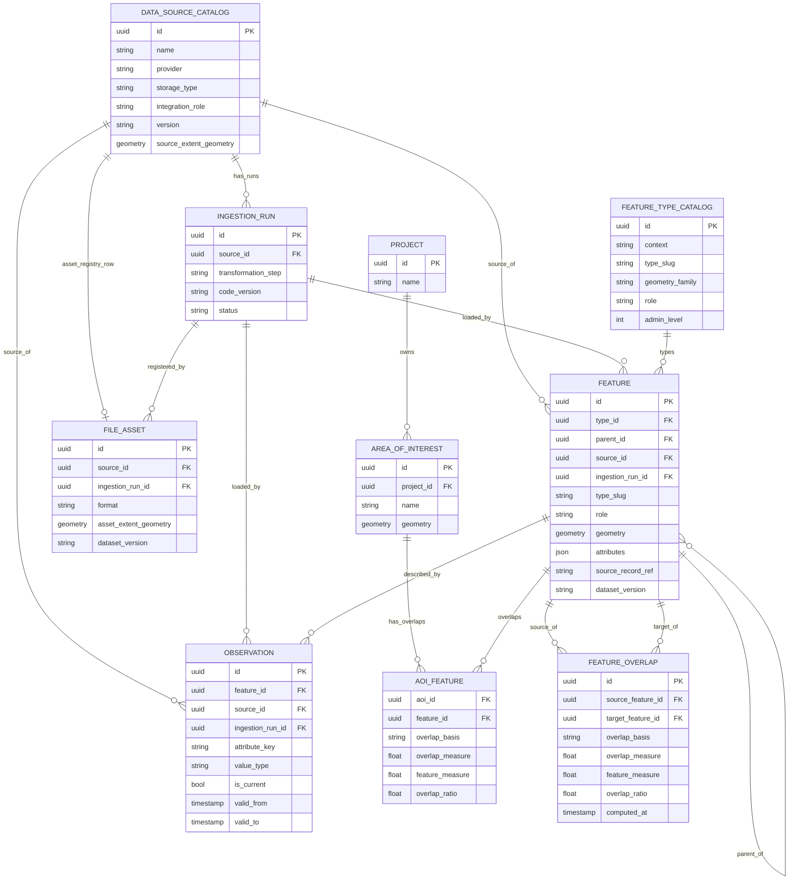
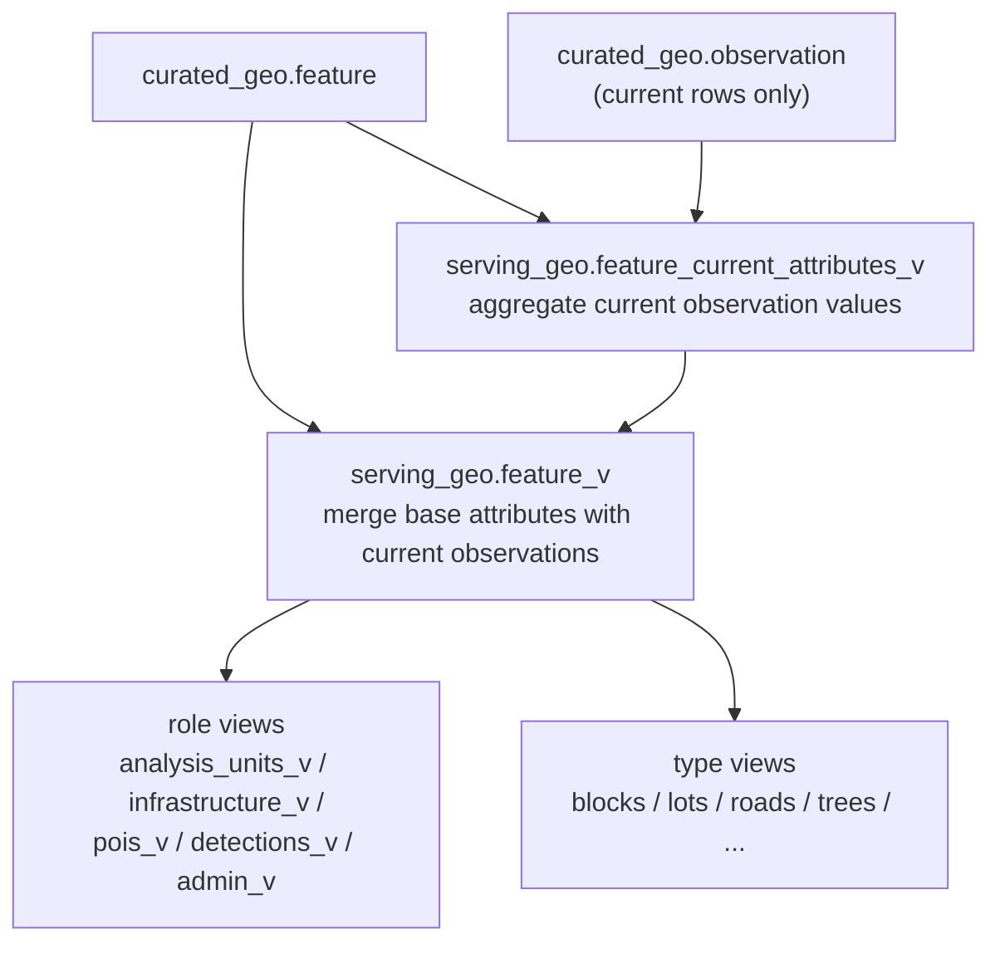

# Data Layer

How the platform ingests, stores, and serves all city data — regardless of origin, format, or size.

**Related documents:** `INDICATORS_LAYER.md` — what gets computed from this data. `SCENARIOS_LAYER.md` — how scenarios read and overlay this data.

---

## What this layer does

It maintains a clean, traceable, canonical representation of the city as it exists today. Everything else — indicators, scenarios — reads from here. Nothing in this layer is ever overwritten by a scenario.

This layer answers five recurring questions:

1. How do we classify a new dataset before loading it?
2. Which table should receive it?
3. How do we keep provenance across very different data types?
4. Which parts of baseline data can scenarios override, and which stay read-only?
5. How do we expose a stable read contract without duplicating the whole database?

---

## Pipeline

Every dataset follows the same three-zone path before the application can read it.

```
Bronze (object storage)  →  Silver (object storage)  →  curated_geo (PostgreSQL)
```

| Zone | Rule | Purpose |
|---|---|---|
| **Bronze** | Immutable after landing. Never modified, never deleted. | Exact copy of the source. Enables full re-processing without re-fetching. |
| **Silver** | Cleaned, CRS standardized to EPSG:4326, bad geometries fixed, validated against the registered schema. | Source-agnostic clean data ready to load. |
| **curated_geo** | Canonical tables with provenance on every row. | What the rest of the platform reads. |

The API never touches Bronze or Silver. It reads only `serving_geo`, which is a thin view layer over `curated_geo`.

---

## Two destinations, one question

Every dataset that enters this platform produces one of two kinds of canonical records:

- **`feature`** — a spatial object that exists in the city: a block, a parcel, a road segment, a detected tree. Has its own geometry, a stable identity, and is reused across indicators and scenarios.
- **`observation`** — a measured or derived value *about* an existing feature: the population count of a block, the NDVI mean of a lot, the width of a sidewalk. Comes from a separate dataset, arrives at a different time, and must retain its own provenance.

**The single question that routes every dataset:**

> Does this dataset define spatial objects, or does it describe them?
> - Defines new spatial objects with geometry → **`feature`**
> - Describes or measures existing objects → **`observation`**

This is the OGC Observations & Measurements (ISO 19156) pattern. An observation is always *about* a feature — it cannot exist without one.

### Where each storage type lands

Every dataset has a `storage_type`. This determines its loading path automatically.

| `storage_type` | Examples | Canonical destination |
|---|---|---|
| `vector` | INEGI blocks, lots, roads, bus stops | `curated_geo.feature` — new spatial objects with geometry |
| `tabular` | Census population, employment counts, school capacity | `curated_geo.observation` — measured values about existing features |
| `raster` | Sentinel-2 NDVI, elevation, land surface temperature | Object storage (file) + zonal stats → `curated_geo.observation` |
| `imagery` | Google Street View, aerial photos | Object storage (file) + ML detections → `curated_geo.feature` |
| `point_cloud` | LiDAR | Object storage (file) + derived metrics → `curated_geo.observation` |

### Why does raster land in `observation`, not `feature`?

A raster is a continuous surface — every pixel is a value, not an object. There is no meaningful "raster row" to persist in a city model. The standard practice is **zonal statistics**: for each existing feature (block, lot, grid cell), summarize the pixels that fall inside it — mean NDVI, median elevation, canopy fraction. Each summary value is an observation *about* that feature from that raster dataset.

The raster file itself stays in object storage permanently. Only the per-feature summary values enter PostgreSQL as `observation` rows, with full lineage back to the source file and the ingestion run.

Tool: [`exactextract`](https://github.com/isciences/exactextract) — computes exact partial-pixel overlap rather than approximating from centroid or bounding box.

### Why does imagery land in `feature`, not `observation`?

An ML model run over imagery identifies discrete spatial objects — individual trees, barriers, building fronts — each with a point or polygon geometry. These are candidates for stable city objects. If the detection confidence is high enough to persist, each detection becomes a `feature` row (with `confidence` and `model_version` set). Measurements about a detected object (height estimate, canopy area) go to `observation`.

---

## Repeatable onboarding playbook

Every new dataset follows the same decision path. The goal is that onboarding a new source is mostly classification and mapping work, not schema redesign.

### Step 1. Register the source

Create one `data_source_catalog` row before loading anything. At registration time, answer four questions:

| Question | Why it matters | Typical answers |
|---|---|---|
| What raw asset arrived? | Sets `storage_type` | `vector`, `tabular`, `raster`, `imagery`, `point_cloud` |
| What role does it play in the city model? | Sets `integration_role` | `canonical_entity`, `enrichment`, `model_output` |
| Does it define baseline reality, enrich it, seed scenario-editable context, or become scenario output? | Guides worker usage and examples | baseline-defining, baseline evidence, scenario-editable, output-only |
| What feature grain does it attach to? | Determines joins and keys | block, lot, road, sidewalk, tree, grid cell |

### Step 2. Decide the landing table

- If the dataset defines persistent spatial objects, load `feature`.
- If it measures or derives values about existing objects, load `observation`.
- If it is a large file asset, register metadata in `file_asset` and write derived values to `observation`.
- If it is a user-facing computed result imported from outside the normal worker pipeline, treat it as `indicator_result`.

### Step 3. Start lineage

Create an `ingestion_run` for each curated load step. Every canonical row must point back to the run that produced it.

### Step 4. Expose only what readers need

The API and model workers read `serving_geo`, not the canonical tables directly. Start with plain views. Only materialize proven hot paths.

### Step 5. Decide scenario participation

- Baseline-defining data lives only in the data layer.
- Baseline evidence stays read-only but can influence scenario recomputation.
- Scenario edits go to `intervention_feature.attribute_overrides`, never back into `feature` or `observation`.

This means a source can be essential to scenario evaluation without ever becoming scenario-owned data.

---

## Schema setup

```sql
CREATE SCHEMA IF NOT EXISTS app_core;
CREATE SCHEMA IF NOT EXISTS jobs_runtime;
CREATE SCHEMA IF NOT EXISTS curated_geo;
CREATE SCHEMA IF NOT EXISTS serving_geo;
```

---

## Visual schema

This section uses two diagrams on purpose, because one diagram is not enough to explain the data layer clearly without mixing storage concerns and read-model concerns.

**Diagram 1** answers: *what tables exist and how are they related?*  
**Diagram 2** answers: *how is the API/model read contract derived from those tables?*

### 1. Stored entities and lineage

This is the persisted schema view. It shows the main stored tables, the key foreign-key-style links, and the ownership/lineage structure. It intentionally focuses on persisted entities only.



Read Diagram 1 as:

- `data_source_catalog` and `ingestion_run` provide provenance.
- `feature` is the canonical city-object table.
- `observation` stores later measurements about `feature`.
- `file_asset` stores batch/manifest-level asset metadata, not per-feature values.
- `area_of_interest` and `aoi_feature` are project-scoped support tables for AOI filtering and overlap-based prorating.
- `feature_overlap` stores pre-computed spatial intersections between arbitrary feature type pairs (e.g. blocks vs. H3 grid cells, lots vs. road segments), generalising `aoi_feature` to feature-to-feature. Populated by a background overlap worker for declared type-pair combinations (`feature_overlap_type_pair`). Enables cross-grain indicator aggregation for both hierarchical and non-hierarchical spatial relationships.
- `aoi_indicator_summary` caches a single aggregated value per `(aoi_id, scenario_id, indicator_id)`. The schema and read contract (`serving_geo.aoi_summary_v`) land in Layer 1 so API code can target them; the worker that populates rows reads from `indicator_result`, which arrives with the Layer 2 indicators milestone.
- In the actual schema, `aoi_feature` uses the pair `(aoi_id, feature_id)` as its composite primary key.

The diagram does **not** try to encode every workflow rule. For example, raster and imagery assets may later produce `observation` rows or detected `feature` rows, but that is a pipeline behavior, not a direct foreign-key relationship.

### 2. Derived serving views

This is the read-model view. It shows how `serving_geo` is built from the canonical tables. These are derived views, not additional source-of-truth tables.



Read Diagram 2 as:

- `feature_current_attributes_v` aggregates the current `observation` rows per feature.
- `feature_v` combines immutable `feature.attributes` with those aggregated current values.
- role-based and type-based views are thin projections over `feature_v`.
- `serving_geo` is not a second storage layer: it is the read contract derived from canonical tables.

---

## Tables

### data_source_catalog

Every dataset must be registered here before any data is loaded. This is the registry that makes every canonical row traceable to its origin.

**Purpose:** one row per external dataset or feed, before any curated load occurs.  
**Use this when:** onboarding any new source, even if the canonical load has not been written yet.  
**Do not use this for:** per-run lineage, per-feature values, or model execution metadata.  
**Relationships:** parent of `ingestion_run`; referenced by `feature`, `observation`, and `file_asset`.  
**Examples:** INEGI blocks, Sentinel-2 NDVI, GSV detection batches, cellphone footfall by block.

Each row should represent one loadable dataset version or asset collection in v1, not an entire provider universe. For example, `Sentinel-2 NDVI 2024-Q1` is one source row; `GSV tree detections batch 2024-03` is another.

```sql
CREATE TABLE curated_geo.data_source_catalog (
  id                uuid        PRIMARY KEY DEFAULT gen_random_uuid(),
  name              text        NOT NULL,
  provider          text        NOT NULL,
  -- 'INEGI', 'IMIP', 'GSV', 'OSM', 'SEP', 'Sentinel-2', 'custom'

  storage_type      text        NOT NULL
                                CHECK (storage_type IN ('vector','tabular','raster','imagery','point_cloud')),
  -- Raw-format class. Answers "what kind of asset arrived?"

  integration_role  text        NOT NULL
                                CHECK (integration_role IN
                                  ('canonical_entity','enrichment','model_output')),
  -- Semantic routing class. Answers "how does this dataset participate in the city model?"

  storage_uri       text        NOT NULL,
  -- Bronze file location (object storage URI). Set for all types — even vector datasets
  -- that eventually land in PostGIS still have a Bronze file.

  schema_definition jsonb,
  -- JSON Schema of expected source fields. Used to validate Silver before loading.
  -- NULL means no structural validation is applied at ingest.

  version           text        NOT NULL,
  license           text,
  update_frequency  text
                                CHECK (update_frequency IS NULL OR update_frequency IN
                                  ('daily','weekly','monthly','quarterly','annual','on_demand')),
  source_extent_geometry geometry(Polygon, 4326),
  -- Optional footprint of the registered source dataset or asset collection.
  ingested_at       timestamptz,
  -- Timestamp of the last successful curated load. NULL = never loaded.
  notes             text,
  created_at        timestamptz NOT NULL DEFAULT now()
);
```

---

### ingestion_run

One row per curated-load execution. Every canonical row points back here, giving full lineage: which script, which version, which run produced this data.

**Purpose:** the lineage anchor for one curated load step.  
**Use this when:** writing any new batch of canonical rows into `feature`, `observation`, or `file_asset`.  
**Do not use this for:** queue execution or model results; that belongs to `job_run`.  
**Relationships:** child of `data_source_catalog`; referenced by `feature`, `observation`, and `file_asset`.  
**Examples:** `silver_to_curated` for vector blocks, `zonal_stats` for NDVI, `ml_detection` for GSV tree extraction.

```sql
CREATE TABLE curated_geo.ingestion_run (
  id                  uuid        PRIMARY KEY DEFAULT gen_random_uuid(),
  source_id           uuid        NOT NULL REFERENCES curated_geo.data_source_catalog(id),
  orchestrator        text        NOT NULL,          -- 'airflow', 'prefect', 'manual'
  orchestrator_run_id text        NOT NULL,          -- run ID from the orchestration system
  transformation_step text        NOT NULL,          -- 'silver_to_curated', 'zonal_stats', 'ml_detection'
  code_version        text        NOT NULL,          -- git SHA or package version
  status              text        NOT NULL
                                  CHECK (status IN ('running','succeeded','failed','cancelled')),
  started_at          timestamptz NOT NULL DEFAULT now(),
  completed_at        timestamptz,
  details             jsonb       NOT NULL DEFAULT '{}',
  -- optional counts or metadata: {"records_written": 14200, "records_rejected": 3}
  CHECK (completed_at IS NULL OR completed_at >= started_at),
  UNIQUE (source_id, orchestrator, orchestrator_run_id, transformation_step)
);

CREATE INDEX ingestion_run_source_idx ON curated_geo.ingestion_run (source_id);
CREATE INDEX ingestion_run_status_idx ON curated_geo.ingestion_run (status);
```

Detailed ETL logs, retry metadata, and error traces belong to the orchestration layer (Airflow, Prefect). This table stores only the lineage reference, not verbose runtime output.

---

### feature_type_catalog

Defines what spatial types exist. New types are rows here — no table or schema migration needed.

**Purpose:** registry of valid feature kinds, their geometry family, and their semantic role.  
**Use this when:** introducing a new canonical object type such as `building`, `crossing`, or `grid_cell`.  
**Do not use this for:** source-specific datasets or ad hoc attributes.  
**Relationships:** referenced by `feature.type_id`; drives `role`-based serving views.  
**Examples:** `block`, `lot`, `tree`, `road`, `bus_stop`, `grid_cell`.

```sql
CREATE TABLE curated_geo.feature_type_catalog (
  id              uuid      PRIMARY KEY DEFAULT gen_random_uuid(),
  context         text      NOT NULL,
  -- 'global'  → applies everywhere (tree, road, bus_stop)
  -- 'MEX'     → Mexico-specific administrative types
  -- A project UUID can also be used for project-specific types.

  type_slug       text      NOT NULL,
  -- Stable code-level identifier: 'block', 'municipality', 'tree', 'grid_cell'

  label           text      NOT NULL,
  -- Human-readable display name: 'Manzana', 'Municipio', 'Árbol'

  geometry_family text      NOT NULL
                            CHECK (geometry_family IN ('point','line','polygon','geometry')),
  -- 'geometry' allows any type (mixed datasets)

  role            text      NOT NULL
                            CHECK (role IN ('analysis_unit','context','infrastructure','poi','detection')),
  -- analysis_unit  → spatial units that receive indicator values (block, lot, ageb, grid_cell)
  -- context        → administrative framing, not directly analysed (municipality, state)
  -- infrastructure → physical urban fabric (road, sidewalk, bike lane)
  -- poi            → point of interest, establishment, amenity
  -- detection      → ML-derived object with a confidence score

  admin_level     smallint  CHECK (admin_level IS NULL OR admin_level > 0),
  -- Hierarchy depth: 1 = coarsest, N = finest. NULL for non-hierarchical types.

  description     text,
  UNIQUE (context, type_slug)
);
```

**Seed data — Mexico:**
```sql
INSERT INTO curated_geo.feature_type_catalog
  (context, type_slug, label, geometry_family, role, admin_level)
VALUES
  ('MEX', 'state',         'Estado',        'polygon', 'context',        1),
  ('MEX', 'municipality',  'Municipio',     'polygon', 'context',        2),
  ('MEX', 'neighborhood',  'Colonia',       'polygon', 'context',        3),
  ('MEX', 'ageb',          'AGEB',          'polygon', 'analysis_unit',  4),
  ('MEX', 'block',         'Manzana',       'polygon', 'analysis_unit',  5),
  ('MEX', 'lot',           'Predio',        'polygon', 'analysis_unit',  6),
  ('global', 'tree',          'Tree',          'point',   'detection',      NULL),
  ('global', 'bus_stop',      'Bus Stop',      'point',   'poi',            NULL),
  ('global', 'station',       'Station',       'point',   'poi',            NULL),
  ('global', 'establishment', 'Establishment', 'point',   'poi',            NULL),
  ('global', 'road',          'Road',          'line',    'infrastructure', NULL),
  ('global', 'sidewalk',      'Sidewalk',      'line',    'infrastructure', NULL),
  ('global', 'bike_lane',     'Bike Lane',     'line',    'infrastructure', NULL),
  ('global', 'crossing',      'Crossing',      'point',   'infrastructure', NULL);
```

**Use case with no administrative hierarchy (flat grid):**
```sql
INSERT INTO curated_geo.feature_type_catalog
  (context, type_slug, label, geometry_family, role, admin_level)
VALUES
  ('custom', 'grid_cell', 'Analysis Cell', 'polygon', 'analysis_unit', 1);
-- All grid cells will have parent_id = NULL.
```

---

### feature

One row = one canonical spatial object. All types live in one table. The type is a column, not a table name.

**Purpose:** store stable spatial objects that should exist in the city model with identity, geometry, and provenance.  
**Use this when:** a dataset defines reusable entities such as blocks, roads, lots, bus stops, or validated detections.  
**Do not use this for:** mutable enrichments like population, NDVI, footfall, or sidewalk measurements from a later dataset.  
**Relationships:** child of `feature_type_catalog`, `data_source_catalog`, and `ingestion_run`; parent of `observation`, `aoi_feature`, `intervention_feature`, and `indicator_result`.  
**Examples:** municipality polygons, block polygons, road centerlines, detected trees.

```sql
CREATE TABLE curated_geo.feature (
  id                uuid             PRIMARY KEY DEFAULT gen_random_uuid(),

  -- Type
  type_id           uuid             NOT NULL REFERENCES curated_geo.feature_type_catalog(id),
  type_slug         text             NOT NULL,
  -- Copied from feature_type_catalog at insert time. Immutable after insert.
  role              text             NOT NULL,
  -- Copied from feature_type_catalog at insert time. Immutable after insert.

  -- Hierarchy (self-referencing, any depth)
  parent_id         uuid             REFERENCES curated_geo.feature(id),
  -- NULL at the top of the hierarchy, or for non-hierarchical types.

  name              text,

  geometry          geometry(Geometry, 4326) NOT NULL,

  attributes        jsonb            NOT NULL DEFAULT '{}',
  -- Immutable base properties that belong to the object itself.
  -- block:   {"area_m2": 4200}
  -- tree:    {"species": "Ficus benjamina"}
  -- lot:     {"area_m2": 380}
  -- Mutable or derived values (census, NDVI, footfall) go to observation.

  -- Provenance
  source_id         uuid             NOT NULL REFERENCES curated_geo.data_source_catalog(id),
  source_record_ref text             NOT NULL,
  -- Original ID in the source dataset. Used for upserts and deduplication.
  ingestion_run_id  uuid             NOT NULL REFERENCES curated_geo.ingestion_run(id),
  dataset_version   text             NOT NULL,

  -- ML detection metadata (NULL for authoritative sources)
  confidence        double precision CHECK (confidence IS NULL OR confidence BETWEEN 0 AND 1),
  model_version     text,

  created_at        timestamptz      NOT NULL DEFAULT now(),
  updated_at        timestamptz      NOT NULL DEFAULT now(),

  UNIQUE (source_id, dataset_version, source_record_ref)
);

CREATE INDEX feature_geometry_gist  ON curated_geo.feature USING GIST (geometry);
CREATE INDEX feature_type_slug_idx  ON curated_geo.feature (type_slug);
CREATE INDEX feature_role_idx       ON curated_geo.feature (role);
CREATE INDEX feature_parent_idx     ON curated_geo.feature (parent_id);
CREATE INDEX feature_source_idx     ON curated_geo.feature (source_id);

-- Partial spatial indexes for the highest-frequency types
CREATE INDEX feature_block_geom_idx ON curated_geo.feature USING GIST (geometry) WHERE type_slug = 'block';
CREATE INDEX feature_lot_geom_idx   ON curated_geo.feature USING GIST (geometry) WHERE type_slug = 'lot';
```

**Trigger requirement — `curated_geo.feature_before_write`:**
Set `type_slug` and `role` from `type_id` on every insert. Reject mismatches between `source_id` and `ingestion_run.source_id`. Validate geometry family against the type catalog. Enforce hierarchy rules: no self-parenting, no cycles, parent `admin_level` must be lower than child.

---

### observation

One row = one measured or derived value about an existing feature, from a specific dataset, at a specific time. Implements the OGC Observations & Measurements (ISO 19156) pattern.

This is separate from `feature.attributes` because observations come from different datasets at different times and must remain traceable independently. `feature.attributes` is what the object *is*; `observation` is what we have *learned about it* from external data.

**Purpose:** store external measurements and derived values about canonical features, with independent provenance and history.  
**Use this when:** a dataset enriches existing objects instead of defining new ones.  
**Do not use this for:** the immutable identity of a feature, scenario overrides, or pairwise flow matrices that are not naturally "about one feature".  
**Relationships:** child of `feature`, `data_source_catalog`, and `ingestion_run`; merged into `serving_geo.feature_v`.  
**Examples:** census population for a block, NDVI mean for a lot, sidewalk width from GSV, cellphone footfall by AGEB and hour.

```sql
CREATE TABLE curated_geo.observation (
  id               uuid             PRIMARY KEY DEFAULT gen_random_uuid(),
  feature_id       uuid             NOT NULL REFERENCES curated_geo.feature(id) ON DELETE CASCADE,

  attribute_key    text             NOT NULL CHECK (attribute_key <> ''),
  -- e.g. 'population_total', 'ndvi_mean', 'tree_canopy_pct', 'sidewalk_width_m'

  value_type       text             NOT NULL
                                    CHECK (value_type IN ('numeric','text','json')),
  value_numeric    double precision,
  value_text       text,
  value_json       jsonb,
  -- Exactly one of these must be populated. Enforce in a database trigger.

  -- Provenance
  source_id        uuid             NOT NULL REFERENCES curated_geo.data_source_catalog(id),
  ingestion_run_id uuid             NOT NULL REFERENCES curated_geo.ingestion_run(id),
  lineage_ref      jsonb,
  -- Optional extra context: time window, aggregation method, ML model used, etc.

  -- Currency tracking
  is_current       boolean          NOT NULL DEFAULT true,
  valid_from       timestamptz      NOT NULL DEFAULT now(),
  valid_to         timestamptz,

  created_at       timestamptz      NOT NULL DEFAULT now(),
  updated_at       timestamptz      NOT NULL DEFAULT now(),

  CHECK ((is_current AND valid_to IS NULL) OR (NOT is_current AND valid_to IS NOT NULL)),
  CHECK (valid_to IS NULL OR valid_to >= valid_from)
);

-- Only one current value per (feature, attribute)
CREATE UNIQUE INDEX obs_one_current
  ON curated_geo.observation (feature_id, attribute_key)
  WHERE is_current;

CREATE INDEX obs_feature_key_idx ON curated_geo.observation (feature_id, attribute_key);
CREATE INDEX obs_source_run_idx  ON curated_geo.observation (source_id, ingestion_run_id);
```

**Trigger requirement — `curated_geo.observation_before_write`:**
Enforce exactly one populated value column and require it to match `value_type`. Reject mismatches between `source_id` and `ingestion_run.source_id`. Maintain `updated_at`. Require refresh semantics: a load must close the previous current row for `(feature_id, attribute_key)` before inserting the next current row. The partial unique index is the final safety net.

**Refresh rule:** before inserting a new current value for `(feature_id, attribute_key)`, mark the previous current row `is_current = false, valid_to = now(), updated_at = now()`. The unique partial index enforces one current value at a time.

---

### file_asset

Asset registry for files that permanently reside in object storage: rasters, imagery batches, and point-cloud collections. Derived values extracted from these files land in `observation` or `feature`.

**Purpose:** register external assets that remain in object storage while their derived values feed the relational model.  
**Use this when:** the source is a raster, imagery collection, or point-cloud asset too large or too scene-based to become canonical rows directly.  
**Do not use this for:** per-feature summaries or detections themselves. Those go to `observation` or `feature`.  
**Relationships:** child of `data_source_catalog` and `ingestion_run`; paired with downstream `observation` rows or `feature` detections.  
**Examples:** Sentinel-2 NDVI GeoTIFF, a GSV image batch manifest, a LAZ tile collection.

In v1, this table stores one row per registered source batch, version, or manifest. It does not attempt per-scene or per-tile lineage. If finer-grained lineage becomes necessary later, add a child `asset_item` table rather than overloading the current v1 contract.

```sql
CREATE TABLE curated_geo.file_asset (
  id               uuid             PRIMARY KEY DEFAULT gen_random_uuid(),
  source_id        uuid             NOT NULL REFERENCES curated_geo.data_source_catalog(id) UNIQUE,
  -- UNIQUE: one metadata record per registered source batch/version/manifest
  ingestion_run_id uuid             NOT NULL REFERENCES curated_geo.ingestion_run(id),
  storage_uri      text             NOT NULL,
  format           text             CHECK (format IN ('COG','GeoTIFF','NetCDF','LAZ','JPEG','PNG')),
  crs              text,
  resolution_m     double precision,
  band_description jsonb            NOT NULL DEFAULT '{}',
  -- {"B4": "red", "B8": "NIR", "NDVI": "derived"}
  -- {"returns": "lidar_returns", "height": "normalized_height"}
  asset_extent_geometry geometry(Polygon, 4326),
  captured_at      timestamptz,
  dataset_version  text             NOT NULL,
  created_at       timestamptz      NOT NULL DEFAULT now()
);
```


**Trigger requirement:** reject rows where the referenced `source_id` does not have `storage_type IN ('raster','imagery','point_cloud')`.

---

### area_of_interest

User-defined study scope for a project. Not a city feature — it is project-scoped and user-drawn. It defines where analysis runs, not what exists in the city.

**Purpose:** store project-scoped analysis boundaries.  
**Use this when:** a project needs a study boundary or user-selected subarea.  
**Do not use this for:** baseline city objects or administrative hierarchy.  
**Relationships:** child of `app_core.project`; parent of `aoi_feature`; used by jobs and result queries.  
**Examples:** downtown study boundary, regeneration district, corridor project polygon.

```sql
CREATE TABLE curated_geo.area_of_interest (
  id          uuid             PRIMARY KEY DEFAULT gen_random_uuid(),
  project_id  uuid             NOT NULL REFERENCES app_core.project(id) ON DELETE CASCADE,
  name        text             NOT NULL,
  description text,
  geometry    geometry(Geometry, 4326) NOT NULL
              CHECK (ST_GeometryType(geometry) IN ('ST_Polygon', 'ST_MultiPolygon')),
  created_at  timestamptz      NOT NULL DEFAULT now(),
  updated_at  timestamptz      NOT NULL DEFAULT now()
);

CREATE INDEX aoi_geometry_gist ON curated_geo.area_of_interest USING GIST (geometry);
```

---

### aoi_feature

Pre-computed spatial intersection between an AOI and canonical features. A background job populates and refreshes this table whenever an AOI geometry is created or modified.

**Purpose:** cache how much of each canonical feature overlaps a project AOI.  
**Use this when:** workers or API queries need stable AOI membership and proportional overlap.  
**Do not use this for:** defining features or storing indicators.  
**Relationships:** join table between `area_of_interest` and `feature`; commonly joined to `serving_geo.feature_v` and `serving_geo.current_indicator_v`.  
**Examples:** 80% of a block lies inside the AOI, 35% of a road length lies inside, a bus stop is present inside.

```sql
CREATE TABLE curated_geo.aoi_feature (
  aoi_id          uuid             NOT NULL REFERENCES curated_geo.area_of_interest(id) ON DELETE CASCADE,
  feature_id      uuid             NOT NULL REFERENCES curated_geo.feature(id)           ON DELETE CASCADE,

  overlap_basis   text             NOT NULL
                                   CHECK (overlap_basis IN ('area','length','presence')),
  -- area:     polygons — fraction of the feature's area inside the AOI
  -- length:   lines    — fraction of the feature's length inside the AOI
  -- presence: points   — always 1 if the point falls inside the AOI

  overlap_measure double precision NOT NULL CHECK (overlap_measure > 0),
  -- m² or meters of the feature that falls inside the AOI (1 for points)
  feature_measure double precision NOT NULL CHECK (feature_measure > 0),
  -- total m² or meters of the feature (1 for points)
  overlap_ratio   double precision NOT NULL CHECK (overlap_ratio > 0 AND overlap_ratio <= 1),

  PRIMARY KEY (aoi_id, feature_id),
  CHECK (overlap_measure <= feature_measure),
  CHECK (
    overlap_basis <> 'presence'
    OR (overlap_measure = 1 AND feature_measure = 1 AND overlap_ratio = 1)
  )
);

CREATE INDEX aoi_feature_feature_idx ON curated_geo.aoi_feature (feature_id);
```

**Trigger requirement — `curated_geo.aoi_feature_before_write`:**
Validate that `overlap_basis` matches the referenced feature geometry family: polygons use `area`, lines use `length`, points use `presence`. Reject inconsistent combinations before insert.

Compute area and length in metres using `ST_Area(geography)` or a projected CRS, never in degrees.

---

## Serving layer

The API reads only `serving_geo`. These are views over `curated_geo` — no data is duplicated.

**Purpose:** provide a stable read contract for the API and model workers without exposing every canonical table directly.  
**Use this when:** readers need baseline features with current observations already merged in.  
**Do not use this for:** canonical writes, lineage, or scenario storage.  
**Relationships:** reads from `feature`, `observation`, and `indicator_result`; feeds scenario workers and API endpoints.  
**Examples:** `feature_v` for baseline reads, `analysis_units_v` for worker inputs, `current_indicator_v` for comparisons.

```sql
-- Aggregates current observations into one JSON object per feature
CREATE VIEW serving_geo.feature_current_attributes_v AS
SELECT
  f.id AS feature_id,
  COALESCE(
    jsonb_object_agg(
      obs.attribute_key,
      COALESCE(to_jsonb(obs.value_numeric), to_jsonb(obs.value_text), obs.value_json)
    ) FILTER (WHERE obs.id IS NOT NULL),
    '{}'::jsonb
  ) AS current_attributes
FROM curated_geo.feature f
LEFT JOIN curated_geo.observation obs
  ON obs.feature_id = f.id AND obs.is_current
GROUP BY f.id;

-- Full feature view: base attributes merged with current observations
CREATE VIEW serving_geo.feature_v AS
SELECT
  f.id, f.type_id, f.type_slug, f.role, f.parent_id, f.name, f.geometry,
  f.attributes || fca.current_attributes AS attributes,
  f.source_id, f.source_record_ref, f.dataset_version,
  f.confidence, f.model_version, f.created_at, f.updated_at
FROM curated_geo.feature f
JOIN serving_geo.feature_current_attributes_v fca ON fca.feature_id = f.id;
```

### Role-based views

Role-based views are the primary shortcut for model workers and API queries that need all features of a given semantic category — regardless of how many specific types exist under that role.

```sql
-- All spatial units that receive indicator values: block, lot, ageb, grid_cell, ...
CREATE VIEW serving_geo.analysis_units_v AS
  SELECT * FROM serving_geo.feature_v WHERE role = 'analysis_unit';

-- All physical urban fabric: road, sidewalk, bike_lane, crossing, ...
CREATE VIEW serving_geo.infrastructure_v AS
  SELECT * FROM serving_geo.feature_v WHERE role = 'infrastructure';

-- All points of interest: bus_stop, station, establishment, ...
CREATE VIEW serving_geo.pois_v AS
  SELECT * FROM serving_geo.feature_v WHERE role = 'poi';

-- All ML-derived detections: tree, barrier, building_front, ...
CREATE VIEW serving_geo.detections_v AS
  SELECT * FROM serving_geo.feature_v WHERE role = 'detection';

-- Administrative context: state, municipality, neighborhood, ...
CREATE VIEW serving_geo.admin_v AS
  SELECT * FROM serving_geo.feature_v WHERE role = 'context';
```

These views are **zero-maintenance**: when a new type is added to `feature_type_catalog` with `role = 'infrastructure'`, it automatically appears in `infrastructure_v`. No view migration required.

This is the pattern used by Overture Maps (theme-level views) and OGC API Features (feature collections grouped by type). The `role` column is the discriminator.

**When to use role-based views vs per-type views:**

| Use case | Recommended view |
|---|---|
| Accessibility model reading all street-level infrastructure | `infrastructure_v` |
| API endpoint returning all transit stops | `pois_v WHERE type_slug = 'bus_stop'` |
| Indicator computation for all analysis units in an AOI | `analysis_units_v` |
| Admin boundary lookup (municipality name for a point) | `admin_v` |
| Debug: how many trees are detected on a block | `detections_v WHERE type_slug = 'tree'` |
| Render a specific layer on a map | per-type view (`blocks`, `roads`) |

### Per-type precision views

For the highest-frequency types, per-type views avoid the `WHERE type_slug = ...` clause in every query and allow targeted materialization later.

```sql
CREATE VIEW serving_geo.blocks         AS SELECT * FROM serving_geo.feature_v WHERE type_slug = 'block';
CREATE VIEW serving_geo.lots           AS SELECT * FROM serving_geo.feature_v WHERE type_slug = 'lot';
CREATE VIEW serving_geo.municipalities AS SELECT * FROM serving_geo.feature_v WHERE type_slug = 'municipality';
CREATE VIEW serving_geo.trees          AS SELECT * FROM serving_geo.feature_v WHERE type_slug = 'tree';
CREATE VIEW serving_geo.roads          AS SELECT * FROM serving_geo.feature_v WHERE type_slug = 'road';
CREATE VIEW serving_geo.sidewalks      AS SELECT * FROM serving_geo.feature_v WHERE type_slug = 'sidewalk';
CREATE VIEW serving_geo.bike_lanes     AS SELECT * FROM serving_geo.feature_v WHERE type_slug = 'bike_lane';
CREATE VIEW serving_geo.bus_stops      AS SELECT * FROM serving_geo.feature_v WHERE type_slug = 'bus_stop';
```

Only create per-type views for types that are queried independently in the API or by model workers. Do not create one for every type in `feature_type_catalog`.

Start with plain views. Promote to materialized views only when measured query times on production data justify the added refresh complexity.

---

## How this layer feeds scenarios and jobs

The data layer owns the baseline city. Other layers consume it but do not rewrite it.

```
Bronze / Silver
      │
      ▼
data_source_catalog ──► ingestion_run
      │                    │
      ├──────────────► feature ◄────────────── feature_type_catalog
      │                    │
      │                    └──────────────► observation
      │
      └──────────────► file_asset

feature + current observation values
      │
      ▼
serving_geo.feature_v
      │
      ├── read by scenario workers as baseline input
      └── read by API as stable feature contract
```

The key boundary is simple:

- Canonical writes go to `curated_geo`.
- Scenario overlays live in `app_core.intervention_feature`.
- Jobs read baseline from `serving_geo`, apply overrides in memory, and write `indicator_result`.
- No scenario writes back into `feature` or `observation`.

---

## Use cases

### Adding a new feature type

This is the entire change needed — one INSERT, no migration:

```sql
INSERT INTO curated_geo.feature_type_catalog
  (context, type_slug, label, geometry_family, role)
VALUES
  ('global', 'building', 'Building Footprint', 'polygon', 'analysis_unit');
```

---

### Loading a vector dataset (INEGI block polygons)

**1. Register the dataset:**
```sql
INSERT INTO curated_geo.data_source_catalog
  (name, provider, storage_type, integration_role, storage_uri, version, license, update_frequency)
VALUES
  ('INEGI Block Polygons 2020', 'INEGI', 'vector', 'canonical_entity',
   's3://bronze/inegi/blocks_2020.geojson', '2020', 'public', 'annual')
RETURNING id; -- :source_id
```

**2. Land** — copy the raw file to the Bronze URI. Do not modify it.

**3. Clean (Silver)** — standardize CRS, fix invalid geometries, validate against `schema_definition`.

**4. Start ingestion run:**
```sql
INSERT INTO curated_geo.ingestion_run
  (source_id, orchestrator, orchestrator_run_id, transformation_step, code_version, status)
VALUES
  (:source_id, 'airflow', 'run_20260319_001', 'silver_to_curated', 'v1.2.3', 'running')
RETURNING id; -- :run_id
```

**5. Load features (upsert):**
```sql
INSERT INTO curated_geo.feature
  (type_id, type_slug, role, parent_id, name, geometry,
   attributes, source_id, source_record_ref, ingestion_run_id, dataset_version)
SELECT
  :block_type_id, 'block', 'analysis_unit',
  :parent_municipality_id,
  s.nombre,
  ST_GeomFromGeoJSON(s.geometry),
  jsonb_build_object('area_m2', ST_Area(ST_Transform(ST_GeomFromGeoJSON(s.geometry), 32614))),
  :source_id, s.cvegeo, :run_id, '2020'
FROM silver.inegi_blocks s
ON CONFLICT (source_id, dataset_version, source_record_ref) DO UPDATE
  SET geometry         = EXCLUDED.geometry,
      attributes       = EXCLUDED.attributes,
      ingestion_run_id = EXCLUDED.ingestion_run_id,
      updated_at       = now();
```

**6. Finalize:**
```sql
UPDATE curated_geo.ingestion_run
  SET status = 'succeeded', completed_at = now() WHERE id = :run_id;
UPDATE curated_geo.data_source_catalog
  SET ingested_at = now() WHERE id = :source_id;
```

**How scenarios use it:** this is baseline-defining data. Scenarios never rewrite these block rows, but workers read them from `serving_geo.feature_v` as the geometry and identity backbone for recomputation.

---

### Loading a tabular dataset (INEGI census population by block)

**1. Register:**
```sql
INSERT INTO curated_geo.data_source_catalog
  (name, provider, storage_type, integration_role, storage_uri, version, update_frequency)
VALUES
  ('INEGI Census 2020 — Population by Block', 'INEGI', 'tabular', 'enrichment',
   's3://bronze/inegi/census_block_2020.csv', '2020', 'annual')
RETURNING id;
```

**2–4.** Land, clean, start ingestion run (same pattern as vector).

**5. Write observations — close old values, insert new:**
```sql
-- Close prior current values for these features and keys
UPDATE curated_geo.observation
SET is_current = false, valid_to = now()
WHERE feature_id = ANY(:block_ids)
  AND attribute_key IN ('population_total', 'household_count')
  AND is_current;

-- Insert new current values
INSERT INTO curated_geo.observation
  (feature_id, attribute_key, value_type, value_numeric,
   source_id, ingestion_run_id, is_current, valid_from)
SELECT
  f.id, 'population_total', 'numeric', c.pobtot,
  :source_id, :run_id, true, now()
FROM silver.census_block c
JOIN curated_geo.feature f
  ON f.source_record_ref = c.cvegeo AND f.type_slug = 'block';
```

**How scenarios use it:** these are baseline evidence rows. A scenario does not edit census observations directly, but housing, accessibility, and composite indicators can still depend on them when the same blocks are recomputed.

---

### Loading a raster dataset (Sentinel-2 NDVI)

**1. Register:**
```sql
INSERT INTO curated_geo.data_source_catalog
  (name, provider, storage_type, integration_role, storage_uri, version)
VALUES
  ('Sentinel-2 NDVI 2024-Q1', 'ESA', 'raster', 'enrichment',
   's3://bronze/sentinel2/ndvi_2024_q1.tif', '2024-Q1')
RETURNING id;
```

**2.** Land the COG file. Start ingestion run.

**3. Register raster metadata:**
```sql
INSERT INTO curated_geo.file_asset
  (source_id, ingestion_run_id, storage_uri, format, crs, resolution_m,
   band_description, asset_extent_geometry, dataset_version)
VALUES
  (:source_id, :run_id,
   's3://bronze/sentinel2/ndvi_2024_q1.tif', 'COG', 'EPSG:32614', 10,
   '{"NDVI": "normalized difference vegetation index"}',
   ST_SetSRID(ST_MakeEnvelope(:xmin, :ymin, :xmax, :ymax), 4326),
   '2024-Q1');
```

**4. Run zonal statistics** using `exactextract` — computes exact per-polygon statistics accounting for partial pixel overlap. Better than `rasterstats` at block and lot scale.

**5. Write per-feature summary values as observations:**
```sql
INSERT INTO curated_geo.observation
  (feature_id, attribute_key, value_type, value_numeric,
   source_id, ingestion_run_id, is_current, valid_from)
VALUES
  (:block_id, 'ndvi_mean',        'numeric', 0.42, :source_id, :run_id, true, now()),
  (:block_id, 'ndvi_p25',         'numeric', 0.31, :source_id, :run_id, true, now()),
  (:block_id, 'tree_canopy_pct',  'numeric', 0.18, :source_id, :run_id, true, now());
```

The raster file itself never enters PostgreSQL.

**How scenarios use it:** the raster stays read-only baseline evidence. Scenario jobs can consume the derived NDVI or canopy observations when evaluating green-area or heat-related indicators, but the scenario itself never modifies the raster asset.

---

### Loading imagery / ML detections (GSV street trees)

Detections that are reliable enough to persist as canonical city objects become `feature` rows.

**1. Register:**
```sql
INSERT INTO curated_geo.data_source_catalog
  (name, provider, storage_type, integration_role, storage_uri, version)
VALUES
  ('GSV Street Tree Detections — Batch 2024-03', 'GSV+ML', 'imagery', 'canonical_entity',
   's3://bronze/gsv/tree_batch_2024_03/', '2024-03')
RETURNING id;
```

**2.** Start ingestion run after running the ML model.

**3. Register the imagery asset metadata:**
```sql
INSERT INTO curated_geo.file_asset
  (source_id, ingestion_run_id, storage_uri, format, dataset_version, band_description, asset_extent_geometry)
VALUES
  (:source_id, :run_id,
   's3://bronze/gsv/tree_batch_2024_03/', 'JPEG', '2024-03',
   '{"scene_type": "street_view", "detector": "tree-detector-v2.1"}',
   ST_SetSRID(ST_MakeEnvelope(:xmin, :ymin, :xmax, :ymax), 4326));
```

**4. Insert validated detections as features:**
```sql
INSERT INTO curated_geo.feature
  (type_id, type_slug, role, parent_id, geometry, attributes,
   source_id, source_record_ref, ingestion_run_id, dataset_version,
   confidence, model_version)
VALUES
  (:tree_type_id, 'tree', 'detection',
   :block_id,
   ST_SetSRID(ST_MakePoint(:lon, :lat), 4326),
   '{}',
   :source_id, :detection_uuid, :run_id, '2024-03',
   0.87, 'tree-detector-v2.1');
```

**5. Add measurements about detections or existing street features as observations:**
```sql
INSERT INTO curated_geo.observation
  (feature_id, attribute_key, value_type, value_numeric,
   source_id, ingestion_run_id, is_current, valid_from, lineage_ref)
VALUES
  (:tree_feature_id, 'canopy_diameter_m', 'numeric', 4.2,
   :source_id, :run_id, true, now(), '{"scene_id": "gsv-123", "frame": 18}'::jsonb),
  (:sidewalk_feature_id, 'sidewalk_width_m', 'numeric', 2.1,
   :source_id, :run_id, true, now(), '{"scene_id": "gsv-123", "frame": 18}'::jsonb);
```

Measurements about a detected feature (height estimate, canopy area) or about an existing object (sidewalk width, barrier presence) go to `observation`, not `feature.attributes`.

**How scenarios use it:** the validated tree detections can participate in baseline canopy or streetscape indicators as persistent features. The sidewalk-width observations remain read-only evidence unless a scenario chooses to override width through `intervention_feature.attribute_overrides`.

---

### Loading cellphone aggregate data (footfall by block / zone / time window)

This is a good fit for `observation` when the dataset is already aggregated to one feature grain per time window.

**1. Register:**
```sql
INSERT INTO curated_geo.data_source_catalog
  (name, provider, storage_type, integration_role, storage_uri, version, update_frequency)
VALUES
  ('Cellphone Footfall by Block — Weekdays 2024-03', 'MobilityVendor', 'tabular', 'enrichment',
   's3://bronze/mobility/footfall_block_2024_03.parquet', '2024-03', 'monthly')
RETURNING id;
```

**2. Load as observations on the target feature grain:**
```sql
INSERT INTO curated_geo.observation
  (feature_id, attribute_key, value_type, value_numeric,
   source_id, ingestion_run_id, is_current, valid_from, lineage_ref)
SELECT
  f.id,
  'footfall_weekday_08_10',
  'numeric',
  m.device_count,
  :source_id,
  :run_id,
  true,
  now(),
  jsonb_build_object('time_window', '08:00-10:00', 'aggregation', 'average_weekday')
FROM silver.mobility_block_footfall m
JOIN curated_geo.feature f
  ON f.type_slug = 'block'
 AND f.source_record_ref = m.block_id;
```

**How scenarios use it:** these rows are baseline evidence. They help models understand current demand or activity patterns, but scenarios do not write back into them.

---

### Cellphone OD flow matrices

Origin-destination matrices, pairwise trip tables, and network flow tables are not a clean fit for the current per-feature `observation` model because they are fundamentally about pairs of places or edges in a graph, not one canonical feature at a time.

For v1:

- keep the raw asset in object storage,
- register the dataset in `data_source_catalog`,
- document it as a future mobility-flow extension,
- do not force it into `observation` just to fit the current schema.

This preserves clarity in the current framework and leaves room for a dedicated flow table or graph-oriented extension later.

---

### Querying features inside an AOI

```sql
SELECT
  f.id,
  f.name,
  f.type_slug,
  f.geometry,
  af.overlap_ratio,
  f.attributes
FROM curated_geo.aoi_feature af
JOIN serving_geo.feature_v f ON f.id = af.feature_id
WHERE af.aoi_id    = :aoi_id
  AND f.type_slug  = 'block'
  AND af.overlap_basis = 'area'
ORDER BY af.overlap_ratio DESC;
```

---

### Hierarchy traversal

Works for any geography and any depth without schema changes.

```sql
-- All blocks within a municipality
WITH RECURSIVE descendants AS (
  SELECT * FROM curated_geo.feature WHERE id = :municipality_id
  UNION ALL
  SELECT f.* FROM curated_geo.feature f
  JOIN descendants d ON f.parent_id = d.id
)
SELECT * FROM descendants WHERE type_slug = 'block';
```

---

## Build order

1. Schemas (`app_core`, `jobs_runtime`, `curated_geo`, `serving_geo`)
2. `app_core.project` — defined in `SCENARIOS_LAYER.md`
3. `curated_geo.data_source_catalog`
4. `curated_geo.ingestion_run`
5. `curated_geo.feature_type_catalog` — seed with known types
6. `curated_geo.feature` — add trigger for type_slug/role sync and hierarchy validation
7. `curated_geo.observation`
8. `curated_geo.file_asset`
9. `curated_geo.area_of_interest`
10. `curated_geo.aoi_feature`
11. `serving_geo.feature_current_attributes_v`, `serving_geo.feature_v`
12. Role-based views (`analysis_units_v`, `infrastructure_v`, `pois_v`, `detections_v`, `admin_v`)
13. Per-type views (`blocks`, `lots`, `roads`, `trees`, `sidewalks`, `bike_lanes`, `bus_stops`, …)

---

## Standards referenced

| Decision | Standard |
|---|---|
| Single typed feature table | OGC Simple Features; Overture Maps theme model |
| `observation` table name and pattern | OGC Observations & Measurements (ISO 19156) |
| Adjacency list hierarchy with recursive CTE | Standard SQL / PostgreSQL |
| Medallion pipeline (Bronze / Silver / curated) | Databricks Medallion Architecture |
| Dataset registry before ingest | Apache Atlas lineage registry pattern |
| Separate observation table with currency flag | SCD Type 2 / fact-table pattern |
| Zonal statistics tool (`exactextract`) | Exact partial-pixel overlap (vs. approximation in `rasterstats`) |
| Raster metadata structure | STAC-inspired asset metadata |
| Quality language | ISO 19157 |
