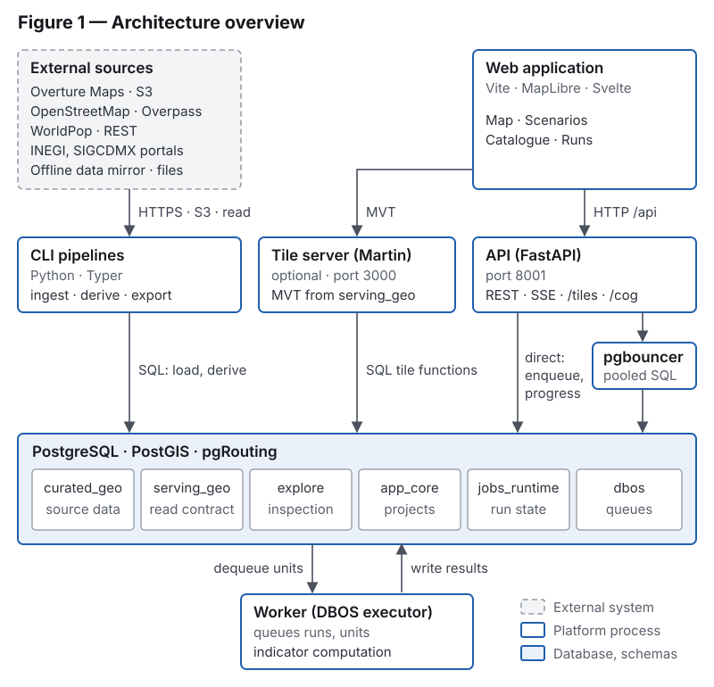

## Document control

| | |
|---|---|
| **Deliverable** | Schedule A, Work 1 — Software and systems architecture map |
| **Version** | 1.0 |
| **Date** | 20 November 2026 |
| **Status** | Issued |
| **System state** | Database migration `r051` |
| **Delivery identification** | Date, release tag, commit and SHA-256 of every delivered file are recorded in `docs/delivery/MANIFEST.md`, as Article 2.2 of the agreement requires |
| **Audience** | Technical reviewers, maintainers and operators of the platform |

| Version | Date | Author | Summary |
|---|---|---|---|
| 1.0 | 2026-11-20 | Rossano Schifanella | Issued |

---

## 1. Purpose and scope

Reimagina is an urban-planning data platform. It ingests geospatial data about a territory into one canonical model, computes urban indicators and serves them to a web map. It evaluates **scenarios**: hypothetical attribute edits whose effect on the indicators is compared against the baseline. The delivered configuration covers two pilot territories, Tlalpan (Mexico City) and Mexicali.

| # | Quality goal, in priority order | Meaning |
|---|---|---|
| Q1 | Correctness of derived numbers | An indicator is reproducible from its inputs and does not drift silently |
| Q2 | Integrity of the baseline | No scenario alters the territory as recorded |
| Q3 | Inspectability | An engineer can see what the system holds, and why, without reading application code |
| Q4 | Efficient recomputation | An edit recomputes what it affects, not everything |
| Q5 | Operability | A run is observable, cancellable and resumable |

## 2. Constraints

| # | Constraint | Consequence |
|---|---|---|
| C1 | Part of the source data exists only in a private data lake, copied manually to local disk | The code holds no credential and never calls the lake; pipelines read the offline data mirror under `data/sources/azure/`. Without the mirror the platform loads a territory from the public sources or from `scripts/synthetic_territory.py`, without INEGI's 2024 block and AGEB geometry, the 2020 census attributes and the two amenity layers |
| C2 | Spatial work runs in PostGIS | Areas, lengths, distances and network walks are SQL |
| C3 | Network distance requires pgRouting | pgRouting is not a trusted extension; installation needs a superuser |
| C4 | One CRS for vector data | Every geometry column is SRID 4326, enforced by the column type. Rasters keep their native CRS; zonal statistics reproject feature geometries to the raster |
| C5 | Delivery as source, run by the recipient | Installation is reproducible from the repository |
| C6 | No third-party service at serving time | Ingestion calls public services; the map, the API and the runs call none. There is no hosted basemap |

## 3. Context and external integrations

External systems are reached only at ingestion, by the CLI, and are read-only. The licence of each loaded source is recorded in `curated_geo.data_source_catalog` and credited on the map; full terms are in `docs/THIRD_PARTY_LICENSES.md`.

| System | Direction | Protocol | Data | Used by |
|---|---|---|---|---|
| Overture Maps | In | Anonymous S3 (`s3://overturemaps-us-west-2/release`), GeoParquet | Buildings, places, administrative divisions | `pipeline/overture.py`, `overture_places.py`, `overture_divisions.py` |
| OpenStreetMap | In | Overpass API over HTTPS, through `osmnx` | Walking network into `road_node` / `road_edge` | `pipeline/osm_network.py` |
| WorldPop | In | REST API over HTTPS | Gridded population rasters | `pipeline/worldpop.py` |
| INEGI portal | In | HTTPS archive download (`inegi.org.mx`) | CDMX marco geoestadístico: municipalities, AGEBs, blocks | `pipeline/inegi.py` |
| SIGCDMX portal | In | ArcGIS REST over HTTPS | Colonias | `pipeline/cdmx.py` |
| Offline data mirror | In | Local files; no call at run time | INEGI marco 2024, census 2020, Tlalpan (SIGCDMX) and Mexicali amenities | `pipeline/inegi_marco.py`, `inegi_censo.py`, `points.py` |
| Browsers and GIS clients | Out | HTTP: JSON, SSE, MVT, raster tiles, PMTiles | Pages, features, indicators, runs, downloads | API, Martin, nginx |

`make verify-sources` checks the offline data mirror, Overture and WorldPop before an ingestion. The PMTiles export runs GDAL's `ogr2ogr` locally. All serving interfaces are plain HTTP; TLS and authentication belong to a reverse proxy in front of a networked deployment (T1).

Build-time integrations, outside the runtime: GitHub Actions (CI); PyPI through `uv.lock`; the npm registry through `package-lock.json`; Docker Hub (`pgrouting/pgrouting`, `edoburu/pgbouncer`, `nginx`) and `ghcr.io` (Martin).

## 4. Architecture overview

The CLI ingests external data into PostgreSQL. The database holds the source of truth (`curated_geo`), the read contract (`serving_geo`), run state (`jobs_runtime`, `dbos`) and projects and scenarios (`app_core`). The API serves the web application from `serving_geo` and enqueues runs on DBOS queues; the worker executes the queued indicator units and writes results to `curated_geo`. Vector tiles come from `serving_geo` tile functions, through the API or Martin. The API's pool passes through pgbouncer; the worker, Martin, migrations and the API's orchestration client connect directly.

## 5. Components

| Component | Technology | Responsibility | Interfaces | Location |
|---|---|---|---|---|
| API | Python 3.12, FastAPI, uvicorn, titiler | Serves features, indicators, AOIs, tiles, scenarios and runs; submits and observes runs | REST/JSON, SSE, MVT, COG tiles under `/cog`; SQL via pgbouncer; DBOS client | `apps/api/` |
| Web application | Vite 8 multi-page build; TypeScript and MapLibre GL 6 (map); Svelte 5, Tailwind 4, bits-ui, terra-draw (other pages) | Four pages: map, scenarios, catalogue, runs | HTTP to the API via the `/api` proxy | `apps/web/` |
| Worker | Python, DBOS | Executes queued indicator units | SQL, direct connection | `apps/worker/` |
| Orchestration module | Python, DBOS | Impact analysis, planning, run identity, queueing, recovery, progress (§8) | `Orchestrator` port | `packages/py/reimagina/orchestration/`, `packages/py/reimagina/jobs/_lifecycle.py` |
| CLI and pipelines | Python, Typer | Ingestion, derivation jobs, run submission, inspection, PMTiles export | SQL; external sources (§3) | `apps/cli/`, `packages/py/reimagina/pipeline/`, `packages/py/reimagina/jobs/` |
| Indicator computation | PostGIS and pgRouting SQL; Hamilton; Pandera | Twelve indicators: spatial measures in SQL, arithmetic in pure Python kernels, each result frame schema-checked before writing | Worker runner registry | `packages/py/reimagina/indicators/`, `assets/`, `data/` |
| Scenario evaluation | Python, SQL | Rules, materialisation into overrides, comparison against the baseline | API `/scenarios`, CLI `scenario` | `packages/py/reimagina/scenarios/`, `apps/api/routers/scenarios.py`, `apps/web/src/scenarios/` |
| Database | PostgreSQL, PostGIS, pgRouting | Canonical model, read contract, run state | SQL; six schemas (§7) | `infra/db/migrations/` |
| Tile serving | `serving_geo` tile functions, served by Martin or the API | Live MVT for features, indicator values and aggregations | `/tiles/{function}/{z}/{x}/{y}`; Martin function sources | `apps/api/routers/mvt.py`, `infra/docker/martin.yaml` |
| PMTiles server | nginx | Serves PMTiles snapshots of stable layers to GIS clients; the web pages do not use them | HTTP | `infra/docker/docker-compose.yml` |
| Pooler | pgbouncer 1.26.1, transaction mode | Pools the API's ordinary connections | PostgreSQL protocol | `infra/docker/docker-compose.yml` |

Supporting packages: `reimagina.storage` holds every SQL statement the application issues, behind typed interfaces; `reimagina.db` provides connections and `bootstrap-db`; `reimagina.tiles` holds tile-function names, the layer manifest and the PMTiles export; `reimagina.perf` holds the benchmark harness.

**API.** The OpenAPI document lists 63 operations on 56 paths: 44 are the platform's own, in the groups health, indicators (catalogue, lineage, values, statistics, CSV/GeoJSON/Parquet downloads), places (AOIs, features, statistics inside a drawn polygon), tiles, runs (`/jobs`) and scenarios; 19 are titiler's raster endpoints under `/cog`. Work 3 lists every operation. Ordinary reads and writes use one process-wide `ThreadedConnectionPool` of at most 16 connections (`REIMAGINA_API_POOL_MAX`) through pgbouncer; a request finding all busy waits up to 30 s (`REIMAGINA_API_POOL_WAIT_S`), then receives `503` with `Retry-After`. A direct connection, through the DBOS client, enqueues runs, writes their plan and streams progress to `GET /jobs/{run_id}/events`.

**Web application.** A shared top bar links four pages.

| Page | File | Function |
|---|---|---|
| Map | `index.html` | Layer explorer with legend (colour ramp, share of blocks at the cap), block inspector (values and rank in the area), and indicator summary inside a drawn selection (`/metrics/indicator-within-polygon`); data credits from `/tile-sources/attribution` |
| Scenarios | `scenarios.html` | Create a scenario, draw an area, set attribute values as rules, recompute, compare against the baseline per indicator |
| Catalogue | `catalog.html` | Indicators and datasets with facets, lineage graph per indicator, impact check of what an attribute edit recomputes |
| Runs | `ops.html` | Worker liveness from executor heartbeats, work in flight, run launch, run list, per-unit execution timeline drawn from observed progress |

**Worker.** The worker executes indicator units only; its runner registry binds the twelve shipped indicators to their compute functions. Ingestion pipelines and derivation jobs (`reimagina.jobs`: overlaps, AOI summaries, observation rollups, raster zonal statistics, derivations) run in the CLI process. The worker uses `reimagina.jobs._lifecycle` to record one `job_run` per unit.

**Tile serving.** The contract is a SQL function signature, `(z, x, y, query_params json)` returning `bytea` (Martin's function-source convention). `serving_geo` holds three tile functions: `get_tile` (features), `indicator_overlay_tile` (baseline or scenario values) and `aggregation_overlay_tile` (values at a coarser grain). Martin publishes every function in `serving_geo`; the API serves the same contract at `/tiles/{function}/{z}/{x}/{y}` for those three names only. `REIMAGINA_TILE_LIVE_BASE_URL` selects the source: the code default is Martin (`http://localhost:3000/get_tile`), the recommended production path; `make dev` sets `/api/tiles`. The routing graph is published as `global:road` features through the same path and replaces a basemap (C6).

## 6. Data flow

### 6.1 End to end

| Step | From → to | Mechanism | Data |
|---|---|---|---|
| 1 | External sources → CLI pipelines | HTTPS, anonymous S3 | Source files and API responses |
| 2 | Offline data mirror → CLI pipelines | Local file read | INEGI marco 2024, census 2020, amenity layers |
| 3 | CLI pipelines → `data/bronze/`, `data/silver/` | File write | Bronze: source as received. Silver: valid vector geometry in SRID 4326, COG rasters in native CRS, consistent column names |
| 4 | CLI pipelines → `curated_geo` | SQL | Features, observations, road graph, raster registrations, each under a source and dataset version |
| 5 | CLI derivation jobs → `curated_geo` | SQL | AOIs and feature overlaps, zonal statistics, observation rollups, derivations, AOI summaries |
| 6 | Web application or CLI → orchestration module | `POST /jobs`, `POST /scenarios/{id}/recompute`; CLI `indicators`, `scenario recompute` | Run request |
| 7 | Orchestration module → `jobs_runtime`, `dbos` | Direct connection; DBOS queues `runs`, `units` | Run envelope, plan, dependency-ordered units |
| 8 | Worker → `curated_geo.indicator_result` | Dequeue; SQL and Python kernels | Baseline and scenario rows side by side |
| 9 | Worker → API → web application | DBOS durable stream; SSE | Run and unit progress |
| 10 | `serving_geo` → API, Martin | SQL views and tile functions | Features, attributes, indicator values, MVT |
| 11 | API → web application | HTTP | JSON, downloads, MVT, raster tiles from silver COGs |
| 12 | CLI `tiles export` → nginx → GIS clients | `ogr2ogr`; HTTP | PMTiles snapshot of a stable layer |

Pipelines that fetch from upstream land bronze (`cdmx`, `overture`, `overture_places`, `raster`). Pipelines reading the offline data mirror, already an immutable copy, write silver (`inegi_marco`, `points`) or curated observations (`inegi_censo`) directly. `osm_network` and `overture_divisions` load directly from their fetch.

### 6.2 Scenario recomputation

| Step | Action | Effect |
|---|---|---|
| 1 | Author a rule (area, feature type, attribute, value) through the API, CLI or scenario workspace | Stored in `curated_geo.scenario_edit`; nothing is computed |
| 2 | Recompute | Rules are materialised into per-feature `curated_geo.scenario_override` rows; each value is checked against its ceiling and one failure refuses the whole set |
| 3 | Impact analysis | The asset graph records which indicators read which attribute: an edit to `floors` marks one of twelve indicators; an edit to `num_levels` marks four (three edificability indicators, and the livability score through them) |
| 4 | Execution | The marked units run on the worker and write rows carrying the `scenario_id` |
| 5 | Comparison | `GET /scenarios/{scenario_id}/comparison` reads scenario and baseline side by side |

An attribute under a scenario resolves as override, then observation, then base attribute. An indicator the scenario has not recomputed falls back to its baseline value.

## 7. Data model

| Schema | Holds (at `r051`) | Written by | Read by |
|---|---|---|---|
| `curated_geo` | Source of truth: 25 tables | CLI pipelines and jobs; worker (`indicator_result`); API scenario routes (`scenario_edit`, `scenario_override`) | CLI, worker; API for catalogues (indicators, AOIs, sources, attribution) and scenario authoring |
| `serving_geo` | Read contract: 23 views, one materialised view, three tile functions | Migrations; CLI refreshes the materialised view after a load | API, Martin, PMTiles export |
| `explore` | Inspection: 11 views and one table (`layer_catalog`) | Migrations; CLI (`layer_catalog` rows) | CLI `explore` commands; API lineage endpoint (`asset_freshness_v`) |
| `app_core` | Projects and scenarios: 2 tables, the root of row-level security | CLI, API | CLI, API |
| `jobs_runtime` | Run envelope, units, plans, job records, executor heartbeats: 5 tables | API, CLI, worker | API, worker |
| `dbos` | DBOS workflow state, created by the library | DBOS | DBOS |

`curated_geo.feature` is the spatial anchor: every block, AGEB, municipality, building, amenity and street segment. `curated_geo.observation` holds measured or derived facts about a feature, so re-measuring never rewrites the feature. The routing graph lives in `road_node` and `road_edge`. Indicator results, overlaps, scenario rules and overrides, and the asset graph reference these tables.

Features, attributes and indicator values reach the map and downloads only through `serving_geo`. The API reads `curated_geo` only for catalogue rows and scenario intent, and `explore` only for `asset_freshness_v`; storage behind `serving_geo` can change without changing the API or the tile server.

All 24 geometry columns are SRID 4326 and two-dimensional. Areas, lengths and distances use a geography cast and are in metres. Ratios are clamped and divisors guarded, so a degenerate geometry yields null. Work 3 documents the full schema.

## 8. Orchestration

**Port.** API routers and the CLI depend on `Orchestrator`, an interface of six methods (`submit_run`, `get_run`, `list_enqueued_runs`, `forget_runs`, `cancel_run`, `subscribe_progress`) over plain dataclasses; it names no queue, workflow handle or run table. `factory.py` builds `dbos`, the durable implementation and the only one a deployment may select, or `sync`, the in-process reference. `tests/conformance` asserts the port contract against both. The worker, `bootstrap-db` and the CLI's `evaluate-scenario` in its default embedded mode use the DBOS engine module directly.

| Engine-independent | Engine-specific |
|---|---|
| Impact engine; planner and graph; wave scheduler; run identity (`dedup.py`); runners and in-process coordinator; SSE progress framing | Adapter, workflows and queues; run envelope in `jobs_runtime`; reclaim and liveness |

**Durability.** DBOS is a library, not a service. It checkpoints workflow state into the same PostgreSQL, in the `dbos` schema, transactionally with the data. Checkpoints and progress streams use `LISTEN`/`NOTIFY`, which a transaction-mode pooler does not carry, so every process that uses them connects directly.

**Fixed inputs.** A recovered workflow re-executes from the top and matches recorded step outputs by position. The dirty set is therefore resolved before the workflow starts and passed in as input (spike 2, `docs/product/PHASE3_OPS_PLANE_DBOS_SPIKES.md`).

**Deduplication.** Submitting work already outstanding returns the existing run, flagged. Run identity includes a content fingerprint of everything the planned units read, so an edited override yields a new run and an unchanged resubmission does not.

| Failure | Recovery |
|---|---|
| Process restarts | On launch it reclaims its own interrupted workflows |
| Process never returns | A live peer reclaims the work after the executor has been silent in `jobs_runtime.ops_executor_heartbeat` for several heartbeat intervals; the system refuses to start with a narrower window |

`tests/recovery` (`make test-recovery`) tests both against a real `SIGKILL`.

## 9. Deployment

The reference installation is one host. `infra/docker/docker-compose.yml` runs the data services; the API, the worker and the CLI are host processes in the repository's virtual environment. `make dev` starts the API, the worker and Vite; Vite serves the four pages and proxies `/api` to the API, and live tiles come from `/api/tiles`. `npm run build` produces a static bundle for any web server with the same `/api` proxy; no production web server ships.

| Process | Image / runtime | Port | Connects to | Started by |
|---|---|---|---|---|
| API | uvicorn, host | 8001 (`API_PORT`) | pgbouncer (`REIMAGINA_APP_DSN`); PostgreSQL direct (`DATABASE_URL_DIRECT`) | `make dev`, `make dev-api` |
| Web dev server | Vite, Node.js 24 | 5173 (`WEB_PORT`) | API via `/api` | `make dev`, `make dev-web` |
| Worker | DBOS executor, host | none | PostgreSQL direct | `make dev`, `make dev-worker` |
| CLI | host | none | PostgreSQL; external sources | operator |
| pgbouncer | `edoburu/pgbouncer:v1.26.1-p0` | 5432 | PostgreSQL | `make stack-up` |
| PostgreSQL | `pgrouting/pgrouting:16-3.4-3.6.1` | 5433 host, 5432 container | — | `make stack-up` |
| Martin | `ghcr.io/maplibre/martin:v0.14.0` | 3000 | PostgreSQL direct | `make stack-up` |
| nginx (PMTiles) | `nginx:1.27-alpine` | 3001 | PMTiles files | `make stack-up` |

## 10. Cross-cutting concerns

| Concern | Approach |
|---|---|
| Authentication | None in the API; CORS and request-id middleware only (T1) |
| Raster access | `apps/api/cog_security.py` replaces titiler's `DatasetPathParams`, which accepts any `url`, with a validator accepting only `file://` URLs beneath the data root, symlinks resolved, escapes rejected |
| Row-level security | `tenant_isolation` policies on `app_core.project`, `app_core.scenario` and `curated_geo.area_of_interest` (migrations `r011`, `r048`) are enabled, not forced, and permissive while `app.current_project_id` is unset; no code sets it. They are not a tenancy boundary (T4) |
| Injection | Request values are query parameters. Dynamic SQL composes identifiers with `psycopg2.sql.Identifier` / `sql.SQL` or selects fixed code-controlled fragments |
| Configuration | Environment: `REIMAGINA_APP_DSN`, `DATABASE_URL_DIRECT`, `REIMAGINA_API_POOL_MAX`, `REIMAGINA_API_POOL_WAIT_S`, `REIMAGINA_TILE_LIVE_BASE_URL`, `REIMAGINA_ORCHESTRATOR` (default `dbos`); `API_PORT`, `WEB_PORT` in the `Makefile` |
| Observability | Health endpoints (`/health/live`, `/health/ready`, `/health/tile-server`); executor heartbeats; SSE run progress; the runs page; the `explore` schema; lineage and asset freshness per indicator |
| Attribution | The credit line is derived from the loaded data (`GET /tile-sources/attribution`) and shown on the map |
| Testing | CI (GitHub Actions) gates on ruff, its formatter and mypy; unit and contract suites; web type-check, build and vitest; integration and conformance suites against PostGIS. Browser end-to-end, performance, workload and recovery suites run on demand |

## 11. Architecture decisions

| # | Decision | Rationale | Consequence |
|---|---|---|---|
| AD1 | Spatial measures in PostGIS; arithmetic in pure Python kernels (Hamilton), checked by Pandera | Geometry and measurement in one place; arithmetic testable without a database | Two layers per indicator; the database is the scaling bound |
| AD2 | Separate schemas per audience (§7) | Source of truth and inspection evolve without breaking the map | More views to maintain |
| AD3 | Scenarios as overrides resolved at read time | `feature` and `observation` carry no scenario identifier, so the baseline cannot be written | A resolution step on scenario reads |
| AD4 | Per-attribute dependency graph drives recomputation | An edit recomputes only what it affects | The graph must match what indicators read |
| AD5 | DBOS durable execution in the same database | No second system; checkpoints transactional with data | Coupled to PostgreSQL and one DBOS major version (T8) |
| AD6 | Live vector tiles primary; PMTiles for stable layers | Scenario-aware and filtered layers cannot be static | Two tile paths |
| AD7 | Tile contract as a SQL function signature | Martin and the API are interchangeable; development needs no Martin | One variable selects the source |
| AD8 | No hosted basemap | No runtime third-party service or extra licence (C6) | Context comes from the platform's street network |

## 12. Risks and technical debt

| # | Risk or debt | Assessment |
|---|---|---|
| T1 | No API authentication; anyone reaching the port can read all data and delete job history | Private deployment only; authentication and TLS required before network exposure |
| T2 | Scenarios cannot edit geometry; overrides carry numeric and text values | Geometric scenarios are future work |
| T3 | One database is the scaling bound | Adequate at delivered scale; revisit before a multi-city deployment |
| T4 | Row-level security is inert | Required before several projects share a database |
| T5 | Geometry validity is enforced only in the pipeline (`silver.clean_vector`) | Failure is a loud GEOS `TopologyException`, not a wrong number; an `explore` view of invalid geometries fits better than a per-row `ST_IsValid` check |
| T6 | `ST_Intersection` evaluated three times per candidate pair in the overlap query | A `LATERAL` rewrite is equivalent; change only against `docs/architecture/PERFORMANCE.md` benchmarks |
| T7 | Stacks differ: Compose and CI run PostgreSQL 16 / PostGIS 3.4 / pgRouting 3.6.1; performance baselines PostgreSQL 17 / PostGIS 3.4; the development database checked for this document PostgreSQL 17.10 / PostGIS 3.5.6 / pgRouting 3.6.3 | GEOS behaviour on invalid input varies across PostGIS minors (T5); align stacks and re-measure |
| T8 | DBOS major-version coupling: version 3 reads version 2 workflows, not the reverse | Upgrades require draining in-flight runs; no rollback. The port permits replacing the engine |

## Glossary

| Term | Definition |
|---|---|
| AGEB | *Área Geoestadística Básica*: INEGI's statistical area between a block and a municipality |
| AOI | Area of interest: a polygon over which indicator values are aggregated |
| Asset | A produced item whose freshness is tracked |
| Baseline | The territory as recorded, before any scenario edit |
| Bronze / silver | Ingestion stages: the source as received, and its normalised form |
| COG | Cloud-Optimized GeoTIFF |
| DBOS | The durable-execution library used by the orchestration module |
| Feature | The canonical spatial entity |
| MVT | Mapbox Vector Tile |
| Observation | A measured or derived fact about a feature |
| Offline data mirror | The local copy of the private data lake under `data/sources/azure/` |
| Override | A scenario's value for one attribute of one feature |
| Rule | A scenario edit as authored: area, feature type, attribute, value |
| Run / unit | A submitted recomputation, and one indicator computation within it |
| SSE | Server-Sent Events |

## References

1. arc42 — template for software architecture documentation. <https://arc42.org>
2. *Database and API reference* — Schedule A, Work 3 of this delivery.
3. *Technical documentation* — Schedule A, Work 4 of this delivery.
4. *Third-party dependencies and licences* — `docs/THIRD_PARTY_LICENSES.md`.
5. *Delivery manifest* — `docs/delivery/MANIFEST.md`.
