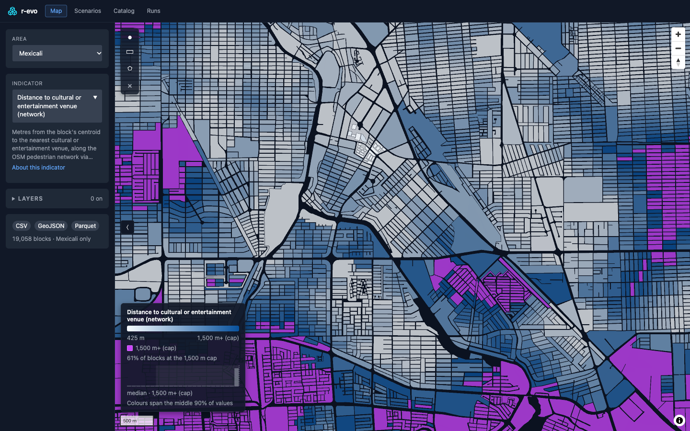
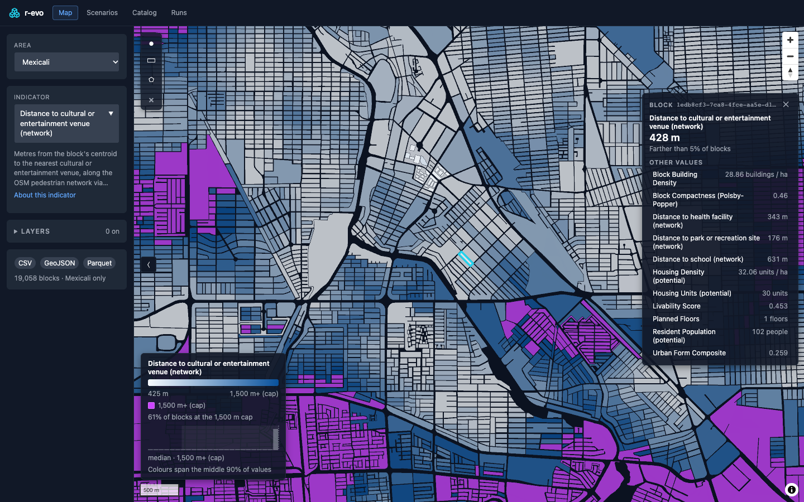
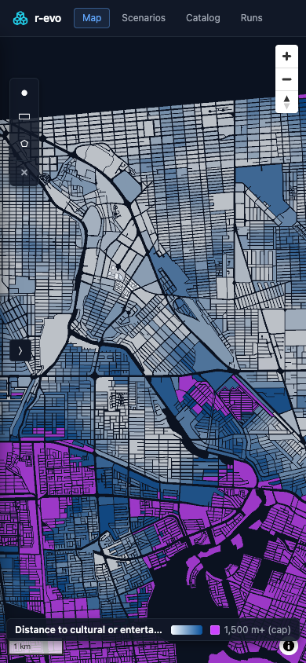
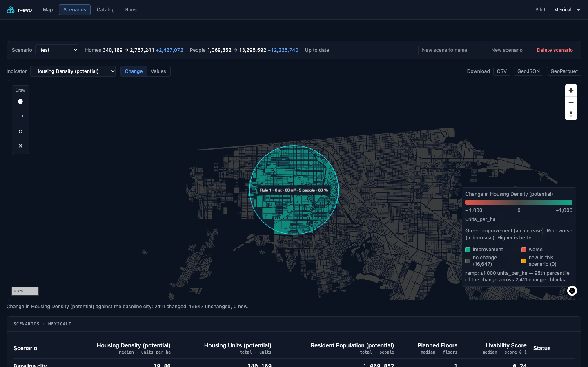
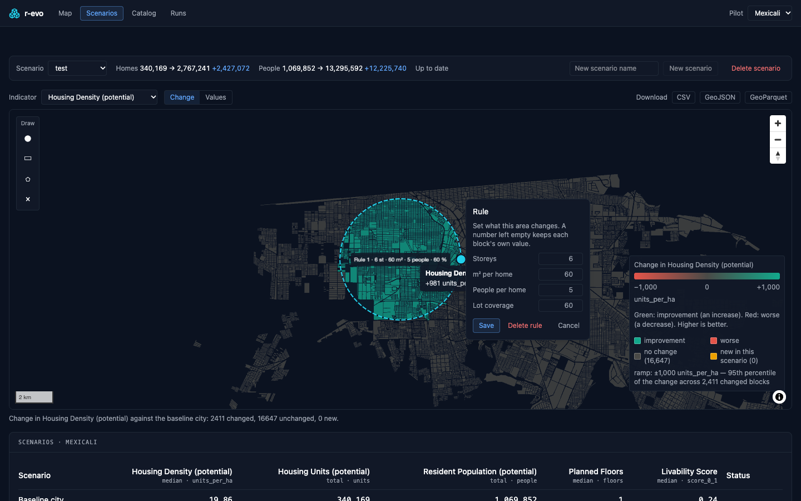
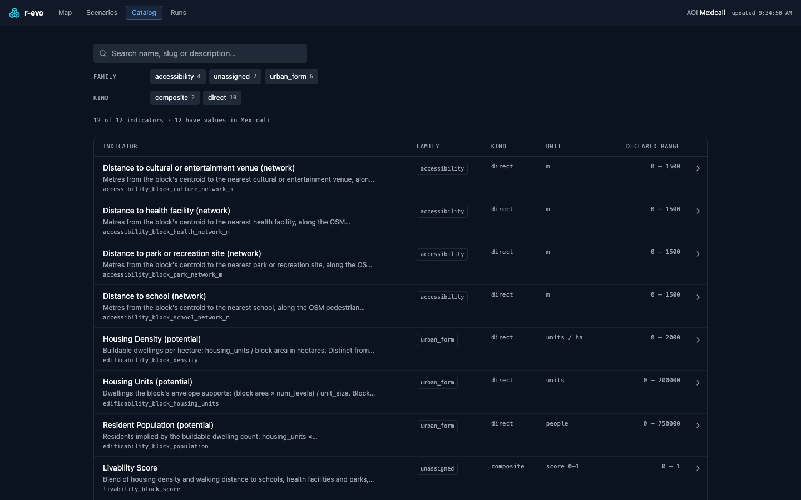
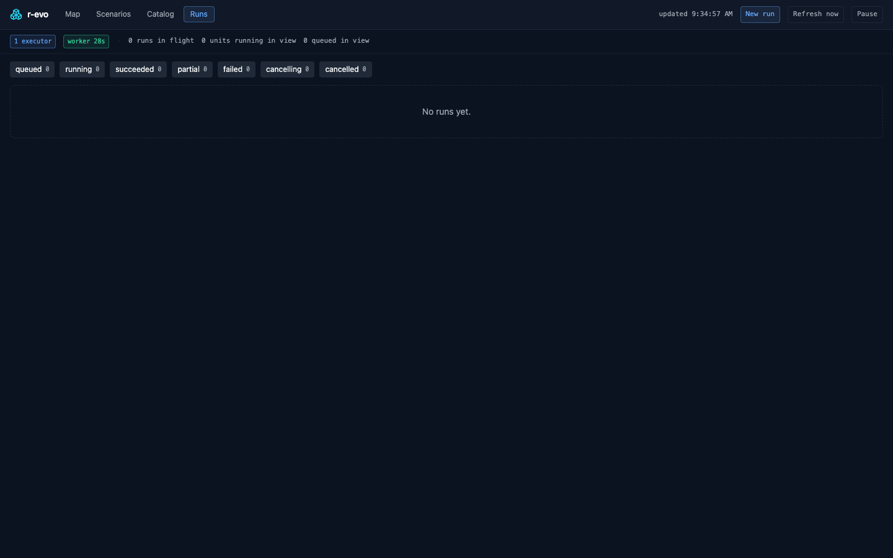

## Document control

| | |
|---|---|
| **Deliverable** | Schedule A, Work 4 — Technical documentation |
| **Version** | 1.0 |
| **Status** | Issued |
| **Audience** | A technically competent reader installing, configuring and operating the platform |

| Version | Date | Author | Summary |
|---|---|---|---|
| 1.0 | 2026-11-20 | Rossano Schifanella | Issued |

### About this document

This document covers installation, configuration and operation; architecture
is Work 1, and the schema and endpoint reference Work 3. It assumes
familiarity with PostgreSQL, Python and the command line, but no prior
knowledge of this system.

---

## 1. What you will end up with

A working installation is a database, three processes — the API, the web
application and the worker — and, in the container stack, two optional tile
hosts:

| Part | Address | Purpose |
|---|---|---|
| API | `http://localhost:8001` (`API_PORT`) | Features, indicators, downloads, scenarios, run control; OpenAPI at `/docs` |
| Web application | `http://localhost:5173` (`WEB_PORT`) | Map (`/`), scenario workspace (`/scenarios.html`), indicator catalogue (`/catalog.html`), run dashboard (`/ops.html`). Press `⌘K` for the command palette, `?` for the shortcut list |
| Worker | no port | Executes the runs the API and the CLI submit. Without it runs stay queued |
| Vector tiles, from the API | `/api/tiles` through the web application; `http://localhost:8001/tiles` directly | Live MVT tiles served by the API itself. What `make dev` uses (§6.2) |
| Vector tiles, from Martin | `http://localhost:3000` | The same tiles from a dedicated tile server. Path A only, optional (§6.2) |
| Snapshot tiles | `http://localhost:3001` | PMTiles exports of stable reference layers. Path A only |
| Database, pooled | `localhost:5432` | Path A: the **connection pooler**, holding one database only. The API reads through it. Path B: PostgreSQL itself |
| Database, direct | `localhost:5433` | Path A only: PostgreSQL behind the pooler. Migrations, bootstrap, the test suites and the ops plane all connect here, not to `5432` — §4.1 says why |

`8001` and `5173` are defaults. Every `make` target that starts a server
takes `API_PORT` and `WEB_PORT`, and checks the ports are free before it
starts (§5).

An installation without access to the source data lake still runs: you can
install, migrate, start every process, run the test suites, build the web
application and load a generated territory (§7.1). Loading the real territory
needs the lake mirror and internet access (§7.2).

## 2. Prerequisites

| Requirement | Version | Why |
|---|---|---|
| Python | 3.12 or later | The backend (`requires-python = ">=3.12"`). `uv` provides it if the system has none |
| `uv` | recent | Creates the project environment from `uv.lock` |
| Node.js | `^22.22.2 \|\| ^24.15.0 \|\| >=26` | The web application (`engines` in `apps/web/package.json`); 23.x and 25.x are not accepted. CI uses 22 |
| PostgreSQL | 16 or later | The database. The container stack and CI use 16 |
| PostGIS | 3.4 or later | All spatial types and functions |
| pgRouting | 3.6 or later | Network-distance indicators (migration `r037`) |
| GDAL (`ogr2ogr`) | 3.8 or later | **Only** for `tiles export` (PMTiles snapshots), which needs the PMTiles driver. The Python packages (`rasterio`, `pyogrio`) bundle their own GDAL |
| Docker with Compose | recent | **Optional**: only for the container stack (Path A, §3.1) |
| `make`, `bash`, `curl` | any | The `make` targets and scripts below |

> **PostGIS and pgRouting are not in the Ubuntu archive.** They come from the
> PostgreSQL Global Development Group repository. pgRouting is also not a
> *trusted* extension, so `CREATE EXTENSION` requires a superuser — see §10.4.

**Every Python command in this document runs through `uv run`**, which uses the
project environment `make install` creates in `.venv`. A bare `python` or
`pytest` resolves to whatever interpreter is first on `PATH`, which does not
have the project's dependencies (or, on many systems, does not exist). If you
prefer, run `source .venv/bin/activate` once per shell and drop the `uv run`
prefix.

## 3. Installation

### 3.1 Choose a database path

Two paths are supported, and the choice only affects where PostgreSQL comes
from.

**Path A — container stack.** Brings up PostgreSQL with PostGIS and
pgRouting, a connection pooler, Martin and a static tile host:

```bash
cp .env.example .env
# edit .env: set POSTGRES_PASSWORD, and the same password in the five DSNs
make stack-up
```

The password appears six times in `.env`: once in `POSTGRES_PASSWORD` and
once in each of the five DSNs (§4.1). Change all six together. The stack
publishes host ports `5432`, `5433`, `3000` and `3001`; they must be free —
see §10.10.

**Path B — host PostgreSQL.** If you already run PostgreSQL locally, copy
`.env.example` to `.env`, comment out the Path A block and uncomment Path B.
`make migrate` (§3.3) creates both databases if they are absent; to create
them yourself instead:

```bash
createdb reimagina_app
createdb reimagina_test
```

> Path B's DSNs name no user, so they assume your own operating-system
> username is a PostgreSQL role that can connect without a password and create
> databases — the usual Homebrew or Postgres.app arrangement. If yours is not,
> put a user and password into the five Path B DSNs.

### 3.2 Install dependencies

```bash
make install        # uv sync --extra dev, then npm ci in apps/web
```

`npm ci` installs exactly what `apps/web/package-lock.json` records and never
rewrites it. It ends with an `npm audit` summary; §10.6 says how to read one.

### 3.3 Create and migrate the databases

```bash
make migrate
```

This creates the application and test databases if they are absent, enables
PostGIS and pgRouting, and migrates both to the latest revision (`r052`). It
takes no arguments: every DSN is read from `.env`, including
`DATABASE_URL_ADMIN`, which is the connection used to *create* the other two.

A successful run prints, for each database, whether it was created and that it
was migrated. On Path A the application database already exists — the
container created it as `POSTGRES_DB` — so it reports `created: false`:

```json
{"app":  {"created": false, "dsn": "…/reimagina",      "migrated": true},
 "test": {"created": true,  "dsn": "…/reimagina_test", "migrated": true}}
```

Confirm the schema landed:

```bash
uv run python -m apps.cli.app verify-schema
```

Every CLI command reads `.env`, so no connection flags are needed. `--dsn`
remains available and overrides the environment when given. One exception:
`raster fetch-worldpop` does not read `.env` for its `--dsn`; pass it when you
pass `--aoi-id` (§7.2).

## 4. Configuration

All configuration is environment variables, read from `.env` at the
repository root. `.env.example` is the template; it is never read at runtime.
A variable already set in the shell wins over `.env`.

### 4.1 Database connections

Five DSNs, deliberately distinct so that one tool never takes another's pool.

| Variable | Read by | Port in Path A | Notes |
|---|---|---|---|
| `DATABASE_URL` | Migrations, loaders, CLI, workers | `5433` | The default DSN for the storage layer. Carries DDL and `CREATE EXTENSION` |
| `REIMAGINA_APP_DSN` | The API only | `5432` | The one pooled DSN, and the one the pooler is for: short read-only handlers, `SET LOCAL` only. Default `postgresql://localhost/reimagina_app`; `make dev` and `make dev-api` fall back to `DATABASE_URL` |
| `DATABASE_URL_DIRECT` | Ops plane, Alembic, `LISTEN`/`NOTIFY` | `5433` | **Must bypass the pooler.** See §10.2 |
| `TEST_DATABASE_URL` | The integration, conformance and recovery suites | `5433` | The database name must contain `test` (or equal `REIMAGINA_TEST_DB_ALLOW_NAME`); the fixture refuses anything else, because its teardown drops every schema — §10.5 |
| `DATABASE_URL_ADMIN` | `make migrate` only | `5433` | The database connected to in order to *create* the other two. Needs a role that may create databases and extensions |

Only one of the five is pooled, and that is not an oversight. In Path A,
`localhost:5432` is PgBouncer in **transaction** pool mode, configured with a
single database (`POSTGRES_DB`). Two consequences follow, and `.env.example`
is written around both:

1. **A name PgBouncer does not hold does not connect.** `postgres` and
   `reimagina_test` are not in its database list, so `DATABASE_URL_ADMIN` and
   `TEST_DATABASE_URL` pointed at `5432` fail before they reach PostgreSQL.
2. **A session handed back between statements loses session state.**
   `CREATE DATABASE` cannot run inside a transaction block, `LISTEN`/`NOTIFY`
   is session-scoped, and a migration lock has to outlive its statement. None
   of those survive transaction pooling.

Path A also reads `POSTGRES_DB`, `POSTGRES_USER` and `POSTGRES_PASSWORD`; the
container stack creates its role and database from them.

### 4.2 Ports and the API process

| Variable | Default | Purpose |
|---|---|---|
| `API_PORT` (`make` variable) | `8001` | The API's port for `make dev`, `make dev-api` and `make check-ports`. `make dev` and `make dev-web` pass it to Vite's proxy. Set it on the command line: `make dev API_PORT=8123` |
| `WEB_PORT` (`make` variable) | `5173` | The web dev server's port for `make dev` and `make dev-web` |
| `REIMAGINA_API_URL` | `http://127.0.0.1:8001` | Where Vite's `/api` proxy sends requests. The `make` targets set it from `API_PORT` |
| `REIMAGINA_API_HOST` | `127.0.0.1` | Bind address for `uv run python -m apps.api`. ⚠ The API has no authentication; do not bind it beyond loopback |
| `REIMAGINA_API_PORT` | `8001` | Bind port for `uv run python -m apps.api` (the `make` targets use `API_PORT`) |
| `REIMAGINA_API_LOG_LEVEL` | `info` | uvicorn's log level for `python -m apps.api` |
| `REIMAGINA_API_CORS_ORIGINS` | `http://localhost:5173,http://localhost:8001` | Comma-separated origins allowed to call the API from a browser. Only matters for an absolute tile or API URL; the `/api` proxy is same-origin |
| `REIMAGINA_API_POOL_MIN` | `1` | Minimum connections in the API's pool |
| `REIMAGINA_API_POOL_MAX` | `16` | Maximum connections in the API's pool |
| `REIMAGINA_API_POOL_WAIT_S` | `30` | How long a request waits for a free connection before answering 503 with `Retry-After` |
| `REIMAGINA_LOG_LEVEL` | `INFO` | Log level of the `reimagina` packages (CLI, worker) |

### 4.3 Tiles and files

| Variable | Default | Purpose |
|---|---|---|
| `REIMAGINA_TILE_LIVE_BASE_URL` | `http://localhost:3000/get_tile` (Martin) | Where the browser fetches live vector tiles. `/api/tiles` serves them from the API. **`make dev` and `make dev-api` set `/api/tiles` and ignore this variable in `.env`**; only the invoking shell can override it — §6.2 |
| `REIMAGINA_MARTIN_URL` | `http://localhost:3000` | Where `GET /health/tile-server` probes Martin |
| `REIMAGINA_TILE_SNAPSHOT_BASE_URL` | `http://localhost:3001` | Static host serving PMTiles snapshots |
| `REIMAGINA_TILE_RASTER_BASE_URL` | derived | Base URL of raster (COG) tiles. Unset, it is `REIMAGINA_API_BASE_URL` + `/cog`, else `http://localhost:8001/cog` |
| `REIMAGINA_API_BASE_URL` | unset | The API's public base URL; only used to derive the raster tile URL. Set it when the API is not on `localhost:8001` |
| `REIMAGINA_TILE_MAX_AGE_S` | `60` | `Cache-Control: max-age` on API-served tiles |
| `REIMAGINA_TILE_STALE_WHILE_REVALIDATE_S` | `300` | `stale-while-revalidate` on API-served tiles |
| `REIMAGINA_TILE_TIMEOUT_MS` | `5000` | Statement timeout of one API-served tile |
| `REIMAGINA_DATA_DIR` | `<repository>/data` | Root of downloaded sources, staged files and COGs. `data/` is git-ignored |
| `REIMAGINA_OVERTURE_RELEASE` | `2026-10-21.0` | The Overture release the extract commands read. Overture removes old releases; `docs/BOOTSTRAP.md` says how to find a current one |

### 4.4 Ops plane

| Variable | Default | Purpose |
|---|---|---|
| `REIMAGINA_ORCHESTRATOR` | `dbos` | Which orchestrator the factory builds. `dbos` is the only deployable value |
| `REIMAGINA_DBOS_EXECUTION_MODE` | `client` | `client` submits and reads runs but executes nothing (the API); `executor` executes them (`python -m apps.worker` sets this itself); `dev` does both in one process |
| `REIMAGINA_EXECUTOR_ID` | `<hostname>:<role>` | Identifies this process to crash recovery. Must be **stable** across restarts and **unique** between concurrent processes — see §10.3 |
| `REIMAGINA_EXECUTOR_ROLE` | `app` | Distinguishes co-located processes. `python -m apps.worker` sets `worker` itself |
| `REIMAGINA_RUN_CONCURRENCY` | `2` | How many runs one worker executes at once (the `runs` queue) |
| `REIMAGINA_UNIT_CONCURRENCY` | `8` | How many indicator units one worker executes at once (the `units` queue) |
| `REIMAGINA_POLL_INTERVAL_SEC` | `0.1` | How often a worker polls its queues |
| `REIMAGINA_APP_VERSION` | derived | Pins the version gating recovery. Set deliberately or not at all — see §10.9 |
| `REIMAGINA_EXECUTOR_HEARTBEAT_S` | `30` | How often a process publishes liveness |
| `REIMAGINA_EXECUTOR_STALE_S` | `300` | How silent an executor must be before a peer presumes it dead — see §10.9 |
| `REIMAGINA_RECLAIM_SWEEP_S` | half the window, at least 60 | How often the worker looks for dead executors |
| `REIMAGINA_RECLAIM_ENABLED` | `1` | Set `0` to disable the sweep entirely |
| `REIMAGINA_PROGRESS_SUBSCRIBERS` | `32` | How many live-progress streams (`/jobs/{run_id}/events`) one API process serves at once |
| `REIMAGINA_RUN_PLAN_TTL_HOURS` | `24` | Age after which an orphaned run plan is swept |
| `REIMAGINA_HAMILTON_CACHE` | off | `1` enables the indicator dataflow's result cache. Development only |

### 4.5 Test and benchmark switches

These are read only by the test suites and benchmark scripts.

| Variable | Purpose |
|---|---|
| `REIMAGINA_REQUIRE_DB=1` | A database-backed suite fails, instead of skipping, when the test database is unreachable. CI sets it |
| `REIMAGINA_TEST_DB_ALLOW_NAME` | Allows one exact `TEST_DATABASE_URL` database name that does not contain `test` |
| `REIMAGINA_POOLED_TEST_DSN` | A DSN through a transaction-mode PgBouncer; enables the one integration test that needs one |
| `REIMAGINA_RECOVERY_TEST=1` | Enables `tests/recovery` (`make test-recovery` sets it) |
| `REIMAGINA_E2E=1` | Enables `tests/e2e` (`make test-e2e` sets it) |
| `REIMAGINA_E2E_WRITES=1` | Enables the scenario editor flow, which creates and deletes a scenario: only against a scratch database (`tests/e2e/README.md`) |
| `REIMAGINA_E2E_API`, `REIMAGINA_E2E_WEB` | Where the browser suite finds the API and the web app; default `http://127.0.0.1:8001` and `http://localhost:5173` |
| `REIMAGINA_BENCH=1`, `REIMAGINA_BENCH_SCALE`, `REIMAGINA_BENCH_REPS` | Enable and size `tests/workloads` and the benchmark scripts |

## 5. Running the platform

The whole platform is one command:

```bash
make dev
```

It starts the API on `:8001`, the web application on `:5173` and the worker,
and Ctrl-C stops all three. It reads `REIMAGINA_APP_DSN`, falling back to
`DATABASE_URL` from `.env`, and refuses to start rather than silently serving
the API's own default database — an empty database looks like a broken
frontend, not a missing variable. It points the map's tiles at the API
(`/api/tiles`, §6.2).

Open the web application at **`http://localhost:5173`**. Use `localhost`, not
`127.0.0.1`: on machines where `localhost` resolves to IPv6, Vite listens on
`[::1]` only and `127.0.0.1:5173` does not answer.

Before it starts anything it checks that both ports are free and names the
process holding one if not. To use other ports:

```bash
make dev API_PORT=8123 WEB_PORT=5199
make check-ports API_PORT=8123 WEB_PORT=5199   # the check on its own
```

To run the three processes in separate terminals:

```bash
make dev-api      # FastAPI on API_PORT; same DSN and tiles as make dev
make dev-web      # Vite on WEB_PORT; proxies /api to API_PORT
make dev-worker   # drains runs; reads DATABASE_URL_DIRECT from .env
```

Pass the same `API_PORT` to `make dev-api` and `make dev-web`.

The worker is required for anything to compute. Without it the run dashboard
shows submitted runs that never progress, which looks like a hang and is not;
the dashboard says so in its health strip.

The split between the API and Vite is a development artefact, not
architecture: Vite serves the frontend itself because it does hot module
replacement and the TypeScript and Svelte transforms that the API cannot. A
deployment runs `make build-web` and serves the static output in
`apps/web/dist/` behind one reverse proxy that maps `/api` to the API, which is
the mapping `vite.config.ts` performs in development.

## 6. Verifying the installation

With `make dev` running:

```bash
curl -s localhost:8001/health          # {"status":"ok","db":"reachable"}
curl -s localhost:8001/openapi.json | head -c 80
open http://localhost:5173             # xdg-open on Linux
```

Then the suites. Four Python suites and the web unit tests are gated in CI;
four further suites are run by hand.

```bash
make test                # unit + contract: no services needed
make test-integration    # needs PostgreSQL + PostGIS (TEST_DATABASE_URL)
make test-conformance    # needs PostgreSQL + PostGIS (TEST_DATABASE_URL)
make test-web            # the web unit tests (vitest)
make build-web           # typecheck + production build of the web app
```

The `make` targets call `uv run pytest`; to call pytest yourself, name the
suites, e.g. `uv run pytest tests/integration`.

> **Do not run a bare `pytest`, and run the suites as separate processes.** A
> bare `pytest` collects every suite, including `tests/integration`, whose
> session fixture ends by dropping every managed schema from
> `TEST_DATABASE_URL`; a suite collected after it in the same process finds no
> schema. CI runs each suite as its own process, and so do the `make` targets.

For an end-to-end check that the platform *does* something rather than merely
starts — a populated database, every shipped indicator computed, tiles with
features in them, a run drained by the worker — run `scripts/acceptance_run.sh`
(§7.1). It needs no credentials.

The four hand-run suites:

| Suite | Command | What it needs |
|---|---|---|
| `tests/performance` | `uv run pytest tests/performance` | The test database; benchmark budgets and explain-plan shape |
| `tests/workloads` | `make test-workloads` | Nothing; measures how the ops plane schedules synthetic DAGs (`tests/workloads/README.md`) |
| `tests/recovery` | `make test-recovery` | A test database with at least 20,000 blocks — §6.1 |
| `tests/e2e` | `make test-e2e` | Both servers running and Playwright — below |

**The browser suite** opens every page in a real Chromium and asserts what the
page reports about itself. One-time setup, inside the web application so its
driver resolves Playwright:

```bash
cd apps/web
npm install --no-save playwright
npx playwright install chromium
cd ../..
```

Then, with a populated database (§7.1) and `make dev` running in another
terminal:

```bash
make test-e2e
```

It expects the API on `http://127.0.0.1:8001` and the web application on
`http://localhost:5173`. If you moved the ports, say where they are:

```bash
REIMAGINA_E2E_API=http://127.0.0.1:8123 REIMAGINA_E2E_WEB=http://localhost:5199 make test-e2e
```

`tests/e2e/README.md` describes what it checks.

### 6.1 Verifying the orchestration module

Schedule A names the orchestration module as a deliverable, and it is the
component whose behaviour is least visible from the outside — a run that
succeeds looks the same whether or not it would have survived the worker
being killed. These are the checks that distinguish the two, in increasing
order of what they cost you.

| Check | Command | What a pass means |
|---|---|---|
| The port contract | `make test-conformance` | 11 behaviours — submit, retrieve, cancel, subscribe, partial failure and the rest — hold against **both** shipped implementations: 22 items, one of which skips because it does not apply to the synchronous orchestrator. A new engine that cannot satisfy them is rejected by a test rather than by an argument |
| It runs through the queue | `scripts/acceptance_run.sh`, step 12 | A separate `python -m apps.worker` process announced itself, dequeued a run, and drained it. Step 12b prints each unit's start offset: units at the same offset ran concurrently, a later one waited for a dependency |
| A resubmission is not a second run | `scripts/acceptance_run.sh`, step 12c | The same request submitted twice returned one run id, the second flagged `deduplicated` |
| It survives its executor dying | `make test-recovery` | A process `SIGKILL`ed mid-compute was resumed — by itself on restart, and by a *different* executor through the liveness sweep |

⚠ **`make test-recovery` runs against `TEST_DATABASE_URL`, needs at least
20,000 blocks there, and skips below that.** The territory in §7.1 has
sixteen, and the integration suite leaves the test database without schemas —
and a skip is one character away from a pass in pytest's output. Prepare the
test database first:

```bash
make migrate                                     # restores the test DB's schemas
uv run python scripts/synthetic_territory.py --dsn "$TEST_DATABASE_URL" \
    --blocks 150 --ageb-side 10                  # 22,500 blocks, under a minute, no credentials
make test-recovery                               # 2 passed
```

The suite seeds the indicator catalogue itself. `$TEST_DATABASE_URL` must be
set in the shell for the middle command — `set -a; . ./.env; set +a` exports
everything in `.env`.

The size is not arbitrary. The suite kills a worker *while a unit is
running*, so the run has to take long enough for the kill to land inside it.
On a sixteen-block territory every unit finishes in milliseconds and the
crash arrives after the work is already done, which would prove the opposite
of what the test claims.

**What none of these cover.** `scenario recompute --sync` (and
`evaluate-scenario --sync`) runs the coordinator in-process with no ops plane
at all. It is the path that still works when the engine is down, and steps 10
and 11 of the acceptance run use it — so a green acceptance run before step 12
says nothing about the orchestrator. That is why step 12 exists.

### 6.2 Live vector tiles: the API or Martin

Live vector tiles are a Postgres function plus an HTTP wrapper, and the
wrapper is interchangeable. The contract is the **function signature** —
every tile function takes `(z, x, y, query_params json)` and returns
`bytea` — which is Martin's function-source convention, so anything
implementing it is a drop-in.

| Server | Address | What it is |
|---|---|---|
| **The API** | `/api/tiles` through the web app; `:8001/tiles` directly | `apps/api/routers/mvt.py`, same functions, same process as the rest of the API. What `make dev` uses |
| **Martin** | `:3000` | `ghcr.io/maplibre/martin`, started by the container stack (Path A) and connecting to PostgreSQL directly. Optional |

**What `make dev` does.** `make dev` and `make dev-api` start no tile server,
so they point the map at the API: they set
`REIMAGINA_TILE_LIVE_BASE_URL=/api/tiles` and ignore that variable in `.env`.
Only the invoking shell can override it. To use Martin from the container
stack instead:

```bash
REIMAGINA_TILE_LIVE_BASE_URL=http://localhost:3000 make dev
```

A process started any other way (`uv run python -m apps.api`) reads the
variable from the environment or `.env`, and its default is Martin's
`http://localhost:3000/get_tile`. Nothing else changes between the two: not
`infra/tiles/layers.json`, not `/tile-sources`, not the frontend.
`GET /health/tile-server` reports whether Martin answers.

⚠ **Use the relative form for the API.** An absolute URL such as
`http://localhost:8001/tiles` makes every tile request cross-origin from the
web application, so it depends on the API's CORS allowlist
(`REIMAGINA_API_CORS_ORIGINS`), which by default names
`http://localhost:5173` and therefore rejects a browser that opened the page
as `http://127.0.0.1:5173`. The symptom is a map that draws nothing, with no
console error naming the cause. `/api/tiles` is served through the same proxy
the rest of the API uses, so the question does not arise. A contract test
asserts both forms resolve to the same URL shape, because that property is
the only thing that makes two implementations safe to keep.

**Which to use.** Martin in production: a Rust tile server with its own
connection pool is the better machine when many clients pan at once. At the
scale of a single reviewer or a demo, the API is enough — measured here,
`serving_geo.get_tile` answers a populated z16 tile in **~1.5 ms** — and
running one fewer service is worth more than the headroom.

**Verify a tile without a browser:**

```bash
# A tile with features: 200, and a vector-tile content type
curl -sD- -o /tmp/tile.mvt "http://localhost:8001/tiles/get_tile/16/11748/26478" | head -5

# Decode it — no dependencies, the decoder is in this repository
uv run python scripts/mvt_inspect.py /tmp/tile.mvt

# A tile outside the loaded territory: 204 No Content, empty by design
curl -s -o /dev/null -w '%{http_code}\n' "http://localhost:8001/tiles/get_tile/14/0/0"

# TileJSON, for a client that prefers discovery
curl -s "http://localhost:8001/tiles/get_tile" | uv run python -m json.tool
```

The z16 tile above lies on the generated territory of §7.1.
`scripts/mvt_inspect.py` prints the layer name, the spec version, the extent,
and a breakdown by geometry type and `type_slug` — so "the tile has features"
is a statement about decoded content rather than about a byte count.

The API path is covered end-to-end by
`tests/integration/test_mvt_route_serves_tiles.py`, which fetches real tiles
over HTTP and decodes them. Martin is an external binary and has no
equivalent coverage here; `docs/architecture/TILE_SERVING.md` has the full
argument for keeping both.

## 7. Loading data

### 7.1 Without credentials — a generated territory

If you have no access to the data lake, this is the path to a populated
system. It takes about a minute and a half and needs no network:

```bash
scripts/acceptance_run.sh
```

⚠ **The script drops and recreates the database named in `DATABASE_URL`.**
Point `DATABASE_URL` at a database you can lose — on Path A the stack's own
`reimagina` database is fine on a fresh install; never a database holding a
real load. `--keep` skips the drop.

It migrates the database from empty, generates a small territory on Mexicali
coordinates — AGEBs containing blocks containing buildings, a pedestrian
street graph, four amenities, an area of interest and a single-band population
raster — and then runs every analysis stage over it: feature overlaps, every
shipped indicator (all twelve) including the pgRouting network family, raster ingest
through COG staging, zonal statistics, an observation rollup, a scenario, a
run drained by a separate worker process, and the live tile functions. Any
failure stops the run.

To generate the territory without the rest:

```bash
uv run python scripts/synthetic_territory.py --blocks 6
uv run python scripts/synthetic_territory.py --raster-out /tmp/population.tif
```

Everything is written through the production loaders, so what lands passes
the same triggers and carries the same provenance columns as an ingested
dataset. ⚠ **The geometry is a regular grid, not a city.** Use it to exercise
and demonstrate the platform; never to draw a conclusion about Mexicali.

### 7.2 With credentials — the real dataset

The real territory comes from two kinds of source:

| Source | Where it comes from | Needs |
|---|---|---|
| INEGI Marco Geoestadístico 2024 (blocks, AGEBs, municipalities, states) | The lake mirror on disk | Lake credentials, once |
| INEGI 2020 census (block attributes) | The lake mirror on disk | Lake credentials, once |
| Municipal amenities (health, schools, …) | The lake mirror on disk | Lake credentials, once |
| Overture buildings, places and administrative divisions | Overture's public S3 bucket, at load time | Internet access |
| OpenStreetMap pedestrian network | Overpass, through `osmnx`, at load time | Internet access |
| WorldPop population raster (optional) | WorldPop's public REST API, at load time | Internet access |

**The lake mirror is an offline copy.** The private Azure data lake
(`cfcetlsadls/raw`) is copied once to `data/sources/azure/` with the
credentials; the loaders then read those files and never contact the lake.
`docs/AZURE_DATA_INVENTORY.md` documents the expected layout. `data/` is
git-ignored, so a fresh clone has none of it.

Without the mirror there are no blocks, so no indicator can run on real data;
§7.1 is the alternative. Overture alone still gives a real municipal boundary
and real buildings on the map (`overture divisions`, `overture
aoi-from-division`, `overture extract`, `overture load`; see
`docs/BOOTSTRAP.md`).

**`scripts/mexicali_run.sh` is the runbook**, as one command. It checks the
mirror first and names each missing path, drops and rebuilds the database
named in `DATABASE_URL` (unless `--keep`), keeps the step order that matters,
and treats the optional sources as non-fatal so a rate-limited Overpass does
not discard the INEGI load:

```bash
scripts/mexicali_run.sh                  # drops and rebuilds $DATABASE_URL
scripts/mexicali_run.sh --skip-network   # without OSM: no network-distance indicators
```

The steps it runs, for running a part of it or another municipality:

```bash
CLI="uv run python -m apps.cli.app"
BBOX=-115.70,32.40,-115.20,32.80          # Mexicali's urban core

$CLI data verify-sources                  # mirror paths, Overture S3, WorldPop reachable
$CLI feat seed-types
$CLI indicators seed-catalog

# INEGI geometry for Baja California (state 02)
$CLI inegi-marco bootstrap --cve-ent 02 \
  --layers areas_estatales,areas_municipales,agebs_urbanas,manzanas_urbanas

# The area of interest: the INEGI municipality polygon. Prints the AOI id.
$CLI cdmx aoi-from-alcaldia --cve-ent 02 --cve-mun 002 \
  --name Mexicali --project-name "Mexicali Pilot"
export AOI_ID=…                           # the aoi_id it printed

# Attributes and destinations
$CLI inegi-censo bootstrap --cve-ent 02
$CLI points bootstrap --layers mexicali_amenities
$CLI overture places --bbox $BBOX --country MX --aoi-id "$AOI_ID" \
  --output-path data/overture_places_mexicali.parquet

# Buildings (Overture) and the street network (OSM)
$CLI overture extract --bbox $BBOX --output-path data/overture_buildings_mexicali.parquet
$CLI overture load --raw-path data/overture_buildings_mexicali.parquet \
  --source-name "Overture Buildings - Mexicali BBox" --aoi-id "$AOI_ID"
$CLI network bootstrap --aoi-id "$AOI_ID" --clip-bbox $BBOX

# Membership, after every feature exists; then overlaps
$CLI aoi compute-features --aoi-id "$AOI_ID"
$CLI overlap declare-pair --source-context global --source-slug building \
  --target-context MEX --target-slug block
$CLI overlap declare-pair --source-context MEX --source-slug block \
  --target-context MEX --target-slug ageb
$CLI overlap compute-all --aoi-id "$AOI_ID"

# Baseline of the scenario inputs
$CLI inegi-censo bootstrap --cve-ent 02 --columns prom_ocup
$CLI overture block-storeys --aoi-id "$AOI_ID"
uv run python scripts/seed_demo_attributes.py --aoi-id "$AOI_ID" --fit-to-census

# Indicators, inputs before the indicators that read them
$CLI indicators compute --slug urban_form_block_compactness --aoi-id "$AOI_ID"
```

Three ordering rules matter:

- **`aoi compute-features` runs after every load.** Area membership is what
  AOI-scoped reads, tiles and indicators filter on; a feature loaded after it
  belongs to no area, and its tiles come back empty.
- **`--country MX` on `overture places` is not optional.** The Mexicali box
  crosses the border, and without it a block is reported near a park in
  California.
- **Indicators compute inputs first.** The order is the one in
  `scripts/mexicali_run.sh` step 10: the three urban-form indicators, then
  planned floors, the edificability family, the four network-distance
  indicators and the livability score. With the worker running, a run of
  "what is out of date" on the run dashboard (§9.4) computes all of them in
  dependency order instead.

The scenario inputs need a baseline, which the "baseline of the scenario
inputs" block supplies: household size comes from the census and storeys from
Overture where they exist; the rest is synthetic, fitted so each block's
dwellings equal the census count.

**WorldPop (optional).** A population raster, fetched from WorldPop (the
country file, about 1 GB for Mexico, is cached under `data/cache/worldpop/`),
clipped to the AOI and ingested as a COG:

```bash
$CLI raster fetch-worldpop --country MEX --year 2020 --aoi-id "$AOI_ID" \
  --dsn "$DATABASE_URL" --output-path data/worldpop_mexicali_2020_100m.tif
$CLI raster ingest --raw-path data/worldpop_mexicali_2020_100m.tif \
  --layer-slug worldpop_mexicali_2020_100m --aggregation-kind extensive \
  --source-name "WorldPop · MEX · 2020 (100m, Mexicali clip)" \
  --provider WorldPop --version 2020-100m
```

`docs/BOOTSTRAP.md` is the longer runbook, including Mexico City, WorldPop and
rolling forward to a new Overture release.

Lot coverage (`lot_coverage`, the share of a block that is built on) is not
seeded: a block without it is computed at 1.0, the whole block, so the fitted
baseline still equals the census. A rule drawn on the scenarios page sets it
only when the planner types one (§8.4.1), and `housing_units = area ×
lot_coverage × storeys ÷ m² per home`.

## 8. How the platform works

This chapter explains the mechanisms behind what §9 operates: how the
database is organised (§8.1), how the API and the workers coordinate a run
(§8.2), how the indicator catalogue decides what a run recomputes (§8.3), and
how a scenario is written, materialised, recomputed and compared (§8.4).
Work 3 gives every table, column and endpoint; Work 1 places the components
in the architecture.

### 8.1 Database structure

All database state lives in one PostgreSQL database with the PostGIS and pgRouting
extensions. Stored files (rasters, imagery, point clouds, exported tiles) are registered
there but kept on disk or in object storage. Besides `public`, which holds the two
extensions and `alembic_version`, the database has six schemas. Five of them are created
and versioned by the platform's Alembic migrations. The sixth, `dbos`, belongs to the
workflow library.

#### 8.1.1 The six schemas

| Schema | Purpose | Written by | Read by |
|---|---|---|---|
| `curated_geo` | Source of truth: features, observations, overlaps, indicator results, provenance, AOIs, assets, road network, scenario rows | Loaders, CLI, worker jobs, API (scenario authoring) | Everything |
| `serving_geo` | Read contract: 23 views, 1 materialized view, 3 tile functions. Holds no tables | Migrations only (DDL) | API, worker, Martin |
| `explore` | Inspection contract for engineers reading SQL: 11 views and `layer_catalog` | Migrations (catalogue rows) | CLI (`explore`, `scenario`, `assets` and `raster` commands), the CDMX loader, `psql` users, one API read |
| `app_core` | Tenancy: `project`, `scenario` | CLI/loaders (project), API and CLI (scenarios) | API, worker, CLI |
| `jobs_runtime` | Run bookkeeping: runs, job units, per-unit job runs, run plans, executor heartbeats | API (submit, cancel, delete), worker, CLI (`job_run` from direct and embedded computes) | API, worker |
| `dbos` | Workflow checkpoints, queues, notifications (14 tables) | The DBOS library (worker executors, API client) | Same, plus reclaim and plan-sweep queries |

`r001` creates `app_core`, `jobs_runtime`, `curated_geo` and `serving_geo`. `r006` creates
`explore`. DBOS's own migrations create `dbos` (§8.1.7). §8.2 covers how `jobs_runtime` and
`dbos` are used.

**The `serving_geo` rule and its exceptions.** `serving_geo` is the read contract for map
geometry, feature lists and per-feature indicator values. Its scope is narrower than "all
reads", though. Here is what each part of the application actually reads:

- **Through `serving_geo`:** feature lists (`GET /features` reads `feature_v` or
  `feature_aoi_v`), polygon counts (`POST /metrics/within-polygon` reads `feature_aoi_v`),
  indicator values (`GET /indicators/{slug}/values` reads `current_indicator_v`), raster
  layer and aggregation-recipe metadata (`raster_layer_v`, `aggregation_recipe_v`), asset
  lineage (`asset_lineage_v`), and every vector tile. Martin publishes only `serving_geo`
  functions (`infra/docker/martin.yaml`). The API's `/tiles` router accepts only the three
  names in `TILE_FUNCTIONS` (`packages/py/reimagina/tiles/functions.py`).
- **Directly from `curated_geo`:** the API reads these tables directly:
  - the indicator catalogue and its dependencies;
  - AOIs and their membership;
  - AOI summaries (`aoi_indicator_summary`, not `aoi_summary_v`);
  - value statistics and histograms;
  - feature ranks;
  - CSV/GeoJSON/Parquet exports (`indicator_result` joined to `feature`);
  - tile-source discovery;
  - source attribution;
  - scenario authoring and comparison.

  Worker jobs and indicator SQL also read `curated_geo` directly.
- **From `explore`:** one application read. The lineage endpoint
  (`GET /indicators/{slug}/lineage`) reads `explore.asset_freshness_v`. Executor health on
  the Runs page reads `jobs_runtime.ops_executor_heartbeat` directly, not the `explore`
  view.

The three tile functions sit in `serving_geo`, but they read `curated_geo` tables inside
their bodies. The per-role and per-type views (`admin_v`, `analysis_units_v`, `blocks`,
`lots`, `roads`, `trees` and others) are a convenience for SQL users. No application code
reads them.

#### 8.1.2 Canonical model

**Feature types.** `feature_type_catalog` holds one row per type, keyed by
`(context, type_slug)`. Two contexts are seeded, 15 types in total:

- **`MEX`** holds the administrative hierarchy: `state`, `municipality`, `neighborhood`,
  `ageb`, `block`, `lot`. Each has an `admin_level` from 1 to 6.
- **`global`** holds types that exist in any country: `building`, `tree`, `bus_stop`,
  `station`, `establishment`, `road`, `sidewalk`, `bike_lane`, `crossing`. These have no
  `admin_level`.

Each type also declares a `geometry_family` (`point`, `line`, `polygon`, `geometry`) and a
`role` (`analysis_unit`, `context`, `infrastructure`, `poi`, `detection`). The tile function
filters by role.

**Features.** `feature` holds one geometry per entity, in `geometry(Geometry,4326)`, and a
generated `geometry_centroid` (`ST_PointOnSurface`). Every geometry column in the database
uses SRID 4326, so any two layers can be compared without reprojecting. Lengths and areas
are computed on `::geography`, in metres and square metres.

The before-write trigger copies `type_slug` and `role` from the type. Rows can therefore be
filtered without a join, and the copies cannot drift from the catalogue. Static attributes
live in `attributes` (jsonb). `parent_id` links a feature into the administrative hierarchy.
The unique key `(source_id, dataset_version, source_record_ref)` makes a re-load at the same
version a no-op.

**Observations.** `observation` stores time-varying attribute values: one row per
`(feature_id, attribute_key)` value. Exactly one of `value_numeric`, `value_text` or
`value_json` is set. Writing a new value does two things:

1. It retires the previous row (`is_current = false`, `valid_to = now()`).
2. It inserts the new row with `is_current = true`.

The partial unique index `obs_one_current` allows only one current row per key. A check
constraint ties `is_current` to `valid_to IS NULL`. Retired rows are kept as history.

**Indicator results.** `indicator_result` holds one value per feature, indicator and
scenario. `scenario_id IS NULL` is the baseline. Each row records:

- the `job_run_id` that produced it;
- a `quality_flag` (`measured`, `estimated`, `imputed`, `missing`, `not_applicable`);
- a `status` (`current`, `stale`, `failed`).

A writer first marks the existing current row `stale`, then inserts the new one. Two partial
unique indexes allow at most one current row:

- `ir_one_current_base` on `(feature_id, indicator_id)` where `scenario_id IS NULL` and
  `status = 'current'`;
- `ir_one_current_scenario` on `(feature_id, scenario_id, indicator_id)` where
  `scenario_id IS NOT NULL` and `status = 'current'`.

Stale rows remain as history. `serving_geo.current_indicator_v` shows only
`status = 'current'`. The foreign key to `jobs_runtime.job_run` is `ON DELETE CASCADE`, so
deleting a job run deletes the results it wrote. `indicator_catalog` (including `valid_min`,
`valid_max`, `applies_to` and `cap_value`) and `indicator_dependency` define what can be
written. §8.3 covers how they are used.

**Provenance.** Every feature, observation and file asset carries:

- a `source_id` pointing to `data_source_catalog`. That table is unique on
  `(provider, name, version)` and records `storage_type`, `integration_role`,
  `storage_uri` and `license`;
- an `ingestion_run_id` pointing to `ingestion_run`, which records the orchestrator, the
  transformation step, the code version and the status.

`GET /tile-sources/attribution` builds the map's credit line from the `license` of every
source that has features loaded (`packages/py/reimagina/data/attribution.py`). It is not
hard-coded in the frontend.

**Areas of interest.** `area_of_interest` is a polygon owned by an `app_core.project`.
`aoi_feature` stores membership: one row per `(aoi_id, feature_id)` with an `overlap_basis`
(`area`, `length` or `presence`), the overlap and feature measures, and `overlap_ratio`.
The rows are recomputed by deleting and re-inserting; `compute_overlaps` in
`packages/py/reimagina/storage/postgres/repositories.py` does this.

- **Polygons and lines** become members when at least a fraction of 1e-9 of their area or
  length lies inside the AOI.
- **Points** become members when they lie inside the AOI.
- **Identifier rule.** When the AOI has a `membership_key` (for example
  `{"CVE_ENT": "09", "CVE_MUN": "012"}`), a feature whose attributes carry all of those keys
  must match them exactly. Features without the keys, such as buildings, are placed by
  geometry alone.

`aoi_indicator_summary` caches one aggregated value per AOI and indicator, and one per AOI,
scenario and indicator. Partial unique indexes enforce this.

**Overlaps.** `feature_overlap` stores the geodesic overlap between pairs of features of two
types (source and target). Only type pairs declared in `feature_overlap_type_pair` are
computed. Each row records the measure and the ratio relative to the source feature. The
table is unique on `(source_feature_id, target_feature_id)`, and a recomputation updates
rows in place. Roll-ups from child features to parent features read it.

**Assets and files.** Two groups of tables share the word "asset":

- **Files:** `file_asset` registers one stored raster, imagery or point-cloud file per
  source. `raster_layer` publishes such a file as a map layer.
- **The asset graph:** `asset`, `asset_dependency`, `asset_version` and
  `asset_materialization` record what each derived product reads and which input versions
  it was built from. `asset_version_one_current` keeps one current version per
  `(asset_id, partition_key)`. §8.3 explains how freshness is derived from this.

`tile_snapshot_registry` records exported tile files.

**Road network.** `road_node` and `road_edge` hold the pedestrian graph in the shape
pgRouting expects:

- node ids are OpenStreetMap ids;
- each edge has `source` and `target` node ids, plus `cost` and `reverse_cost` in metres;
- each edge is a `LINESTRING`, SRID 4326.

A load replaces the whole network (`TRUNCATE curated_geo.road_node CASCADE`). Accessibility
indicators route over these tables. `publish_road_features` then projects the edges into
`feature` as `global:road` rows so they can be drawn on the map.

**Scenario tables** are listed here as structure only; §8.4 explains the mechanism.

- `app_core.scenario` holds one row per scenario, unique on `(project_id, name)`.
- `curated_geo.scenario_edit` holds drawn rules, ordered by `ordinal`.
- `curated_geo.scenario_override` holds per-feature attribute values, unique on
  `(scenario_id, feature_id, attribute_key)`.
- `indicator_result.scenario_id` marks results computed under a scenario.

#### 8.1.3 Triggers that enforce invariants

These checks run in the database, so they hold for every writer, whether loader, worker, CLI
or a hand-written `psql` session. A row that breaks one is rejected with an exception.

| Trigger (table) | When | Guarantees |
|---|---|---|
| `feature_before_write` (`feature`) | before insert/update | The type exists. `type_slug` and `role` are copied from it. The geometry matches the type's family. `source_id` equals the ingestion run's source. There is no self-parent. Non-hierarchical types have no parent. The parent's `admin_level` is strictly lower. The hierarchy has no cycle |
| `observation_before_write` (`observation`) | before insert/update | Exactly one value column is set, and it matches `value_type`. `source_id` equals the run's source |
| `file_asset_before_write` (`file_asset`) | before insert/update | The source stores raster, imagery or point-cloud data. `source_id` equals the run's source |
| `aoi_feature_before_write` (`aoi_feature`) | before insert | The `overlap_basis` fits the feature geometry: `presence` for points, `length` for lines, `area` for polygons |
| `indicator_result_before_write_trigger` (`indicator_result`) | before insert/update | See the list below |
| `indicator_dependency_validate_trigger` | deferred, at commit | Only composite indicators have dependencies. The graph is acyclic. One parent's weights are all null or sum to 1 |
| `asset_dependency_validate_trigger` | deferred, at commit | Only derived assets consume other assets. The graph is acyclic. `derived_from` weights are all null or sum to 1 |

On every insert or update, `indicator_result_before_write_trigger` enforces the following:

- **On insert,** it fills `feature_type`, `indicator_slug` and a default `model_version`.
  `feature_type` and `indicator_slug` cannot change afterwards.
- `scenario_id` equals the job run's scenario.
- The feature's type is in the indicator's `applies_to`, unless the row is flagged
  `not_applicable`.
- A `measured`, `estimated` or `imputed` row has exactly one value unless its status is
  `failed`; every other row has none.
- A `missing` row has a `missing_reason`.
- A numeric value lies within `valid_min` and `valid_max`.

The two dependency triggers are `DEFERRABLE INITIALLY DEFERRED` constraint triggers. A
transaction may therefore pass through intermediate states while it replaces a set of edges,
as long as the graph is valid at commit.

#### 8.1.4 Tile functions and the materialized view

| Function | Draws | Notes |
|---|---|---|
| `serving_geo.get_tile` | Features by role and zoom | Context only below z8. Analysis units added at z8–z11. All roles from z12. Buildings only from z14. Attributes from z12. Current observations merged in at z14 and above. Optional `type_slug`, `role`, `aoi_id` |
| `serving_geo.indicator_overlay_tile` | One indicator as a choropleth | Requires `indicator_slug`. Optional `scenario_id`, `feature_type`, `aoi_id`, `delta`. Empty below z8 |
| `serving_geo.aggregation_overlay_tile` | Current observations of one `attribute_key` | Requires `attribute_key` and `feature_type_slug`. Optional `aoi_id`. Empty below z8 |

All three functions follow Martin's `/{function}/{z}/{x}/{y}` contract, are
`STABLE PARALLEL SAFE`, and simplify geometry below z14. The API runs them under
`SET LOCAL transaction_read_only = on` and a statement timeout.

`serving_geo.feature_current_attributes_mv` holds, for each feature, a jsonb object with its
current observations. `feature_v` merges this object into `attributes`, and so does
`get_tile` at z14 and above. The view is refreshed only when an ingestion run completes with
status `succeeded` (`complete_ingestion_run`). The refresh is non-concurrent and runs in the
completing transaction, holding an exclusive lock on the view until commit. Between
refreshes, the view may lag `observation`. The overlay functions and
`current_indicator_v` read the base tables and do not lag.

#### 8.1.5 Tenancy and row-level security

`app_core.project` is the tenant root. Areas of interest and scenarios belong to a project,
and deleting a project removes them (`ON DELETE CASCADE`), together with the scenarios'
edits. Scenario overrides, scenario results and scenario asset versions have no foreign key
to the scenario, so the cascade leaves them behind. Delete each scenario through
`DELETE /scenarios/{id}` (§8.4.7) before deleting its project. Migrations `r011` and `r048`
enable row-level security on three tables: `app_core.project`, `app_core.scenario` and
`curated_geo.area_of_interest`. Each table gets one policy, `tenant_isolation`:

- If the setting `app.current_project_id` is unset or empty, every row is visible.
- Otherwise, only that project's rows are visible.

No application code sets `app.current_project_id`; only tests do. Security is also **enabled, not forced**. PostgreSQL
exempts a table's owner from policies that are only enabled, and superusers bypass
row-level security in every case. Migrations create the tables as the role in the DSNs, and
every DSN in `.env.example` uses that same role. The policies therefore filter nothing in a
standard deployment.

> ⚠ Row-level security is not a tenancy boundary in this delivery. For it to act as one,
> three conditions must all hold:
>
> - the API connects as a separate non-owner role without `BYPASSRLS`;
> - the tables are set to `FORCE ROW LEVEL SECURITY`;
> - each request sets `app.current_project_id`.

#### 8.1.6 Main tables at a glance

Work 3 (`docs/delivery/03_database_and_api_reference.md`) gives every column, constraint and
index.

| Schema | Table | Holds |
|---|---|---|
| `curated_geo` | `feature_type_catalog` | Feature types per `(context, type_slug)` |
| `curated_geo` | `feature` | One geometry per entity, with provenance |
| `curated_geo` | `observation` | Attribute values with history; one current per key |
| `curated_geo` | `indicator_catalog`, `indicator_dependency` | Indicator definitions and composition |
| `curated_geo` | `indicator_result` | Indicator values per feature and scenario; one current |
| `curated_geo` | `data_source_catalog`, `ingestion_run` | Source, licence, version; each load |
| `curated_geo` | `area_of_interest`, `aoi_feature` | AOIs and measured membership |
| `curated_geo` | `aoi_indicator_summary` | One aggregate per AOI, scenario and indicator |
| `curated_geo` | `feature_overlap`, `feature_overlap_type_pair` | Pairwise overlaps; declared pairs |
| `curated_geo` | `asset`, `asset_dependency` | Registered assets and their edges |
| `curated_geo` | `asset_version`, `asset_materialization` | Input versions; what each build read |
| `curated_geo` | `file_asset`, `raster_layer` | Stored files; published raster layers |
| `curated_geo` | `aggregation_recipe` | Raster or feature to feature aggregations |
| `curated_geo` | `road_node`, `road_edge` | Routing graph for pgRouting |
| `curated_geo` | `scenario_edit`, `scenario_override` | Scenario rules and attribute values |
| `curated_geo` | `tile_snapshot_registry` | Exported tile files |
| `app_core` | `project`, `scenario` | Tenants and scenarios |
| `jobs_runtime` | `orchestration_run`, `job_unit`, `job_run` | A run, its units, each unit's job run |
| `jobs_runtime` | `run_plan`, `ops_executor_heartbeat` | Planned feature sets; live executors |
| `explore` | `layer_catalog` | Descriptions of the inspection views |

#### 8.1.7 Migrations

The schema is defined by 51 Alembic revisions in `infra/db/migrations/versions/`, from
`r001` to the head `r052`. They form a single linear chain; there is no `r033`, because
`r034` follows `r032`. `alembic.ini` sets `script_location = infra/db/migrations`. The URL
comes from the caller, else from `DATABASE_URL` (`.env` is loaded), else
`postgresql://localhost/reimagina`. Each run executes in one transaction, and
every index is built with a plain `CREATE INDEX`, never `CONCURRENTLY`. `r001` creates
PostGIS. `r037` creates pgRouting, which needs a superuser (§10.4).

`make migrate` runs `apps.cli.app bootstrap-db --with-test-db`, which does the following in
order (`packages/py/reimagina/db/bootstrap.py`):

1. Through `DATABASE_URL_ADMIN`, it creates the application database if it is absent.
2. It upgrades that database to head over `DATABASE_URL_DIRECT`, or over `DATABASE_URL`
   when no direct DSN is set. If both DSNs are set, they must name the same database.
3. It creates and upgrades the test database named by `TEST_DATABASE_URL`
   (`postgresql://localhost/reimagina_test` when unset).
4. It seeds the application database idempotently with the feature types, the indicator
   catalogue and the asset registry.
5. It installs the `dbos` schema in the application database over `DATABASE_URL_DIRECT`,
   or over `DATABASE_URL` when no direct DSN is set. It refuses a DSN that goes through
   PgBouncer.

Without `--with-test-db`, `bootstrap-db` touches only the application database.

The test database is migrated to head once per pytest session (`tests/conftest.py`). At
teardown the fixture runs `alembic downgrade base`, which drops the platform's schemas. For
that reason the fixture refuses any database whose name lacks `test`, unless
`REIMAGINA_TEST_DB_ALLOW_NAME` names it exactly (§10.5). To restore the test database's
schemas afterwards, run `make migrate` again. To check which revision a database is on, run
`SELECT version_num FROM alembic_version;`.


### 8.2 Coordination and orchestration

The API and the workers never talk to each other. They coordinate through
two schemas in the one domain database: `dbos`, owned by the DBOS
durable-execution library (version 3.5), which holds queues, checkpoints and progress
streams; and `jobs_runtime`, the platform's own record of each run. There is no
broker or scheduler service.

#### 8.2.1 The orchestrator port

Every caller (API routes, CLI) depends on one interface, `Orchestrator`, in
`packages/py/reimagina/orchestration/port.py`, which exposes no engine types.

| Method | What it does |
|---|---|
| `submit_run` | Plans the run and enqueues it; returns a `RunHandle` (`run_id`, `deduplicated`) |
| `get_run` | Run and unit statuses; `None` if the run does not exist |
| `list_enqueued_runs` | Runs the engine holds that no worker has opened yet |
| `cancel_run` | Stops a live run; `False` if unknown or already terminal |
| `subscribe_progress` | Async stream of `RunEvent`s, ending with the run-level terminal event |
| `forget_runs` | Removes runs from the engine after their rows were deleted |

The API and the CLI's `--detach` mode obtain their implementation through
`get_orchestrator` in `orchestration/factory.py`. The CLI's embedded mode builds `DBOSOrchestrator` in
`dev` mode directly, and tests construct either class explicitly:

- **`DBOSOrchestrator`** (`dbos_orchestrator.py`, with the workflows in
  `dbos_app.py`) is the production implementation and the default.
  `REIMAGINA_ORCHESTRATOR` accepts only `dbos`.
- **`SynchronousOrchestrator`** (`synchronous.py`) computes in the calling
  process and keeps run state in memory, so configuration cannot select it;
  the conformance suite (§6.1) and integration tests construct it explicitly.
  The CLI's `--sync` flag runs the same in-process coordinator without the
  port: units one after another in dependency order, with no queue, no worker
  and no `orchestration_run` or `job_unit` rows. Each indicator still records
  its `job_run`.

`REIMAGINA_DBOS_EXECUTION_MODE` decides what a process using the DBOS
implementation may do:

| Mode | Used by | Behaviour |
|---|---|---|
| `client` (default) | API | Enqueues, reads, cancels, streams; executes nothing |
| `executor` | `python -m apps.worker` | Launches DBOS, recovers, heartbeats, executes units |
| `dev` | CLI `evaluate-scenario`, tests | Executes inside the submitting process |

If the `dbos` schema has never been created, every submit fails with
`OpsPlaneNotProvisioned`, which the API answers with `503`. `make migrate`
creates the schema (`bootstrap-db`); so does the first worker launch.

#### 8.2.2 Runs, units and queues

A run is one DBOS workflow, `run_workflow`, enqueued on the `runs` queue. Its
id is a fresh UUID and is also the DBOS workflow id, so any process can read,
stream or cancel it without a mapping table. The planner (§8.3) returns the
units, one per indicator; each unit becomes a child workflow,
`unit_workflow`, enqueued on the `units` queue with the id `{run_id}-{slug}`.

| Variable | Default | Limit |
|---|---|---|
| `REIMAGINA_RUN_CONCURRENCY` | `2` | Runs one worker drives at once |
| `REIMAGINA_UNIT_CONCURRENCY` | `8` | Units one worker computes at once |
| `REIMAGINA_POLL_INTERVAL_SEC` | `0.1` | Queue and child-wait polling interval |

Both limits are per worker, not global: each added worker adds capacity. A
run holds its `runs` slot until it ends.

Units start as they unblock, not in fixed levels. After each child finishes,
`plan_wave` (`orchestration/wave.py`) returns the queued units whose
prerequisites *within this run* have all succeeded (dispatched now) and those
with a prerequisite that failed, was skipped or was cancelled (marked
`skipped`). A prerequisite outside the run is an already-materialised input
and never blocks. A dependency cycle among the units is rejected at submit.

A failed unit is not retried (its exception is deterministic): it is marked
`failed`, its dependents are skipped, independent units continue.

#### 8.2.3 Statuses

| Level | Status | Meaning |
|---|---|---|
| Unit | `queued` | Recorded, waiting for its prerequisites or a slot |
| Unit | `running` | Its child workflow has started |
| Unit | `succeeded` / `failed` | Compute committed / raised |
| Unit | `skipped` | A prerequisite in the run did not succeed |
| Unit | `cancelled` | The run was cancelled before the unit finished |
| Run | `queued` | Enqueued, not yet opened by a worker (read from DBOS) |
| Run | `running` | Opened by a worker |
| Run | `succeeded` / `partial` / `failed` / `cancelled` | Terminal |

The run's terminal status is derived from its units (`overall_status` in
`port.py`): all succeeded gives `succeeded`; some succeeded gives `partial`;
none succeeded, none failed and at least one cancelled gives `cancelled`;
anything else, including a run whose units were all skipped, gives `failed`.
Writes are guarded: once a unit or a run is terminal, no later write moves it
(`orchestration/runstore.py`). A submit whose plan is empty returns `noop`
with `run_id` null and persists nothing. The `cancelling` value permitted by
the `orchestration_run` CHECK constraint is never written.

#### 8.2.4 Deduplication of identical submissions

`submit_run` computes a deduplication id (`orchestration/dedup.py`) and passes
it to the enqueue with the policy `return-existing`. While a run with the same id
is outstanding, DBOS returns that run instead of starting another, and the
response carries `deduplicated: true`. The id is cleared when the run becomes
terminal, so a later resubmission starts a new run.

Two submissions are identical when all of the following match: the set of
planned unit slugs; the changed attributes; the edited feature ids (as a
SHA-256 digest); `scenario_id`; `aoi_id`; the code version (the git commit);
the explicit indicator list; and, for each unit, the content fingerprint of its
whole upstream closure from `serving_geo.asset_expected_version_v`, so a
scenario edit between two submissions yields a new run. If any unit lacks a
fingerprint (missing or NULL), no id is produced and nothing is deduplicated.

#### 8.2.5 Cancellation, rerun and deletion

`POST /jobs/{run_id}/cancel` (404 if unknown, 409 if already terminal) applies
three mechanisms, because each stops something the others cannot:

1. `cancel_workflow` with `cancel_children` stops DBOS scheduling the run and
   its units. DBOS observes it only at the next step boundary.
2. `pg_cancel_backend` is sent to every backend recorded in
   `jobs_runtime.job_run.backend_pid` for a live unit of the run, interrupting
   the PostGIS statement in progress.
3. Every non-terminal unit is set to `cancelled` and the run is closed with
   the status derived from its units. A run where some units had already
   succeeded therefore closes as `partial`.

A unit's compute step, `s_compute`, writes in one transaction committed at
the end, so an interrupted unit leaves no partial result, and it re-checks the
run status first, so a unit dequeued after the cancel computes nothing. A
cancelled workflow is never resumed. A run cancelled before any worker opened
it gets a terminal run row with `code_version` `cancelled-before-start`.

`POST /jobs/{run_id}/rerun` is accepted only for a terminal run with at least
one unit that did not succeed (409 otherwise; 404 if the run is unknown). It
submits a **new** run for every unit that did not succeed
(failed, skipped and cancelled) with the original scenario and area. The old run
cannot be resumed: its child workflow ids already exist in DBOS.

`DELETE /jobs/{run_id}` (terminal runs only, 409 otherwise) and
`DELETE /jobs` (all terminal runs) remove the `orchestration_run` row and,
by cascade, its `job_unit` rows, and delete the workflows and their children
from DBOS before committing. Computed values (`indicator_result`) and
provenance (`job_run`) are kept.

#### 8.2.6 Observing a run

| Table | One row per | Written by |
|---|---|---|
| `orchestration_run` | Run | `s_open_run`, or the API for a run cancelled before start; closed by `s_finalize` or by a cancel |
| `job_unit` | Unit of a run | `s_open_run`; status per transition |
| `job_run` | Indicator execution, with `backend_pid` | The indicator runner |
| `run_plan` | Unit feature set of an open run | `submit_run`; deleted at run end |
| `ops_executor_heartbeat` | Executor process | Every launched executor |

All five are in `jobs_runtime`; Work 3 lists their columns. Because the run
row is written by the worker, not at submit, `get_run` falls back to DBOS for
a run no worker has opened yet, and `GET /jobs` merges such runs into its
list as `queued`.

- **`GET /jobs/{run_id}/events`** streams Server-Sent Events. The first event
  is a snapshot of the run status from `jobs_runtime` (`unknown` until a worker
  opens the run); then one event per unit that settles or is
  skipped; then a run-level event (`indicator` null) that ends the stream.
  Events are written exactly once from the workflow body and read through
  `LISTEN`/`NOTIFY`. Keep-alive every 15 s; at most 300 s per stream and
  `REIMAGINA_PROGRESS_SUBSCRIBERS` (32) streams per API process.
- **`latest_run`** on each scenario in `GET /scenarios` is `{id, status}` of its
  newest `orchestration_run`; until a worker opens a new run it names the
  previous one.
- **The Runs page** (§9.4) polls `GET /jobs` once a second while visible; one
  response carries runs, status counts and executor health (read from
  `jobs_runtime.ops_executor_heartbeat`). `GET /jobs/{run_id}/detail` adds unit
  timings and in-run prerequisites. The Scenarios page polls its own recompute
  every 0.5 s for up to two minutes, then defers to the Runs page.

#### 8.2.7 Durability and recovery

Each workflow step's result is checkpointed in the `dbos` schema. On recovery
DBOS replays the workflow: completed steps return their recorded results and
execution resumes at the first incomplete one. Replay matches
steps by position, so the workflow body branches only on its inputs and on
recorded step results: the unit list and dependencies are workflow input, not
read from the catalogue, and the order in which children finished is itself
recorded (`DBOS.wait_first`). A child handle whose id is not the expected
`{run_id}-{slug}` aborts the workflow with an error rather than misattribute a
result. The run row is not finalised and stays `running` until it is
cancelled.

**Executor identity.** Recovery reclaims only workflows recorded against the
recovering process's `executor_id`. It is `REIMAGINA_EXECUTOR_ID`, or
`<hostname>:<role>` with `REIMAGINA_EXECUTOR_ROLE` (default `app`; the worker
sets `worker`). It must be stable across restarts and unique between
concurrent processes (§10.3).

**Application version.** Recovery is also scoped by DBOS application version.
`REIMAGINA_APP_VERSION` pins it; unset, DBOS derives it from the workflow
source and the launching executor records itself as the latest version. Runs
enqueued by the API carry no version and are dequeued by executors of the
latest one. Pin it when two different builds run at once.

**Liveness.** Every launched executor upserts its row in
`ops_executor_heartbeat` every `REIMAGINA_EXECUTOR_HEARTBEAT_S` (30 s). The
first beat is unguarded: a process that cannot record it does not start.

**Reclaim sweep.** Only the worker sweeps. Every `REIMAGINA_RECLAIM_SWEEP_S`
(default half the staleness window, at least 60 s: 150 s) it finds executors
whose heartbeat is older than `REIMAGINA_EXECUTOR_STALE_S` (300 s), excluding
itself, and has DBOS recover their pending workflows onto itself. The window
must be at least 4 times the heartbeat interval; startup refuses otherwise. An
executor with no heartbeat row is never swept. Its row is deleted only once
nothing unfinished remains against it; work of another application version is
left, and logged, for a process of that version (§10.9). Recovered workflows
pass through the queue's atomic dequeue, so racing sweepers admit one runner.
`REIMAGINA_RECLAIM_ENABLED=0` disables the sweep.

**A worker killed mid-unit.** The unit's open transaction is rolled back by
the server when the connection drops, so no partial result is written. Its
workflows stay `PENDING` against the dead executor's id. If a process with the
same id starts, `DBOS.launch()` recovers them; otherwise a live worker's sweep
does after the staleness window. Replay skips the steps and units that had
completed, and the interrupted unit's `s_compute` runs again from the start.
`make test-recovery` (§6.1) proves both paths with a real `SIGKILL` while a
unit runs (restart under the same id; a peer's sweep under another id),
requiring the run to end `succeeded` with no unit `queued` or `running`.

#### 8.2.8 Connection paths

| Connection | Variable | Through PgBouncer |
|---|---|---|
| API requests, planning, cancel, delete | `REIMAGINA_APP_DSN` | Yes (5432 in the stack) |
| API `DBOSClient`, plan write, SSE | `DATABASE_URL_DIRECT` | No (5433) |
| Worker: queues, checkpoints, compute, heartbeat, sweep | `DATABASE_URL_DIRECT` | No |
| Migrations and `dbos` schema (`bootstrap-db`) | `DATABASE_URL_DIRECT`, else `DATABASE_URL` | No |
| Loaders, CLI commands | `DATABASE_URL`, plus `DATABASE_URL_DIRECT` for DBOS submits (embedded, `--detach`) | No |

DBOS needs session features a transaction-mode pooler cannot carry: progress
streams use `LISTEN`/`NOTIFY`, and its schema migration holds a session
advisory lock across statements (`bootstrap-db` refuses a pooled DSN). With
`DATABASE_URL_DIRECT` unset the ops plane refuses to start rather than let DBOS
fall back to SQLite. Each submit checks that both connections reach the same
database, so a run is never planned in one and executed in another.

#### 8.2.9 One run, from submit to landed

1. A client calls `POST /jobs`, `POST /scenarios/{id}/recompute` or
   `POST /jobs/{run_id}/rerun`. The API opens a connection on
   `REIMAGINA_APP_DSN` and calls `submit_run`.
2. `submit_run` checks both DSNs name the same database, mints the run id and
   gets the units from the planner (§8.3). An empty plan returns `noop`.
3. It commits each unit's feature set to `jobs_runtime.run_plan` under the run
   id, validates the workflow input and computes the deduplication id.
4. `DBOSClient` enqueues `run_workflow` on `runs` with the run id; DBOS stores
   the workflow and its input in one transaction. The API answers `202` with
   status `queued` (in `run_status` for the scenario recompute), or the
   existing run with `deduplicated: true`. `POST /jobs` with `wait: true`
   instead answers `200` once the run is terminal.
5. A worker with a free `runs` slot dequeues it. Step `s_open_run` writes the
   `orchestration_run` row (`running`) and one `job_unit` per unit (`queued`).
6. `plan_wave` marks units with an unsatisfied prerequisite `skipped` and
   enqueues ready units on `units` as `{run_id}-{slug}`.
7. A worker with a free `units` slot runs the unit: `running`, then
   `s_compute` reads the unit's feature set from `run_plan`, runs the
   indicator in one transaction and commits; the unit becomes `succeeded` or
   `failed`.
8. The parent takes the next finished child, records its status
   (`s_settle_unit`), emits a progress event and returns to step 6.
9. With nothing outstanding or left to skip, the parent derives the run
   status, closes the run (`s_finalize`), deletes its `run_plan` rows and
   emits the run-level event. `GET /jobs/{run_id}` and the scenario's
   `latest_run` now report the terminal status: the run has landed.


### 8.3 Indicator catalogue and selective recomputation

An indicator is a number computed per feature (here, per block), stored in
`curated_geo.indicator_result` (structure in §8.1) and recomputed only when
something it depends on has changed. This section covers where indicators are
declared, how they are computed, how their dependencies are recorded, and how
the planner decides what a run recomputes. Queueing and execution are covered
in §8.2; how a scenario records its edits is covered in §8.4.

#### 8.3.1 Where indicators are declared

The source of truth is Python code: one `IndicatorSpec` per indicator in
`packages/py/reimagina/indicators/catalog.py`, collected in the
`SHIPPED_INDICATORS` tuple. Two seeders write the database from code; the rows
are never edited by hand:

| Seeder | Writes | From | Used by |
|---|---|---|---|
| `seed_catalog` | `indicator_catalog`, `indicator_dependency` | `SHIPPED_INDICATORS` | write trigger, API, web pages |
| `seed_assets` | `asset`, `asset_dependency` | the 10 dataset assets declared in `SHIPPED_ASSETS` (`assets/registry.py`), plus the indicator and `scenario.override.<attribute>` assets derived from `SHIPPED_INDICATORS` | freshness views, scenario planning |

`bootstrap-db` runs both (after `seed_feature_types`) in one transaction.
`indicators seed-catalog` and `assets seed` re-run them individually. Catalogue
and asset rows are upserted on `slug` and `asset_key`, so ids and version
history survive a re-seed. Each indicator's or asset's dependency rows are
deleted and inserted again. The seeders must run in one transaction because the dependency triggers
are deferred to commit (§8.3.5). The CLI commands do this.

Adding an indicator means adding a spec, a compute function in the runner
registry (`orchestration/runners.py`), and re-seeding. No migration is
needed. A composite needs no compute code: every spec with
`computation_kind = 'composite'` is bound to the generic `compute_composite`.

#### 8.3.2 What a catalogue entry carries

| Field | Meaning |
|---|---|
| `slug`, `name`, `description` | Identity; the description is served by the API |
| `computation_kind` | `direct` or `composite` |
| `model_family` | Required for `direct`, must be NULL for `composite` (CHECK) |
| `value_type`, `unit` | `numeric`/`text`/`json`; unit label, e.g. `m`, `score_0_1` |
| `valid_min`, `valid_max` | Accepted range, enforced on write |
| `cap_value` | A clamp meaning "at least this", not a measurement |
| `aggregation_method` | `mean`, `weighted_mean`, `sum`, `min`, `max`, `none` |
| `applies_to` | Feature types (grains) the indicator may be written for |
| `inputs` | Typed edges to datasets, attributes and other indicators; Python-only, projected into `indicator_dependency` and `asset_dependency` |
| `higher_is_better` | Direction; Python-only, not a column |

`inputs` is the single declaration of what an indicator consumes. Each
`AssetEdge` names an asset key (`mex.block`, `global.poi`,
`indicator.<slug>`), a relation (`self`, `child_in_parent`, `within_radius`,
`derived_from`), optionally the attributes read and a weight. Two projections
are derived from it and cannot be declared separately: `reads` (attribute
keys) and `depends_on` (component indicators with weights). The catalogue has
no "statistic" field. `aggregation_method` controls how area summaries
(`indicators aoi-summary`) combine block values.

#### 8.3.3 The shipped indicators

All twelve are computed at the `block` grain (`applies_to = {block}`) and
aggregate by `weighted_mean`.

| Slug | Family | Measures (unit, range) | Main inputs |
|---|---|---|---|
| `urban_form_block_compactness` | urban_form | Polsby-Popper (ratio, 0–1) | block `geometry` |
| `urban_form_block_building_density` | urban_form | Buildings/ha (0–500) | block `geometry`, buildings |
| `urban_form_block_planned_floors` | urban_form | Planned floors (0–200) | `floors` |
| `urban_form_block_composite` | — | 0.5 compactness + 0.5 density (0–1) | the two above |
| `edificability_block_housing_units` | urban_form | Potential dwellings (0–200,000) | `num_levels`, `unit_size`, `lot_coverage`, `people_per_household` |
| `edificability_block_population` | urban_form | Potential residents (0–750,000) | same four attributes |
| `edificability_block_density` | urban_form | Dwellings/ha (0–2,000) | same four attributes |
| `accessibility_block_school_network_m` | accessibility | Walk distance to a school (m, cap 1,500) | POIs, road network |
| `accessibility_block_health_network_m` | accessibility | Walk distance to health care (m, cap 1,500) | POIs, road network |
| `accessibility_block_park_network_m` | accessibility | Walk distance to a park or recreation site (m, cap 1,500) | POIs, road network |
| `accessibility_block_culture_network_m` | accessibility | Walk distance to a cultural venue (m, cap 1,500) | POIs, road network |
| `livability_block_score` | — | 0.4 housing density + 0.2 per school/health/park distance (0–1) | four indicators |

The three edificability indicators declare the same four attributes, although
only population uses `people_per_household`. Editing that attribute therefore
recomputes all three. The four accessibility distances are lower-is-better.
`compute_composite` normalises each input to 0–1 against its own
`valid_min`/`valid_max`, inverts lower-is-better inputs, and then applies the
weights. A composite value is written only for features where every input has
a value. The accessibility indicators also declare the attributes
`poi_version` and `network_version`. These are version markers that are bumped
by hand and stand in for a dataset change. They are not policy levers, and a
scenario cannot set them.

#### 8.3.4 How an indicator is computed and written

Each direct indicator has three stages:

1. **Read**: SQL against PostGIS or pgRouting, scoped by `aoi_id` and/or
   `feature_ids`. Compactness and the edificability family use geodesic
   `ST_Area`/`ST_Perimeter` on `geography`. Building density counts building
   centroids inside each block. Accessibility runs one multi-source
   `pgr_drivingDistance` per category over `curated_geo.road_edge`. Attribute
   reads resolve the *effective* value: scenario override, then observation,
   then base attribute (§8.4).
2. **Kernel**: pure Python functions (`indicators/kernels.py`) run as nodes of
   a Hamilton dataflow (`indicators/dataflow.py`). Each node returns a
   `(feature_id, value_numeric)` frame with a Pandera `@check_output` bounds
   schema derived from the catalogue range. An out-of-range value fails the
   unit before anything is written. `planned_floors` and the composites write
   without a Hamilton stage.
3. **Write**: inside a `job_run` context, `bulk_write_numeric_results` marks
   the feature's existing `current` row for that indicator and scenario as
   `stale` and inserts a new `current` row. Partial unique indexes allow one
   current row per (feature, indicator) for the baseline and one per
   (feature, scenario, indicator) for scenarios. The trigger
   `indicator_result_before_write_trigger` re-checks range, `applies_to`, value-column
   cardinality and that `scenario_id` matches the job run. It is the database
   backstop for the same rules as `indicators/validation.py`.

Two families refuse to write values that would only reflect a missing input.
They raise `MissingInputData` instead:

- **Building density** raises it when no building is loaded, and when the
  blocks in scope match no building at all.
- **Accessibility** raises it when `curated_geo.road_edge` or the
  establishment (POI) layer is empty. A category with no matching POI does
  not raise. Every block gets the 1,500 m cutoff, and a warning is logged.

The edificability indicators skip blocks that lack an input. Compactness,
planned floors and the composites never raise it.

A scenario reads indicator results as an overlay. It takes its own row where
that row carries a value, and the baseline row otherwise.

#### 8.3.5 The dependency graph

There are two graphs, both seeded from `inputs`:

- **`indicator_dependency`**: composite to component, with a weight. The
  deferred trigger `indicator_dependency_validate_trigger` rejects a non-composite
  parent, a cycle (recursive walk, depth 50), a mix of weighted and NULL
  weights, and weights that do not sum to 1.0 (tolerance 1e-9). A CHECK
  constraint keeps each weight in 0–1. Six rows are shipped: two for
  `urban_form_block_composite`, four for `livability_block_score`.
- **`asset_dependency`**: every edge from each indicator asset
  (`indicator.<slug>`) to the datasets, the other indicators, and one
  `scenario.override.<attribute>` asset per attribute it reads. Each edge
  carries a `partition_mapping`. The value is `identity` when the producer is
  partitioned by scenario (override assets, indicators) and `baseline`
  otherwise, so a scenario's results read the single shared copy of the source
  layers. `asset_dependency_validate_trigger` applies the same cycle and weight rules
  to `derived_from` edges. The release seeds 48 edges.

In Python, `orchestration/graph.py` orders the graph with
`graphlib.TopologicalSorter`, which raises `CycleError` on a cycle. Nodes and
prerequisites are sorted first, so the order is identical in every process.
The durable executor depends on this when it replays a run (§8.2).

#### 8.3.6 Freshness

An indicator is out of date when the version it was computed against differs
from the version its inputs now imply.

- **Source versions.** A feature layer gets a new `asset_version` (its version
  string is the ingestion run id) only when an ingest actually wrote rows.
  `global.road_network` is `observed`: `assets observe` runs its `probe_sql`
  (edge count and maximum OSM id) and publishes a new version if the result
  changed. Materialising a scenario (at recompute) publishes a version of
  `scenario.override.<attribute>` in partition `scenario=<id>` (§8.4.3).
  Adding an edit alone publishes nothing.
- **Expected version.** `serving_geo.asset_expected_version_v` is an MD5
  over everything upstream of an asset. That includes each source's current
  version (`missing` if none), each derived asset's `code_version` and
  `params_digest`, and every edge. `params_digest` hashes `computation_kind`,
  `value_type`, `unit`, `aggregation_method`, `valid_min`, `valid_max` and
  `applies_to`. Changing a range therefore invalidates the indicator, but
  editing its description does not. `code_version` is maintained by hand
  (currently `1` for every indicator), so a commit alone invalidates nothing.
- **Materialised version.** Each unit records an `asset_materialization` row
  through the runner wrapper (`runners._recording`). The row holds the
  expected version captured *before* the compute starts, the input versions
  read, and `coverage_scope.complete`. A failed compute records nothing.
- **State.** `serving_geo.asset_freshness_v` reports `absent` (never
  computed), `stale` (versions differ), `partial` (the last run was
  feature-scoped or AOI-scoped), or `fresh`. `assets stale` lists the out-of-date
  assets. `assets consumers <key>` lists everything downstream of an asset.

⚠ A run scoped by `aoi_id` or by edited features records `complete = false`,
and the indicator stays `partial`. A later baseline request that names nothing
and has no `aoi_id` recomputes it over the whole grain. A scenario recompute
is always scoped to the scenario's AOI, and from the API also to the blocks
its rules touch (§8.4.5), so a scenario partition never becomes `fresh`. Each
recompute therefore reruns every indicator the scenario's rules reach, even
when the rules have not changed.

⚠ Loading the road network, including `network bootstrap`, publishes no
version. Run `assets observe` after every load; until then freshness does not
see the change.

#### 8.3.7 Planning a run

`plan_run` (`packages/py/reimagina/orchestration/plan.py`) turns a request
into an ordered list of `DirtyUnit(indicator, features)`. Every run submission
calls it: `POST /jobs`, the scenario recompute, and `evaluate-scenario` on
the CLI. The CLI's `indicators compute` does not; it calls the runner
directly. An empty `features` set means every feature the indicator applies
to. The request selects one of three paths:

| Request | Dirty set | Order |
|---|---|---|
| `indicators` (named list) | Exactly those; unknown slugs → 422 | Topological on the induced subgraph |
| `changed_attributes` / `edited_features` | Indicators whose `reads` meet the attributes, plus the downstream closure | Topological; features passed down |
| Nothing named | Freshness: baseline `stale`/`partial`; with `scenario_id`, that partition, `absent` included | Topological |

`changed_datasets` (for example `["global.road_network"]`) is resolved by
`indicators_for_datasets` to every indicator with an edge to that dataset,
plus the downstream closure. The result is submitted as a named list. The
downstream closure (`downstream_closure`) walks the reverse dependency edges
from the seed set, so a composite becomes dirty when any of its components is
dirty. During execution a unit runs only after every prerequisite *in the same
run* has succeeded. A unit with a failed prerequisite is skipped (§8.2). A
prerequisite outside the run is treated as already materialised.

Scope: `aoi_id` is passed to every compute. Compactness, building density,
the edificability family and the accessibility family restrict their read to
blocks that intersect the AOI polygon. Planned floors and the two composites
ignore it and cover every block. A non-empty `features` set restricts every
compute, these three included, to those blocks. `scenario_id` makes the
computes read effective values for that scenario and write rows tagged with
it. Neither ever touches the baseline rows. With `scenario_id` and nothing
else named, freshness returns the indicators that the scenario's published
overrides reach through `identity` edges. It also returns any indicator
already materialised in that scenario's partition. The API's scenario
recompute names attributes and blocks, and so takes the change-set path; the
CLI's `scenario recompute` names nothing, and so takes freshness (§8.4.5).

⚠ On a database where nothing has been computed, every indicator is
`absent`, and a baseline request that names nothing is a `noop`. To build
everything the first time, name the indicators (`POST /jobs` with
`indicators: [...]`). Alternatively, compute them one at a time with
`indicators compute`, as §7.2 does. A `noop` returns no `run_id`.

#### 8.3.8 Impact check

`POST /jobs/preview` takes the same body as `POST /jobs`, runs `plan_run` on a
pooled API connection whose transaction is rolled back at the end of the
request, and returns `indicators`, `count`, `noop` and a
`reason` naming which path answered. It persists and enqueues nothing.
`GET /jobs/attributes` lists what a change set can name: each
`dataset · attribute` pair with the indicators that read it, each
whole-dataset edge, and the registered datasets that no indicator consumes.
The Impact check panel on the Catalogue page (§9.3) is built on these two
endpoints and can submit the previewed run.

#### 8.3.9 Worked example: a scenario changes `num_levels`

The edge rows for this example can be listed with:

```sql
SELECT c.asset_key AS consumer, p.asset_key AS producer, d.relation, d.attributes
FROM curated_geo.asset_dependency d
JOIN curated_geo.asset c ON c.id = d.consumer_asset_id
JOIN curated_geo.asset p ON p.id = d.producer_asset_id
WHERE p.asset_key = 'scenario.override.num_levels'
   OR c.asset_key = 'indicator.livability_block_score';
```

1. Materialising the scenario at recompute publishes a new version of
   `scenario.override.num_levels` in partition `scenario=S`.
2. Three indicators have an `identity` edge from that asset:
   `edificability_block_density`, `edificability_block_housing_units` and
   `edificability_block_population`. The partition propagates to them.
3. `livability_block_score` has a `derived_from` edge (weight 0.4) from
   `edificability_block_density`, so the partition propagates to it as well.
   `urban_form_block_composite`, `planned_floors` and the accessibility
   indicators are not reached.
4. The planner returns, in order: `edificability_block_density`,
   `edificability_block_housing_units`, `edificability_block_population`,
   `livability_block_score`. The first three are independent and may run
   concurrently. Within this run, the score's only prerequisite is
   `edificability_block_density`, so it is dispatched as soon as density
   succeeds. It does not wait for the other two. It reads density from the
   scenario rows just written. The scenario has no accessibility rows, so it
   reads the three distances from the baseline.

Steps 1–3 are the freshness path, which the CLI's `scenario recompute`
takes. The same four indicators result from naming the attribute explicitly
(`changed_attributes: ["num_levels"]`). The API's recompute takes this path:
it names the attributes and the blocks the rules touch, so each unit computes
only those blocks (§8.4.5). By contrast, `["geometry"]` yields
compactness, building density and `urban_form_block_composite`.
`["floors"]` yields `urban_form_block_planned_floors` alone.
`changed_datasets: ["global.road_network"]` yields the four accessibility
distances followed by `livability_block_score`.


### 8.4 Scenario making

This section describes how a scenario works underneath. The page that drives it is described in §9.2.

#### 8.4.1 Scenario, baseline and rules

A scenario is a row of `app_core.scenario` with four fields that matter here: a project (`project_id`), an area of interest (`aoi_id`), a `name` that is unique within the project (`UNIQUE (project_id, name)`), and `materialized_at`. The *baseline city* is not a scenario row. It is the data with no scenario applied: `indicator_result` rows whose `scenario_id IS NULL`. A scenario stores only what it changes and reads everything else through to the baseline.

The `aoi_id` is optional when the scenario is created but required at recompute. The foreign key is `ON DELETE SET NULL`, so deleting the AOI leaves the scenario unable to recompute. `create_scenario` also checks that the AOI belongs to the scenario's project, because the schema does not enforce that link.

A *rule* is a drawn area plus the edits that one proposal writes over it. Each edit is a row of `curated_geo.scenario_edit` with a polygon (EPSG:4326), a feature type (`MEX:block` by default), an `attribute_key`, a `value_numeric` and an `ordinal`. A proposal carries up to four numbers, at least one, and writes one edit per number it sets, two for `levels` (`edits_for`, `packages/py/reimagina/scenarios/proposal.py`):

| Proposal field | Edits written | Unit | Valid values |
|---|---|---|---|
| `levels` | `floors` and `num_levels` | storeys | finite, > 0 |
| `unit_size` | `unit_size` | m² per dwelling | finite, > 0 |
| `people_per_household` | `people_per_household` | people | finite, > 0 |
| `lot_coverage` | `lot_coverage` | share of block | 0 < c ≤ 1 |

`floors` and `num_levels` are the same quantity under two names. Planned floors reads `floors` and the edificability family reads `num_levels`, so a proposal that sets `levels` always writes both. A number the proposal leaves out is not written: each block keeps its own value for it (§8.4.3), and a block without `lot_coverage` is computed at 1.0. A rule that sets household size alone therefore leaves every block's storeys, unit size, coverage and density as they were. The API writes only the numbers in the request; the web page sends only the numbers typed; the CLI `set-attribute` requires the three numbers and writes `lot_coverage` 1.0 unless `--lot-coverage` is given. The authorable set is derived from the attributes that the catalogue's indicators read, minus `geometry`, `poi_version` and `network_version` (`authorable_attributes`, `reimagina/assets/registry.py`). `add_edit` refuses any other key.

`ordinal` is `max + 1` within the scenario, assigned under a `FOR UPDATE` lock on the scenario row. Where two edits of the same attribute catch the same block, the higher ordinal wins. Precedence is decided per attribute, not per rule.

`PATCH /scenarios/{id}/rules` edits a rule in place. It takes the rule's `edit_ids`, the rule's whole set of numbers (at least one) and, optionally, a new area. The ids must all belong to this scenario and share one geometry; otherwise the call is refused with 422. The edits of numbers still in the set keep their ids and ordinals, so the rule keeps its place in "later wins". The edit of a number left out is deleted: the rule no longer sets it, and each block keeps its own value. A number that the rule has no edit for is appended over the rule's area with a new ordinal. On that attribute it therefore beats every rule that exists at that moment, including rules drawn after this one. A rule added later still wins over it.

`DELETE /scenarios/{id}/edits?edit_id=…` removes one edit, so removing a rule means one call per edit. Ordinals are not renumbered. The removed rule's overrides stay in place until the next recompute.

#### 8.4.2 Validation and refusals

`POST /scenarios/{id}/edits` and `PATCH …/rules` check the request in this order. A refused proposal opens no connection and leaves no partial rule.

| # | Check | Refusal | HTTP |
|---|---|---|---|
| 1 | Scenario id is a UUID | `ScenarioNotFound` | 404 |
| 2 | At least one number set | `EmptyProposal` (`empty_proposal`) | 400 |
| 3 | Each number set: storeys, unit size and household size finite and > 0; coverage in (0, 1] | `ProposalValueError` (names `field`) | 400 |
| 4 | Area-independent ceilings: density and planned floors | `CeilingPrecheckFailed` (`allowed_levels`) | 422 |
| 5 | Area is GeoJSON with a polygonal part; repairable | `InvalidGeometry` | 400 |
| 6 | Per-block ceilings, at recompute | `CeilingExceeded` (exact `breach_count`; at most 20 breaches listed) | 422 |

A missing AOI at recompute is refused with `ScenarioHasNoAOI` (409).

The ceilings exist because a trigger on `curated_geo.indicator_result` raises when a value exceeds the catalogue's `valid_max`; it does not clamp the value. A value over a ceiling would therefore fail that indicator's unit (where a Hamilton stage exists, its bounds check stops the value before the trigger; §8.3.4), skip the indicators that depend on it, and leave the run `partial`. The bounds are read from the catalogue at call time (`reimagina/scenarios/ceilings.py`):

| Indicator | `valid_max` | Depends on block area |
|---|---|---|
| `urban_form_block_planned_floors` | 200 storeys | no |
| `edificability_block_density` | 2,000 units/ha | no |
| `edificability_block_housing_units` | 200,000 units | yes |
| `edificability_block_population` | 750,000 people | yes |

The precheck can test only the two bounds that do not depend on area. `allowed_levels` is `min(0.2 × unit_size, 200)` rounded down, computed at full coverage; at 60 m² that is 12 storeys. A number the proposal leaves out takes each block's own value, which only materialisation sees: a proposal without storeys is not prechecked, and one without a unit size is checked against the floors bound alone (`allowed_levels` 200). The area-dependent bounds are checked during materialisation, block by block, with each block's own area and its effective inputs after the rules are applied.

Geometry is repaired on write: several polygons are unioned into one area, then the area goes through `ST_MakeValid`, and the polygonal part is kept.

A rule whose area catches no block is not refused by the server. Recompute reports `matched_per_edit` = 0 for it. The web page treats a rule whose edits all caught zero blocks as empty and undoes its own write.

#### 8.4.3 Materialisation

`materialize_scenario` (`reimagina/scenarios/authoring.py`) turns the edits into per-feature rows of `curated_geo.scenario_override`, keyed by `UNIQUE (scenario_id, feature_id, attribute_key)`. It runs seven steps in one transaction:

1. Lock the scenario row and refuse if it has no AOI.
2. Select, for each edit in ordinal order, the features of the edit's type that are AOI members (`aoi_feature`) and whose `geometry_centroid` the area covers (`ST_Covers`). Later edits overwrite earlier ones per feature and attribute.
3. Check every selected block against the ceilings. Nothing has been written yet, so a refusal leaves the previous materialisation intact.
4. Delete the overrides that no surviving edit implies any more.
5. Upsert the resolved overrides (`apply_overrides`).
6. Publish one version per attribute (`publish_scenario_version`) and retire the versions of attributes that are no longer edited.
7. Mark `stale` the scenario results that depended on deleted overrides, then set `materialized_at`.

Besides its counts, it returns the scenario's *footprint*: every block a current rule overrides plus every block whose override step 4 deleted, and the attributes involved (`footprint_features`, `footprint_attributes`). A block outside the footprint carries no override and reads the baseline through the overlay.

`geometry_centroid` is a generated `ST_PointOnSurface(geometry)`. A block is in or out as a whole: a block whose point-on-surface lies inside the area takes the full value, and a block partly inside whose point lies outside is untouched. No value is apportioned by area. This is the same predicate the map's selection card uses for its counts.

Materialisation is idempotent. Each version is an MD5 digest of the attribute's override rows (asset `scenario.override.<attribute>`, partition `scenario=<id>`). Re-materialising unchanged rules therefore publishes no new override version. The following submit still recomputes the reachable indicators: from the API, because it names the footprint (§8.4.5); from the CLI, because a scenario run is always scoped to the scenario's AOI, so its results are recorded as `partial`, and the scenario planner counts `partial` as out of date (§8.3.6).

The effective value of an input under a scenario is the first non-null of the override, the current observation, and the base `feature.attributes` value (`effective_numeric`, `reimagina/scenarios/overrides.py`). Reads of indicator results apply the same rule to outputs (`scenario_overlay`, `reimagina/storage/_utils.py`): a scenario read returns the scenario's row where it carries a value and the baseline row otherwise.

#### 8.4.4 Derived quantities and the fitted baseline

The edificability family (`reimagina/indicators/edificability.py`) computes, per block, with the block's geodesic area in m² (A):

- `housing_units` = A × `lot_coverage` × `num_levels` ÷ `unit_size`
- `population` = `housing_units` × `people_per_household`
- `density` = `housing_units` ÷ (A ÷ 10,000), which is 10,000 × `lot_coverage` × `num_levels` ÷ `unit_size`

A block missing any of `num_levels`, `unit_size` or `people_per_household` is skipped, not zeroed. A block without `lot_coverage` is computed at 1.0.

The census-fitted baseline (§7.2, `scripts/seed_demo_attributes.py --fit-to-census`) sets `unit_size` = A × `num_levels` ÷ census dwellings (`censo_2020_vivtot`) for each block on which the census reports dwellings. A block without dwellings gets `num_levels` 0 and the median fitted `unit_size`. It seeds no `lot_coverage`. The baseline formula therefore returns the census dwelling count exactly, and a rule's change is measured against the existing city.

#### 8.4.5 Recompute

`POST /scenarios/{id}/recompute` (CLI `scenario recompute`) runs in two transactions. The first materialises and commits. The second submits a run for the scenario and its AOI (§8.2, §8.3), and here the two entry points differ:

- **The API** submits the footprint the materialisation returned (§8.4.3) as `changed_attributes` and `edited_features`. The planner takes the indicators that read those attributes plus their downstream closure (§8.3.7), and each unit computes only the footprint's blocks; the rest of the AOI keeps reading the baseline through the overlay. An empty footprint (no rule catches a block and no override was deleted) names nothing, and the planner falls back to freshness.
- **The CLI** submits an empty change set, so the planner derives the work from freshness at the scenario's partition, and each unit is scoped by the AOI alone (§8.3.7).

The API needs a running worker. The CLI runs the coordinator embedded by default, or with `--detach` / `--sync`.

The indicators a rule can make stale are listed by `GET /scenarios/indicators`, which is derived from the catalogue:

- `urban_form_block_planned_floors`, from `floors`;
- the three edificability indicators;
- `livability_block_score`, which depends on edificability density.

Results are written as `indicator_result` rows carrying the scenario's `scenario_id`. The baseline partition of an override asset never receives a version, so no scenario edit can change a baseline result.

#### 8.4.6 Comparison

`GET /scenarios/{id}/comparison?indicator_slug=…[&aoi_id][&limit]` (`reimagina/scenarios/comparison.py`) full-outer-joins the current baseline and scenario rows that carry values. A block's scenario value is the scenario's value, or the baseline's where the scenario has none. Each block falls into one state:

| State | Condition | `delta` |
|---|---|---|
| `changed` | Has a baseline; scenario value differs | scenario − baseline |
| `unchanged` | Has a baseline; same value or no scenario row | 0 |
| `new` | Scenario row only | null |

The summary gives the three counts and `higher_is_better`, taken from the catalogue. It also gives `mean_delta`, averaged over every block that has a baseline, untouched blocks included, so it is the mean shift across the territory. `limit` truncates only `rows`; `row_count` and `summary` always cover the whole comparison.

The scenarios page uses two reads:

- **The table** shows one cell per scenario and indicator, read from `GET /indicators/{slug}/stats` with `scenario_id`, which applies the overlay. A cell is a total (`sum`) for indicators whose unit is `units` or `people`, and a median otherwise (`table_statistic`).
- **The map** has two modes. *Change* paints each block's `delta` from the delta overlay tile (`indicator_overlay_tile` with `delta`). The diverging ramp spans ±p95 of |delta| over the changed blocks, a limit taken from the comparison; the side coloured green follows `higher_is_better`. *Values* colours a scenario on the baseline city's range, so a colour means the same number in every scenario; values above the range show in the darkest colour.

Scenario tiles are served with `Cache-Control: no-cache` plus an ETag, because the URL stays the same across recomputes. Baseline tiles are served as `public, max-age=60, stale-while-revalidate=300` (`REIMAGINA_TILE_MAX_AGE_S`, `REIMAGINA_TILE_STALE_WHILE_REVALIDATE_S`).

#### 8.4.7 Deletion

`DELETE /scenarios/{id}` runs five steps in one transaction:

1. Delete the scenario's overrides.
2. Retire its override versions.
3. Mark all of its current results `stale`.
4. Delete the `asset_materialization` rows of its partition.
5. Delete the scenario row, which cascades to its edits.

The response returns four counts: `overrides`, `versions_retired`, `results_superseded` and `materializations`. An unknown id answers 404. Stale results and retired versions are kept: an operator querying `indicator_result` without a `status = 'current'` filter will still see rows of deleted scenarios. The CLI has no delete command.

#### 8.4.8 The same operations from the CLI and the API

All CLI commands are `scenario …` subcommands; their flags are given in `--help`.

| Operation | CLI | API |
|---|---|---|
| Create | `create --name` with `--aoi-id` and/or `--project-id` | `POST /scenarios` |
| List, show | `list`, `show` | `GET /scenarios`, `GET /scenarios/{id}` |
| Add a rule | `set-attribute --geojson --levels --unit-size --people-per-household [--lot-coverage]` | `POST /scenarios/{id}/edits` |
| Edit, remove a rule | (none) | `PATCH …/rules`, `DELETE …/edits?edit_id=` |
| Recompute | `recompute [--detach\|--sync]` | `POST /scenarios/{id}/recompute` (202) |
| Compare | `compare --slug [--limit 20]` | `GET /scenarios/{id}/comparison` |
| Delete | (none) | `DELETE /scenarios/{id}` |

The CLI `set-attribute` requires the three numbers and defaults `--lot-coverage` to 1.0, so it always writes five edits; `POST …/edits` writes only the numbers sent. The CLI `recompute` plans from freshness over the AOI; the API's recompute plans the footprint (§8.4.5).

#### 8.4.9 Worked example

These are real values from the acceptance database, produced through the CLI as `scripts/acceptance_run.sh` steps 10 and 11 run it. The database holds a synthetic territory of 16 blocks of about 12,150 m² each. The baseline storeys run from 2 to 6 and the unit sizes from 65 to 80 m² per dwelling, with 3.2 people per household throughout; these blocks carry no census count.

1. **Rule.** One rule draws an area of 18,982 m² and proposes 12 storeys, 80 m² per dwelling, 3.2 people and coverage 1.0. That writes five edits, ordinals 1–5.
2. **Materialisation.** The area covers the point-on-surface of 4 blocks of 12,150.9 m² each, with 2–5 storeys at 65 m² per dwelling. Together they cover more than twice the drawn area. The step writes 4 × 5 = 20 overrides.
3. **Per-block values.** Each of the four blocks gets housing units = 12,150.9 × 1.0 × 12 ÷ 80 = 1,822.63; population = 1,822.63 × 3.2 = 5,832.4; density = 1,500 units/ha, under the 2,000 bound.
4. **Recompute.** `scenario recompute --sync` plans from freshness; the run writes scenario rows for the five reachable indicators.
5. **Comparison.** `edificability_block_housing_units` reports 4 `changed`, 12 `unchanged` and `mean_delta` 292.09. The table total rises from 11,287.6 to 15,961.0 dwellings and population from 36,120.4 to 51,075.3. The median of planned floors rises from 4 to 5.

## 9. Operating the platform

The four pages share one top bar that links them. Every page reads the API
through the web application's `/api` proxy; none needs anything but `make dev`.
The screenshots in this chapter show the Mexicali pilot on 20 November 2026;
`scripts/capture_app_screenshots.js` retakes them from any running stack
without changing its data.

### 9.1 Map (`/`)

The map shows one indicator over one area of interest.



*The map page. Left: the area, the indicator and its description, the optional layers (all off on arrival, so the first view is the indicator alone) and the downloads. Bottom left: the legend — the colour ramp, the share of blocks at the indicator's cap, and the distribution of values with its median.*

1. **Pick the area** under *Area*; the map fits to it (`f` refits).
2. **Pick the indicator** under *Indicator*. The map opens on the first
   indicator that has values, so it never opens blank. *About this indicator*
   opens its catalogue entry (§9.3). Where an indicator exists at more than
   one grain, a toggle switches between them (blocks, AGEBs).
3. **Read the legend**, on the map. The colour ramp spans the middle 90 % of
   values, so one outlier cannot flatten it; outside that span colours
   saturate. Below the ramp, the distribution strip shows the indicator's
   values across the area (grey bars), the median (dashed rule) and the span
   the ramp resolves (lighter band). The distribution is computed by the
   server over the whole area, not from what the map has drawn. An indicator
   with a **cap** — a distance indicator truncated at, say, 1,500 m, where a
   reading means "this far or more" — draws capped blocks in a separate cap
   colour (amber) that belongs to neither end of the ramp, and the legend
   states the share of blocks at the cap.
4. **Hover** a block to see its value; **click** it to pin the block
   inspector on the map. The inspector shows the block's id (click it to
   select and copy), its value with its **exact rank** among the area's blocks
   ("Higher than 31% of blocks", "Farther than …" for distances, "At the cap,
   with …" at the cap), and its other indicator values; click one of those to
   switch the map to it. `esc` or ✕ closes it.
5. **Draw a selection** with the circle, rectangle or polygon tool at the
   top left of the map (`c`, `r`, `p`). The selection card shows how many
   blocks fall inside and their median, beside the whole area's median.
   `esc` closes the block inspector first, then clears the selection.
6. **Layers** lists the spatial layers — buildings, blocks, municipalities,
   streets and any raster overlays. All are **off by default**: the opening
   view is the indicator alone. Streets appear from zoom 12.
7. **Download** the indicator on the map as CSV, GeoJSON or GeoParquet. The
   files are scoped to the area and grain drawn, not the whole database.

There is no external basemap, on purpose — no tile provider to depend on and
no third-party licence to carry. Orientation comes from the platform's own
street network, published as `global:road` features and served through the
same tile path as the blocks. The map credits whatever data it is showing,
bottom-right, from the licence recorded against each loaded source — so a
real OpenStreetMap network is credited as ODbL requires, and a generated
territory credits the generator instead.



*Clicking a block pins it. The card shows its value for the current indicator, its rank among the area's blocks ("farther than 5 % of blocks"), and its value for every other indicator. Hovering shows the value under the cursor.*

**On a phone or narrow window.** Below 860 px the panel becomes a drawer that
starts closed, so the map gets the whole screen; the toggle is top-left, and
`esc` or a tap outside closes it. Below 768 px the legend becomes a one-line
strip, and the block inspector and the selection card share one bottom sheet:
the one opened last is in front.



*On a phone the panel becomes a drawer (the arrow at the left edge) and the legend shrinks to a strip, so the map has the whole screen.*

**Keyboard.** The command palette (`⌘K`, `Ctrl-K`) lists every area,
indicator, layer, draw mode and page, and is the shortest route to all of
them.

| Key | |
|---|---|
| `⌘K` / `Ctrl-K` | Command palette |
| `?` | The shortcut list |
| `\` | Show or hide the panel |
| `f` | Fit the map to the active area |
| `r` / `p` / `c` | Draw a rectangle, polygon or circle selection |
| `esc` | Close the block inspector, then clear the selection |

### 9.2 Scenarios (`/scenarios.html`)

A scenario is a named what-if over a pilot area: rules that set any of the
storeys, dwelling size, household size and lot coverage of the blocks inside
a drawn area, and the indicators those changes recompute.



*The scenarios workspace. Top: the scenario picker, the change it makes in homes and people against the baseline city, and whether its results are up to date. Middle: the map in the Change view — green blocks gain, red blocks lose, grey are unchanged — with each rule outlined and labelled. Bottom: every scenario side by side, one row each, against the baseline.*

1. **Pick a pilot.** The table lists every scenario on it side by side, with
   the baseline city first, on the indicators a rule can change — one number
   per cell, a total for counts and a median for rates. Click a row to select
   a scenario; the URL records the selection, so a link reopens it.
2. **Pick an indicator** above the map. **Change** draws the selected
   scenario's difference from the baseline city — green is an improvement,
   red is worse, and the legend states which direction is better; **Values**
   colours every scenario on the baseline city's scale, so a colour means the
   same number everywhere.
3. **Draw a rule's area** with the tools at the map's top left (or `r` / `p`
   / `c`): drag out a rectangle or circle, or click a polygon's corners and
   click the last one again to close it.
4. **Set the rule.** A box opens beside the shape with four empty numbers,
   each marked *as is* — *Storeys*, *m² per home*, *People per home* and
   *Lot coverage* (the share of the block built on, in %). Type only what
   this area changes: a number left empty keeps each block's own value, so
   changing household size alone leaves storeys, unit size, coverage and
   density as they were, block by block. At least one number is needed. On
   the baseline city the box also asks for the new scenario's name.
   **Apply** writes the rule and recomputes; the bar above the map shows the
   change in homes and people, the bar and the box say *Recomputing…*, and a
   spinner sits at the centre of the map while the run is in progress or
   tiles load. A recompute that outlives the page's two-minute wait is handed
   to the run dashboard (§9.4).
5. **Edit a rule.** Every rule stays outlined on the map, labelled with the
   numbers it sets. Click one to change its numbers (clearing one stops the
   rule setting it), drag or resize it, or delete it; each is followed by a
   recompute, and the rule keeps its place in "later wins" (a box opened on
   an earlier rule says which later rule overrides it). `esc` cancels. If the
   recompute refuses the rule — a per-block ceiling — or the area catches no
   block, the page undoes its own write and says why in the box.
6. **Create or delete a scenario** from the bar: *New scenario* with a name,
   or *Delete scenario*, which removes it, its rules and its results after a
   confirmation.



*Clicking a rule opens its box: change its numbers, drag or resize it, or delete it. Only the numbers a rule sets are applied; a number left empty keeps each block's own value.*

The same operations are in the CLI (`scenario create`, `set-attribute`,
`recompute`, `compare`) and the API (`/scenarios`); `scripts/acceptance_run.sh`
steps 10 and 11 use the CLI.

### 9.3 Catalogue (`/catalog.html`)

What each indicator is and where it comes from.



*The catalogue: a search box, filters by family and by kind (computed directly, or a composite of other indicators), and one row per indicator with its family, kind, unit and declared range. The header says how many have values in the selected area. A row opens the indicator's full definition.*

- **Find an indicator**: search by name, slug or description, and filter by
  family, kind and grain.
- **Open one** (click its row) for its definition, the values observed in
  the active area (percentiles against the declared range, and a histogram),
  its lineage — the indicators it is computed from and those computed from
  it — and the datasets upstream of it with their freshness. *Open on map*
  shows it on the map page; the download links give its values as CSV,
  GeoJSON or GeoParquet.
- **Ask what would recompute.** The impact check takes a change — an
  attribute of a dataset, or a whole dataset — and lists the indicators that
  would recompute. Previewing submits nothing; a separate button submits
  that run.

### 9.4 Runs (`/ops.html`)

Every computation — an indicator, a scenario recompute — is a run of units,
one unit per indicator, executed by the worker.



*The run dashboard. Top: the executors and the worker's heartbeat, and the runs and units in flight. The chips filter runs by status. New run submits one; Refresh now and Pause control the live view. Each run opens to its units and their timeline. Here the list is empty: finished runs had been cleared.*

- **The health strip** at the top says whether a worker is alive. If none
  is, nothing will run until one is started (`make dev-worker`).
- **The run list** shows every run with its status and unit counts; filter by
  status, *Clear* to reset.
- **Launch a run** under *New run*: recompute *what is out of date*, *what
  changed* (pick the attributes or datasets that changed), or *indicators I
  choose*; optionally for one scenario (by id; the baseline if empty) and one
  area (the whole dataset if none). Before you submit, the form shows what the
  planner would recompute, so an empty run is visible in advance.
- **Open a run** for its units — status, duration and in-run prerequisites —
  and its timeline. The timeline draws each unit as a bar that grows from left
  to right while it runs, on a time axis that starts at 10 s and doubles each
  time the run reaches its edge. Rows are ordered by dependency depth and
  never move. Nothing is predicted: there is no estimated duration, and no
  progress number other than finished units over total units.
- **Act on a run.** *Cancel run* stops a live run (it asks for confirmation;
  a cancelled unit is not resumed). *Rerun N unfinished* submits a new run
  for the units that did not succeed. *Delete run* forgets a finished run's
  history; the indicator values it produced are kept.

The same actions through the API:

| Action | Endpoint |
|---|---|
| Submit | `POST /jobs` |
| Preview what would recompute | `POST /jobs/preview` |
| List, with filters | `GET /jobs` |
| Detail, including units | `GET /jobs/{run_id}/detail` |
| Live progress | `GET /jobs/{run_id}/events` (server-sent events) |
| Cancel | `POST /jobs/{run_id}/cancel` |
| Re-run | `POST /jobs/{run_id}/rerun` |
| Delete one finished run, or all | `DELETE /jobs/{run_id}`, `DELETE /jobs` |

### 9.5 The command line

`uv run python -m apps.cli.app --help` lists everything; each group takes
`--help` too. Top-level commands:

| Command | What it does |
|---|---|
| `status` | Prints the CLI's status |
| `bootstrap-db` | Creates the application database if needed and migrates it (`--with-test-db` for both). `make migrate` runs it |
| `verify-schema` | Checks that the canonical schemas, tables and views exist |
| `evaluate-scenario` | Recomputes the indicators a scenario edit affects |

The seventeen command groups:

| Group | What it holds |
|---|---|
| `explore` | Read-only inspection: layers, sources, feature and serving statistics, executor health (§9.6) |
| `feat` | The feature-type catalogue (`seed-types`) |
| `inegi-marco` | INEGI Marco Geoestadístico 2024 ingest from the lake mirror |
| `inegi-censo` | INEGI 2020 census ingest, block grain |
| `cdmx` | INEGI-derived areas of interest (`aoi-from-alcaldia`, `aoi-from-state`) and the Mexico City open-data layers |
| `points` | Per-city amenity ingest from the lake mirror |
| `overture` | Overture buildings, places and divisions; block storeys |
| `network` | The OSM pedestrian network of an area, loaded and published as roads |
| `aoi` | Areas of interest: list, delete, compute membership |
| `overlap` | Feature-to-feature overlap pairs: declare and compute |
| `raster` | Raster ingest (COG), WorldPop fetch, zonal statistics, derivations |
| `indicators` | Indicator catalogue (`seed-catalog`), compute, area summaries |
| `scenario` | Create a scenario, draw rules, recompute, compare |
| `tiles` | The tile manifest, resolved tile sources, PMTiles export and snapshots |
| `assets` | The asset graph: lineage, freshness, observation of external sources |
| `data` | Cross-source checks (`verify-sources`) |
| `perf` | Performance benchmarks and observability |

### 9.6 Inspection

Inspection goes through the `explore` schema, which exists for humans and is
never an application dependency:

```bash
uv run python -m apps.cli.app explore layers
uv run python -m apps.cli.app explore sources
uv run python -m apps.cli.app explore feature-stats
uv run python -m apps.cli.app explore serving-stats
uv run python -m apps.cli.app explore executor-health
```

## 10. Troubleshooting

Each of these was encountered while verifying this document.

### 10.1 `make migrate` fails with `fe_sendauth: no password supplied`

The admin connection has no credentials. `make migrate` reads
`DATABASE_URL_ADMIN` from `.env`; if it is absent the built-in default is
`postgresql://localhost/postgres`, which carries no user and no password and
will be refused by any PostgreSQL that asks for one. Set it, with a role that
may create databases and extensions.

### 10.2 Runs are submitted but nothing computes; or checkpoints vanish

First, is a worker running? Without one, runs stay queued; the run
dashboard's health strip says so.

If one is, `DATABASE_URL_DIRECT` is unset or points at the pooler. The ops
plane needs a real server connection: progress streams use `LISTEN`/`NOTIFY`,
which cannot cross a transaction-mode pooler. When the variable is missing
entirely, DBOS would fall back to a local SQLite file — the process works, and
its checkpoints are private and unrecoverable. The code raises rather than
allow this, so the symptom is a loud error naming the variable.

⚠ **Changing `DATABASE_URL_DIRECT` after the process has started does not
move it.** The ops plane builds a pooled DBOS client the first time it needs
one and keeps it for the life of the process. That client is keyed by DSN, so
pointing the variable somewhere else and re-running a command in the same
process gets a client for the new database — but a long-lived process that
already launched against the old one keeps its executor and its queues there.
Restart it.

### 10.3 A restarted worker reclaims nothing, or two processes fight over work

`REIMAGINA_EXECUTOR_ID` identifies a process to crash recovery, which reclaims
only work recorded against that exact id. It must be stable across restarts,
or a restarted process reclaims nothing; and unique between concurrent
processes, or one reclaims work another is still running — a double execution.
Unset, it derives `<hostname>:<role>`, which is correct for at most one
process per role per host.

### 10.4 `CREATE EXTENSION pgrouting` is refused

pgRouting is not a trusted extension, so it needs a superuser. This holds for
the container stack, for CI, and for a local install. On a managed instance
that hands out a non-superuser role, migration `r037` cannot run.

### 10.5 The integration suite drops your schemas

That is by design, and it is why the database `TEST_DATABASE_URL` names must
contain `test` — the fixture refuses anything else unless
`REIMAGINA_TEST_DB_ALLOW_NAME` names it exactly. Never point it at a database
you care about. `make migrate` restores the test database's schemas
afterwards.

### 10.6 `npm audit` reports vulnerabilities after installation

At this revision it reports none. Advisories published later will appear in
the summary `npm ci` prints. `npm audit` does not distinguish what ships to
the browser from what only builds it; `docs/THIRD_PARTY_LICENSES.md` does, in
its `Distribution` column, and that is the first thing to check before acting
on an entry.

### 10.7 `make stack-up` fails before any container starts

`make stack-up` reads `.env`, and Compose refuses the stack definition at
configuration time — before any container is created, naming the variable —
if a variable it requires is unset. Copy `.env.example` to `.env` first and
keep the Path A block uncommented. In Path A, `DATABASE_URL_DIRECT` must name
port **5433**, PostgreSQL behind the pooler, not 5432, which is the pooler
itself.

### 10.8 The map draws no tiles

The map asks for tiles at `REIMAGINA_TILE_LIVE_BASE_URL` (§6.2). Under
`make dev` that is the API (`/api/tiles`) and nothing else needs to run. If
the API process was started another way, its default is Martin at
`localhost:3000`; with no Martin running, nothing draws. Restart it under
`make dev-api`, or set the variable to `/api/tiles`:

```bash
REIMAGINA_TILE_LIVE_BASE_URL=/api/tiles uv run python -m apps.api
```

If tiles are requested but empty, the area has no members: run
`aoi compute-features` after the last load (§7.2). An area outside the loaded
territory is empty by design — the API answers `204`.

### 10.9 A dead worker's run is stuck at `running` forever

Two different recoveries exist and they cover different failures.

`DBOS.launch()` reclaims the workflows recorded against *its own*
`executor_id`, which covers a process that comes back — a restart, a redeploy,
an OOM kill with a supervisor behind it. It does nothing for a process that
never comes back. A destroyed host or a scaled-away replica leaves PENDING
workflows recorded against an id nothing will ever claim, and the run never
reaches a terminal state, because from the database's point of view the work
is still in progress.

A live worker sweeps those. Every `REIMAGINA_RECLAIM_SWEEP_S` seconds it asks
which executors have stopped publishing liveness for longer than
`REIMAGINA_EXECUTOR_STALE_S`, and re-enqueues their pending workflows onto
itself. So the first thing to check is whether a worker is running at all:

```bash
uv run python -m apps.cli.app explore executor-health
```

If the dead executor is still listed with a large `heartbeat_age`, no live
worker has swept it yet — wait one sweep interval. If it is not listed and the
run is still `running`, the executor died before it ever published liveness;
restart a worker with that same `REIMAGINA_EXECUTOR_ID` and `launch()` will
reclaim it directly.

⚠ **Do not lower `REIMAGINA_EXECUTOR_STALE_S` to make the sweep react faster.**
The window must stay at least 4x the heartbeat interval, and startup refuses a
configuration where it is not. Reclaiming a dead executor late costs latency;
reclaiming a live one re-enqueues work it is still executing and runs that
indicator twice.

**If the worker log says it left an executor unreclaimed**, the sweep found
work it is not allowed to take:

```
reclaim sweep left vm:worker-3 unreclaimed — work remains open against
them that this application version cannot recover
```

Recovery is scoped by `application_version` as well as by `executor_id`, so a
worker pinned to a different `REIMAGINA_APP_VERSION` than the dead executor
recovers nothing from it. This is the expected state mid-deploy. The sweep
keeps that executor's liveness row rather than tidying it away, because the
row is the last pointer to the stranded work. Find the version and start a
process pinned to it:

```sql
SELECT executor_id, application_version, status, count(*)
FROM dbos.workflow_status
WHERE status IN ('PENDING', 'ENQUEUED')
GROUP BY 1, 2, 3 ORDER BY 1, 2;
```

Or cancel the runs and resubmit — writes are replace-in-place, so a
resubmission is safe.

### 10.10 The container stack will not start, or starts slowly

- **A port is taken.** The stack publishes fixed host ports — `5432`
  (pooler), `5433` (PostgreSQL), `3000` (Martin) and `3001` (snapshots). A
  host PostgreSQL already on `5432` makes the stack fail to start. Stop it, or
  use Path B with that PostgreSQL instead.
- **Apple silicon.** The PostgreSQL + PostGIS + pgRouting image is published
  for `amd64` only, so on an ARM Mac Docker runs it under emulation. It works;
  it is slower than a native PostgreSQL, which is a reason to prefer Path B
  there.
- **Credentials.** The pooler authenticates with SCRAM against the role the
  stack creates from `POSTGRES_USER` and `POSTGRES_PASSWORD`. A password
  changed in `POSTGRES_PASSWORD` but not in the DSNs (or the reverse) is
  refused — change all six together (§3.1). A password changed after the
  first `make stack-up` does not reach the existing data volume; remove the
  volume (`docker compose -f infra/docker/docker-compose.yml down -v`, which
  deletes the database) or change the role's password in PostgreSQL.

## 11. Appendix — a verified clean install

The sequence below was executed in a fresh checkout of the delivered
revision, in this order, and each step is reported with its actual result.

| Step | Command | Result |
|---|---|---|
| 1 | `cp .env.example .env` (Path B, §3.1) | OK |
| 2 | `make install` | OK; `npm ci` reports 0 vulnerabilities |
| 3 | `make migrate` | Both databases created and migrated to `r052`; 25 tables in `curated_geo` |
| 3b | `uv run python -m apps.cli.app verify-schema` | `all_present: true` across the five canonical relations |
| 4 | `make dev API_PORT=8057 WEB_PORT=5197` | `/health` 200, `{"status":"ok","db":"reachable"}`; `/docs` 200; `/`, `/scenarios.html`, `/catalog.html`, `/ops.html` all 200 |
| 5 | `make test` | 1,040 passed |
| 6 | `make test-integration` | 564 passed, 1 skipped |
| 7 | `make test-conformance` | 21 passed, 1 skipped |
| 8 | `uv run pytest tests/performance` | 6 passed, 1 skipped |
| 9 | `make test-web` | 440 passed (30 files) |
| 10 | `make build-web` | OK |
| 11 | `scripts/acceptance_run.sh` | Every step passed, in 1 min 20 s |
| 12 | The recovery preparation of §6.1, then `make test-recovery` | 22,500 blocks generated in 15 s; 2 passed |
| 13 | `REIMAGINA_E2E_WRITES=1 make test-e2e` | 41 of 41 passed, in a real browser against both servers, including the scenario editor flow |

Measured against PostgreSQL 17.10, PostGIS 3.5.6 and pgRouting 3.6.3, with
Python 3.12.11 (from `uv`) and Node.js 24.22.2. CI and the container stack use
PostgreSQL 16, PostGIS 3.4 and pgRouting 3.6.1; the schema is identical
across both.

Three things about this run differ from a fresh machine. It used Path B (§3.1) with the databases named
`reimagina_rel_app_test` and `reimagina_rel_test`, because the machine's
other work already uses the default names and the integration suite drops
schemas (§10.5). The API and Vite ran on ports 8057 and 5197 (`API_PORT`,
`WEB_PORT`, §5), because 8001 and 5173 were in use. And step 13 ran after
loading the generated territory (§7.1): the browser suite asserts on what the
map draws and on the legend's distribution, and an empty database has
neither.

The skips: one integration test needs a database reached through a
transaction-mode PgBouncer (`REIMAGINA_POOLED_TEST_DSN`); one conformance
test does not apply to the synchronous orchestrator, which finishes a run
before `submit_run` returns; one performance test benchmarks overlaps on the
real Mexico City dataset and skips without it. On a machine whose `ogr2ogr` lacks the PMTiles driver (GDAL
older than 3.8) one more integration test skips.

The database-backed suites are run with `REIMAGINA_REQUIRE_DB=1`. Without it
`pytest` exits 0 when every database test *skips*, and a summary of skips
reads as success to anyone who looks only at the exit code. With it, an
unreachable database fails instead of skipping.
