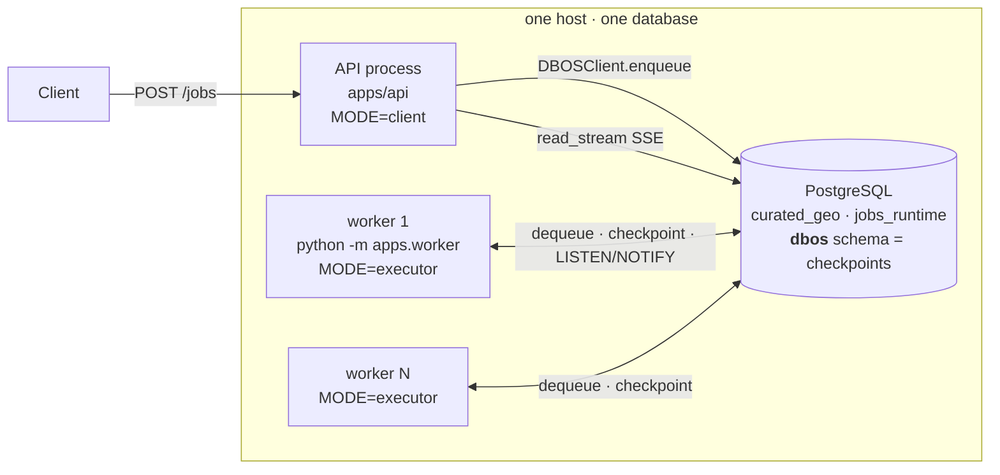

# Track A — DBOS ops-plane

> **Durable execution as a _library_.** No orchestration service. Checkpoints live in the
> application's own Postgres. We keep the scheduler we wrote and borrow one property:
> an interrupted workflow resumes from its last completed step.

**Branch** `feat/ops-plane-dbos` · **Engine** DBOS Transact `>=2.28,<3` · **Licence** MIT, ungated

> Read this beside `PHASE3_OPS_PLANE_HATCHET_ARCHITECTURE.md`. **Sections 2 and 4 use the
> same 15 capabilities, in the same order, in both documents** — the rows pair up one for one.

---

## 1 · At a glance

| | Track A |
|---|---|
| Process kinds to operate | **2** — API, worker |
| Databases | **1** — checkpoints are a schema (`dbos`) beside the domain data |
| Containers beyond Postgres | **0** |
| Idle Postgres connections | worker 4 · DBOS pool 5 · **+1 per in-flight unit** |
| Ops-plane code we own | ~1 290 LOC across 6 modules |
| Run history | our tables · unbounded · `GROUP BY`-able |
| Operator UI | none — SQL |
| One process can submit *and* execute? | **yes** (`dev` mode) |

---

## 2 · Who provides what — the capability map

The same 15 capabilities, in the same order, appear in the Hatchet document.
**Owner** is the question the whole comparison turns on.

| # | Capability | Owner | Component providing it |
|---:|---|:---:|---|
| 1 | Change intake → dirty set | shared | `plan.py` + `impact.py` + `graph.py` |
| 2 | Run submission & durability | engine | `dbos_orchestrator.submit_run` → `DBOSClient.enqueue` |
| 3 | Dependency scheduling | **ours** | `orchestration/wave.py` + the `run_workflow` loop |
| 4 | Unit execution | **ours** | `dbos_app.s_compute` inside `unit_workflow` |
| 5 | Failure isolation & propagation | **ours** | `plan_wave()` skip set |
| 6 | Retries | **ours — off** | `@DBOS.step(retries_allowed=False)` |
| 7 | Cancellation | shared | `cancel_workflow` + `pg_cancel_backend` + `runstore` |
| 8 | Run status vocabulary | **ours** | `orchestration_run` / `job_unit` tables |
| 9 | Status read | **ours** | `runstore.get_run`, engine as existence oracle |
| 10 | Run history & cross-run querying | **ours** | SQL on our tables |
| 11 | Live progress (SSE) | engine | `DBOS.write_stream` → `read_stream` |
| 12 | Crash recovery | engine — **one executor only** | DBOS startup recovery, per `executor_id` |
| 13 | Admission control (dedup, serialisation) | — | **not implemented** |
| 14 | Provenance | shared | `jobs_runtime.job_run` (r031) |
| 15 | Observability & operator UX | **ours** | runbook SQL + `ops_executor_health_v` |

**Score: 8 ours · 3 engine · 3 shared · 1 absent.**

---

## 3 · Architecture

| process | required | role |
|---|---|---|
| API (`apps/api`) | yes | submits, reads status, serves SSE. Does **not** execute PostGIS. |
| worker (`python -m apps.worker`) | yes in production | executes runs and units. Scale for throughput. |

`REIMAGINA_DBOS_EXECUTION_MODE` = `client` (API-safe default) · `executor` (workers) ·
`dev` (explicit one-process execution, local only).

### Component inventory

| File | LOC | Owns |
|---|---:|---|
| `orchestration/dbos_app.py` | 580 | queues, steps, workflows, executor identity, DB guards, progress |
| `orchestration/dbos_orchestrator.py` | 432 | the port — submit / read / cancel / subscribe |
| `orchestration/runstore.py` | 200 | run + unit SQL, with terminal-state guards |
| `orchestration/wave.py` | 75 | the wave scheduler |
| `orchestration/factory.py` | 81 | modes `dbos`, `sync` |
| `orchestration/executor_health.py` | 32 | worker heartbeat |
| `apps/worker/app.py` | 65 | launch, heartbeat, block |

Diff vs the fork point, orchestration package: **+1 186 / −773 across 15 files.**

---

## 4 · Capability detail

### 1 · Change intake → dirty set

| | |
|---|---|
| **Component** | `plan.py:plan_run()` · `impact.py:compute_dirty_set()` · `graph.py` |
| **Owner** | shared — byte-identical on both branches |
| **How** | Resolve the change-set (explicit, or derived from the scenario's override rows), then derive the invalidated indicators in dependency order. |
| **Note** | An engine replaces the *execution* of a run, never the decision of what the run contains. Empty dirty set → `noop`, nothing persisted. |

### 2 · Run submission & durability

| | |
|---|---|
| **Component** | `dbos_orchestrator.submit_run` → `DBOSClient.enqueue(EnqueueOptions(...))` |
| **Owner** | engine |
| **How** | Guard database identity → plan → **serialise the dirty set into the workflow input** → validate → enqueue on the `runs` queue → return 202. |
| **Key property** | **The run id _is_ the DBOS workflow id.** No mapping table; addressable from any process; re-submitting the same id attaches rather than starting a second run. |
| **Watch out** | In `client` mode the API never imports or launches an executor. |

> **Why the DAG is a workflow input, not a module global — the branch's one hard rule.**
> DBOS matches replayed steps by `(position, function name)`. Our design calls the *same*
> step once per indicator, so position alone decides which checkpointed output a replayed
> call receives. Measured (spike 2): a module-global registry returned `v0`'s output for
> `vNEW` — **no exception, plausible result, one indicator's value attributed to another.**
> Hence: the workflow body branches only on workflow inputs and step results.

### 3 · Dependency scheduling

| | |
|---|---|
| **Component** | `orchestration/wave.py` (75 LOC) + the `run_workflow` loop |
| **Owner** | **ours** |
| **How** | `plan_wave(units, registry)` → `(dispatch, skip, final)`. Enqueue the wave as child workflows, await in the **same fixed order**, settle each through a step, repeat. |
| **Watch out** | A wave is a **barrier**. Child ids are positional (`parent_id + function_id`), so an as-completed loop would mint duplicate children. Branch on `s_settle_unit`'s return, never on `get_result` — the latter is recorded but never read back, so a replay re-queries a *live* status. |
| **Measured** | `slr` 3.19 (`diamond`), 3.54 (`lattice`) · head-of-line **1.9–3.0 s** |

### 4 · Unit execution

| | |
|---|---|
| **Component** | `dbos_app.s_compute` (a step) inside `unit_workflow` |
| **Owner** | **ours** |
| **How** | Open a non-autocommit psycopg2 connection, re-check the run is not terminal, run the runner under `current_run(run_id)`, **commit once at the end**. |
| **Watch out** | The single transaction is load-bearing: the write path is stale-then-insert, so on autocommit a cancel landing between the flip and the insert leaves features with **zero** current rows — permanently, since a cancelled workflow never re-runs the step. On failure, re-record the `failed` `job_run` from the **original DSN string** (`conn.dsn` masks the password as literal `xxx`). |

### 5 · Failure isolation & propagation

| | |
|---|---|
| **Component** | `plan_wave()` — the `skip` set |
| **Owner** | **ours** (the repo's F6 rule, hand-written) |
| **How** | A queued unit whose *dirty* input failed / was skipped or cancelled → `skipped`, reason `"unsatisfied input"`. Independent branches keep running; the run stays alive until they finish. |
| **Note** | A **non-dirty** input does not block — it kept its current value. |

### 6 · Retries

| | |
|---|---|
| **Component** | `@DBOS.step(retries_allowed=False)` on `s_compute` |
| **Owner** | **ours — and deliberately off** |
| **How** | A runner exception is deterministic; a retry burns the same minutes to reach the same failure. Infrastructure faults surface as a failed *connect*, retried by the step that owns it. |
| **Gap** | No transient/deterministic classification — nothing distinguishes a serialization failure from a broken query. |

### 7 · Cancellation

| | |
|---|---|
| **Component** | `cancel_workflow(cancel_children=True)` + `job_run_repo().cancel_run_backends()` + `runstore` |
| **Owner** | shared — **neither track solves this in the ops-plane** |
| **How** | Three mechanisms, none sufficient alone: stop scheduling (engine) · **`pg_cancel_backend`** stops the statement (r031) · mark units and close the run (ours). |
| **Watch out** | `cancel_children` is required — units are child workflows and would otherwise start the next wave after the run closed. With no envelope yet, the orchestrator writes it already-terminal, so the workflow's later `create_run` (ON CONFLICT DO NOTHING) is a no-op. |
| **The shared truth** | **No engine can interrupt a thread blocked in a psycopg C call.** The answer lives outside both ops-planes. |

### 8 · Run status vocabulary

| | |
|---|---|
| **Component** | `runstore.py` → `jobs_runtime.orchestration_run` + `job_unit` |
| **Owner** | **ours** |
| **Vocabulary** | unit: `succeeded` / `failed` / **`skipped`** / `cancelled` — run: `succeeded` / **`partial`** / `failed` / `cancelled` |
| **How** | Written at the moment it is meant, with a reason. No reconstruction from partial signals. |
| **Watch out** | Both writers refuse to move a **terminal** row, and return whether the write landed. That guard is what makes a cancel stick — otherwise the mid-unit worker writes `failed` over the top and resurrects a closed run. Callers announce only what the database accepted. |

### 9 · Status read

| | |
|---|---|
| **Component** | `dbos_orchestrator.get_run` |
| **Owner** | **ours**, with the engine as existence oracle |
| **How** | Detail from our tables; **existence** from the engine. The envelope is written by the workflow's first step, so there is a window where the run exists and `jobs_runtime` is silent — `_from_workflow` reconstructs it from the workflow's own persisted input. |
| **Why not write the envelope at submit** | That reintroduces the permanent wedge already on `main`: a crash between commit and enqueue leaves a `running` run nothing will ever drive. |
| **Property** | **Correct on arrival** — a submitted run is immediately retrievable and already knows its units. |

### 10 · Run history & cross-run querying

| | |
|---|---|
| **Component** | plain SQL on `orchestration_run` / `job_unit` |
| **Owner** | **ours** |
| **How** | Joinable, indexable, aggregable. *"How many scenarios partially failed this week"* = one `GROUP BY`. |
| **Retention** | Unbounded — disk only. |

### 11 · Live progress (SSE)

| | |
|---|---|
| **Component** | `_emit` → `DBOS.write_stream` · `subscribe_progress` → `DBOSClient.read_stream` · `frames.py` |
| **Owner** | engine (transport) · ours (wire shape) |
| **How** | Written **from the workflow body, never a step** — a body write is exactly-once, a step write at-least-once, and a duplicated terminal event would close a subscriber early. Events carry identity, ordering and a resumable offset natively. |
| **Watch out** | `read_stream` is a *blocking sync* generator, so it runs on a **dedicated daemon thread**, not `run_in_executor` — that future cannot be cancelled once running, so ~30 SSE disconnects would deadlock the API's entire thread-offload path. Bounded: 32 subscriber slots, 128-event queue, snapshot-first yield. |
| **Measured** | Spike 6 — ordered, offset-resumable (`resume at offset=6 → []`, no gap, no duplicate), closes cleanly. |

### 12 · Crash recovery

| | |
|---|---|
| **Component** | DBOS startup recovery scoped by `executor_id` · `executor_health.heartbeat()` |
| **Owner** | engine, **but only within one executor** |
| **How** | Launching reclaims *this executor's* interrupted workflows automatically. |
| **Measured** | Spike 1, kill −9 mid-wave: **redundant compute is exactly one unit — the minimum possible.** Two units untouched, the interrupted one re-run, no duplicate results. |
| **⚠ Gap** | **No cross-executor recovery.** A live peer does not adopt orphans. The sweep works but is a private API, and 2.28.0 shipped without the idempotent-recovery fix (merged 6 h after release) — a sweep against a live executor **double-executes**. Heartbeats are for diagnosis only. |
| **⚠ Config trap** | `executor_id` fails silently both ways: **not stable across restarts** → orphaned runs; **shared by two live processes** → double execution. Default `<hostname>:<role>` is safe for one process per role per host, and warns. |

### 13 · Admission control (dedup, serialisation)

| | |
|---|---|
| **Component** | — |
| **Owner** | **nobody — not implemented on any rung** |
| **Consequence** | `submit_run` mints a fresh `uuid4()` per call, so a **double-clicked Save starts two identical multi-minute runs**. Nothing serialises two runs writing the same scenario's rows. |
| **Note** | Track B gets both as ~6 lines of engine config. |

### 14 · Provenance

| | |
|---|---|
| **Component** | `jobs_runtime.job_run` + `backend_pid` (migration r031) |
| **Owner** | shared — survives on both branches |
| **How** | A runner owns its own `job_run` row. `record_failed_job_run` re-records on a separate connection after the rollback erases it. |
| **⚠ Known gap** | `job_unit.job_run_id` has existed since r028 and is **never written** (verified: 0 of 3 rows on a live run). Per-**run** aggregates are correct; per-**unit** attribution is impossible, and joining the two tables gives a cartesian product (3 × 3 = 9 rows). |

### 15 · Observability & operator UX

| | |
|---|---|
| **Component** | the runbook's SQL · `explore.ops_executor_health_v` · process stdout |
| **Owner** | **ours** |
| **How** | Cross-check two planes in one query: `orchestration_run.status` (what the run *means*) joined to `dbos.workflow_status` (whether anything is still *driving* it). |
| **Have** | run/unit status · executor liveness · orphan detection · per-run timing |
| **⚠ Missing** | no dashboard · no DAG visualisation · no per-task log viewer · no replay button · **no metrics at all** · no OpenTelemetry |

---

## 5 · Deployment & configuration surface

| variable | default | consequence if wrong |
|---|---|---|
| `DATABASE_URL_DIRECT` | — | **startup fails.** Unset → DBOS silently writes **SQLite** checkpoints; wrong DSN → DBOS **creates a database** and looks healthy |
| `REIMAGINA_DBOS_EXECUTION_MODE` | `client` | `executor` for workers, `dev` only locally |
| `REIMAGINA_EXECUTOR_ID` | `<hostname>:<role>`, warns | recovery reclaims **only** this exact id |
| `REIMAGINA_RUN_CONCURRENCY` | 2 | parent workflows per executor |
| `REIMAGINA_UNIT_CONCURRENCY` | 2 | units per process **= domain DB connections** |
| `REIMAGINA_PROGRESS_SUBSCRIBERS` | 32 | excess SSE clients told to reconnect |
| `REIMAGINA_APP_VERSION` | derived from source | ⚠ **sticky** once set; gates blue-green recovery |

**Three guards exist because DBOS prefers working over failing:** no URL → SQLite · wrong
DSN → it creates the database · API DSN ≠ worker DSN → plan here, execute there. Each is
checked at startup or per submit.

**Database footprint.** 1 database · `dbos` schema, 11 tables · `pg_dump -n curated_geo -n
jobs_runtime` stays self-contained with **no reference to the dbos schema** (spike 8) · DBOS
tracks migrations in `dbos.dbos_migrations`, no alembic collision. Budget connections as
`processes × (4 + REIMAGINA_UNIT_CONCURRENCY)`.

**API surface.** `POST /jobs` still honours `wait: true` → **200 with the finished status**,
because one process can both submit and drain. Track B rejects it with a **422** — the
clearest one-line expression of library-vs-service in the HTTP surface.

⚠ Migration histories fork: `r032` here, `r033` on Track B, both off `r031` and mutually
unresolvable. **Each track needs its own database.**

---

## 6 · Measured evidence

### Scheduling — workload suite, 9 synthetic DAGs

`slr` = makespan ÷ critical path. 1.00 = the scheduler hit the DAG's lower bound.

| workload | slr **A** | slr B | head-of-line **A** | head-of-line B |
|---|---:|---:|---:|---:|
| `diamond` | 3.19 | 1.13 | 1868 ms | 78 ms |
| `lattice` | 3.54 | 1.21 | 2480 ms | 103 ms |
| `barrier_probe` | 6.80 | 1.44 | 2811 ms | 96 ms |
| `layered_random` | 4.45 | 1.22 | 3023 ms | 1372 ms |
| `chain_deep` | 13.72 | 2.87 | 1956 ms | 80 ms |

**Track A is measurably the slower scheduler, and the cause is structural** — the wave loop
is a barrier, so per-hop latency is paid once per wave.

> ⚠ **Read in proportion.** Suite units are `pg_sleep`/`sha256` loops of 10 ms–3 s, chosen to
> measure the scheduler rather than the geometry. **Real indicator units run for minutes**,
> where a 2 s wave barrier is <1 % overhead; against a 100 ms unit it is 20×. `barrier_probe`,
> `lattice` and `diamond` are solid at ±2 %; `chain_deep` / `many_tiny` are order-of-magnitude
> only. The `sync` control agrees to within 0.5 % across both worktrees — the harness is sound.

### Spikes

| # | Spike | Result |
|---|---|---|
| 1 | Kill −9 mid-wave | **pass** — exactly one unit recomputed |
| 2 | Registry drift under replay | **fail, worse than predicted** — silent wrong data, no error |
| 3 | Dirty-set order stability | **failed, then fixed** — a real bug on `main` (`f6ff6ef`) |
| 4 | Exception picklability | **pass — the plan was wrong**; psycopg2 errors pickle fine |
| 5 | Blue-green with in-flight runs | **pass** — version isolation holds |
| 6 | Progress streams, offset resume | **pass** |
| 7 | Connection budget | **pass** — ~3 connections idle |
| 8 | Schema co-location | **pass** — `pg_dump` self-contained |

---

## 7 · Pros

- **Nothing to deploy.** No engine, no second database, no broker, no credential, no container.
- **One database, one backup, one migration story.** Checkpoints are a schema, not a system.
- **Run history is ours and unbounded** — joinable, indexable, `GROUP BY`-able.
- **`partial` and `skipped` are first-class**, written when meant, with a reason.
- **Minimum redundant compute on crash — exactly one unit** (measured).
- **The submitting process can also drive.** A worker fleet is throughput, not a precondition.
- **No engine to be down.** Diagnosis is SQL against tables we wrote; `--sync` still runs.
- **Adding an indicator is a catalog row** — the registry is read at runtime, no redeploy.
- **Semantics live in code you can read and step through.** `wave.py` is 75 lines; `pdb` works.

## 8 · Cons

- **We own the scheduler** — waves, skip propagation, status rollup, all ours to maintain.
- **Measurably slower dispatch** — 1.9–3.0 s head-of-line vs ~80–100 ms.
- **No cross-executor recovery.** A dead worker's runs stay stuck until a process with that
  exact `REIMAGINA_EXECUTOR_ID` starts. Blocked upstream.
- **`executor_id` is a silent-failure knob** — orphans one way, double execution the other.
- **The replay hazard is subtle and permanent.** Anyone "simplifying" DAG-as-input back to a
  module global reintroduces silent result misattribution.
- **No dashboard, no DAG view, no log viewer, no replay button, no metrics, no OTel.**
- **No run dedup, no scenario serialisation** — a double-clicked Save runs twice.
- **`REIMAGINA_APP_VERSION` is sticky**; blue-green needs old-version processes kept alive to drain.
- **Never load-tested, never run multi-process beyond a two-process spike, never deployed.**

## 9 · Gaps

1. **No cross-executor recovery** — heartbeats support diagnosis only.
2. **No metrics** — diagnosis is the runbook's SQL.
3. **A `job_run` cannot be attributed to a unit** — `job_unit.job_run_id` is never written.
4. **Never load-tested.**

---

## 10 · Summary line

Track A buys durability and nothing else. Zero new infrastructure, and full ownership of run
vocabulary, history and scheduling semantics — all queryable in SQL beside the domain data.
It pays with a scheduler we maintain, ~2 s per-wave dispatch latency, no operator UI, no
metrics, and recovery that stops at one executor's boundary.
**Right answer if the units are long and the fleet is small.**

---

## Appendix · Cross-references

Deep detail lives on this branch, not on `main`:
`docs/product/PHASE3_OPS_PLANE_DBOS_SPIKES.md` (the eight spikes in full) and
`docs/architecture/OPS_PLANE_RUNBOOK.md` (the pager runbook — every query run against a real
database). Measurement definitions are shared: `PHASE3_OPS_PLANE_MEASUREMENT.md`.

**Shared foundation — byte-identical on both branches:** `port.py` (the 4-method Protocol and
the status vocabulary) · `plan.py` · `impact.py` · `graph.py` · `coordinator.py` ·
`runners.py` · `frames.py` · `jobs_runtime.job_run` · `tests/conformance/` ·
`tests/workloads/`. `factory.py` is the single place either engine is named.
