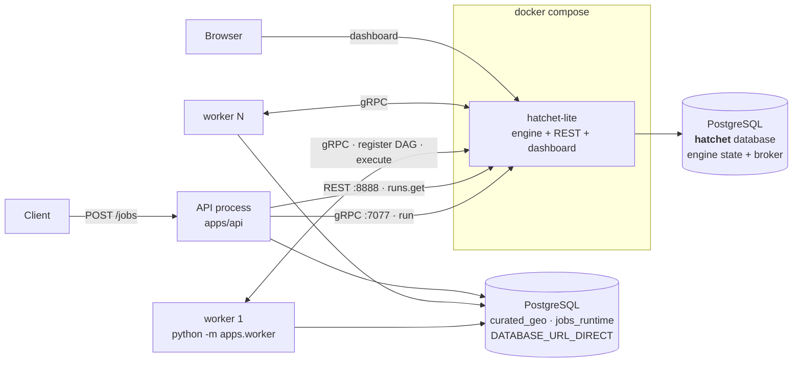

# Track B — Hatchet ops-plane

> **Durable execution as a _service_.** The engine owns scheduling, run state, retries,
> admission control and the dashboard. We declare the graph once and **delete our scheduler**.

**Branch** `feat/ops-plane-hatchet` · **Engine** `hatchet-sdk >=1.35,<2`, self-hosted
`hatchet-lite v0.86.24` · **Licence** MIT, ungated, no licence key, no quota

> Read this beside `PHASE3_OPS_PLANE_DBOS_ARCHITECTURE.md`. **Sections 2 and 4 use the same
> 15 capabilities, in the same order, in both documents** — the rows pair up one for one.

---

## 1 · At a glance

| | Track B |
|---|---|
| Process kinds to operate | **3** — engine, API, worker |
| Databases | **2** — domain + the engine's own `hatchet` |
| Containers beyond Postgres | **1** (`hatchet-lite`; no RabbitMQ — Postgres broker) |
| Idle Postgres connections | **~47** engine (94 before tuning) · +1 per in-flight unit |
| Ops-plane code we own | ~1 080 LOC across 4 modules — `wave.py` and `runstore.py` **deleted** |
| Run history | the engine's · **720 h default, then deleted** · one run at a time |
| Operator UI | dashboard, DAG view, per-task logs, replay |
| One process can submit *and* execute? | **no** — a worker is a precondition |

---

## 2 · Who provides what — the capability map

The same 15 capabilities, in the same order, appear in the DBOS document.
**Owner** is the question the whole comparison turns on.

| # | Capability | Owner | Component providing it |
|---:|---|:---:|---|
| 1 | Change intake → dirty set | shared | `plan.py` + `impact.py` + `graph.py` |
| 2 | Run submission & durability | engine | `hatchet_orchestrator.submit_run` → `workflow.run()` |
| 3 | Dependency scheduling | **engine** | `hatchet_app.build_dag` — declaration only |
| 4 | Unit execution | **ours** | the `_runner` task body in `build_dag` |
| 5 | Failure isolation & propagation | **engine** | task parentage — inherited, not written |
| 6 | Retries | **engine** | `TaskDefaults(retries=2)` + `_is_retryable` |
| 7 | Cancellation | shared | `runs.cancel` + `pg_cancel_backend` |
| 8 | Run status vocabulary | **ours, in the engine's output** | `_verdict` in `on_success`/`on_failure_task` |
| 9 | Status read | **engine** | `runs.get()` → verdict, else status mapping |
| 10 | Run history & cross-run querying | **engine** | `runs.list(additional_metadata=…)` — lookup, not aggregate |
| 11 | Live progress (SSE) | engine + ours | gRPC listener as *wakeup*, `get_run` as *answer* |
| 12 | Crash recovery | **engine** | slot released, work reassigned — no code of ours |
| 13 | Admission control (dedup, serialisation) | **engine** | `TTLBasedIdempotencyConfig` + `ConcurrencyExpression` |
| 14 | Provenance | shared | `jobs_runtime.job_run` (r031) |
| 15 | Observability & operator UX | **engine** | dashboard · per-task logs · replay · OTel · Prometheus |

**Score: 9 engine · 2 ours · 1 hybrid · 2 shared · 1 split.**

---

## 3 · Architecture



| process | required | role |
|---|---|---|
| engine (`hatchet-lite`) | **yes** | schedules everything; nothing runs without it |
| worker (`python -m apps.worker`) | **yes** | there is no in-process mode |
| API (`apps/api`) | for HTTP | submits and reads; does not execute units |

```bash
docker compose -f infra/docker/docker-compose.hatchet.yml up -d
```

Postgres is **not** in that compose file — the engine uses the host instance in its own
`hatchet` database. Deliberate: it keeps the comparison honest by not charging this track for
a database the other track also needs. Broker is `SERVER_MSGQUEUE_KIND: postgres`, so **no
RabbitMQ**.

> ⚠ **A worker is a precondition, not an optimisation.** `run(wait_for_result=False)` returns
> a workflow-run id, but `runs.get()` on it returns **404** until a worker has registered the
> workflow definition. On this track a run id can exist and be unqueryable. Track A has no
> equivalent state.

### Component inventory

| File | LOC | Owns |
|---|---:|---|
| `orchestration/hatchet_app.py` | 504 | the DAG declaration, task defaults, admission control, the verdict |
| `orchestration/hatchet_orchestrator.py` | 487 | the port — submit / read / cancel / subscribe, + `cancel_scenario` |
| `orchestration/database_identity.py` | 92 | the plan-here-execute-there guard |
| `orchestration/factory.py` | 73 | modes `hatchet`, `sync` |
| `apps/worker/app.py` | 95 | preflight, register the DAG, execute |
| `infra/docker/docker-compose.hatchet.yml` | 76 | the engine, with every biting default documented |

**Deleted:** `wave.py` (75) · `runstore.py` (196) · `tasks.py` (192) · `queue_app.py` (82) ·
`events.py` (42) · `embedded.py` (167).
Diff vs the fork point, orchestration package: **+1 199 / −1 010 across 14 files.**

---

## 4 · Capability detail

### 1 · Change intake → dirty set

| | |
|---|---|
| **Component** | `plan.py:plan_run()` · `impact.py:compute_dirty_set()` · `graph.py` |
| **Owner** | shared — byte-identical on both branches |
| **How** | Resolve the change-set (explicit, or derived from the scenario's override rows), then derive the invalidated indicators in dependency order. |
| **Note** | The dirty set is derived by the **submitter**, not by the `plan` task — a graph that re-derived its own work would disagree with the one that was scheduled. |

### 2 · Run submission & durability

| | |
|---|---|
| **Component** | `hatchet_orchestrator.submit_run` → `get_run_workflow().run(payload, wait_for_result=False)` |
| **Owner** | engine |
| **How** | Guard database identity → plan → build `RunInput` (dirty, features, ids, `concurrency_key`, `dedup_key`) → submit with `additional_metadata` → return 202. |
| **Key property** | **The run id _is_ Hatchet's workflow run id.** There is no `orchestration_run` table to hold a mapping, and inventing one would re-adopt the state model this track exists to give away. |
| **⚠ Consequence** | `RunInput.run_id` is an **empty-string placeholder** — the submitter cannot know the id. Runners must read `ctx.workflow_run_id`. Reading `input.run_id` passed `""` into `job_run.run_id uuid` and killed every unit; **the DAG had never once run end to end** until the conformance worker fixture existed (B11). |

### 3 · Dependency scheduling

| | |
|---|---|
| **Component** | `hatchet_app.build_dag()` — one task per indicator, parented by its prerequisites |
| **Owner** | **engine** |
| **How** | We *declare*; the engine does readiness, ordering, fan-out and dispatch. `plan` returns the dirty slugs, and each task's `skip_if` CEL decides for itself whether to run. |
| **⚠ Polarity is load-bearing** (B1) | `skip_if` means *skip when true*, so the expression is negated: `!('{slug}' in output.dirty)`. Backwards, it computes exactly the indicators it should have left alone — and every task reports `COMPLETED`, so nothing looks wrong. |
| **⚠ Non-deterministic by default** (B9) | `ParentCondition` defaults `readable_data_key` to a `datetime.now()` string and `or_group_id` to `uuid4`. Two `build_dag()` calls a second apart serialise to **different bytes**, and API + worker both build at import. Fixed by deriving both from the slug. |
| **Measured** | `slr` **1.13** (`diamond`), **1.21** (`lattice`) · head-of-line **~80–100 ms** |

### 4 · Unit execution

| | |
|---|---|
| **Component** | the `_runner` task body inside `build_dag` |
| **Owner** | **ours** |
| **How** | Open a psycopg2 connection on `DATABASE_URL_DIRECT` (the engine's database is not the domain database), run the runner under `current_run(ctx.workflow_run_id)`, commit, always close. |
| **Watch out** | `except Exception`, **never `BaseException`** — the wider clause caught `KeyboardInterrupt`/`SystemExit`/`CancelledError` and re-raised them as `NonRetryableException`, so a worker being shut down recorded a healthy unit as a permanent failure. On failure, re-record the `failed` `job_run` from the **original DSN string** (`conn.dsn` masks the password as literal `xxx`), once per attempt. |
| **Bonus** | `ctx.log(...)` per unit — free, per-task, searchable in the dashboard. |

### 5 · Failure isolation & propagation

| | |
|---|---|
| **Component** | task parentage — nothing of ours |
| **Owner** | **engine** |
| **Measured** (B3) | `doomed` FAILED · `dependent` **CANCELLED** · `independent` COMPLETED *after* the failure. |
| **Why it matters** | **Exactly the repo's F6 rule, inherited rather than implemented.** This is the strongest single argument for the service track: behaviour Track A hand-writes in `wave.py` comes free. |
| **⚠ Emergent, not contracted** (B2) | A dirty composite whose *non-dirty* input was skipped still runs — because declaring `skip_if` anywhere disables the engine's default skip-inheritance graph-wide. Undocumented. **Pin the image and cover it with a test**; an upgrade could flip it silently and composites would quietly stop recomputing. |

### 6 · Retries

| | |
|---|---|
| **Component** | `TaskDefaults(retries=2, backoff_factor=2.0, backoff_max_seconds=60)` + `_is_retryable` + `NonRetryableException` |
| **Owner** | **engine** |
| **How** | The engine distinguishes the cases for us: a serialization failure or dropped connection *is* worth retrying; `NonRetryableException` opts a deterministic failure out. Track A turns retries off entirely. |
| **⚠ Ordering trap** | `QueryCanceled` **inherits from `OperationalError`**, so it is tested *first* and classified non-retryable. Reorder those checks and a unit you stopped with `pg_cancel_backend` re-runs up to `REIMAGINA_UNIT_RETRIES` more times, each free to burn a full 120 minutes. `tests/unit/test_unit_retry_policy.py` fails if swapped. |
| **⚠ Both engine defaults are wrong** (B5) | `execution_timeout` **60 seconds** — kills a healthy PostGIS unit a minute in. `schedule_timeout` **5 minutes**, and merely-queued work then reports **FAILED**, so a busy period is indistinguishable from an outage. Overridden to 120 min / 6 h. Sizing rule: `schedule_timeout > slowest_unit × queued_depth ÷ slots`. |

### 7 · Cancellation

| | |
|---|---|
| **Component** | `runs.cancel(run_id)` + `job_run_repo().cancel_run_backends(run_id)` |
| **Owner** | shared — **neither track solves this in the ops-plane** |
| **Measured** (B4) | The task reports **CANCELLED immediately while the SQL keeps running**, and the worker logs *"thread … is still running after cancellation. This could cause the thread pool to get blocked."* The slot is **not** released. |
| **⚠ Accepted ≠ terminal** | `cancel_run` returns once the engine *accepted* the request, not once the run is terminal. Two conformance tests passed by luck and started failing when the machine got busy. |
| **Engine-only bonus** | `cancel_scenario()` cancels every in-flight run for a scenario **by metadata rather than by id** (`runs.list(additional_metadata=…)` + `bulk_cancel`). Deliberately *not* in the port — Track A has no equivalent to offer. |
| **The shared truth** | **No engine can interrupt a thread blocked in a psycopg C call.** `pg_cancel_backend` against `job_run.backend_pid` (r031) is the answer, and it lives outside both ops-planes. |

### 8 · Run status vocabulary

| | |
|---|---|
| **Component** | `_verdict(ctx)` returned by both `on_success_task` and `on_failure_task` |
| **Owner** | **ours — but stored in the engine's run output, not in a table** |
| **The engine's enum** | `QUEUED \| RUNNING \| COMPLETED \| CANCELLED \| FAILED` — no `partial`, no `skipped` |
| **The correction** (B8) | That was recorded as an accepted fidelity loss, and **the conclusion was wrong** — it only looked at the run's *status*. A run's **output** is arbitrary JSON, and `on_failure_task` fires precisely when some units succeeded and one did not. So the vocabulary survives: `{"overall": "partial", "units": {…}}`. |
| **⚠ Reconstructed from 4 signals, in order** (B10) | error → `failed`; `ctx.was_skipped` → `skipped`; **no output** → `cancelled`; else `succeeded`. A cancelled dependent has **no error and `was_skipped=False`**, so classifying on those two alone reports a composite that never ran as **`succeeded`**. That bug was itself the fix for the previous bug. |
| **⚠ Still true** | The run's *status* remains `FAILED` on a partial run. A dashboard chip, an alert or an operator reading status alone sees red. **The verdict is the one to believe.** |

### 9 · Status read

| | |
|---|---|
| **Component** | `hatchet_orchestrator.get_run` → `runs.get(run_id)` |
| **Owner** | **engine** |
| **How** | Prefer the finalizer's verdict; while in flight, translate task statuses. `conn` is **unused** — this branch has no run tables; the signature keeps it so the port stays implementable by a track that does. |
| **⚠ Cleanup required** | Strip the engine's millisecond `display_name` suffix (`compactness-1785250189293`) and the scaffolding tasks — the engine **renames** finalizers (`summarise_failure` → `summarise_failure-on-failure`), and listing the bare names let a phantom unit through to callers. |
| **⚠ Property** | **Answers converge rather than arriving correct.** A run is retrievable before it reports its units, because the engine creates task rows after acceptance. |

### 10 · Run history & cross-run querying

| | |
|---|---|
| **Component** | `runs.list(additional_metadata={"scenario_id": …})` + the dashboard search box |
| **Owner** | **engine** |
| **How** | `additional_metadata` (scenario, AOI, code version) round-trips, is readable in-workflow via `ctx.additional_metadata`, and filters both the API and the dashboard. |
| **⚠ The comparison row** | It is a **lookup key, not an aggregate**. *"How many scenarios partially failed this week"* is a `GROUP BY` on Track A and **N+1 engine round-trips** here. |
| **⚠ Retention** | `SERVER_LIMITS_DEFAULT_TENANT_RETENTION_PERIOD` defaults to **720 h — runs older than 30 days are deleted.** On this track that *is* the run history. |

### 11 · Live progress (SSE)

| | |
|---|---|
| **Component** | `hatchet.listener.stream(run_id)` as *wakeup* + `get_run` as *answer* · `frames.py` |
| **Owner** | engine (wakeup) · ours (identity, diffing, wire shape) |
| **Why both halves** | The gRPC listener fires the instant a task changes — no polling. But `StepRunEvent` carries only `(type, payload)`: **there is no task identity on it**, which is exactly what a `RunEvent` is. So the listener wakes us and `get_run` answers; `emit()` diffs against what was already sent. |
| **vs Track A** | Track A needs neither half — `DBOS.write_stream` is written by the workflow body, so it carries identity, ordering and a resumable offset natively. |
| **`frames.error_frame` added here** | Once the response headers are on the wire a 503 is unreachable, so an engine outage mid-stream would just stop the stream — indistinguishable from a finished run. Instead: `event: error / data: {"reason":"orchestrator_unavailable"}`. An SSE **event type**, not a run status. |

### 12 · Crash recovery

| | |
|---|---|
| **Component** | none of ours |
| **Owner** | **engine** |
| **How** | A worker that dies mid-task releases its slot and the engine reassigns the work. Nothing is scoped by an executor id, because run ownership is the engine's to track. **Track A spends a runbook section and a heartbeat table on exactly this.** |
| **⚠ But the worker registry leaks** (B12) | Killing a worker does not deregister it — **and neither does `Worker.exit_gracefully()`**, measured after a clean teardown. A clean exit leaks exactly like a `SIGKILL`. |
| **⚠ Symptom is not an error** | Runs sit at `running` with `units=()` while the engine waits on a process that will never answer. After several aborted test runs: **14 workers ACTIVE, one live.** Suite wall clock tracked it exactly — **62 s → 322 s on identical code**. |
| **⚠ Survives a restart** | Registrations live in the engine's own Postgres and came back byte-for-byte after a container restart. Clearing them means recreating the engine database — which discards run history. |
| **⚠ Unsettled** | Whether the engine ever expires a worker on heartbeat timeout. Within every window observed, it did not. **Settle before claiming anything about recovery.** |

### 13 · Admission control (dedup, serialisation)

| | |
|---|---|
| **Component** | `TTLBasedIdempotencyConfig(key_expression="input.dedup_key", ttl=60s)` + `ConcurrencyExpression(max_runs=1, GROUP_ROUND_ROBIN)` |
| **Owner** | **engine — ~6 lines of config** |
| **What it buys** | Dedup collapses a double-clicked Save. Concurrency serialises two runs writing the same scenario's rows (the write path is stale-then-insert, so overlapping writers leave the wrong current value). **Track A implements neither, on any rung.** |
| **⚠ Both were misconfigured first time** (B11) | The first dedup key (`scenario_id + code_version`) ignored the dirty set, so **two different edits inside the TTL deduped to one run and the second edit was never computed — data loss wearing a dedup's clothes.** Now a `sha256` over scenario, AOI, code version, dirty set **and feature scope**. The first concurrency key, the constant `"baseline"`, put **every** scenario-less run in one bucket, cancelling unrelated work. |
| **⚠ Not `CANCEL_IN_PROGRESS`** | Cancellation is cooperative (B4), so it would start the new run while the old one is still writing — exactly the two-writer case. |
| **The finding** | Not "we had bugs". Both were the engine behaving **exactly as configured**, in ways unit tests could not catch and that would have been data loss in production. A declarative feature is load-bearing behaviour you did not write and cannot step through. |

### 14 · Provenance

| | |
|---|---|
| **Component** | `jobs_runtime.job_run` + `backend_pid` (migration r031) |
| **Owner** | shared — survives on both branches |
| **How** | A runner owns its own `job_run` row. `record_failed_job_run` re-records on a separate connection after the rollback erases it — once per attempt, deliberately, since each retry is a separate failed execution. |
| **⚠ Known gap** | `job_unit.job_run_id` is never written (shared with Track A). Per-**run** aggregates are correct; per-**unit** attribution is impossible, and joining the two tables gives a cartesian product. |

### 15 · Observability & operator UX

| | |
|---|---|
| **Component** | the engine's dashboard + REST on `:8888` |
| **Owner** | **engine** |
| **Have** | Runs list · metadata filter · **DAG view** · per-task **Logs** · Input/Output inspection · **Replay** button · Workers/slots · hand-triggered runs · **OTel `traceparent` injected free** |
| **⚠ Green means two things** (B7) | The DAG view renders a **skipped** unit the same green as a computed one — the status enum has no `skipped`. Open the run's **output** to tell them apart. |
| **⚠ Credentials** | Seeded defaults are hardcoded in the engine's own source (`pkg/config/database/config.go:59-60`): `admin@example.com` / `Admin123!!`. **Change before this is reachable beyond localhost.** |
| **⚠ Health probes** | `/api/v1/readiness` and `/api/v1/liveness` return **403**, not 200. `/api/v1/meta` answers unauthenticated and is the real liveness check. |
| **Metrics** | Exist and are **off** — `SERVER_OBSERVABILITY_ENABLED` / `SERVER_PROMETHEUS_ENABLED` default false. Turning them on is config, not code. Track A has nothing to turn on. |

### Track A equivalents, side by side

| dashboard view | Track A equivalent |
|---|---|
| Runs list | `SELECT` on `orchestration_run` |
| filter by metadata | `WHERE scenario_id = …` |
| **DAG view** | nothing — the shape is implicit in `wave.py` |
| per-task **Logs** | process stdout |
| Input/Output | `job_unit` row |
| **Replay** button | `fork_workflow`, CLI only |
| **Workers** | `ps` |

---

## 5 · Deployment & configuration surface

| variable | default | consequence if wrong |
|---|---|---|
| `HATCHET_CLIENT_TOKEN` | — | startup fails. ⚠ Mint against the **`default`** tenant, not `internal` — an `internal` token authenticates, registers the worker and all its actions, and then **every run sits in `queued` forever** |
| `HATCHET_CLIENT_TLS_STRATEGY` | — | must be `none` against `SERVER_GRPC_INSECURE=t`, or the worker dies on `WRONG_VERSION_NUMBER` |
| `DATABASE_URL_DIRECT` | — | submit/worker startup fails |
| `REIMAGINA_UNIT_TIMEOUT_MIN` | 120 | ⚠ engine default is **60 seconds** |
| `REIMAGINA_QUEUE_TIMEOUT_HOURS` | 6 | ⚠ engine default is **5 minutes**, and timed-out queued work reports FAILED |
| `REIMAGINA_UNIT_RETRIES` | 2 | with backoff |
| `REIMAGINA_DEDUP_TTL_S` | 60 | a debounce, not a result cache |
| `REIMAGINA_UNIT_CONCURRENCY` | 2 | worker slots **= simultaneous domain DB connections** |

**Two engine constraints Track A has no analogue for:** the engine's database **must be UTC**
or it refuses to start · `SERVER_AUTH_COOKIE_DOMAIN` is **mandatory**, even headless.

**⚠ The connection-pool number is the price of sharing Postgres.** Left at its default the
engine opened **94 of the host's 100 connections** at idle — the next thing to connect got
`sorry, too many clients already`, which the workload suite reported as a *missing* database
rather than a full one. `DATABASE_MAX_CONNS: 20` bounds one pool, not the engine's total:
**94 → 47**. The honest number is **~47 idle connections**, not 20.

**Lazy construction, two locks.** Client and DAG are built on first use behind *separate*
locks, always taken DAG → client — `build_dag()` calls `get_hatchet()`, so one non-reentrant
lock would deadlock on the nested acquire. Zero locks meant two concurrent cold `POST /jobs`
each built a client and a DAG, leaking a gRPC channel and its threads.

**API surface.** `POST /jobs` accepts `wait` only as `Literal[False]`; `true` is a **422** —
nothing can drain a run inside the request. Track A keeps `wait: true` → 200. `GET
/jobs/{run_id}` types the path param as `UUID`, so a malformed id is a 422 at the boundary
instead of an engine-client pydantic error that looks like an outage and returns 503.

⚠ Migration histories fork: `r033` here (**drops** `orchestration_run` and `job_unit`),
`r032` on Track A, both off `r031` and mutually unresolvable. **Each track needs its own
database.**

---

## 6 · Measured evidence

### Scheduling — workload suite, 9 synthetic DAGs

`slr` = makespan ÷ critical path. 1.00 = the scheduler hit the DAG's lower bound.

| workload | slr A | slr **B** | head-of-line A | head-of-line **B** |
|---|---:|---:|---:|---:|
| `diamond` | 3.19 | **1.13** | 1868 ms | **78 ms** |
| `lattice` | 3.54 | **1.21** | 2480 ms | **103 ms** |
| `barrier_probe` | 6.80 | **1.44** | 2811 ms | **96 ms** |
| `layered_random` | 4.45 | **1.22** | 3023 ms | 1372 ms |
| `chain_deep` | 13.72 | **2.87** | 1956 ms | **80 ms** |

**Track B is decisively the better scheduler, and it is structural** — per-task readiness
instead of a wave barrier. `slr` 1.13 on `diamond` is within 13 % of the DAG's theoretical
lower bound. It is also the only track that beat the serial `sync` control on parallel shapes
(`layered_random` speedup **1.63×** vs 0.44×).

> ⚠ **Read in proportion.** Suite units are `pg_sleep`/`sha256` loops of 10 ms–3 s, chosen to
> measure the scheduler rather than the geometry. **Real indicator units run for minutes**,
> where a 2 s wave barrier is <1 % overhead. `barrier_probe`, `lattice` and `diamond` are solid
> at ±2 %; `chain_deep` / `many_tiny` are order-of-magnitude only. The `sync` control agrees to
> within 0.5 % across both worktrees — the harness is sound.

### Spikes

| # | Spike | Result |
|---|---|---|
| B0 | Engine/SDK facts, licence | MIT confirmed · **two undocumented startup constraints** (UTC, cookie domain) |
| B1 | `skip_if` CEL set membership | **works — polarity inverted from the plan.** The static-DAG design is viable |
| B2 | Skip inheritance | **agrees with our rule** — emergent and undocumented; pin the image |
| B3 | Failure propagation | **exactly our F6 rule, inherited free** |
| B4 | Cancelling a live statement | task CANCELLED at once, **statement keeps running**, slot not released |
| B5 | `schedule_timeout` under saturation | queued-too-long reports **FAILED** — saturation looks like an outage |
| B6 | Payload headroom | 72 KB at a 2 000-indicator catalog = 1.7 % of the gRPC frame. Non-issue |
| B7 | What the status enum loses | skipped ≡ COMPLETED · partial ≡ FAILED |
| B8 | Is `partial` inexpressible? | **No — and it invalidated B7's conclusion.** The verdict mechanism |
| B9 | DAG declaration determinism | **non-deterministic by default**, fixed |
| B10 | Cancelled dependent looks like success | **a bug in the fix for the previous bug** |
| B11 | Cost of real admission control | **4 bugs in code that passed review, ruff and 293 unit tests** |
| B12 | Dead workers keep their registration | leaks · survives engine restart · `exit_gracefully()` does not help |

---

## 7 · Pros

- **We do not own a scheduler.** Readiness, ordering, fan-out, propagation, retries, backoff —
  inherited. `wave.py` is deleted, not maintained.
- **Measurably better scheduling** — `slr` 1.13–1.44 vs 3.19–6.80; ~80–100 ms head-of-line vs 1.9–3.0 s.
- **Failure propagation is exactly our F6 rule, for free.** The strongest single argument for the track.
- **Run dedup and scenario serialisation exist**, in ~6 lines of config. Track A has neither.
- **A real operator UI** — DAG view, per-task logs, input/output, one-click replay, worker/slot
  visibility, metadata search, hand-triggered runs.
- **Retries that distinguish transient from deterministic**, classified by the engine.
- **Bulk operations by meaning, not by id** — `cancel_scenario` in one call.
- **OTel `traceparent` free**; Prometheus a config flag away.
- **No recovery code to write** — a dead worker's slot is reassigned.
- **Zero extra infrastructure beyond the engine container** — Postgres broker, no RabbitMQ,
  no licence key, no quota, MIT.

## 8 · Cons

- **There is a service to operate** — a container, a second database, a UTC requirement, a
  client token, a TLS strategy, seeded default credentials to change.
- **A worker is a precondition.** No in-process mode; a run is **404 until a worker registers**.
- **~47 idle Postgres connections** on the shared instance, against a default `max_connections` of 100.
- **Run history is the engine's and expires in 30 days by default.**
- **The vocabulary is reachable one run at a time** — lookup, not aggregate.
- **Status is reconstructed from partial signals**, and reconstruction has more corner cases
  than writing the truth down (B10 shipped a cancelled unit as `succeeded`).
- **The dashboard's status chip and the run's verdict can disagree.**
- **Answers converge rather than arriving correct**; `cancel_run` returns on acceptance, not terminality.
- **Worker registrations leak and survive an engine restart.** Clearing them discards run history.
- **Both defaults that matter are actively wrong** for this workload (60 s, 5 min).
- **Adding an indicator requires a redeploy** — the DAG is declared at import. Track A reads
  the registry at runtime.
- **Semantics live in engine config**, whose effects surface at runtime and cannot be stepped
  through. Both of ours were misconfigured first time, in ways that would have been data loss.
- **Behaviour we rely on is emergent, not contracted** (B2 skip inheritance).

## 9 · Gaps

1. **`rate_limits` and `slot_cost` are not wired up** — the engine-native answer to N workers
   saturating one Postgres, and unmeasured.
2. **`ctx.refresh_timeout` is not wired up**, so a wedged unit burns the full 120 minutes.
   Needs a runner progress callback that does not exist yet.
3. **No unbounded baseline cron** — a whole-database recompute has no safe scope contract.
4. **Worker-expiry behaviour unestablished** (see capability 12) — blocks any recovery claim.
5. **Metrics available and off.**
6. **A `job_run` cannot be attributed to a unit** — shared with Track A.

---

## 10 · Summary line

Track B buys a scheduler, an operator UI, admission control and retries, and pays with a
standing service: a container, a second database, ~47 idle connections, a worker that must
exist before a run is observable, and history that expires in 30 days. It schedules measurably
better — within 13 % of the DAG's lower bound where Track A is 3× off it — and inherits our
exact failure-propagation rule for free. The cost that surfaced repeatedly in practice is not
performance but **legibility**: semantics live in engine config rather than steppable code,
status is reconstructed rather than written, and answers converge rather than arriving correct.
**Right answer if the DAG is wide, the fleet is large, and someone will actually watch the dashboard.**

---

## Appendix · Cross-references

Deep detail lives on this branch, not on `main`:
`docs/product/PHASE3_OPS_PLANE_HATCHET_SPIKES.md` (all twelve spikes) and
`docs/architecture/OPS_PLANE_RUNBOOK.md` (the pager runbook, plus what to click in the
dashboard and in what order). Measurement definitions are shared:
`PHASE3_OPS_PLANE_MEASUREMENT.md`.

**Shared foundation — byte-identical on both branches:** `port.py` (the 4-method Protocol and
the status vocabulary) · `plan.py` · `impact.py` · `graph.py` · `coordinator.py` ·
`runners.py` · `jobs_runtime.job_run` · `tests/conformance/` · `tests/workloads/`.
`frames.py` differs by one function (`error_frame`). `factory.py` is the single place either
engine is named.
