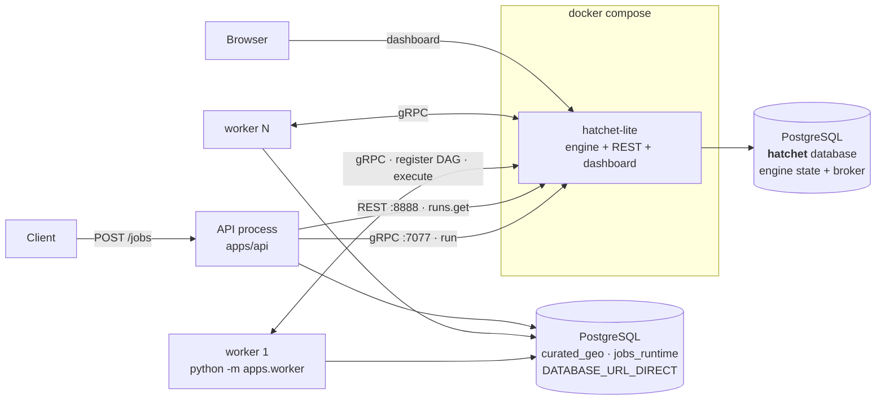

# Track B — Hatchet ops-plane

**Branch:** `feat/ops-plane-hatchet` (worktree `~/Desktop/projects/reimagina-hatchet`)
**Engine:** [Hatchet](https://github.com/hatchet-dev/hatchet) `hatchet-sdk >=1.35,<2`, self-hosted `hatchet-lite v0.86.24` — MIT, ungated, no licence key
**One line:** durable execution as a *service*. The engine owns scheduling, run state, retries, admission control and the dashboard. We declare the graph and delete our scheduler.

---

## 1. The shape of the decision

Hatchet is a standing service that takes a declared DAG and runs it. It gives us readiness,
ordering, fan-out, failure propagation, retries, dedup, concurrency control, a DAG
visualiser, per-task logs and one-click replay — none of which we write.

So this track **deletes** `orchestration/wave.py`, `orchestration/runstore.py`, and the
`orchestration_run` / `job_unit` tables (migration `r033_drop_our_run_state`). What we keep
is the declaration and the translation back to the port's vocabulary.

Everything in this document follows from that. Track A's document is the mirror image.

---

## 2. Shared foundation (identical on both tracks)

Both branches fork from the same `main`, and these modules are **byte-identical** between
them. They are what makes the comparison a comparison rather than two different products.

| Module | Role |
|---|---|
| `orchestration/port.py` | The `Orchestrator` Protocol — 4 methods, plain dataclasses, no engine types leak. Also the status vocabulary (`UNIT_TERMINAL_STATES`, `RUN_TERMINAL_STATES`, `overall_status()`). |
| `orchestration/plan.py` | `plan_run()` — resolve the change-set, derive the dirty-set, in dependency order. The "what" of a run; an engine only replaces the "how". |
| `orchestration/impact.py` | `compute_dirty_set()` — which indicators an edit invalidates. |
| `orchestration/graph.py` | Engine-neutral `topological_order` / `dependents_of` / `downstream_closure`. Pure `graphlib`, no engine, no DB. |
| `orchestration/coordinator.py` | `run_dirty_set()` — the in-process `--sync` executor, and the `_dep_map` derivation. |
| `orchestration/runners.py` | slug → compute function. A runner owns its own `job_run` row. |
| `orchestration/frames.py` | SSE wire framing (+ `error_frame`, added here — see §5.8). |
| `jobs_runtime.job_run` + `backend_pid` (migration r031) | Domain provenance, and the **only** mechanism that actually stops a running statement. Survives on both branches. |
| `tests/conformance/` | The port contract, asserted through `factory.get_orchestrator` only. |
| `tests/workloads/` | 9 synthetic DAG shapes for measuring how an engine schedules. |

### The port

```python
class Orchestrator(Protocol):
    def submit_run(self, conn, *, changed_attributes, edited_features,
                   scenario_id=None, aoi_id=None, code_version="dev") -> RunHandle: ...
    def get_run(self, conn, run_id: str) -> RunStatus | None: ...
    def cancel_run(self, conn, run_id: str) -> bool: ...
    def subscribe_progress(self, run_id: str) -> AsyncIterator[RunEvent]: ...
```

Note `get_run(conn, ...)` — `conn` is **unused** on this branch. The signature keeps it
because the port must stay implementable by a track that has run tables.

---

## 3. Deployment shape



**Processes to operate: 3 kinds (engine, API, worker). Databases: 2. Containers beyond
Postgres: 1.**

| process | required | why |
|---|---|---|
| engine (`hatchet-lite`) | **yes** | schedules everything; nothing runs without it |
| worker (`python -m apps.worker`) | **yes** | there is no in-process mode |
| API (`apps/api`) | for HTTP | submits and reads; does not execute units |

```bash
docker compose -f infra/docker/docker-compose.hatchet.yml up -d
```

Postgres is **not** in that compose file — the engine uses the host instance, in its own
`hatchet` database. Deliberate: it keeps the comparison honest by not charging this track
for a database the other track also needs. Broker is `SERVER_MSGQUEUE_KIND: postgres`, so
**no RabbitMQ** — zero extra infrastructure beyond the engine container itself.

> ⚠ **A worker is a precondition, not an optimisation.** `run(wait_for_result=False)`
> returns a workflow-run id, but `runs.get()` on it returns **404** until a worker has
> registered the workflow definition. On this track a run id can exist and be unqueryable.
> Track A has no equivalent state.

---

## 4. Component map

| File | LOC | What it owns |
|---|---:|---|
| `orchestration/hatchet_app.py` | 504 | The DAG declaration, task defaults, admission control, the verdict finalizers |
| `orchestration/hatchet_orchestrator.py` | 487 | The port implementation — submit / read / cancel / subscribe, + `cancel_scenario` |
| `orchestration/database_identity.py` | 92 | Plan-here-execute-there guard |
| `orchestration/factory.py` | 73 | Modes: `hatchet`, `sync` |
| `apps/worker/app.py` | 95 | Preflight validation, register the DAG, start executing |
| `infra/docker/docker-compose.hatchet.yml` | 76 | The engine, with every default that bites documented |

**Deleted:** `wave.py` (75), `runstore.py` (196), `tasks.py` (192), `queue_app.py` (82),
`events.py` (42), `embedded.py` (167). Diff against the fork point, orchestration package
only: **+1199 / −1010 across 14 files.**

---

## 5. How each feature is implemented

### 5.1 The DAG is declared once, at import

`build_dag()` is the entire scheduler:

```python
workflow = client.workflow(name="reimagina-run", input_validator=RunInput,
                           task_defaults=TaskDefaults(...), idempotency=..., concurrency=...)

@workflow.task(execution_timeout=timedelta(minutes=5), retries=1)
def plan(input: RunInput, ctx: Context) -> dict:
    return {"dirty": input.dirty}          # slugs only — see B6

for spec in _topo_order(registry):
    parents = [plan] + [node[dep] for dep, _w in spec.depends_on if dep in node]
    node[spec.slug] = workflow.task(name=spec.slug, parents=parents,
                                    skip_if=_skip_unless_dirty(plan, spec.slug))(_runner)
```

One task per indicator, parented by its prerequisites. Readiness, ordering, fan-out and
failure propagation are the engine's.

**`skip_if` polarity is load-bearing** (spike B1). `skip_if` means *skip when the expression
is true*, so the expression is negated: `!('{slug}' in output.dirty)`. Measured with
`dirty = ["alpha", "gamma"]`:

| expression | alpha | beta | gamma |
|---|---|---|---|
| `'{slug}' in output.dirty` | **SKIPPED** | QUEUED | **SKIPPED** |
| `!('{slug}' in output.dirty)` | QUEUED | **SKIPPED** | QUEUED |

Getting it backwards computes exactly the indicators it should have left alone — and every
task reports `COMPLETED`, so nothing looks wrong. That is the shape of bug that survives
review: the DAG builds, the run succeeds, the dashboard is green, wrong values are served.

**The DAG declaration is non-deterministic by default** (spike B9). `ParentCondition`
defaults `readable_data_key` to a `datetime.now(UTC).isoformat()` string that reaches the
wire, and `or_group_id` to `Field(default_factory=uuid4)`. Two `build_dag()` calls a second
apart serialise to **different bytes**. Since the API and the worker both build at import,
they would describe the same workflow differently every time either starts. Fixed by
deriving both from the slug (`readable_data_key=f"dirty:{slug}"`, `or_group_id=uuid5(...)`).

### 5.2 Submit

`HatchetOrchestrator.submit_run` (`hatchet_orchestrator.py:94`):

1. `assert_same_domain_database(conn, direct_dsn)` — §5.10.
2. `plan_run(...)` derives the dirty-set. Empty → `noop_handle` (the one run id on this
   branch that is ours rather than the engine's; the engine never sees a noop).
3. Build `RunInput`: `dirty`, per-unit `features`, `scenario_id`, `aoi_id`, `code_version`,
   `concurrency_key`, `dedup_key`.
4. `get_run_workflow().run(payload, wait_for_result=False, additional_metadata={...})`.
5. Return `RunHandle(ref.workflow_run_id, status=None)`.

**The run id is Hatchet's workflow run id.** There is no `orchestration_run` table to hold a
mapping, and inventing one would re-adopt the state model this track exists to give away.

⚠ Consequence: `RunInput.run_id` is an **empty-string placeholder** — the submitter cannot
know the id. Unit runners must read `ctx.workflow_run_id`. Reading `input.run_id` instead
passed `""` into `job_run.run_id uuid` and killed every unit with
`invalid input syntax for type uuid: ""`. **The DAG had never once run end to end** until the
conformance worker fixture existed (B11).

`additional_metadata` (`scenario_id`, `aoi_id`, `code_version`) round-trips, is readable
inside the workflow via `ctx.additional_metadata`, and is a filter in both `runs.list()` and
the dashboard search box. It buys back run-level *lookup* — not aggregation.

### 5.3 Admission control — declared, not coded

Two features that are "never implemented on any rung" on Track A, here as config fields:

```python
idempotency=TTLBasedIdempotencyConfig(key_expression="input.dedup_key",
                                      ttl=timedelta(seconds=60)),
concurrency=ConcurrencyExpression(expression="input.concurrency_key", max_runs=1,
                                  limit_strategy=ConcurrencyLimitStrategy.GROUP_ROUND_ROBIN),
```

**Dedup** collapses a double-clicked Save. The key must fingerprint **the work**, not the
scenario: `sha256` over scenario, AOI, code version, dirty set **and per-unit feature scope**.
The first version keyed on `scenario_id + code_version` — which deduplicates two *different*
edits inside the TTL, so the second edit's changes are silently never computed. **Data loss
wearing a dedup's clothes.** Caught by the conformance suite. A collision now returns the
existing run id rather than raising: a dedup hit is the feature working.

**Concurrency** protects the write path. Two runs writing the same scenario's rows
concurrently interleave a stale-then-insert and leave features with the wrong current value.

- ⚠ **Not `CANCEL_IN_PROGRESS`**: cancellation is cooperative and nothing interrupts a
  blocking psycopg call (B4), so it would start the new run while the old one is still
  writing — exactly the two-writer case.
- ⚠ The key falls back to `scenario_id or aoi_id or "baseline"`. The original constant
  `"baseline"` put **every** scenario-less run in one bucket under `max_runs=1`, so unrelated
  baseline runs cancelled each other.

> **The finding is not "we had bugs".** Both misconfigurations were the engine behaving
> exactly as configured, in ways unit tests could not catch and that would have been data
> loss in production. A declarative feature is load-bearing behaviour you did not write and
> cannot step through.

### 5.4 Retries and timeouts — the engine distinguishes the cases

```python
task_defaults=TaskDefaults(
    execution_timeout=UNIT_EXECUTION_TIMEOUT,   # 120 min  (Hatchet default: 60 SECONDS)
    schedule_timeout=UNIT_SCHEDULE_TIMEOUT,     #   6 h    (Hatchet default: 5 minutes)
    retries=UNIT_RETRIES,                       #   2, backoff 2.0 up to 60 s
)
```

⚠ **Both defaults are wrong for this workload** (spike B5). `execution_timeout=60s` kills a
healthy PostGIS unit a minute in. `schedule_timeout=5min` reports merely-queued work as
**FAILED** — the same status as broken compute, so a busy period is indistinguishable from
an outage. Measured with `schedule_timeout=10s`, three 20 s tasks, one slot: tasks 2 and 3
report FAILED without ever executing. Sizing rule:
`schedule_timeout > slowest_unit × queued_depth ÷ slots`.

Track A turns retries off entirely, because there retrying is our decision and a
deterministic exception re-burns the minutes. Here the engine distinguishes: a serialization
failure or dropped connection *is* worth retrying, and `NonRetryableException` opts a
deterministic failure out.

```python
def _is_retryable(exc):
    if isinstance(exc, psycopg2.errors.QueryCanceled):     # ⚠ MUST come first
        return False
    if isinstance(exc, (psycopg2.OperationalError, psycopg2.InterfaceError)):
        return True
    return getattr(exc, "pgcode", None) in {"40001", "40P01"}
```

⚠ `QueryCanceled` inherits from `OperationalError`. Reorder those two checks and a unit you
stopped with `pg_cancel_backend` gets re-run up to `REIMAGINA_UNIT_RETRIES` more times, each
free to burn a full 120 minutes. `tests/unit/test_unit_retry_policy.py` fails if swapped.

### 5.5 Status vocabulary — the verdict, not the enum

Hatchet's status enum is `QUEUED | RUNNING | COMPLETED | CANCELLED | FAILED`. It has no
`partial` and no `skipped`. **That was recorded as an accepted fidelity loss, and the
conclusion was wrong** (spike B8) — because it only ever looked at the run's *status*.

A run's **output** is arbitrary JSON, and `on_failure_task` is a shipped hook that fires
precisely when some units succeeded and one did not. So both finalizers compute a verdict:

```python
@workflow.on_success_task()
def summarise_success(input, ctx): return _verdict(ctx)

@workflow.on_failure_task()
def summarise_failure(input, ctx): return _verdict(ctx)
```

```json
{"overall": "partial",
 "units": {"urban_form_block_compactness":     {"status": "succeeded"},
           "urban_form_block_planned_floors":  {"status": "skipped"},
           "urban_form_block_composite":       {"status": "cancelled"}}}
```

`_verdict` reconstructs each unit from **four signals, in a specific order** (spike B10):

| unit was | `task_run_errors` | `was_skipped` | `task_output` |
|---|---|---|---|
| computed | – | False | the value |
| failed | set | False | raises *not found* |
| **cancelled** (parent failed) | – | **False** | raises *not found* |
| skipped (not dirty) | – | **True** | raises *was skipped* |

⚠ A cancelled dependent carries **no error and `was_skipped=False`**. Classifying on those
two alone reports a composite that never ran as `succeeded` — a wrong value presented as a
good one. **Absence of an output is the discriminator, checked after `was_skipped`.** That
bug was itself the fix for the previous bug: reconstructing status from three partial
signals has more corner cases than mapping an enum did. Track A pays none of this, because
it writes the status it means at the moment it means it.

`get_run` prefers the verdict; while the run is still in flight it falls back to translating
task statuses, stripping the engine's millisecond `display_name` suffix
(`compactness-1785250189293`) and the scaffolding tasks (`plan`,
`summarise_success-on-success`, `summarise_failure-on-failure` — the engine **renames**
finalizers, and listing the bare names let a phantom unit through to callers).

> **The comparison row is not "the engine is lossy". It is where the vocabulary lives.**
>
> | | Track A | Track B |
> |---|---|---|
> | `partial` / `skipped` expressible | yes | yes, in the run output |
> | queryable across runs | `SELECT … GROUP BY` | one run at a time, via the engine |
> | survives the engine being down | yes, it is our table | no |
> | costs a table to maintain | yes | no |
>
> ⚠ The run's *status* is still `FAILED` on a partial run. A dashboard chip, an alert or an
> operator reading status alone still sees red with no way to tell which units survived. The
> verdict is the one to believe.

### 5.6 Execute a unit

The task body opens its **own** psycopg2 connection on `DATABASE_URL_DIRECT` (the engine's
database is not the domain database), runs the runner under `current_run(ctx.workflow_run_id)`,
and commits. Three deliberate properties:

| property | why |
|---|---|
| `except Exception`, **never `BaseException`** | The wider clause caught `KeyboardInterrupt`/`SystemExit`/`CancelledError` and re-raised them as `NonRetryableException` (which subclasses `Exception`), so a worker being shut down recorded a healthy unit as a permanent failure. A signal is not a unit outcome. |
| Re-record the failed `job_run` on the original DSN | The rollback erases the `failed` row the runner opened. `conn.dsn` returns the password as literal `xxx`, so reconnecting from it fails auth silently. Once per attempt, deliberately — each retry is a separate failed execution. |
| `finally: conn.close()` | The runner holds a direct connection for the whole multi-minute transaction; `slots` is therefore a database-connection budget as much as a CPU one. |

`ctx.log(...)` per unit is free, per-task, searchable in the dashboard. Track A has nowhere
to put this but process stdout.

### 5.7 Cancel

```python
hatchet_app.get_hatchet().runs.cancel(run_id)                            # engine
backend_for_connection(conn).job_run_repo().cancel_run_backends(run_id)  # pg_cancel_backend
```

Spike B4: cancelling marks the task `CANCELLED` **immediately while the SQL keeps running**,
and the worker itself logs *"thread … is still running after cancellation. This could cause
the thread pool to get blocked."* The slot is not released. `enable_force_kill_sync_threads`
defaults false and is not a fix worth having.

**This is identical on both tracks** — neither engine can interrupt a thread blocked in a
psycopg C call. `pg_cancel_backend` against `job_run.backend_pid` (r031) is the real answer,
and it lives outside both ops-planes.

⚠ `cancel_run` returns once the engine **accepted** the request, not once the run is
terminal. Accepted ≠ terminal. Two conformance tests passed by luck and started failing when
the machine got busy.

**Engine-only bonus:** `cancel_scenario()` cancels every in-flight run for a scenario **by
metadata rather than by id** — `runs.list(additional_metadata={"scenario_id": …})` +
`bulk_cancel`. Deliberately *not* in the port: Track A has no equivalent to offer, and
putting it in the Protocol would force a hand-rolled implementation there purely to satisfy
the shape.

### 5.8 Progress / SSE — listener as wakeup, `get_run` as answer

Hatchet's gRPC run-event listener fires the moment a task starts, completes, fails or is
cancelled — no polling interval. But `StepRunEvent` carries only `(type, payload)`; **there
is no task identity on it**, which is exactly what a `RunEvent` is.

So: the listener is the *wakeup*, `get_run` is the *answer*, and `emit()` diffs the engine's
current answer against what has already been sent. Strictly better than the fixed 1 s poll it
replaces — an idle run costs nothing, a status change is reported immediately — while being
honest that the event feed alone is insufficient.

A final reconciliation in `finally:` preserves the port's terminal-event contract when the
listener hangs up before the REST projection catches up.

⚠ Track A needs neither half: `DBOS.write_stream` is written by the workflow body, so it
carries identity, ordering and a resumable offset natively.

**`frames.error_frame` is added on this branch.** Once a `StreamingResponse` has sent its
headers the status code is settled, so an engine outage mid-stream cannot become a 503 — the
stream would simply stop, indistinguishable from a run that finished. Instead:

```
event: error
data: {"reason":"orchestrator_unavailable"}
```

An SSE **event type**, not a run status — a transport failure is not an orchestration
outcome. `HatchetUnavailable` → 503 + `Retry-After: 5` on the non-streaming routes, kept
distinct from an unknown run (404).

### 5.9 API surface: `wait: true` is gone

`POST /jobs` accepts `wait` only as `Literal[False]`; `true` is a **422**. Nothing can drain
a run inside the request here — there is no in-process mode, so a blocking submit is not
implementable. Track A keeps `wait: true` → 200. That is the clearest single-line expression
of the library-vs-service difference in the HTTP surface.

⚠ `false` is still accepted rather than forbidden outright: `wait` used to default to
`false`, so rejecting the key wholesale would also have rejected clients that merely spelled
out the default. Rejecting `true` is the contract change; rejecting `false` was collateral.

`GET /jobs/{run_id}` types the path param as `UUID`, not `str` — a malformed id is a 422 at
the boundary instead of reaching the engine client, whose own length validation raises a
pydantic error carrying no HTTP status, which the orchestrator then cannot tell from an
outage and reports as a retryable 503.

### 5.10 Two databases, one plane

The API derives a plan on its own connection; the worker executes against
`DATABASE_URL_DIRECT`. If those are not the same server *and* database, the API produces a
plan for rows the worker never sees — silent and total.

`assert_same_domain_database` compares
`(current_database(), inet_server_addr(), current_setting('port'))` on both sides:

| rejected alternative | why |
|---|---|
| `current_database()` alone | two servers both hosting `reimagina` compare equal — the staging/production split the guard exists to catch |
| `inet_server_port()` | NULL over a Unix socket, exactly where two local clusters need telling apart |
| `pg_control_system()` | the precise answer, and **superuser-only**: on managed Postgres the app role gets permission-denied on *every submit* |

Fails closed on socket-vs-TCP asymmetry. Residual limitation, stated rather than implied:
with both sides on Unix sockets, identity rests on database name plus port.

### 5.11 Recovery

**There is no recovery story to write.** A worker that dies mid-task releases its slot and
the engine reassigns the work. Nothing is scoped by an executor id, because run ownership is
the engine's to track. Track A spends a runbook section and a heartbeat table on exactly this.

⚠ **But there is a worker registry, and it leaks** (spike B12). Killing a worker process does
not deregister it, and **`Worker.exit_gracefully()` does not deregister either** — measured
after a clean teardown, the engine still listed the worker ACTIVE and still eligible for
`reimagina-run` tasks. So a clean exit leaks exactly like a `SIGKILL`.

The symptom is not an error. It is runs sitting at `running` with `units=()` while the engine
waits on a process that will never answer. After several aborted pytest runs the engine
listed **14 workers ACTIVE**, six `conformance`, one live. Suite wall clock tracked the leak
exactly — **62 s → 322 s on identical code**, which is what identified the cause.
**Restarting the engine container does not clear them** — registrations live in the engine's
own Postgres and survived byte-for-byte. Clearing them means recreating the engine database,
which also discards run history.

⚠ Not established: whether the engine eventually expires a worker on heartbeat timeout.
Within every window observed it did not. **Settle this before the side-by-side claims
anything about recovery** — it is the sharpest operational difference found so far, and the
library track has no equivalent because it has no registry.

---

## 6. What you get in a browser

This is the capability Track A does not have at any price.

**http://localhost:8888** — dashboard and REST API on the same port.

| view | what it answers | Track A equivalent |
|---|---|---|
| **Runs** list | which runs exist, status, duration | `SELECT` on `orchestration_run` |
| filter by metadata | "every run for scenario X" | `WHERE scenario_id = …` |
| a run's **DAG view** | which indicators ran, which skipped, what is blocked on what | nothing — the shape is implicit in `wave.py` |
| a task's **Logs** tab | `ctx.log()` output, per unit, searchable | process stdout |
| a task's **Input/Output** | the exact `RunInput` and what came back | `job_unit` row |
| **Replay** button | re-run from the failure, no resubmit | `fork_workflow`, CLI only |
| **Workers** | is a worker connected, how many slots free | `ps` |
| **Trigger Run** | drive a run by hand from `RunInput` JSON | CLI |

⚠ **The DAG view renders a skipped unit the same green as a computed one** (B7) — the status
enum has no `skipped`. Open the run's **output** to tell them apart.

⚠ Seeded credentials are hardcoded defaults in the engine's own source
(`pkg/config/database/config.go:59-60`): `admin@example.com` / `Admin123!!`. **Change them
before this is reachable from anywhere but localhost.**

⚠ `/api/v1/readiness` and `/api/v1/liveness` return **403**, not 200 — they are not anonymous
health checks. `/api/v1/meta` answers unauthenticated and is the fastest liveness probe.

**Free with the engine:** OTel `traceparent` injected into every run's metadata. Metrics
exist and are **off** — `SERVER_OBSERVABILITY_ENABLED` and `SERVER_PROMETHEUS_ENABLED` both
default false; turning them on is a config change, not code. Track A has no equivalent to
turn on.

---

## 7. Database and infrastructure footprint

| | |
|---|---|
| Databases | **2** — domain + the engine's own `hatchet` |
| Containers | 1 (`hatchet-lite`; production shape is a 4-service split) |
| Broker | none — `SERVER_MSGQUEUE_KIND: postgres`, no RabbitMQ |
| Engine idle connections | **~47** on the shared Postgres |
| Run history retention | ⚠ `SERVER_LIMITS_DEFAULT_TENANT_RETENTION_PERIOD` defaults to **720 h — runs older than 30 days are deleted.** On this track that *is* the run history. |

⚠ **The connection-pool number is the price of sharing Postgres.** Left at its default the
engine opened **94 of the host's 100 connections** and held them at idle — the next thing to
connect got `sorry, too many clients already`, which the workload suite reported as a
*missing* database rather than a full one. `DATABASE_MAX_CONNS: 20` halves it, but it bounds
one pool, not the engine's total: **94 → 47**. The honest number is "~47 idle connections on
a shared Postgres", not 20.

Migrations: `r033_drop_our_run_state` **drops** `orchestration_run` and `job_unit`.

⚠ Migration histories fork here: `r033` on this branch, `r032` on Track A, both off `r031`
and mutually unresolvable. Each track needs its own database.

Two engine constraints Track A has no analogue for:
- **The engine's database must be UTC.** It refuses to start otherwise
  (`ALTER DATABASE hatchet SET TIMEZONE='UTC'`).
- **`SERVER_AUTH_COOKIE_DOMAIN` is mandatory**, even headless with no dashboard user.

---

## 8. Configuration

| variable | default | consequence if wrong |
|---|---|---|
| `HATCHET_CLIENT_TOKEN` | — | client/worker startup fails. ⚠ Mint it against the **`default`** tenant, not `internal` — an `internal` token authenticates, registers the worker, registers all actions, and then every run sits in `queued` forever |
| `HATCHET_CLIENT_TLS_STRATEGY` | — | must be `none` against `SERVER_GRPC_INSECURE=t`, or the worker dies on `WRONG_VERSION_NUMBER` |
| `DATABASE_URL_DIRECT` | — | submit/worker startup fails |
| `REIMAGINA_UNIT_TIMEOUT_MIN` | 120 | ⚠ Hatchet's own default is **60 seconds** |
| `REIMAGINA_QUEUE_TIMEOUT_HOURS` | 6 | ⚠ Hatchet's default is **5 minutes**, and timed-out queued work reports FAILED |
| `REIMAGINA_UNIT_RETRIES` | 2 | with backoff |
| `REIMAGINA_DEDUP_TTL_S` | 60 | a debounce, not a result cache |
| `REIMAGINA_UNIT_CONCURRENCY` | 2 | worker slots = simultaneous domain DB connections |

Client and DAG construction are **lazy**, behind two separate locks (client, DAG) always
taken in that order — `build_dag()` calls `get_hatchet()`, so a single non-reentrant lock
would deadlock on the nested acquire. `POST /jobs` is a sync def on the anyio threadpool, so
zero locks meant two concurrent cold requests each built a client and a DAG, leaking a gRPC
channel and its threads.

---

## 9. Measured evidence

### Scheduling (workload suite, 9 synthetic DAGs, `slr` = makespan ÷ critical path)

| workload | slr DBOS | slr Hatchet | head-of-line DBOS | head-of-line Hatchet |
|---|---:|---:|---:|---:|
| `diamond` | 3.19 | **1.13** | 1868 ms | **78 ms** |
| `lattice` | 3.54 | **1.21** | 2480 ms | **103 ms** |
| `barrier_probe` | 6.80 | **1.44** | 2811 ms | **96 ms** |
| `layered_random` | 4.45 | **1.22** | 3023 ms | 1372 ms |
| `chain_deep` | 13.72 | **2.87** | 1956 ms | **80 ms** |

**Track B is decisively the better scheduler**, and it is structural rather than incidental:
per-task readiness instead of a wave barrier. `slr` of 1.13 on `diamond` means the engine got
within 13% of the DAG's theoretical lower bound. It is also the only track that beat the
serial `sync` control on parallel shapes (`layered_random` speedup 1.63× vs 0.44×).

⚠ **Read this in proportion.** The suite's units are `pg_sleep` and `sha256` loops of
10 ms–3 s, chosen to measure the scheduler rather than geometry. Real indicator units run for
**minutes**, where a 2 s wave barrier is <1% overhead. The scheduling comparison
(`barrier_probe`, `lattice`, `diamond`) is solid at ±2%; `chain_deep`/`many_tiny` are
overhead-dominated and order-of-magnitude only. The `sync` control agrees to within 0.5%
across both worktrees, which is the strongest evidence the harness is sound.

### Spike results

| # | Spike | Result |
|---|---|---|
| B0 | Engine/SDK facts, licence | MIT confirmed; **two undocumented startup constraints** (UTC, cookie domain) |
| B1 | `skip_if` CEL set membership | **works — polarity inverted from the plan.** The static-DAG design is viable |
| B2 | Skip inheritance | **agrees with our rule** — a dirty composite with a non-dirty input still runs. Emergent, undocumented; pin the image |
| B3 | Failure propagation | **exactly our F6 rule, inherited free** — dependent CANCELLED, independent branch completes, run stays alive |
| B4 | Cancelling a live statement | task CANCELLED immediately, **statement keeps running**, slot not released |
| B5 | `schedule_timeout` under saturation | queued-too-long reports **FAILED** — a busy period looks like an outage |
| B6 | Payload headroom | 72 KB at a 2 000-indicator catalog = 1.7% of the gRPC frame. Non-issue |
| B7 | What the status enum loses | skipped ≡ COMPLETED; partial ≡ FAILED |
| B8 | Is `partial` inexpressible? | **No — and it invalidated B7's conclusion.** The verdict mechanism |
| B9 | DAG declaration determinism | **non-deterministic by default**, fixed |
| B10 | Cancelled dependent looks like success | **a bug in the fix for the previous bug** |
| B11 | What conformance costs with real admission control | **4 bugs in code that passed review, ruff and 293 unit tests** |
| B12 | Dead workers keep their registration | leaks; survives engine restart; `exit_gracefully()` does not help |

---

## 10. Pros

- **We do not own a scheduler.** Readiness, ordering, fan-out, failure propagation, retries,
  backoff — all inherited. `wave.py` is deleted, not maintained.
- **Measurably better scheduling** — `slr` 1.13–1.44 on parallel shapes vs 3.19–6.80, and
  ~80–100 ms head-of-line vs 1.9–3.0 s.
- **Failure propagation is exactly our F6 rule, for free** (B3): the dependent does not run,
  the independent branch is untouched, the run stays alive until it finishes. This is the
  strongest single argument for the service track.
- **Run dedup and scenario serialisation exist**, in ~6 lines of config. On Track A they are
  "never implemented on any rung", and a double-clicked Save starts two identical runs.
- **A real operator UI**: DAG view, per-task logs, input/output inspection, one-click replay,
  worker/slot visibility, metadata search, hand-triggered runs.
- **Retries that distinguish transient from deterministic** — the engine does the classifying;
  `NonRetryableException` opts out.
- **Bulk operations by meaning, not by id** — `cancel_scenario` cancels every in-flight run
  for a scenario in one call.
- **OTel `traceparent` free**; Prometheus metrics a config flag away.
- **No recovery code to write** — a dead worker's slot is reassigned by the engine.
- **Zero extra infrastructure beyond the engine container** — Postgres broker, no RabbitMQ,
  no licence key, no quota, MIT.

## 11. Cons

- **There is a service to operate.** An engine container, a second database, a UTC
  requirement, a client token, a TLS strategy, seeded default credentials to change.
- **A worker is a precondition.** No in-process mode; a run is **404 until a worker
  registers**, so a submitted run can exist and be unqueryable.
- **~47 idle Postgres connections** on the shared instance (94 before tuning), against a
  default `max_connections` of 100.
- **Run history is the engine's and expires in 30 days by default.** Track A's history is a
  table bounded only by disk.
- **The vocabulary is reachable one run at a time.** *"How many scenarios partially failed
  this week"* is a `GROUP BY` on Track A and N+1 engine round-trips here.
  `additional_metadata` narrows it — it is a lookup key, not an aggregate.
- **Status is reconstructed from three partial signals**, and reconstruction has more corner
  cases than writing the truth down (B10 shipped a cancelled unit as `succeeded`).
- **The dashboard's status chip and the run's verdict can disagree** — a skipped unit renders
  the same green as a computed one.
- **Answers converge rather than being correct on arrival.** A run is retrievable before it
  reports its units; `cancel_run` returns on acceptance, not on terminality. Two conformance
  tests passed by luck until the machine got busy.
- **Worker registrations leak and survive an engine restart.** Clean exit leaks like a kill.
  Clearing them means recreating the engine database — which discards run history.
- **Both defaults that matter are actively wrong** for this workload (60 s execution, 5 min
  schedule), and the second makes saturation indistinguishable from an outage.
- **Adding an indicator requires a redeploy.** The DAG is declared at import; Track A reads
  the registry at runtime.
- **Semantics live in engine config**, whose effects surface at runtime and cannot be stepped
  through. Both of ours were misconfigured on the first attempt, in ways that would have been
  data loss in production.
- **Behaviour we rely on is emergent, not contracted** (B2 skip inheritance) — pin the image
  and cover it with a test, because an upgrade could flip it silently.

## 12. Known gaps

1. **`rate_limits` and `slot_cost` are not wired up** — the engine-native answer to N workers
   saturating one Postgres, and unmeasured.
2. **`ctx.refresh_timeout` is not wired up**, so a wedged unit burns the full 120 minutes
   rather than dying in minutes. Needs a runner progress callback that does not exist yet.
   (A watchdog that refreshed unconditionally would tick just as happily for a wedged unit.)
3. **No unbounded baseline cron** — a whole-database recompute has no safe scope contract.
4. **Worker-expiry behaviour unestablished** — see §5.11. Blocks any recovery claim.
5. **Metrics available and off.**
6. **A `job_run` cannot be attributed to a unit** (shared with Track A) — `job_unit.job_run_id`
   is never written; joining the tables produces a cartesian product.

---

## 13. One-paragraph summary for the meeting

Track B buys a scheduler, an operator UI, admission control and retries, and pays for them
with a standing service: an engine container, a second database, ~47 idle connections, a
worker that must exist before a run is even observable, and a run history that expires in 30
days. It schedules measurably better — within 13% of the DAG's lower bound where the library
track is 3× off it — and it inherits our exact failure-propagation rule for free. The cost
that surfaced repeatedly in practice is not performance but *legibility*: the semantics live
in engine config rather than in code you can step through, status is reconstructed rather
than written, and answers converge rather than arriving correct. It is the right answer if
the DAG is wide, the fleet is large, and someone will actually look at the dashboard.
